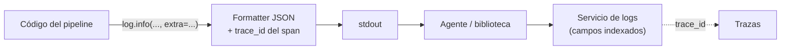

## 1. Resumen

Un **log** es un registro con fecha de algo que pasó (*Logs*). Como señal de observabilidad, sirve si se puede consultar:

- **estructurado**, en JSON de una línea, con campos con nombre, antes que texto libre;
- con **nivel** (`INFO`, `WARNING`, `ERROR`);
- con **campos del dominio** (tabla, filas, `run_id`);
- con el **`trace_id` y el `span_id`** del span activo, para ir de un log a la traza de la corrida y al revés.

`python-logging` cubre cómo configurar `logging`; esta ficha trata el log como señal: qué campos lleva y cómo se cruza con trazas y se consulta en cada nube.

## 2. Qué es

Campos del modelo de log de OpenTelemetry (*Logs*), y su equivalente en el ejemplo:

| Campo (OpenTelemetry) | En el ejemplo |
|---|---|
| SeverityText | `severity` |
| Body | `message` |
| Attributes | `table`, `rows`, `run_id` |
| TraceId, SpanId | `trace_id`, `span_id` del span activo |
| Timestamp | Lo agrega el handler o el agente |

## 3. Problema que resuelve

Un pipeline falla de madrugada. Los logs dicen `Error al cargar` en texto libre, mezclados con los de otros procesos. Con logs JSON que traen `table`, `run_id` y `trace_id`, la consulta «errores de la tabla `pedidos` de la corrida de hoy» es una línea, y del log se salta a la traza de esa corrida para ver qué etapa tardó o falló.

## 4. Cómo funciona

1. Un `Formatter` propio convierte cada `LogRecord` en JSON.
2. Los campos del dominio llegan con `extra` (*logging*).
3. El formatter pide el span actual (`trace.get_current_span()`, *Instrumentation*) y, si hay uno válido, agrega `trace_id` y `span_id`.
4. El handler escribe una línea por evento; en la nube, un agente o una biblioteca la envía al servicio de logs.
5. El servicio indexa los campos JSON y se consultan por nombre.

## 5. Cuándo utilizarlo

- En todo pipeline: inicio, fin, filas por etapa, reintentos y errores.
- Para eventos con detalle que una métrica no guarda (qué archivo, qué clave).
- Siempre con un identificador de corrida.

## 6. Cuándo no utilizarlo

- Para contar o medir duraciones que se van a graficar: eso es una métrica.
- Para registrar cada fila procesada: el volumen y el costo crecen con los datos.
- Con datos personales o secretos en el mensaje.

## 7. Ejemplo sencillo

Tres logs: `inicio` fuera de un span, y `filas escritas` y `reintento` dentro del span `load`:

| Log | Campos | `trace_id` |
|---|---|---|
| `inicio` | `run_id` | no (no hay span activo) |
| `filas escritas` | `table`, `rows` | sí |
| `reintento` (WARNING) | `table`, `attempt` | sí, el mismo |

## 8. Ejemplo de producción

Un pipeline en Cloud Run:

- `logging` con un formatter JSON y `trace_id` del span activo;
- el agente envía `stdout` a Cloud Logging, donde queda como `jsonPayload`;
- `severity` en cada línea, para filtrar por nivel;
- consultas guardadas por `run_id` y `table`; una alerta por logs `ERROR`.

## 9. Arquitectura



## 10. Código

```python
# Python 3.12, logging de la biblioteca estándar y OpenTelemetry SDK 1.45 (ejecutado en la CI; ADR-020): logs JSON
# de una línea con nivel, mensaje, campos propios y el trace_id y span_id del span activo, para cruzar logs y trazas.
import io
import json
import logging

from opentelemetry import trace
from opentelemetry.sdk.trace import TracerProvider


class JsonConTraza(logging.Formatter):
    def format(self, record: logging.LogRecord) -> str:
        ctx = trace.get_current_span().get_span_context()
        evento = {"severity": record.levelname, "message": record.getMessage(), "logger": record.name,
                  **getattr(record, "campos", {})}
        if ctx.is_valid:
            evento |= {"trace_id": format(ctx.trace_id, "032x"), "span_id": format(ctx.span_id, "016x")}
        return json.dumps(evento, ensure_ascii=False)


salida = io.StringIO()
handler = logging.StreamHandler(salida)
handler.setFormatter(JsonConTraza())
log = logging.getLogger("pipeline.ventas")
log.addHandler(handler)
log.setLevel(logging.INFO)

tracer = TracerProvider().get_tracer("pipeline.ventas")
log.info("inicio", extra={"campos": {"run_id": "2026-10-20"}})            # fuera de un span: sin trace_id
with tracer.start_as_current_span("load"):
    log.info("filas escritas", extra={"campos": {"table": "pedidos", "rows": 1200}})
    log.warning("reintento", extra={"campos": {"table": "pedidos", "attempt": 2}})

eventos = [json.loads(linea) for linea in salida.getvalue().splitlines()]
for e in eventos:
    print({k: v for k, v in e.items() if k not in ("trace_id", "span_id")}, "con trace_id" if "trace_id" in e else "sin trace_id")
print("mismo trace_id en los logs del span:", eventos[1]["trace_id"] == eventos[2]["trace_id"])
```

El script se **ejecuta en la CI** con OpenTelemetry (ADR-020) y pasa `mypy --strict`. Imprime los tres eventos sin los identificadores (`inicio` sin `trace_id`, los otros dos con `trace_id`) y `mismo trace_id en los logs del span: True`.

## 11. GCP

En GCP, **Cloud Logging**. Según *Logs* y *Structured logging* (no ejecutado):

| | Log JSON (este concepto) | Cloud Logging |
|---|---|---|
| Estructura | Un objeto JSON por línea | Si el payload es JSON va a `jsonPayload` y es un log estructurado; si es texto, a `textPayload` |
| Consultas | Por campo | Sobre rutas JSON, con campos indexables; el texto se busca pero no se indexa |
| Envío | Handler a `stdout` | En servicios como Cloud Run functions o GKE, un agente envía `stdout` y `stderr` |

## 12. AWS

En AWS, **CloudWatch Logs**. Según *Logs* y *Supported logs and discovered fields* (no ejecutado):

| | Log JSON (este concepto) | CloudWatch Logs Insights |
|---|---|---|
| Campos | Los que define el formatter | Campos de sistema (`@message`, `@timestamp`) y campos descubiertos, incluidos los de logs JSON |
| Lo que no se descubre | — | Se extrae con `parse` |

## 13. Azure

En Azure, **Azure Monitor Logs**. Según *Logs* y *Azure Monitor Logs overview* (no ejecutado):

| | Log JSON (este concepto) | Azure Monitor Logs |
|---|---|---|
| Almacenamiento | El que elija el equipo | Un Log Analytics workspace, con retención por tipo de dato |
| Consultas | Por campo | KQL o herramientas basadas en KQL |

## 14. Buenas prácticas

- Un evento JSON por línea, con nombres de campo estables.
- `run_id` en todos los logs; `trace_id` cuando hay trazas.
- Niveles con criterio: `ERROR` solo para lo que requiere atención.
- **Seguridad:** nunca secretos ni datos personales en mensajes o campos.
- **Observabilidad:** consultas guardadas por corrida y por tabla; una alerta por errores.
- **Costo:** el volumen de logs crece con los datos si se registra por fila; registrar por etapa y fijar la retención (Azure Monitor Logs la permite por tipo de dato).

## 15. Errores frecuentes

- Texto libre que solo se puede buscar con expresiones regulares.
- Logs sin identificador de corrida.
- Un log por fila procesada.
- Un `trace_id` con otro formato que el de las trazas, que no se puede cruzar.

## 16. Trade-offs

Logs detallados ayudan a investigar y cuestan volumen. JSON es fácil de consultar y menos legible a simple vista. Enviar por `stdout` con un agente es simple; con una biblioteca del servicio se controla más y se acopla el código al proveedor.

## 17. Conceptos relacionados

- `python-logging`: configurar `logging`.
- `observability-traces`: trazas.
- `observability-metrics`: métricas.
- `data-observability`: el panorama.
- `cloudwatch-for-data-pipelines`: CloudWatch en pipelines de AWS.

## 18. Preguntas técnicas abiertas

1. ¿Tus logs se pueden filtrar por tabla y por corrida?
2. ¿Puedes ir de un error en el log a la traza de esa corrida?
3. ¿Cuánto pagas por volumen de logs y cuánto aporta cada línea?

## 19. Laboratorio relacionado

Pendiente (F4).

## 20. Fuentes

- OpenTelemetry: *Logs* e *Instrumentation* (Python).
- Python 3.12: *logging — Logging facility for Python*.
- Google Cloud: *Structured logging*.
- AWS: *Supported logs and discovered fields*.
- Microsoft Learn: *Azure Monitor Logs overview*.

El detalle de cada fuente está en `sources` del frontmatter.

## 21. Fecha de última verificación

2026-10-20. Pasa a `verified`: revisión B-F3.1 del lote F3b-16a sin hallazgos en esta ficha, sin VERIFY pendientes.

## 22. Historial de cambios importantes

- 2026-10-20: creación (lote F3b-16a).
- 2026-10-20: revisión B-F3.1 del lote F3b-16a (docs/reviews/cards-f3b-16a.md), sin hallazgos que corregir.
- 2026-10-20: `verification_status: verified` (sin VERIFY pendientes).
