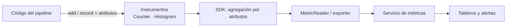

## 1. Resumen

Una **métrica** es una agregación numérica en el tiempo: filas escritas, duración de cada carga, errores por hora (*Observability primer*). Se lleva con un **instrumento** y se separa con **atributos** (en las nubes, labels o dimensiones), por ejemplo por tabla. OpenTelemetry define los instrumentos (*Metrics*):

- **Counter:** solo sube (filas escritas, errores);
- **UpDownCounter:** sube y baja (archivos en cola);
- **Histogram:** distribución de valores (duraciones);
- **Gauge:** valor actual al leerlo.

Una métrica es barata de guardar y graficar; un log tiene el detalle de un evento. Las dos se cruzan por el nombre de la tabla o de la corrida.

## 2. Qué es

- **Instrumento:** Counter, UpDownCounter, Histogram o Gauge.
- **Atributos:** pares clave/valor que separan series (`table=pedidos`).
- **MeterProvider y Meter:** crean los instrumentos.
- **MetricReader:** lee las métricas agregadas; `InMemoryMetricReader` las devuelve en memoria, útil para tests (*opentelemetry.sdk.metrics.export*).
- **Cardinalidad:** cuántas combinaciones de atributos hay; cada una es una serie.

## 3. Problema que resuelve

Un pipeline escribe una cantidad de filas distinta cada día y a veces tarda el doble. Sin métricas, saberlo exige leer logs de cada corrida. Con un Counter de filas y un Histogram de duración por tabla, la tendencia se grafica y una alerta avisa cuando la duración se sale de lo normal.

## 4. Cómo funciona

1. Un `MeterProvider` con un reader; de él, un `Meter` por componente.
2. Se crean los instrumentos con nombre, unidad y descripción (`create_counter`, `create_histogram`).
3. En cada carga, `add` o `record` con los atributos (*Instrumentation*).
4. El SDK agrega por combinación de atributos: suma para el Counter; conteo, suma y buckets para el Histogram.
5. El reader (o un exporter) entrega los puntos agregados a quien los guarda.

## 5. Cuándo utilizarlo

- Filas, bytes, duración y errores por tabla y por etapa.
- Todo lo que se va a graficar o sobre lo que se va a alertar.
- Como entrada de los SLO.

## 6. Cuándo no utilizarlo

- Para el detalle de un evento (qué archivo falló): eso es un log.
- Con atributos de alta cardinalidad (un id de fila o de pedido): cada valor es una serie nueva.

## 7. Ejemplo sencillo

Tres cargas: `pedidos` dos veces (1200 y 800 filas; 4,2 s y 3,1 s) y `clientes` una (50 filas; 0,4 s).

| Métrica | Atributo | Resultado |
|---|---|---|
| `pipeline.rows` (Counter) | `table=pedidos` | suma 2000 |
| `pipeline.rows` (Counter) | `table=clientes` | suma 50 |
| `pipeline.duration` (Histogram, s) | `table=pedidos` | 2 cargas, total 7,3 s |
| `pipeline.duration` (Histogram, s) | `table=clientes` | 1 carga, total 0,4 s |

## 8. Ejemplo de producción

Un pipeline en Python que envía métricas a la nube:

- `pipeline.rows` y `pipeline.duration` por `table` y `stage`, sin ids de fila ni de pedido;
- un exporter hacia el servicio de métricas de la nube (no ejecutado);
- un tablero con filas y duración por tabla;
- alertas por duración y por filas fuera de lo normal (`volume-anomalies`).

## 9. Arquitectura



## 10. Código

```python
# Python 3.12 y OpenTelemetry SDK 1.45 (ejecutado en la CI; ADR-020): un Counter de filas y un Histogram de duración
# por tabla, leídos con InMemoryMetricReader, sin collector ni backend.
from opentelemetry.sdk.metrics import MeterProvider
from opentelemetry.sdk.metrics.export import HistogramDataPoint, InMemoryMetricReader, NumberDataPoint

reader = InMemoryMetricReader()
meter = MeterProvider(metric_readers=[reader]).get_meter("pipeline.ventas")
filas = meter.create_counter("pipeline.rows", unit="1", description="Filas escritas por tabla")
duracion = meter.create_histogram("pipeline.duration", unit="s", description="Duración de cada carga")

for tabla, n, segundos in [("pedidos", 1200, 4.2), ("pedidos", 800, 3.1), ("clientes", 50, 0.4)]:
    filas.add(n, {"table": tabla})
    duracion.record(segundos, {"table": tabla})

data = reader.get_metrics_data()
assert data is not None
for metric in data.resource_metrics[0].scope_metrics[0].metrics:
    for point in metric.data.data_points:
        if isinstance(point, NumberDataPoint):
            print(f"{metric.name}{{table={(point.attributes or {}).get('table')}}}: suma {point.value}")
        elif isinstance(point, HistogramDataPoint):
            print(f"{metric.name}{{table={(point.attributes or {}).get('table')}}}: "
                  f"{point.count} cargas, total {point.sum:.1f} {metric.unit}")
```

El script se **ejecuta en la CI** con OpenTelemetry (ADR-020), sin collector, y pasa `mypy --strict`. Imprime `pipeline.rows{table=pedidos}: suma 2000`, `pipeline.rows{table=clientes}: suma 50`, `pipeline.duration{table=pedidos}: 2 cargas, total 7.3 s` y `pipeline.duration{table=clientes}: 1 cargas, total 0.4 s`.

## 11. GCP

En GCP, **Cloud Monitoring**. Según *Metrics* y *Components of the metric model* (no ejecutado):

| | OpenTelemetry | Cloud Monitoring |
|---|---|---|
| Tipo | Instrumento (Counter, Histogram…) | Kind y tipo de valor del tipo de métrica |
| Separar series | Atributos | Labels |
| Unidad | `unit` del instrumento | Unidad; `1` para conteos sin unidad |
| Contexto | Resource | Recursos monitoreados a los que aplica la métrica |

## 12. AWS

En AWS, **CloudWatch**. Según *Metrics* y *Metrics concepts* (no ejecutado):

| | OpenTelemetry | CloudWatch |
|---|---|---|
| Agrupar | Meter por componente | Namespace: las métricas de namespaces distintos no se agregan juntas |
| Separar series | Atributos | Dimensiones: pares nombre/valor que forman la identidad de la métrica, hasta 30 |

## 13. Azure

En Azure, **Azure Monitor Metrics**. Según *Metrics* y *Azure Monitor Metrics overview* (no ejecutado):

| | OpenTelemetry | Azure Monitor Metrics |
|---|---|---|
| Qué guarda | Puntos agregados por el SDK | Valores numéricos a intervalos regulares en una base de series de tiempo |
| Relación con logs | Señales separadas | Es una mitad de la plataforma de datos; la otra es Azure Monitor Logs |

## 14. Buenas prácticas

- Nombres con espacio de nombres (`pipeline.rows`) y unidad explícita.
- Atributos de baja cardinalidad: tabla, etapa, entorno.
- Counter para conteos, Histogram para duraciones.
- **Seguridad:** sin datos personales en atributos.
- **Observabilidad:** un tablero por pipeline con filas, duración y errores.
- **Costo:** cada combinación de atributos es una serie más que guardar y consultar; revisar la cardinalidad antes de agregar un atributo.

## 15. Errores frecuentes

- Un id de pedido como atributo: millones de series.
- Medir duración con un Counter.
- Métricas sin unidad.
- Graficar promedios de duración en lugar de su distribución.

## 16. Trade-offs

Más atributos separan mejor y multiplican las series. Un Histogram da la distribución y pesa más que un Counter. Exportar directo al servicio es simple; un collector agrega flexibilidad y otra pieza que operar.

## 17. Conceptos relacionados

- `observability-logs`: logs.
- `observability-traces`: trazas.
- `data-observability`: el panorama.
- `volume-anomalies`: alertar sobre filas por carga.
- `cloudwatch-for-data-pipelines`: métricas en CloudWatch.
- `bigquery-monitoring`: métricas de BigQuery.

## 18. Preguntas técnicas abiertas

1. ¿Qué tres métricas mirarías primero de tu pipeline más importante?
2. ¿Tus atributos tienen baja cardinalidad?
3. ¿Mides la distribución de la duración o solo el promedio?

## 19. Laboratorio relacionado

Pendiente (F4).

## 20. Fuentes

- OpenTelemetry: *Metrics*, *Observability primer* e *Instrumentation* (Python); SDK de Python: *opentelemetry.sdk.metrics.export*.
- Google Cloud: *Components of the metric model*.
- AWS: *Metrics concepts*.
- Microsoft Learn: *Azure Monitor Metrics overview*.

El detalle de cada fuente está en `sources` del frontmatter.

## 21. Fecha de última verificación

2026-10-20. Pasa a `verified`: revisión B-F3.1 del lote F3b-16a sin hallazgos en esta ficha, sin VERIFY pendientes.

## 22. Historial de cambios importantes

- 2026-10-20: creación (lote F3b-16a).
- 2026-10-20: revisión B-F3.1 del lote F3b-16a (docs/reviews/cards-f3b-16a.md), sin hallazgos que corregir.
- 2026-10-20: `verification_status: verified` (sin VERIFY pendientes).
