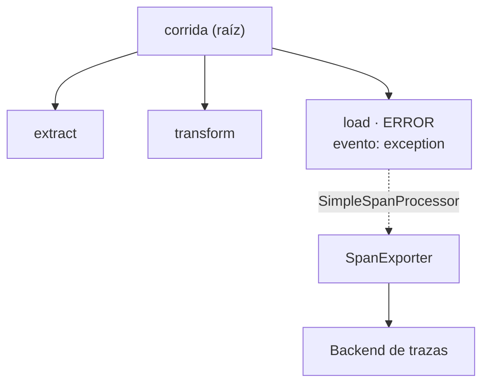

## 1. Resumen

Una **traza** es el recorrido de una operación, como un árbol de **spans** (*Traces*). Cada span es una unidad de trabajo con nombre, padre, inicio, fin, atributos, eventos y estado; todos los de una traza comparten el **trace ID**.

En un pipeline, una traza por corrida y un span por etapa (`extract`, `transform`, `load`) responden qué etapa tardó o falló, y con el `trace_id` en los logs (`observability-logs`) se llega de la traza al detalle. El orquestador muestra tareas y su estado (`orchestration-observability`); la traza muestra lo que pasa dentro de una tarea y entre servicios.

## 2. Qué es

Según *Traces*:

- **Span raíz:** sin padre; aquí, la corrida.
- **Span hijo:** una sub-operación; aquí, cada etapa.
- **Span Context:** trace ID, span ID, flags y estado de la traza; inmutable.
- **Atributos:** pares clave/valor (`rows=3`).
- **Eventos:** cosas que pasaron dentro del span, como una excepción registrada.
- **Estado:** `UNSET`, `OK` o `ERROR`.

## 3. Problema que resuelve

Una corrida tarda 40 minutos en lugar de 10. Los logs dicen que empezó y terminó. Con una traza por corrida se ve que `load` tardó 32 minutos y que tuvo tres reintentos registrados como eventos: el problema está en el destino, no en la extracción.

## 4. Cómo funciona

1. Un `TracerProvider` con un span processor y un exporter.
2. `start_as_current_span("corrida")` abre el span raíz; los que se abren dentro son sus hijos (*Instrumentation*).
3. En cada span se agregan atributos; ante un error, `set_status(Status(StatusCode.ERROR))` y `record_exception` (*Instrumentation*).
4. Al cerrar cada span, el `SimpleSpanProcessor` lo pasa al exporter (*opentelemetry.sdk.trace.export*).
5. El exporter lo envía a un backend; en el ejemplo, un `SpanExporter` propio lo guarda en una lista (ADR-020).

## 5. Cuándo utilizarlo

- Pipelines con varias etapas o llamadas a otros servicios.
- Para investigar lentitud: qué etapa y qué llamada.
- Cuando un pipeline cruza servicios (una API, una cola, un warehouse) y hay que ver el recorrido entero.

## 6. Cuándo no utilizarlo

- Un span por fila: miles de spans por corrida, sin valor.
- Como reemplazo de métricas para tendencias: la traza es una corrida; la métrica, muchas.

## 7. Ejemplo sencillo

Una corrida con tres etapas; `load` falla por un timeout:

| Span | Padre | Estado | Eventos |
|---|---|---|---|
| `corrida` | (raíz) | `UNSET` | — |
| `extract` | `corrida` | `UNSET` | — |
| `transform` | `corrida` | `UNSET` | — |
| `load` | `corrida` | `ERROR` | `exception` |

Los cuatro comparten el mismo trace ID.

## 8. Ejemplo de producción

Un pipeline que lee de una API, transforma y carga a un warehouse:

- una traza por corrida, con `pipeline.run_id` como atributo del span raíz;
- un span por etapa y por llamada externa;
- exportación al servicio de trazas de la nube (no ejecutado);
- `trace_id` en cada log; desde un log de error se abre la traza.

## 9. Arquitectura



## 10. Código

```python
# Python 3.12 y OpenTelemetry SDK 1.45 (ejecutado en la CI; ADR-020): una traza por corrida del pipeline, con un span
# por etapa; un SpanExporter propio guarda los spans en memoria, sin collector ni backend.
from collections.abc import Sequence

from opentelemetry import trace
from opentelemetry.sdk.trace import ReadableSpan, TracerProvider
from opentelemetry.sdk.trace.export import SimpleSpanProcessor, SpanExporter, SpanExportResult
from opentelemetry.trace import Status, StatusCode


class EnMemoria(SpanExporter):
    def __init__(self) -> None:
        self.spans: list[ReadableSpan] = []

    def export(self, spans: Sequence[ReadableSpan]) -> SpanExportResult:
        self.spans.extend(spans)
        return SpanExportResult.SUCCESS


exporter = EnMemoria()
provider = TracerProvider()
provider.add_span_processor(SimpleSpanProcessor(exporter))
tracer = provider.get_tracer("pipeline.ventas")

with tracer.start_as_current_span("corrida") as corrida:
    corrida.set_attribute("pipeline.run_id", "2026-10-20")
    with tracer.start_as_current_span("extract") as span:
        span.set_attribute("rows", 3)
    with tracer.start_as_current_span("transform"):
        pass
    with tracer.start_as_current_span("load") as span:
        try:
            raise TimeoutError("el warehouse no respondió")
        except TimeoutError as exc:
            span.set_status(Status(StatusCode.ERROR))
            span.record_exception(exc)

raiz = next(s for s in exporter.spans if s.parent is None)
assert raiz.context is not None
print(f"spans: {len(exporter.spans)}; una sola traza: {len({s.context.trace_id for s in exporter.spans if s.context}) == 1}")
for s in exporter.spans:
    padre = "raíz" if s.parent is None else ("corrida" if s.parent.span_id == raiz.context.span_id else "?")
    print(f"  {s.name}: padre={padre}, estado={s.status.status_code.name}, eventos={[e.name for e in s.events]}")
```

El script se **ejecuta en la CI** con OpenTelemetry (ADR-020), sin collector, y pasa `mypy --strict`. Imprime `spans: 4; una sola traza: True`, los tres spans de etapa con `padre=corrida` y `load` con `estado=ERROR, eventos=['exception']`. El exporter es una clase propia sobre la interfaz documentada `SpanExporter`; el SDK trae `InMemorySpanExporter`, pero la documentación publicada del SDK no lo describe (ADR-020).

## 11. GCP

En GCP, **Cloud Trace**. Según *Traces* y *Cloud Trace overview* (no ejecutado):

| | OpenTelemetry (este concepto) | Cloud Trace |
|---|---|---|
| Qué es | Un modelo de trazas y spans, y un SDK que los emite | Un sistema de trazas distribuidas que registra latencia |
| Entrada | El exporter elegido | Servicios de Google Cloud y aplicaciones instrumentadas; el índice de la documentación incluye OTLP |
| Relación con logs | `trace_id` en los logs | Ayuda a encontrar los logs relacionados |

## 12. AWS

En AWS, **AWS X-Ray**. Según *Traces* y *What is AWS X-Ray?* (no ejecutado):

| | OpenTelemetry (este concepto) | AWS X-Ray |
|---|---|---|
| Qué es | El modelo y el SDK | Un servicio que recolecta datos de las solicitudes y permite verlos y filtrarlos |
| Fuentes | La aplicación instrumentada | La aplicación y los servicios de AWS ya integrados con X-Ray |

## 13. Azure

En Azure, **Application Insights** (Azure Monitor). Según *Traces* y *Enable OpenTelemetry for .NET, Node.js, Python, and Java applications* (no ejecutado):

| | OpenTelemetry (este concepto) | Application Insights |
|---|---|---|
| Instrumentación en Python | SDK de OpenTelemetry | Microsoft OpenTelemetry Distro para aplicaciones nuevas |
| Qué recolecta | Lo que se instrumenta | Trazas, métricas y logs con instrumentaciones incorporadas |
| Destino | El exporter elegido | Azure Monitor, un endpoint OTLP o Microsoft Agent 365 |

## 14. Buenas prácticas

- Un span por etapa y por llamada externa, no por fila.
- Atributos con el identificador de corrida y la tabla.
- Estado `ERROR` y excepción registrada en el span que falla.
- `trace_id` en los logs.
- **Seguridad:** sin datos personales ni secretos en atributos o eventos.
- **Observabilidad:** muestrear con criterio si hay muchas corridas; guardar siempre las que fallan.
- **Costo:** el volumen de spans crece con la granularidad; un span por fila lo multiplica.

## 15. Errores frecuentes

- Spans que no se cierran porque una excepción salta el bloque (usar `with`).
- Etapas sin span padre común: trazas separadas que no se pueden unir.
- Un error registrado en el log pero no en el estado del span.

## 16. Trade-offs

Más spans dan más detalle y más volumen. Un exporter directo al backend es simple; un collector agrega flexibilidad y otra pieza que operar. OpenTelemetry deja cambiar de backend; una biblioteca propia del proveedor se acopla a él.

## 17. Conceptos relacionados

- `observability-logs`: logs con `trace_id`.
- `observability-metrics`: métricas.
- `data-observability`: el panorama.
- `orchestration-observability`: lo que muestra el orquestador.

## 18. Preguntas técnicas abiertas

1. ¿Sabes qué etapa de tu pipeline tarda más en cada corrida?
2. ¿Tus logs traen un `trace_id`?
3. ¿Qué llamadas externas debería tener un span propio?

## 19. Laboratorio relacionado

Pendiente (F4).

## 20. Fuentes

- OpenTelemetry: *Traces* e *Instrumentation* (Python); SDK de Python: *opentelemetry.sdk.trace.export*.
- Google Cloud: *Cloud Trace overview*.
- AWS: *What is AWS X-Ray?*.
- Microsoft Learn: *Enable OpenTelemetry for .NET, Node.js, Python, and Java applications*.

El detalle de cada fuente está en `sources` del frontmatter.

## 21. Fecha de última verificación

2026-10-20. Pasa a `verified`: revisión B-F3.1 del lote F3b-16a sin hallazgos en esta ficha, sin VERIFY pendientes.

## 22. Historial de cambios importantes

- 2026-10-20: creación (lote F3b-16a).
- 2026-10-20: revisión B-F3.1 del lote F3b-16a (docs/reviews/cards-f3b-16a.md), sin hallazgos que corregir.
- 2026-10-20: `verification_status: verified` (sin VERIFY pendientes).
