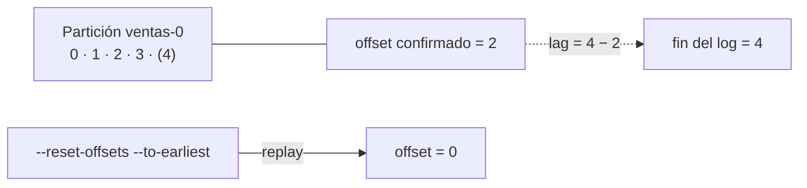

## 1. Resumen

Cada evento de una partición tiene un número que crece: su **offset**. La posición de un grupo de consumidores en una partición es, según la documentación de Kafka, «just a single integer, the offset of the next message to consume».

Con ese número se hacen tres cosas:

- **retomar:** el grupo confirma su offset y, al volver, sigue desde ahí;
- **medir el atraso:** el **lag** es la distancia entre el offset confirmado y el final del log;
- **volver a leer:** reiniciar el offset a uno anterior permite reprocesar (replay).

## 2. Qué es

- **Offset:** la posición de un evento dentro de una partición.
- **Offset confirmado (committed):** el próximo offset que el grupo va a leer, guardado en Kafka.
- **Fin del log (log-end offset):** el offset que tendrá el próximo evento escrito.
- **Lag:** fin del log menos offset confirmado.
- **`auto.offset.reset`:** qué hace un grupo sin offset confirmado: `earliest`, `latest` (por defecto) o `by_duration`.
- **`enable.auto.commit`:** confirma el offset en segundo plano; por defecto, `true`.

## 3. Problema que resuelve

Un consumidor que carga ventas al data warehouse se reinicia. Sin una posición guardada, empezaría de cero (y duplicaría) o desde el final (y perdería lo que no leyó). Con el offset confirmado, retoma donde quedó. Y si se descubre un error en la carga de ayer, se rebobina el offset y se vuelve a leer.

## 4. Cómo funciona

1. El consumidor pide eventos desde su offset.
2. Al procesar, confirma el siguiente offset para el grupo.
3. Al reiniciar, el grupo lee desde el offset confirmado.
4. `kafka-consumer-groups.sh --describe` muestra offset confirmado, fin del log y lag por partición.
5. `kafka-consumer-groups.sh --reset-offsets --to-earliest --execute` mueve el offset del grupo para volver a leer; la documentación pide que las instancias del consumidor estén inactivas.

## 5. Cuándo utilizarlo

- Siempre que un consumidor deba retomar después de reiniciarse.
- Para monitorear si un consumidor se atrasa (lag).
- Para reprocesar mientras los eventos siguen dentro de la retención.

## 6. Cuándo no utilizarlo

- Como reemplazo de una carga idempotente: rebobinar vuelve a entregar eventos ya procesados.
- Reiniciar offsets con el consumidor corriendo: la documentación pide que sus instancias estén inactivas.
- Para volver a eventos que ya superaron la retención: no están.

## 7. Ejemplo sencillo

Un topic `ventas` con 4 eventos. El grupo `carga` lee 2 y confirma: offset 2, fin del log 4, lag 2. Se reinicia el grupo al primer offset y vuelve a leer los 4.

## 8. Ejemplo de producción

La carga de ventas a BigQuery:

- confirma el offset después de escribir cada lote;
- una alerta si el lag supera lo que se puede recuperar antes de que venza la retención;
- un runbook para reprocesar: detener el consumidor, correr `--reset-offsets --to-datetime` sin `--execute` para ver qué cambiaría, revisar y repetir con `--execute`;
- una carga idempotente, porque el replay repite eventos.

## 9. Arquitectura



## 10. Código

```bash
# Bash y Kafka (ejecutado en la CI con un broker Kafka 4.3.1 en KRaft, en Docker; ADR-017): el grupo confirma su offset,
# el lag dice cuánto le falta y reiniciar el offset permite volver a leer (replay).
set -euo pipefail
K="${KAFKA_CONTAINER:-dekh-kafka}"
kafka() { docker exec -i "$K" /opt/kafka/bin/"$1" --bootstrap-server localhost:9092 "${@:2}"; }
trap 'kafka kafka-topics.sh --delete --topic ventas > /dev/null 2>&1 || true' EXIT

kafka kafka-topics.sh --create --topic ventas --partitions 1 > /dev/null
printf '%s\n' 'venta 1' 'venta 2' 'venta 3' 'venta 4' | kafka kafka-console-producer.sh --topic ventas

read_n() { kafka kafka-console-consumer.sh --topic ventas --group carga --from-beginning --max-messages "$1" \
             --timeout-ms 8000 2> /dev/null | wc -l; }
echo "primera lectura: $(read_n 2)"
kafka kafka-consumer-groups.sh --describe --group carga 2> /dev/null |
  awk '$2 == "ventas" {print "offset confirmado " $4 ", fin del log " $5 ", lag " $6}'

kafka kafka-consumer-groups.sh --reset-offsets --group carga --topic ventas --to-earliest --execute > /dev/null
echo "tras reiniciar al primer offset, el grupo vuelve a leer: $(read_n 4)"
```

El script se **ejecuta en la CI contra un broker Kafka 4.3.1 en KRaft, en Docker** (ADR-017). Imprime `primera lectura: 2`, `offset confirmado 2, fin del log 4, lag 2` y `tras reiniciar al primer offset, el grupo vuelve a leer: 4`.

## 11. GCP

En GCP, **Pub/Sub** no expone offsets al suscriptor: se confirma mensaje por mensaje. Según *Class Message* (no ejecutado):

| | Kafka | Pub/Sub |
|---|---|---|
| Posición | Un offset por partición y por grupo | Cada mensaje se confirma con `ack()` o se rechaza con `nack()` para que se reentregue |
| Cuándo confirmar | Después de procesar | Igual: no confirmar hasta terminar de procesar |

## 12. AWS

En AWS, **Kinesis Data Streams** usa números de secuencia. Según *GetShardIterator* y *Amazon Kinesis Data Streams Terminology and concepts* (no ejecutado):

| | Kafka | Kinesis Data Streams |
|---|---|---|
| Posición | Offset por partición | Número de secuencia por registro; se lee con un shard iterator |
| Empezar desde el principio o el final | `auto.offset.reset` = `earliest` o `latest` | `TRIM_HORIZON` (lo más antiguo no recortado) o `LATEST` |
| Dónde se guarda la posición | En Kafka, por grupo | La Kinesis Client Library guarda metadatos en tablas de DynamoDB |

## 13. Azure

En Azure, **Event Hubs** da offsets y el consumidor hace su checkpoint. Según *Event Hubs features and terminology* (no ejecutado):

| | Kafka | Event Hubs |
|---|---|---|
| Posición | Offset por partición | Offset por partición, dentro de un grupo de consumidores |
| Dónde se guarda | En Kafka, por grupo | El consumidor guarda su checkpoint (por ejemplo, en Blob Storage, un contenedor por grupo) |

## 14. Buenas prácticas

- Confirmar el offset después de procesar.
- Alertar por lag, no solo por errores.
- Reprocesar con el consumidor detenido, mirando primero qué cambiaría sin `--execute`.
- **Seguridad:** solo quien opera el grupo puede reiniciar sus offsets.
- **Observabilidad:** lag por partición y tiempo hasta que vence la retención.
- **Costo:** retener más tiempo para poder reprocesar es almacenamiento (ver `message-brokers`).

## 15. Errores frecuentes

- Un grupo nuevo con `latest` que no ve lo ya escrito y nadie lo nota.
- Confirmar antes de procesar y perder eventos si el consumidor se cae (ver `delivery-semantics`).
- Rebobinar sin una carga idempotente y duplicar.
- Un lag que crece hasta pasar la retención: los eventos se pierden sin error.

## 16. Trade-offs

Un offset por partición es un estado chico y barato de guardar, a cambio de que todo dentro de la partición avance en orden: un evento que falla frena a los siguientes. Confirmar seguido reduce lo que se repite tras una caída y agrega escrituras. Poder rebobinar da replay sin otra herramienta, mientras dure la retención.

## 17. Conceptos relacionados

- `topics-and-partitions`: dónde se cuentan los offsets.
- `replay`: reprocesar rebobinando.
- `producers-and-consumers`: cada grupo con sus offsets.
- `checkpoints`: el offset como checkpoint.
- `delivery-semantics`: cuándo confirmar.
- `message-brokers`: la retención que limita el replay.

## 18. Preguntas técnicas abiertas

1. ¿Qué lag tienen hoy tus consumidores y cuánto margen hay antes de la retención?
2. ¿Tu consumidor confirma antes o después de escribir en el destino?
3. ¿Cómo reprocesarías los eventos de ayer entre las 10:00 y las 12:00?

## 19. Laboratorio relacionado

Pendiente (F4).

## 20. Fuentes

- Apache Kafka 4.3: *Design*, *Consumer and Share Consumer Configs* y *Basic Kafka Operations*.
- Google Cloud: *Class Message*.
- AWS: *GetShardIterator* y *Amazon Kinesis Data Streams Terminology and concepts*.
- Microsoft Learn: *Event Hubs features and terminology*.

El detalle de cada fuente está en `sources` del frontmatter.

## 21. Fecha de última verificación

2026-10-20. Pasa a `verified`: revisión B-F3.1 del lote F3b-14a aplicada, sin VERIFY pendientes.

## 22. Historial de cambios importantes

- 2026-10-19: creación (lote F3b-14a).
- 2026-10-20: revisión B-F3.1 del lote F3b-14a aplicada (docs/reviews/cards-f3b-14a.md): la cita de la referencia de Pub/Sub dice *Class Message*, sin la versión del cliente.
- 2026-10-20: `verification_status: verified` (sin VERIFY pendientes).
