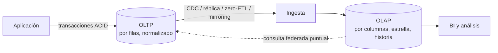

## 1. Resumen

**OLTP** (procesamiento de transacciones en línea) son los sistemas que registran el negocio mientras ocurre: un pago, un pedido, un movimiento de inventario. Hacen muchas escrituras pequeñas por clave, en transacciones ACID, sobre modelos normalizados. **OLAP** (procesamiento analítico) son los sistemas donde se analiza: pocas escrituras por lotes, muchas lecturas que agregan millones de filas, modelos desnormalizados y con historia. Ingeniería de datos es, en buena parte, llevar datos del primero al segundo sin dañar ninguno.

## 2. Qué es

Son dos perfiles de carga consolidados en la literatura y en la documentación de los proveedores:

| | OLTP | OLAP |
|---|---|---|
| Operación típica | Insertar o actualizar un registro por clave | Agregar muchas filas por varias dimensiones |
| Carga | Muchas escrituras, lecturas moderadas | Muchas lecturas, pocas escrituras (por lotes) |
| Modelo | Muy normalizado | Desnormalizado (estrella), con historia |
| Consistencia | ACID en cada transacción | Consistencia por carga |
| Almacenamiento | Por filas, índices por clave | Por columnas |
| Ejemplos | PostgreSQL, Cloud SQL, RDS, Azure SQL | BigQuery, Redshift, Fabric Warehouse |

Microsoft llama **HTAP** a las cargas que mezclan ambos perfiles, por ejemplo reportes en tiempo real sobre el sistema operacional.

## 3. Problema que resuelve

Distinguirlos evita dos errores caros. El primero es correr reportes pesados sobre la base operacional, que se degrada y frena las ventas. El segundo es usar un warehouse como base de una aplicación, con escrituras sueltas lentas y sin las garantías transaccionales por operación que la aplicación necesita. Cada perfil optimiza cosas opuestas: el formato en disco, los índices, el modelo y la consistencia.

## 4. Cómo funciona

1. **OLTP:** cada operación de negocio es una transacción corta que toca pocas filas por clave primaria; el modelo normalizado evita duplicar datos y las anomalías al actualizar. El almacenamiento por filas hace eficiente leer y escribir registros completos.
2. **Paso de OLTP a OLAP:** se extraen los datos sin cargar el origen. Las opciones son extracciones incrementales desde una réplica, CDC desde el log de la base, o integraciones administradas que replican (Datastream, zero-ETL de Redshift, mirroring de Fabric).
3. **OLAP:** los datos se integran y modelan para el análisis, en estrella y con historia, y se guardan por columnas. Las consultas leen pocas columnas de muchas filas.
4. **Consulta federada** (opción intermedia): el motor analítico consulta la base operacional en el momento, sin copiar. Es útil para datos pequeños o puntuales, pero la carga recae sobre el origen.

## 5. Cuándo utilizarlo

Este criterio sirve al:

- diseñar dónde vive cada carga (aplicación frente a análisis);
- decidir cómo llevar los datos operacionales al análisis (réplica, CDC, federación);
- revisar un sistema lento: ¿es un reporte OLAP corriendo sobre OLTP?

## 6. Cuándo no utilizarlo

- Como regla absoluta: muchas cargas son mixtas (HTAP), y algunos motores las atienden, como el columnstore no agrupado sobre tablas rowstore en SQL Server.
- Para elegir producto por la etiqueta: lo que importa es el perfil real de lecturas y escrituras.

## 7. Ejemplo sencillo

- **OLTP:** "descontar 2 unidades del SKU A1 y registrar el pedido", una transacción que toca dos filas.
- **OLAP:** "unidades vendidas por categoría y semana en el último año", una consulta que lee millones de filas y dos columnas.

## 8. Ejemplo de producción

Un e-commerce corre su tienda sobre Cloud SQL para PostgreSQL. Los reportes del área comercial empezaron a ralentizar el checkout, porque se consultaban directamente sobre la base de la tienda. Se separaron las cargas:

- Datastream replica los cambios a BigQuery;
- Dataform modela una estrella de ventas;
- los reportes consultan solo BigQuery.

Para una consulta puntual del soporte, que necesita el estado actual de un pedido, se usa una consulta federada a una réplica de lectura, no a la primaria.

## 9. Arquitectura



## 10. Código

```sql
-- OLTP (PostgreSQL): una operación de negocio es una transacción corta, por clave.
BEGIN;
UPDATE inventario SET stock = stock - 2 WHERE sku = 'A1';      -- CHECK (stock >= 0) la protege
INSERT INTO pedidos (sku, cantidad) VALUES ('A1', 2);
COMMIT;
```

```sql
-- OLAP (BigQuery): agrega muchas filas por dimensiones, sobre el modelo analítico.
SELECT p.categoria, DATE_TRUNC(f.fecha, WEEK) AS semana, SUM(f.cantidad) AS unidades
FROM `proyecto.mart_comercial.fact_venta_linea` AS f
JOIN `proyecto.mart_comercial.dim_producto` AS p USING (producto_sk)
WHERE f.fecha >= DATE_SUB(CURRENT_DATE(), INTERVAL 365 DAY)
GROUP BY categoria, semana;

-- Puente puntual (BigQuery → Cloud SQL): consulta federada, sin copiar datos.
-- Requiere una conexión de BigQuery a Cloud SQL (aquí, proyecto.us.tienda); la consulta interna
-- usa el dialecto de PostgreSQL y corre en la base operacional (mejor una réplica de lectura).
SELECT *
FROM EXTERNAL_QUERY('proyecto.us.tienda',
  '''SELECT pedido_id, estado FROM pedidos WHERE creado_en >= now() - interval '1 hour';''');
```

## 11. GCP

En Google Cloud, el OLTP típico es **Cloud SQL** y el OLAP, **BigQuery**. Para conectarlos hay dos caminos:

- **Federación con Cloud SQL** (`EXTERNAL_QUERY`): BigQuery consulta Cloud SQL en el momento, sin copiar. La consulta interna corre en la base operacional, en su dialecto.
- **Replicación:** Datastream o Cloud Data Fusion llevan los datos a BigQuery.

La federación es útil para lo puntual; la replicación, para el análisis recurrente.

## 12. AWS

En AWS, el OLTP típico es **RDS o Aurora** y el OLAP, **Redshift**. Las **zero-ETL integrations** ponen los datos transaccionales a disposición de Redshift sin mantener un pipeline: AWS automatiza la replicación. A diferencia de la federación de BigQuery, aquí los datos sí se copian a Redshift, con la ventaja de no cargar el origen en cada consulta.

## 13. Azure

En Azure, el OLTP típico es **Azure SQL** (o SQL Server). Para analítica, **Fabric mirroring** replica en casi tiempo real datos y metadatos de bases operacionales a OneLake, donde los consultan los motores de Fabric. Además, SQL Server y Azure SQL permiten analítica operacional sobre la propia base con un índice columnstore no agrupado, el caso HTAP.

## 14. Buenas prácticas

- No correr reportes pesados sobre la base primaria de una aplicación: usar réplica, CDC o una integración administrada.
- Modelar el OLAP para leer (estrella, columnar) y el OLTP para escribir (normalizado, índices por clave).
- Federar solo consultas pequeñas y puntuales, y contra réplicas de lectura.
- **Seguridad:** el OLAP concentra datos de muchos sistemas; aplicar en él controles por fila y columna, y no dar a los analistas acceso directo a las bases operacionales.
- **Observabilidad:** medir el retraso de la replicación (OLTP → OLAP) y la carga que la extracción impone al origen.
- **Costo:** replicar evita que cada reporte cargue al OLTP, pero duplica almacenamiento; las consultas federadas no copian, pero se pagan en la base operacional.

## 15. Errores frecuentes

- Un tablero conectado directo a la base de producción "porque es en tiempo real".
- Usar un warehouse como backend de una aplicación con escrituras por registro.
- Copiar el modelo normalizado del OLTP tal cual al OLAP y exigir a los analistas diez joins por consulta.
- Extraer con consultas completas sobre la primaria en horario de negocio.

## 16. Trade-offs

Separar OLTP y OLAP protege a la aplicación y acelera el análisis, a cambio de un pipeline o replicación que hay que operar y de un retraso entre lo que pasa y lo que se ve. La federación evita copiar, pero carga el origen y no escala para análisis recurrentes. HTAP reduce la latencia del análisis, a costa de compartir recursos con la operación.

## 17. Conceptos relacionados

- `row-vs-columnar-formats`: el formato que favorece cada perfil.
- `data-warehouse`: el sistema OLAP.
- `change-data-capture`: el puente de OLTP a OLAP.
- `normalization`: el modelo del OLTP.
- `acid`: las garantías del OLTP.

## 18. Preguntas técnicas abiertas

1. Un reporte "en tiempo real" está frenando la base de la tienda. ¿Qué opciones tienes y qué retraso acepta cada una?
2. ¿Cuándo usarías una consulta federada en vez de replicar?
3. ¿Qué parte de un sistema de pagos es OLTP y cuál OLAP?

## 19. Laboratorio relacionado

Pendiente (F4).

## 20. Fuentes

- Microsoft Learn: *Online transaction processing (OLTP)*, *Online analytical processing*, *Mirroring in Microsoft Fabric* y *Columnstore indexes: Overview*.
- AWS: *Columnar storage* y *Zero-ETL integrations* (Amazon Redshift).
- Google Cloud: *Cloud SQL federated queries* y *Federated query functions* (BigQuery).
- PostgreSQL: *Transactions* (tutorial).

El detalle de cada fuente está en `sources` del frontmatter.

## 21. Fecha de última verificación

2026-10-05. Pasa a `verified`: revisión B-F3.1 del lote 6 aplicada, sin VERIFY pendientes.

## 22. Historial de cambios importantes

- 2026-10-05: creación (lote 6 de F3).
- 2026-10-05: revisión B-F3.1 del lote 6 aplicada (docs/reviews/cards-lote6.md), sin cambios pedidos. `verification_status: verified` (sin VERIFY pendientes).
- 2026-10-13: `page_title` en cada cita, con el título de la página citada (ADR-012); sin cambios de contenido.
