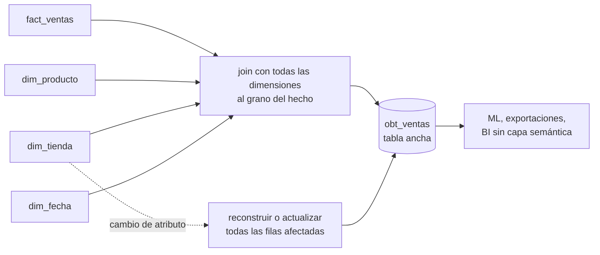

## 1. Resumen

Una One Big Table (OBT) es una tabla ancha con todas las columnas útiles de un concepto: el hecho al grano de siempre, más los atributos de todas sus dimensiones ya unidos. El análisis queda en un `SELECT` sin joins. La guía de dbt la llama «el sistema de modelado más desnormalizado». Conviene cuando quien consume no puede o no quiere hacer joins. Cuesta en mantenimiento: cada cambio de un atributo se repite en muchas filas y la tabla se reconstruye. Se construye a partir de un modelo estrella o normalizado; no lo reemplaza.

## 2. Qué es

- **Definición:** según dbt, intentar reunir en una gran tabla cada columna interesante de un concepto para que el analista solo tenga que seleccionar.
- **Grano:** el del hecho. Una fila por venta, con producto, categoría, tienda y región copiados en cada fila.
- **Origen:** se deriva de un modelo más normalizado (estrella, marts) con un `CREATE TABLE AS` o un modelo materializado.
- **Variantes en BigQuery:** en lugar de aplanar relaciones uno a muchos, la documentación recomienda anidarlas con campos repetidos (ver `denormalization`).

## 3. Problema que resuelve

Muchos consumidores no hacen joins bien o no deberían tener que hacerlos: herramientas de BI sin capa semántica, hojas de cálculo, modelos de ML, analistas ocasionales. Una OBT les da una superficie única y simple. Según Azure Databricks, en un lakehouse más campos en una sola tabla también permiten saltar datos con estadísticas de archivo. Según la guía de marts de dbt, en el modern data stack el almacenamiento es barato y el cómputo caro, y repetir datos es más eficiente que volver a unirlos en cada consulta.

## 4. Cómo funciona

1. Se parte del modelo estrella o de los marts normalizados, que siguen siendo la fuente.
2. Se une el hecho con todas sus dimensiones al grano del hecho y se eligen las columnas que se exponen.
3. Se materializa como tabla y se reconstruye o actualiza en cada carga.
4. Cuando cambia un atributo de dimensión, por ejemplo la región de una tienda:
   - en la estrella cambia una fila;
   - en la OBT cambian todas las filas de esa tienda, o se reconstruye la tabla.
5. Se verifica que la OBT tenga el mismo número de filas que el hecho: un join mal hecho multiplica o pierde filas.

## 5. Cuándo utilizarlo

- Herramientas de consumo sin capa semántica que resuelva relaciones.
- Datasets para ML o exportaciones a terceros, que necesitan una sola tabla.
- Tableros con consultas repetidas sobre las mismas columnas, en motores columnares.
- Como capa final sobre una estrella bien mantenida, nunca en su lugar.

## 6. Cuándo no utilizarlo

- Con una capa semántica que resuelve relaciones: la guía de dbt recomienda, con el Semantic Layer, mantener los marts lo más normalizados posible (ver `semantic-models`).
- Cuando los atributos de dimensión cambian a menudo, porque cada cambio reescribe muchas filas.
- Con historia de dimensiones (SCD tipo 2) que hay que consultar de varias formas: la OBT fija una sola.
- Para relaciones uno a muchos en BigQuery, donde anidar es la recomendación en lugar de aplanar.
- Como única copia de los datos, sin la estrella de la que se deriva.

## 7. Ejemplo sencillo

`obt_ventas(fecha, producto, categoria, tienda, region, monto)` reúne en cada fila de venta lo que en la estrella requiere tres tablas. «Ventas por región y categoría» es un `GROUP BY` sin joins.

## 8. Ejemplo de producción

Un equipo de ciencia de datos entrena un modelo de demanda con una OBT diaria de ventas: 40 columnas con atributos de producto, tienda, calendario y promoción. Se reconstruye cada noche desde el modelo estrella con un `CREATE TABLE AS`. Un chequeo compara su conteo con el del hecho. El tablero de BI, en cambio, usa la estrella a través de la capa semántica de la herramienta, y no la OBT.

## 9. Arquitectura



## 10. Código

```sql
-- PostgreSQL 17 (ejecutado): una One Big Table construida desde el modelo estrella, consultada sin joins,
-- y lo que cuesta mantenerla cuando cambia un atributo de dimensión.
CREATE TABLE dim_producto (producto_key integer PRIMARY KEY, nombre text NOT NULL, categoria text NOT NULL);
CREATE TABLE dim_tienda   (tienda_key integer PRIMARY KEY, codigo text NOT NULL, region text NOT NULL);
CREATE TABLE fact_ventas  (fecha date NOT NULL, producto_key integer REFERENCES dim_producto,
                           tienda_key integer REFERENCES dim_tienda, monto numeric(12,2) NOT NULL);
INSERT INTO dim_producto VALUES (1, 'Café', 'Bebidas'), (2, 'Pan', 'Panadería');
INSERT INTO dim_tienda   VALUES (1, 'T1', 'Norte'), (2, 'T2', 'Sur');
INSERT INTO fact_ventas  VALUES ('2026-10-07', 1, 1, 3000), ('2026-10-07', 2, 1, 1500),
                                ('2026-10-07', 1, 2, 1500), ('2026-10-08', 2, 2, 4500);

-- La OBT: el mismo grano que el hecho, con los atributos de las dimensiones copiados en cada fila.
CREATE TABLE obt_ventas AS
SELECT f.fecha, p.nombre AS producto, p.categoria, t.codigo AS tienda, t.region, f.monto
FROM fact_ventas f JOIN dim_producto p USING (producto_key) JOIN dim_tienda t USING (tienda_key);

SELECT region, categoria, sum(monto) FROM obt_ventas GROUP BY 1, 2 ORDER BY 1, 2;   -- sin joins
-- Norte | Bebidas   | 3000.00
-- Norte | Panadería | 1500.00
-- Sur   | Bebidas   | 1500.00
-- Sur   | Panadería | 4500.00

-- Cambia la región de T2: en la estrella es una fila; en la OBT, todas las filas de esa tienda.
UPDATE dim_tienda SET region = 'Centro' WHERE codigo = 'T2';                        -- UPDATE 1
UPDATE obt_ventas SET region = 'Centro' WHERE tienda = 'T2';                        -- UPDATE 2 (una por venta)
SELECT count(*) = (SELECT count(*) FROM fact_ventas) AS mismo_grano FROM obt_ventas; -- true
```

Ejecutado en PostgreSQL 17.11 local, en un esquema desechable. La consulta sobre la OBT no tiene joins. El cambio de región de T2 es un `UPDATE` de una fila en la dimensión y de dos filas en la OBT, una por cada venta de esa tienda. Con millones de ventas, la diferencia es la que hace preferir reconstruir la tabla. La última consulta verifica que la OBT conserva el grano del hecho.

## 11. GCP

En **BigQuery**, la recomendación oficial para desnormalizar es usar **campos anidados y repetidos**. Aplanar por completo una relación uno a muchos puede obligar a agrupar con shuffle, y eso es menos eficaz. Una OBT en BigQuery suele anidar las relaciones uno a muchos en lugar de repetir filas.

## 12. AWS

Esta ficha no cita una fuente de AWS sobre OBT.

## 13. Azure

En **Azure Databricks**, la guía de modelado indica que tener más campos en una sola tabla permite al optimizador saltar grandes cantidades de datos con estadísticas de archivo. Recomienda evitar modelos muy normalizados en un lakehouse, y menciona estrella y copo de nieve como modelos que rinden bien. La OBT lleva esa dirección al extremo.

## 14. Buenas prácticas

- Derivarla siempre de un modelo fuente (estrella o marts) que sigue siendo la verdad.
- Mismo grano que el hecho, verificado por conteo en cada carga.
- Exponer solo las columnas que se usan; documentar el significado de cada una.
- Reconstrucción o actualización incremental automatizada, con hora de última carga visible.
- **Seguridad:** al reunir columnas de todas las dimensiones, la OBT junta en una tabla datos que antes estaban separados (por ejemplo, cliente y comportamiento de compra); revisar qué columnas sensibles entran y quién puede leerla.
- **Observabilidad:** comparar conteo y totales con el hecho después de cada carga; un join contra una dimensión con claves duplicadas multiplica filas en silencio.
- **Costo:** más almacenamiento y reconstrucciones a cambio de consultas sin joins; en motores columnares, consultar pocas columnas de una tabla ancha lee solo esas columnas (ver `scan-reduction`).

## 15. Errores frecuentes

- Usar la OBT como única fuente y perder el modelo del que derivaba.
- Joins con dimensiones de claves duplicadas, que multiplican las filas del hecho.
- Atributos que cambian a menudo copiados en millones de filas.
- Una OBT distinta por equipo, con definiciones distintas de las mismas columnas.

## 16. Trade-offs

La OBT simplifica al máximo el consumo y, en motores columnares, puede leer solo lo necesario. A cambio, repite datos, encarece cada cambio de atributo y fija una sola forma de mirar la historia de las dimensiones. Con una capa semántica que resuelve relaciones, la guía de dbt prefiere marts normalizados y deja la desnormalización a esa capa.

## 17. Conceptos relacionados

- `denormalization`: el principio general.
- `star-schema`: el modelo del que se construye.
- `semantic-models`: la alternativa que desnormaliza al consultar.
- `scan-reduction`: por qué una tabla ancha no siempre lee de más.

## 18. Preguntas técnicas abiertas

1. ¿Qué consumidor de tu warehouse necesita de verdad una sola tabla y cuál podría usar la estrella con una capa semántica?
2. ¿Reconstruirías la OBT cada noche o la actualizarías de forma incremental? ¿Qué lo decide?
3. ¿Cómo manejarías en una OBT un atributo de dimensión con historia (SCD tipo 2)?

## 19. Laboratorio relacionado

Pendiente (F4).

## 20. Fuentes

- dbt: *Tactical terminology* y *Marts: Business-defined entities* (guías de buenas prácticas).
- Google Cloud: *Use nested and repeated fields* (BigQuery).
- Microsoft Learn: *Data modeling* (Azure Databricks).

El detalle de cada fuente está en `sources` del frontmatter.

## 21. Fecha de última verificación

2026-10-11. Pasa a `verified`: revisión B-F3.1 del lote F3b-04a aplicada, sin VERIFY pendientes.

## 22. Historial de cambios importantes

- 2026-10-10: creación (lote F3b-04a).
- 2026-10-11: revisión B-F3.1 del lote F3b-04a aplicada (docs/reviews/cards-f3b-04a.md): filas aprobadas sin cambios en esta ficha.
- 2026-10-11: `verification_status: verified` (sin VERIFY pendientes).
