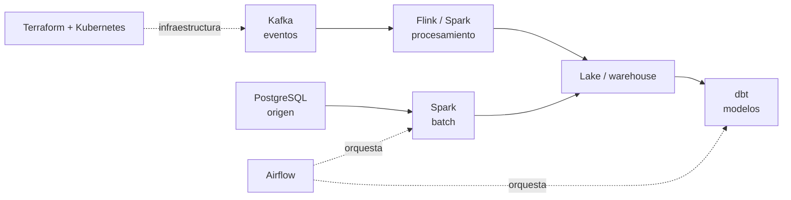

## 1. Resumen

Buena parte de lo que hace un equipo de datos se puede armar con tecnologías abiertas, que corren en cualquier lugar: en una laptop, en servidores propios o en cualquier nube. Ese conjunto es el **open data stack**:

- **orquestación:** Airflow;
- **procesamiento:** Spark, Flink y Beam;
- **mensajería:** Kafka;
- **transformación:** dbt;
- **bases de datos:** PostgreSQL;
- **infraestructura y ejecución:** Terraform y Kubernetes.

Cada nube ofrece versiones administradas de varias de estas piezas (Composer y MWAA para Airflow, EMR y Databricks para Spark, MSK para Kafka, RDS y Cloud SQL para PostgreSQL). Son la misma tecnología con otra forma de operarla: versiones, límites y cobro propios. Conocer la pieza abierta ayuda a no ver Data Engineering solo a través de los productos de una nube.

## 2. Qué es

- **Tecnología abierta:** un proyecto de código abierto con documentación y releases propios (Apache Spark, Apache Kafka, PostgreSQL).
- **Servicio administrado:** la nube opera la tecnología (MSK opera Kafka, MWAA opera Airflow) y el equipo la usa.
- **Servicio propio de la nube:** algo distinto que resuelve un problema parecido (Pub/Sub frente a Kafka, BigQuery frente a Spark); no es la misma tecnología.
- **Portabilidad:** cuánto cuesta mover un pipeline a otro entorno; es mayor cuanto más dependa de la tecnología abierta y menos de las extensiones del proveedor.

## 3. Problema que resuelve

Un equipo aprende Data Engineering solo con los servicios de una nube y no sabe qué parte de lo que hace es la tecnología y qué parte es el producto. Al cambiar de nube o al leer documentación de Spark o Kafka, nada coincide. Separar la pieza abierta de su versión administrada deja claro qué conocimiento sirve en cualquier lado y qué es propio de un proveedor.

## 4. Cómo funciona

1. Cada función de la plataforma tiene una pieza abierta: Airflow orquesta, Spark procesa, Kafka mueve eventos, dbt transforma, PostgreSQL guarda.
2. Se pueden correr todas en una máquina para desarrollo (Docker Compose) o en un clúster (Kubernetes).
3. En producción, cada pieza se opera en forma propia o se usa su versión administrada en la nube.
4. Terraform describe esa infraestructura en código, para cualquiera de las opciones.

## 5. Cuándo utilizarlo

- Para aprender los conceptos que no cambian de proveedor.
- Plataformas que deben poder correr en más de una nube o en servidores propios.
- Entornos locales de desarrollo y pruebas con las mismas piezas que producción.

## 6. Cuándo no utilizarlo

- Operar todo en forma propia cuando el equipo es chico y un servicio administrado cubre el caso.
- Elegir una pieza abierta solo por ser abierta, si un servicio propio de la nube resuelve mejor el problema.
- Suponer que la versión administrada es idéntica a la abierta: cambian versiones, configuración y límites.

## 7. Ejemplo sencillo

Un `compose.yaml` levanta PostgreSQL 17 y Kafka 4.3.1 en una máquina, sin servicios de nube. Cada pieza se comprueba con su propia herramienta: `psql` responde con la versión de la base y `kafka-topics.sh` crea y lista un topic.

## 8. Ejemplo de producción

Una plataforma de datos de una empresa con dos nubes:

- Airflow administrado en cada nube (Composer y MWAA), con los mismos Dags;
- Spark en EMR y en Databricks, con el mismo código PySpark y la versión de Spark revisada en cada uno;
- Kafka en MSK como bus de eventos;
- dbt para los modelos del warehouse;
- Terraform para toda la infraestructura y PostgreSQL administrado como base de metadatos.

## 9. Arquitectura



## 10. Código

```yaml
# Docker Compose (ejecutado en la CI con docker compose up; ADR-016 y ADR-017): un stack abierto mínimo en una máquina,
# sin servicios de nube: PostgreSQL 17 como base y Apache Kafka 4.3.1 en KRaft como broker, fijados por digest.
name: dekh-open-stack
services:
  db:
    image: postgres:17@sha256:2d2b8998d31037bf721cfdf764d76ba74171b4fab3431b7f72c27c56ddbdf9e3
    environment:
      POSTGRES_PASSWORD: solo-local   # entorno descartable; en producción, un secreto
    healthcheck:
      test: ["CMD", "pg_isready", "-U", "postgres"]
      interval: 2s
      retries: 30
  broker:
    image: apache/kafka:4.3.1@sha256:77e3df9054047a88b520d0cc46e16696d3b22022e1d580aeccd2632df6532837
    healthcheck:
      test: ["CMD", "/opt/kafka/bin/kafka-topics.sh", "--bootstrap-server", "localhost:9092", "--list"]
      interval: 3s
      retries: 40
```

```bash
# Bash y Docker Compose (ejecutado en la CI; ADR-016 y ADR-017): levanta el stack, espera los healthchecks y comprueba
# cada pieza con su propia herramienta. Corre en la carpeta del compose.yaml y lo borra todo al salir.
set -euo pipefail
trap 'docker compose down --volumes > /dev/null 2>&1' EXIT

docker compose up --wait --quiet-pull > /dev/null 2>&1
echo "servicios sanos: $(docker compose ps --format '{{.Service}}' --status running | sort | tr '\n' ' ')"
echo "base: $(docker compose exec -T db psql -U postgres -tAc 'SHOW server_version' | cut -d' ' -f1)"
docker compose exec -T broker /opt/kafka/bin/kafka-topics.sh --bootstrap-server localhost:9092 \
  --create --topic pedidos --partitions 3 > /dev/null
echo "broker: $(docker compose exec -T broker /opt/kafka/bin/kafka-topics.sh --bootstrap-server localhost:9092 --list)"
```

El `compose.yaml` y el script se **ejecutan en la CI con `docker compose up --wait`** (ADR-016 y ADR-017), con PostgreSQL 17 y Kafka 4.3.1 fijados por digest. Imprimen `servicios sanos: broker db`, la versión de la base (`17.x`) y `broker: pedidos`, y borran todo al salir.

## 11. GCP

En GCP, las piezas abiertas y su versión administrada. Según *Environment architecture*, *Compare Managed Service for Apache Spark serverless and cluster deployments* y *Dataflow overview* (no ejecutado):

| Pieza abierta | En GCP | Diferencia |
|---|---|---|
| Airflow | Cloud Composer | En Composer 3, los recursos se reparten entre el proyecto del cliente (el bucket con Dags y logs) y un tenant project de Google (la base de Airflow en Cloud SQL) |
| Beam | Dataflow | El runner administrado de los pipelines de Beam |
| PostgreSQL | Cloud SQL para PostgreSQL | La decodificación lógica se activa con una marca propia (ver `postgresql-for-data-engineers`) |
| Kafka | — | Pub/Sub es el servicio propio de mensajería, no Kafka (ver `kafka-architecture`) |

## 12. AWS

En AWS, según *What Is Amazon Managed Workflows for Apache Airflow?*, *Welcome to the Amazon MSK Developer Guide* y *What is Amazon Relational Database Service (Amazon RDS)?* (no ejecutado):

| Pieza abierta | En AWS | Diferencia |
|---|---|---|
| Airflow | Amazon MWAA | Scheduler y workers en contenedores de Fargate; AWS administra la base de metadatos |
| Kafka | Amazon MSK | AWS opera el plano de control; se usa el plano de datos de Kafka |
| PostgreSQL | Amazon RDS para PostgreSQL | Base administrada; los parámetros propios, como `rds.logical_replication`, reemplazan a la configuración directa |

## 13. Azure

En Azure, según *What is Azure Databricks?* y *What is Azure Event Hubs for Apache Kafka?* (no ejecutado):

| Pieza abierta | En Azure | Diferencia |
|---|---|---|
| Spark | Azure Databricks | Plataforma propia sobre Spark que administra la infraestructura |
| Kafka | Event Hubs | Un servicio propio con endpoint compatible con Kafka, no un clúster de Kafka |

## 14. Buenas prácticas

- Aprender cada pieza en su documentación abierta y después su versión administrada.
- Fijar versiones y revisar la del servicio administrado antes de copiar código o configuración.
- Un entorno local con las mismas piezas que producción (Docker Compose).
- **Seguridad:** las credenciales del entorno local son descartables; en producción, un gestor de secretos.
- **Observabilidad:** cada pieza tiene sus propias métricas; un servicio administrado suele exponerlas en el monitoreo de la nube.
- **Costo:** operar en forma propia ahorra el sobreprecio del servicio administrado y cuesta horas de operación.

## 15. Errores frecuentes

- Llamar «Kafka» a Pub/Sub o a Event Hubs, o «Spark» a BigQuery.
- Suponer que la versión del servicio administrado es la última de la tecnología abierta.
- Operar en forma propia todas las piezas con un equipo chico.
- Un entorno local que no se parece a producción.

## 16. Trade-offs

Las piezas abiertas dan portabilidad y conocimiento que sirve en cualquier lado, a cambio de operarlas o de elegir con cuidado la versión administrada. Los servicios propios de cada nube suelen ser más simples de usar y atan más al proveedor. La mayoría de las plataformas mezclan: piezas abiertas administradas donde conviene y servicios propios donde resuelven mejor.

## 17. Conceptos relacionados

- `airflow-architecture`: orquestación.
- `spark-execution-model`: procesamiento con Spark.
- `kafka-architecture`: mensajería con Kafka.
- `postgresql-for-data-engineers`: PostgreSQL.
- `beam-programming-model`: Beam y sus runners.
- `infrastructure-as-code`: Terraform.
- `kubernetes-fundamentals`: ejecución en Kubernetes.
- `docker-compose-environments`: el stack en una máquina.
- `stateful-stream-processing`: Flink y el estado.

## 18. Preguntas técnicas abiertas

1. ¿Qué piezas de tu plataforma son tecnología abierta y cuáles son servicios propios de la nube?
2. ¿Qué versión de Spark, Airflow o Kafka corre tu servicio administrado?
3. ¿Qué parte de tu plataforma podrías levantar en una laptop?

## 19. Laboratorio relacionado

Pendiente (F4).

## 20. Fuentes

- Apache Airflow: *Architecture Overview*. Apache Spark 4.2.0: *Cluster Mode Overview*. Apache Kafka 4.3: *Introduction*. Apache Flink 2.3: *Concepts*. Apache Beam: *Apache Beam Programming Guide*. dbt: *What is dbt?*. HashiCorp: *What is Terraform?*. Kubernetes: *Overview*.
- Google Cloud: *Environment architecture* (Cloud Composer) y *Dataflow overview*.
- AWS: *What Is Amazon Managed Workflows for Apache Airflow?*, *Welcome to the Amazon MSK Developer Guide* y *What is Amazon Relational Database Service (Amazon RDS)?*.
- Microsoft Learn: *What is Azure Databricks?* y *What is Azure Event Hubs for Apache Kafka?*.

El detalle de cada fuente está en `sources` del frontmatter.

## 21. Fecha de última verificación

2026-10-20. `review_required`: pendiente de revisión B-F3.1 del lote F3b-20a.

## 22. Historial de cambios importantes

- 2026-10-20: creación (lote F3b-20a).
