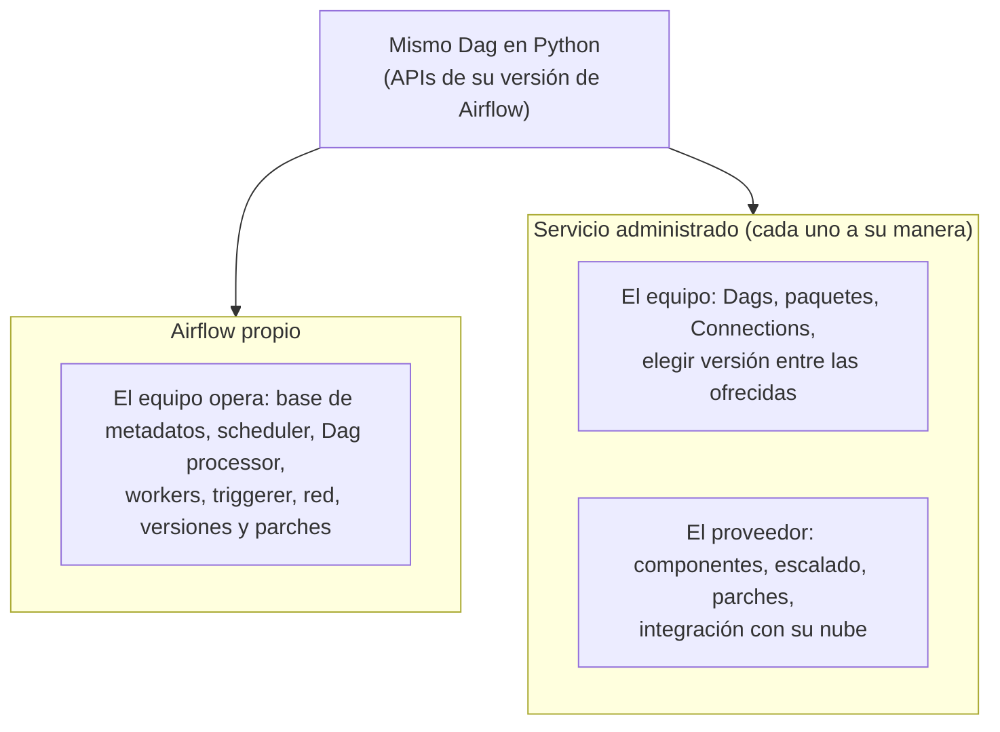

## 1. Resumen

Apache Airflow es un proyecto open source. Operarlo uno mismo implica instalar, escalar, actualizar y asegurar sus componentes. Las tres nubes lo ofrecen además como servicio:

- **Managed Service for Apache Airflow** en Google Cloud. Su página dice que «Cloud Composer is evolving to become Managed Service for Apache Airflow»; las URLs siguen bajo `/composer/`.
- **Amazon MWAA** (Managed Workflows for Apache Airflow).
- El **Apache Airflow job** de Microsoft Fabric, siguiente generación de Workflow Orchestration Manager de Azure Data Factory.

Los Dags se escriben igual, pero **no son Airflow con otro nombre ni equivalentes entre sí**. Cada servicio:

- ofrece **sus** versiones de Airflow y de Python;
- tiene **su** modelo de red y de escalado;
- decide qué configuración puede cambiar el usuario.

Al 2026-10-11, según sus páginas, la versión más nueva era Airflow 3.3.1 en Managed Service for Apache Airflow (Gen 3) y en MWAA, y 2.10.5 en el job de Fabric; este repositorio prueba sus Dags con 3.3.2.

## 2. Qué es

- **Airflow propio (open source):** el equipo despliega y opera todos los componentes, en una máquina o distribuidos, y elige versión, executor, red y escalado. La documentación llama *Deployment Manager* al rol que instala, configura y administra el despliegue (ver `airflow-architecture`).
- **Servicio administrado:** el proveedor despliega y opera los componentes. El usuario sube Dags, elige entre las versiones que el servicio ofrece y configura lo que el servicio expone.
- **Lo que no cambia:** el Dag sigue siendo Python con las APIs de Airflow de su versión.
- **Lo que sí cambia:**
  - qué versiones hay;
  - qué opciones de configuración están bloqueadas;
  - cómo se instalan paquetes;
  - la red;
  - la observabilidad;
  - el precio.

## 3. Problema que resuelve

Operar Airflow en producción exige mucho: base de metadatos, scheduler con alta disponibilidad, workers que escalan, actualizaciones de versión, parches de seguridad, red y secretos. Un servicio administrado se hace cargo de buena parte de eso. Elegir bien evita dos errores:

- operar Airflow propio sin necesidad;
- elegir un servicio cuya versión, red o configuración no sirve para los Dags que hay.

## 4. Cómo funciona

Lo que dice la página de cada servicio, al 2026-10-11:

| Aspecto | Managed Service for Apache Airflow (Gen 3) | Amazon MWAA | Apache Airflow job (Fabric) |
| --- | --- | --- | --- |
| Base | Construido sobre Apache Airflow; entornos basados en GKE | Mismo código open source e interfaz de Airflow | Impulsado por Apache Airflow |
| Versiones (las más nuevas) | Imágenes con Airflow 3.3.1, 3.2.2 y 2.11.1 (por defecto, 2.11.1); Python 3.11.8 | 3.3.1, 3.2.1, 3.0.6, 2.11.2 y otras; Python 3.12 en las recientes | 2.10.5; Python 3.12 |
| Cambio de versión | Imágenes `composer-3-airflow-x.y.z-build.t` | Se elige la versión al crear el entorno | No se cambia en un job existente: hay que crear otro |
| Escalado | Workers automáticos entre límites; schedulers, triggerers y DAG processors ajustables | Workers automáticos entre un mínimo y un máximo | Autoscale (sí en su tabla) |
| Red | El clúster del entorno no se despliega en el proyecto del cliente | Workers y schedulers en la VPC de MWAA; webserver con acceso público o privado | Redes privadas y virtuales aún no soportadas |
| Configuración | Algunas opciones de Airflow bloqueadas | — (no detallado en las páginas citadas) | — (no detallado en la página citada) |

Las celdas resumen lo que dice cada página, no una equivalencia: «autoscale» en Fabric y «escalado automático de workers» en MWAA son afirmaciones distintas de servicios distintos.

## 5. Cuándo utilizarlo

**Servicio administrado:**

- equipos que quieren escribir Dags, no operar la plataforma;
- cuando el servicio ofrece la versión de Airflow y Python que los Dags necesitan;
- integración con la nube donde ya están los datos, sus identidades y su monitoreo.

**Airflow propio:**

- cuando se necesita una versión, un executor, una configuración o una red que el servicio no ofrece;
- cuando ya hay una plataforma Kubernetes y un equipo que la opera.

## 6. Cuándo no utilizarlo

- No elegir un servicio solo por el nombre «Airflow»: si su versión es de otra versión mayor que la de los Dags (por ejemplo, 2.10.5 frente a Dags escritos para 3.x), los imports y las APIs cambian.
- No suponer que lo que funciona en un servicio funciona igual en otro: versiones de Python, opciones bloqueadas y red difieren.
- No operar Airflow propio solo para ahorrar el precio del servicio sin contar el costo de operarlo.

## 7. Ejemplo sencillo

Los Dags de este repositorio se prueban con Airflow 3.3.2 y Python 3.12. Antes de llevarlos a un servicio:

- **Managed Service for Apache Airflow:** su imagen más nueva es 3.3.1 con Python 3.11.8, y la de por defecto, 2.11.1. Hay que elegir la imagen de 3.3.1 y volver a cargar los Dags con esa versión y ese Python.
- **MWAA:** ofrece 3.3.1 con Python 3.12. Hay que volver a cargarlos con 3.3.1.
- **Job de Fabric:** solo ofrece 2.10.5, una versión mayor distinta, así que los imports de `airflow.sdk` no son los de esa versión.

## 8. Ejemplo de producción

Un equipo en Google Cloud migra Dags desde un Airflow propio en Kubernetes a Managed Service for Apache Airflow (Gen 3):

1. Elige la imagen con Airflow 3.3.1, no la de por defecto (2.11.1).
2. Corre en la CI la carga con `DagBag` usando 3.3.1 y Python 3.11.8.
3. Revisa qué opciones de configuración que usaba están bloqueadas.
4. Instala sus operadores propios como plugins.
5. Pasa el monitoreo a Cloud Logging y Cloud Monitoring.

El equipo deja de operar la base de metadatos y el escalado de workers. A cambio, acepta las versiones y las opciones que el servicio ofrece. Las URLs de la documentación siguen bajo `/composer/`, aunque el nombre del producto cambió.

## 9. Arquitectura



## 10. Código

```python
# Python 3.12, solo biblioteca estándar (ejecutado; mypy --strict sin errores): antes de llevar un Dag a un
# servicio administrado, comparar la versión de Airflow y de Python con la que se probó contra la que ofrece
# cada destino. Versiones según la página de cada servicio, consultadas el 2026-10-11; cambian con el tiempo.
Version = tuple[int, int, int]
PROBADO: tuple[Version, str] = ((3, 3, 2), "3.12")    # con lo que la CI carga los Dags de este repositorio

destinos: dict[str, list[tuple[Version, str]]] = {        # parte de las tablas de cada página
    "Managed Service for Apache Airflow (Gen 3)": [((3, 3, 1), "3.11.8"), ((3, 2, 2), "3.11.8"), ((2, 11, 1), "3.11.8")],
    "Amazon MWAA": [((3, 3, 1), "3.12"), ((3, 2, 1), "3.12"), ((3, 0, 6), "3.12"), ((2, 11, 2), "3.12")],
    "Apache Airflow job (Fabric)": [((2, 10, 5), "3.12")],
}


def revisar(destino: str, ofertas: list[tuple[Version, str]]) -> str:
    airflow, python = max(ofertas)                     # la versión de Airflow más nueva que ofrece
    texto = f"{destino}: Airflow {'.'.join(map(str, airflow))}, Python {python}"
    if airflow[0] != PROBADO[0][0]:
        return texto + " -> otra versión mayor: revisar imports y APIs antes de migrar"
    avisos = []
    if airflow != PROBADO[0]:
        avisos.append("otra versión de Airflow")
    if not python.startswith(PROBADO[1]):
        avisos.append("otro Python")
    return texto + (" -> " + " y ".join(avisos) + ": volver a cargar los Dags con esas versiones" if avisos else "")


for destino, ofertas in destinos.items():
    print(revisar(destino, ofertas))
# Managed Service for Apache Airflow (Gen 3): Airflow 3.3.1, Python 3.11.8 -> otra versión de Airflow y otro Python: volver a cargar los Dags con esas versiones
# Amazon MWAA: Airflow 3.3.1, Python 3.12 -> otra versión de Airflow: volver a cargar los Dags con esas versiones
# Apache Airflow job (Fabric): Airflow 2.10.5, Python 3.12 -> otra versión mayor: revisar imports y APIs antes de migrar
```

Este script en Python 3.12, solo con biblioteca estándar, está ejecutado y pasa `mypy --strict` sin errores. Las versiones son las de las páginas citadas al 2026-10-11 (parte de cada tabla) y cambian con el tiempo. El script no consulta los servicios: compara datos copiados de su documentación. La comprobación real es cargar los Dags con la versión del destino, como hace `make check-airflow-dag` con 3.3.2.

## 11. GCP

**Managed Service for Apache Airflow.** Su página de introducción se titula «Managed Airflow overview | Managed Service for Apache Airflow» y dice que «Cloud Composer is evolving to become Managed Service for Apache Airflow». Según sus páginas:

- **Generaciones:** Gen 3, Gen 2 y Legacy Gen 1.
- **Entornos:** basados en GKE, con schedulers, triggerers y workers en el clúster, un web server, la base de Airflow y un bucket de Cloud Storage con Dags, logs y plugins.
- **Gen 3:** el clúster no se despliega en el proyecto del cliente y admite Airflow 2 y 3.
- **Imágenes de Gen 3:** la más nueva lleva Airflow 3.3.1 con Python 3.11.8; la de por defecto, Airflow 2.11.1.
- **Configuración:** algunas opciones de Airflow están bloqueadas.

## 12. AWS

**Amazon MWAA** se describe como «a managed service for Apache Airflow». Según su página:

- configura Airflow con la misma interfaz y el mismo código open source;
- escala los workers entre un mínimo y un máximo;
- usa IAM para autenticar, KMS para cifrar, y corre workers y schedulers en su VPC;
- AWS actualiza y parchea las imágenes.

Su tabla de versiones incluye 3.3.1 (disponible en MWAA desde el 1 de septiembre de 2026, Python 3.12). No soporta el modo multi-team de Airflow.

## 13. Azure

**Apache Airflow job (Fabric)** es la siguiente generación de Workflow Orchestration Manager de Azure Data Factory. Según su página:

- soporta Airflow 2.10.5 con Python 3.12, y la versión de un job existente no se cambia;
- las redes privadas y virtuales aún no están soportadas;
- frente a Workflow Orchestration Manager, su tabla marca alta disponibilidad, autoscale y operadores diferibles como disponibles, y los logs y métricas de diagnóstico como no disponibles.

Desde el 1 de enero de 2026 no se pueden crear instancias nuevas de Workflow Orchestration Manager, y Microsoft recomienda migrar a los Apache Airflow jobs.

## 14. Buenas prácticas

- Fijar en la CI la versión de Airflow y de Python del destino, y cargar los Dags con esa versión.
- Revisar la tabla de versiones de cada servicio antes de actualizar o migrar; la versión por defecto no siempre es la más nueva.
- Mantener los Dags portables: dependencias declaradas, configuración en Connections y Variables, nada atado a un servicio salvo los operadores de su nube.
- Documentar qué configuración del Airflow propio no existe o está bloqueada en el servicio.
- **Seguridad:** en el servicio, las identidades de la nube (IAM) y sus gestores de secretos reemplazan las claves fijas; revisar la red: el job de Fabric no soporta aún redes privadas, según su página.
- **Observabilidad:** cada servicio integra logs y métricas con su nube a su manera (ver `orchestration-observability`); planificarlo antes de migrar.
- **Costo:** el servicio cobra según su modelo, que se consulta en la página de precios de cada uno; Airflow propio cuesta infraestructura y horas de operación. La comparación justa incluye ambas partes.

## 15. Errores frecuentes

- Llamar «lo mismo» a Managed Service for Apache Airflow, MWAA y el job de Fabric.
- Migrar Dags de Airflow 3 a un servicio que solo ofrece Airflow 2.
- Crear un entorno con la imagen por defecto y descubrir después que es otra versión mayor.
- Suponer que toda la configuración de `airflow.cfg` se puede cambiar en el servicio.
- Ignorar las diferencias de Python entre servicios (3.11.8 frente a 3.12).

## 16. Trade-offs

El servicio administrado cambia control por menos operación: el proveedor escala, parchea y asegura, y el equipo se limita a las versiones, las opciones y la red que ofrece. Airflow propio da control total sobre versión, executor, red y configuración, a cambio de operar todo, incluida la alta disponibilidad. Entre servicios, la elección depende de la nube donde están los datos y de la versión de Airflow que ofrecen. No hay un ganador general.

## 17. Conceptos relacionados

- `airflow-architecture`: los componentes que cada servicio administra.
- `orchestration-landscape`: orquestadores que no son Airflow.
- `orchestration-observability`: logs y métricas en cada servicio.
- `airflow-operators-and-hooks`: plugins y paquetes propios en cada servicio.

## 18. Preguntas técnicas abiertas

1. ¿Qué versión de Airflow y de Python usan tus Dags, y cuál ofrece hoy tu servicio?
2. ¿Qué configuración de tu Airflow actual no existiría en un servicio administrado?
3. ¿Cuántas horas al mes dedica tu equipo a operar el orquestador?

## 19. Laboratorio relacionado

Pendiente (F4).

## 20. Fuentes

- Apache Airflow 3.3.2: *Architecture Overview*.
- Google Cloud: *Managed Airflow overview*, comparación de versiones y *version list* (Managed Service for Apache Airflow).
- AWS: *What Is Amazon Managed Workflows for Apache Airflow?* y *Apache Airflow versions on Amazon MWAA*.
- Microsoft Learn: *What is an Apache Airflow job?* (Fabric) y *What is Workflow Orchestration Manager?*

El detalle de cada fuente está en `sources` del frontmatter.

## 21. Fecha de última verificación

2026-10-11. Pasa a `verified`: revisión B-F3.1 del lote F3b-06a aplicada, sin VERIFY pendientes.

## 22. Historial de cambios importantes

- 2026-10-11: creación (lote F3b-06a).
- 2026-10-11: revisión B-F3.1 del lote F3b-06a aplicada (docs/reviews/cards-f3b-06a.md): el paso 2 del ejemplo de producción dice Python 3.11.8, como la lista de imágenes de Gen 3.
- 2026-10-11: `verification_status: verified` (sin VERIFY pendientes).
