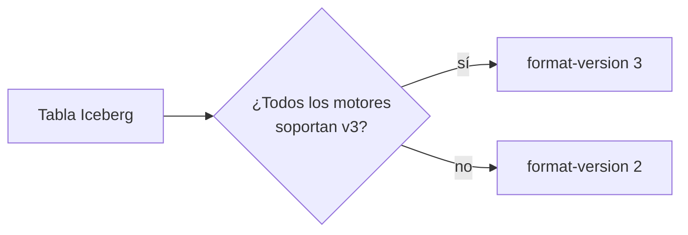

## 1. Resumen

El formato de una tabla Iceberg tiene **versiones**. La especificación lo dice así: «Versions 1, 2 and 3 of the Iceberg spec are complete and adopted by the community. Version 4 is under active development and has not been formally adopted» (*Iceberg Table Spec*). La v2 agregó deletes a nivel de fila; la v3 agrega deletion vectors binarios, variant, tipos geoespaciales, default values y row lineage.

Lo emergente no es la especificación sino el **soporte**: cada motor implementa cada versión a su ritmo. BigQuery tiene la v3 en Preview; S3 Tables la soporta; OneLake produce metadata v2; PyIceberg 0.12, al ejecutarlo, todavía no escribe tablas v3. Por eso la versión del formato se elige por tabla, según los motores que la leen. No reemplaza a la v2: convive con ella.

## 2. Qué es

- **Versión del formato:** propiedad `format-version` de cada tabla.
- **v2:** deletes por posición o por igualdad.
- **v3:** deletion vectors en archivos Puffin, tipos nuevos, default values y row lineage.
- **v4:** reestructura la metadata; en desarrollo, sin adoptar.
- **Compatibilidad hacia adelante:** un lector viejo no lee bien una tabla con funciones nuevas; por eso se sube la versión solo cuando todos los motores la soportan.

## 3. Problema que resuelve

Un equipo sube una tabla a v3 para usar deletion vectors y el dashboard deja de cargar: su motor solo lee v2. Elegir la versión por tabla, según los motores que la leen, evita ese corte.

## 4. Cómo funciona

1. Se lista qué motores leen y escriben la tabla.
2. Se verifica qué versión soporta cada uno, en su documentación.
3. La tabla usa la versión más alta que todos soportan.
4. Se sube de versión cuando el último motor la soporta.
5. Se mide el efecto (deletes, tamaño de metadata) antes y después.

## 5. Cuándo utilizarlo

- Tablas con muchos deletes o upserts, donde los deletion vectors reducen reescrituras.
- Columnas semiestructuradas que se beneficiarían del tipo variant.
- Al planificar la migración de motores.

## 6. Cuándo no utilizarlo

- Subir de versión sin confirmar que todos los lectores la soportan.
- Adoptar v4 mientras no esté formalmente adoptada.

## 7. Ejemplo sencillo

| Tabla | Resultado |
|---|---|
| v2: 3 filas, DELETE de una | 2 filas; snapshots `append` y `overwrite` (el delete reescribe archivos) |
| v3 con PyIceberg 0.12 | No ejecutado: «Writing V3 is not yet supported» |

## 8. Ejemplo de producción

Política de versiones del lakehouse:

- inventario de motores por tabla;
- v2 por defecto; v3 solo en tablas cuyos lectores la soportan;
- prueba de lectura en cada motor antes de subir de versión;
- en la nube (no ejecutado): Iceberg v3 en BigQuery (Preview), S3 Tables o la virtualización de OneLake (V2).

## 9. Arquitectura



## 10. Código

```python
# Python 3.12, PyIceberg 0.12 y PyArrow (ejecutado en la CI en Linux; ADR-018): la versión del formato es una
# propiedad de la tabla. En v2, un DELETE de PyIceberg reescribe archivos (snapshot «overwrite»); v3 agrega deletion
# vectors y tipos nuevos, pero esta versión de PyIceberg todavía no escribe tablas v3: el intento queda registrado
# como «no ejecutado» con el error de la biblioteca. Es la razón para fijar la versión del formato por tabla.
import sys
import tempfile
from pathlib import Path

import pyarrow as pa  # type: ignore[import-untyped]  # pyarrow no publica stubs de tipos
from pyiceberg.catalog.sql import SqlCatalog

base = Path(sys.argv[1] if len(sys.argv) > 1 else tempfile.mkdtemp())
(base / "warehouse").mkdir(parents=True, exist_ok=True)
catalogo = SqlCatalog("local", uri=f"sqlite:///{(base / 'catalog.db').as_posix()}", warehouse=(base / "warehouse").as_uri())
catalogo.create_namespace("ventas")
esquema = pa.schema([("id", pa.int64())])

v2 = catalogo.create_table("ventas.v2", schema=esquema, properties={"format-version": "2"})
v2.append(pa.table({"id": pa.array([1, 2, 3], pa.int64())}))
v2.delete("id = 1")
print("v2: format-version", v2.metadata.format_version, "filas", v2.scan().to_arrow().num_rows,
      "operaciones", [s.summary.operation.value for s in v2.metadata.snapshots if s.summary is not None])

try:
    catalogo.create_table("ventas.v3", schema=esquema, properties={"format-version": "3"}).append(
        pa.table({"id": pa.array([1], pa.int64())}))
    print("v3: escrita")
except NotImplementedError as exc:
    print(f"v3: no ejecutado ({str(exc).split(',')[0]})")
```

El script se **ejecuta en la CI con PyIceberg 0.12 y un catálogo SQLite** (ADR-018; en Linux) y pasa `mypy --strict`. Imprime la tabla v2 con 2 filas y sus operaciones, y `v3: no ejecutado (Writing V3 is not yet supported)`: es la respuesta real de la biblioteca, no una simulación. Si una versión futura de PyIceberg escribe v3, el test lo detectará.

## 11. GCP

En GCP, las **tablas externas Iceberg** de BigQuery. Según *Create Apache Iceberg external tables* (no ejecutado):

| | Este concepto | BigQuery |
|---|---|---|
| v2 | Soportada | «Iceberg external tables support Iceberg version 2, including merge-on-read» |
| v3 | Según el motor | «Support for Iceberg version 3, including binary deletion vectors, is in Preview» |

## 12. AWS

En AWS, **S3 Tables**. Según *Working with Apache Iceberg V3* (no ejecutado):

| | Este concepto | S3 Tables |
|---|---|---|
| v3 | Según el motor | Capacidades V3: deletion vectors, row lineage y column default values, y todos los tipos nuevos |
| Deletes | Reescritura en v2 | Deletion vectors en Puffin en lugar de positional delete files |

## 13. Azure

En Azure, **OneLake**. Según *Use Iceberg tables with OneLake* (no ejecutado):

| | Este concepto | OneLake |
|---|---|---|
| Delta a Iceberg | — | Produce metadata Iceberg V2 |
| Iceberg a Delta | — | Soporta tablas V2; las V3, parcialmente |

## 14. Buenas prácticas

- La versión del formato se decide por tabla, no por plataforma.
- Confirmar el soporte de cada motor en su documentación.
- Probar la lectura en todos los motores antes de subir.
- **Seguridad:** row lineage y encryption keys de v3 ayudan a auditar, solo si el motor los soporta.
- **Observabilidad:** versión del formato por tabla en el catálogo.
- **Costo:** los deletion vectors reducen reescrituras; medir antes de adoptar.

## 15. Errores frecuentes

- Subir de versión y romper un lector.
- Tratar una función en Preview como disponible para producción.
- Adoptar v4 antes de su adopción formal.

## 16. Trade-offs

Una versión nueva trae capacidades y reduce la cantidad de motores que leen la tabla. Esperar mantiene la compatibilidad y posterga las mejoras. Es emergente: el soporte cambia con cada versión de los motores.

## 17. Conceptos relacionados

- `open-table-formats` y `table-format-comparison`: el formato.
- `interoperability-standards`: el catálogo.
- `data-versioning`: snapshots y time travel.

## 18. Preguntas técnicas abiertas

1. ¿Qué motores leen tu tabla más grande?
2. ¿Qué versión del formato soporta el más antiguo?
3. ¿Qué tablas ganarían con deletion vectors?

## 19. Laboratorio relacionado

Pendiente (F4).

## 20. Fuentes

- Apache Iceberg: *Iceberg Table Spec* y *Apache Iceberg 1.12.0 Release*.
- Google Cloud: *Create Apache Iceberg external tables*.
- AWS: *Working with Apache Iceberg V3*.
- Microsoft Learn: *Use Iceberg tables with OneLake*.

El detalle de cada fuente está en `sources` del frontmatter.

## 21. Fecha de última verificación

2026-10-27. `review_required`: pendiente de revisión B-F3.1 del lote F3b-23b.

## 22. Historial de cambios importantes

- 2026-10-27: creación (lote F3b-23b).
