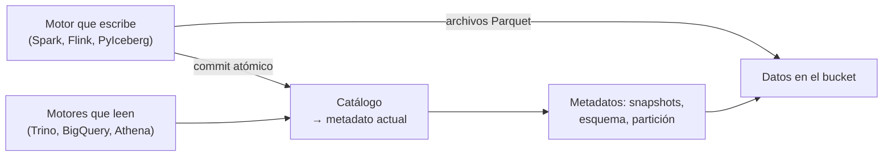

## 1. Resumen

Un data lake guarda archivos; un **formato de tabla abierto** les agrega una capa de metadatos para que se comporten como tablas. Según Iceberg, es «an open table format for huge analytic datasets» que funciona como una tabla SQL para varios motores.

Lo que esa capa agrega a los archivos, en los tres formatos principales (Iceberg, Delta Lake y Hudi):

- **transacciones ACID:** una escritura se ve entera o no se ve;
- **snapshots y time travel:** cada escritura deja una versión, y se puede leer una anterior;
- **evolución del esquema** sin reescribir los datos;
- **lecturas consistentes** desde varios motores (Spark, Trino, Flink, BigQuery, Athena) sobre los mismos archivos.

Los tres no son equivalentes: cambian el modelo de metadatos, la forma de actualizar filas y los motores que mejor los soportan (ver `table-format-comparison`).

## 2. Qué es

- **Archivos de datos:** normalmente Parquet, en un bucket o un sistema de archivos.
- **Metadatos de la tabla:** qué archivos forman cada versión, el esquema y la partición.
- **Snapshot:** el estado de la tabla después de una escritura.
- **Catálogo:** dónde se registra la tabla y su metadato actual (Hive Metastore, Glue, REST, uno SQL).
- **Commit atómico:** la escritura publica un nuevo metadato de una vez; los lectores ven la versión anterior o la nueva.

## 3. Problema que resuelve

Un job escribe Parquet en una carpeta del lake mientras otro lee. El lector ve archivos a medio escribir, y un fallo deja archivos huérfanos que nadie sabe si cuentan. Cambiar una columna obliga a reescribir todo. Con un formato de tabla, cada escritura es un commit atómico, el lector usa un snapshot consistente y el esquema cambia sin reescribir archivos.

## 4. Cómo funciona

1. El motor escribe archivos de datos nuevos.
2. Arma un metadato nuevo que lista esos archivos y los anteriores que siguen vigentes.
3. Hace el commit: el catálogo pasa a apuntar al metadato nuevo de forma atómica.
4. Los lectores usan el snapshot que estaba vigente al empezar.
5. Un lector puede pedir un snapshot anterior (time travel).
6. Un cambio de esquema escribe solo metadatos; las filas viejas leen la columna nueva como nula.

## 5. Cuándo utilizarlo

- Tablas de un lake que escriben y leen varios procesos a la vez.
- Cuando hace falta auditar o reproducir el estado de una tabla en una fecha.
- Lakehouses consultados desde varios motores sin copiar datos.
- Tablas con upserts y borrados (CDC, correcciones).

## 6. Cuándo no utilizarlo

- Archivos de intercambio que se escriben una vez y se leen una vez.
- Datos chicos que caben en una base de datos.
- Sin mantenimiento: snapshots y archivos viejos se acumulan (Delta los borra con `vacuum`; S3 Tables lo hace automáticamente).

## 7. Ejemplo sencillo

Una tabla `ventas.pedidos` en Iceberg, con un catálogo SQL en SQLite. Dos escrituras dejan dos snapshots: hoy hay 3 filas y en el primer snapshot había 2. Se agrega la columna `tienda`: las filas viejas la leen como nula y los archivos Parquet no se reescriben.

## 8. Ejemplo de producción

Un lakehouse de pedidos:

- tablas Iceberg en un bucket, registradas en un catálogo compartido;
- Spark escribe los cambios diarios con commits atómicos;
- BigQuery o Athena consultan las mismas tablas sin copiar datos;
- el equipo de finanzas lee el snapshot del cierre de mes con time travel;
- un mantenimiento periódico expira snapshots viejos y compacta archivos chicos.

## 9. Arquitectura



## 10. Código

```python
# Python 3.12, PyIceberg 0.12 y PyArrow (ejecutado en la CI; mypy --strict sin errores; ADR-018): una tabla Iceberg con
# un catálogo SQL en SQLite y los datos en una carpeta local. Cada escritura crea un snapshot; se lee una versión
# anterior (time travel) y se agrega una columna sin reescribir los archivos (evolución del esquema).
from __future__ import annotations

import sys
import tempfile
from pathlib import Path

import pyarrow as pa  # type: ignore[import-untyped]  # pyarrow no publica stubs de tipos
from pyiceberg.catalog.sql import SqlCatalog
from pyiceberg.types import StringType

base = Path(sys.argv[1] if len(sys.argv) > 1 else tempfile.mkdtemp())
warehouse = base / "warehouse"
warehouse.mkdir(parents=True, exist_ok=True)
catalog = SqlCatalog("local", uri=f"sqlite:///{(base / 'catalog.db').as_posix()}", warehouse=warehouse.as_uri())
catalog.create_namespace("ventas")

first = pa.table({"id": pa.array([1, 2], pa.int64()), "monto": pa.array([10.0, 25.0], pa.float64())})
table = catalog.create_table("ventas.pedidos", schema=first.schema)
table.append(first)                                                     # snapshot 1
table.append(pa.table({"id": pa.array([3], pa.int64()), "monto": pa.array([40.0], pa.float64())}))   # snapshot 2

snapshots = [s.snapshot_id for s in table.metadata.snapshots]
print(f"snapshots: {len(snapshots)}")
print(f"filas hoy: {table.scan().to_arrow().num_rows}")
print(f"filas en el primer snapshot: {table.scan(snapshot_id=snapshots[0]).to_arrow().num_rows}")   # time travel

with table.update_schema() as update:                                   # evolución: agrega una columna opcional
    update.add_column("tienda", StringType())
table = catalog.load_table("ventas.pedidos")
print(f"columnas: {[f.name for f in table.schema().fields]}")
print(f"tienda en filas viejas: {table.scan().to_arrow().column('tienda').to_pylist()}")   # nulas, sin reescribir
data_files = [p.name for p in warehouse.rglob("*.parquet")]
print(f"archivos de datos Parquet: {len(data_files)}")
```

El script se **ejecuta en la CI con PyIceberg 0.12 y un catálogo SQLite** (ADR-018) y pasa `mypy --strict`. Imprime `snapshots: 2`, `filas hoy: 3`, `filas en el primer snapshot: 2`, la columna nueva y `tienda en filas viejas: [None, None, None]`. Delta Lake y Hudi tienen ejemplos en `table-format-comparison`, sin ejecutar.

## 11. GCP

En GCP, **BigQuery** administra tablas Iceberg. Según *Apache Iceberg managed tables* (no ejecutado):

| | Iceberg con un catálogo propio | Tablas Iceberg administradas en BigQuery |
|---|---|---|
| Nombre | — | «Apache Iceberg managed tables (formerly BigLake tables for Apache Iceberg in BigQuery)» |
| Dónde están los datos | En el bucket del equipo | En buckets del cliente, en formato Iceberg, con la experiencia administrada de una tabla estándar |

## 12. AWS

En AWS, **S3 Tables** y **Athena** trabajan con Iceberg. Según *Working with Amazon S3 Tables and table buckets* y *Query Apache Iceberg tables* (no ejecutado):

| | Iceberg con un catálogo propio | En AWS |
|---|---|---|
| Almacenamiento | Un bucket común | S3 Tables: tablas Iceberg en table buckets, con compactación, gestión de snapshots y borrado de archivos sin referencia automáticos |
| Consulta | El motor que el equipo elija | Athena lee, escribe, hace time travel y DDL sobre tablas Iceberg |

## 13. Azure

En Azure, el formato principal es **Delta Lake**. Según *What is Delta Lake in Azure Databricks?* y *Delta Lake table format interoperability* (no ejecutado):

| | Formato abierto | En Azure |
|---|---|---|
| Azure Databricks | — | Delta Lake es la capa de almacenamiento de las tablas: Parquet con un log de transacciones basado en archivos |
| Microsoft Fabric | — | Todas las experiencias generan y consumen tablas Delta; lo que escribe un motor lo lee otro |

## 14. Buenas prácticas

- Un catálogo compartido para que todos los motores vean la misma tabla.
- Mantenimiento programado: expirar snapshots y compactar archivos chicos.
- Evolucionar el esquema con las operaciones del formato, no reescribiendo archivos a mano.
- **Seguridad:** permisos en el catálogo y en el bucket; el catálogo no reemplaza los permisos de almacenamiento.
- **Observabilidad:** cantidad de snapshots, de archivos chicos y tamaño de los metadatos.
- **Costo:** snapshots viejos retienen archivos que se pagan como almacenamiento; el time travel tiene ese costo.

## 15. Errores frecuentes

- Escribir archivos directamente en la carpeta de la tabla, sin pasar por el formato.
- No expirar snapshots y pagar años de archivos viejos.
- Suponer que todos los motores soportan todas las funciones de un formato.
- Borrar a mano archivos que un snapshot todavía usa.

## 16. Trade-offs

Un formato de tabla da transacciones, historia y evolución sobre archivos baratos, a cambio de una capa de metadatos que hay que mantener. El time travel cuesta almacenamiento. Elegir un formato es elegir también los motores y servicios que mejor lo soportan.

## 17. Conceptos relacionados

- `lakehouse`: la arquitectura que usa estos formatos.
- `parquet-format`: los archivos de datos.
- `acid`: las garantías de las transacciones.
- `schema-evolution`: cambiar el esquema.
- `data-lake`: donde viven los archivos.
- `table-format-comparison`: Iceberg, Delta y Hudi.
- `bigquery-biglake-tables`: Iceberg administrado en BigQuery.

## 18. Preguntas técnicas abiertas

1. ¿Qué tablas de tu lake se escriben y leen a la vez?
2. ¿Cuánto tiempo atrás necesitas leer una tabla, y cuánto cuesta retenerlo?
3. ¿Qué motores leen tus tablas y qué formato soportan mejor?

## 19. Laboratorio relacionado

Pendiente (F4).

## 20. Fuentes

- Apache Iceberg: *Documentation* (introducción), *Reliability*, *Evolution* y *Getting started with PyIceberg*.
- Delta Lake: *Welcome to the Delta Lake documentation* y *Table batch reads and writes*.
- Apache Hudi: *Overview*.
- Google Cloud: *Apache Iceberg managed tables*.
- AWS: *Working with Amazon S3 Tables and table buckets* y *Query Apache Iceberg tables*.
- Microsoft Learn: *What is Delta Lake in Azure Databricks?* y *Delta Lake table format interoperability*.

El detalle de cada fuente está en `sources` del frontmatter.

## 21. Fecha de última verificación

2026-10-20. Pasa a `verified`: revisión B-F3.1 del lote F3b-20b aplicada, sin VERIFY pendientes.

## 22. Historial de cambios importantes

- 2026-10-20: creación (lote F3b-20b).
- 2026-10-20: revisión B-F3.1 del lote F3b-20b aplicada (docs/reviews/cards-f3b-20b.md): sin hallazgos en esta ficha; sin cambios.
- 2026-10-20: `verification_status: verified` (sin VERIFY pendientes).
