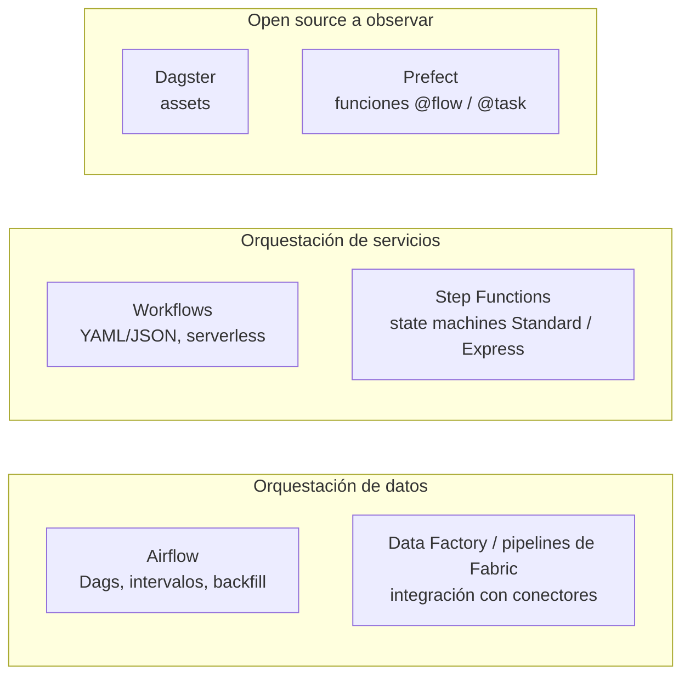

## 1. Resumen

Airflow es el orquestador de datos consolidado de este dominio, pero no el único. Cada herramienta modela el flujo de otra forma, y cada una se describe aquí según su documentación, **sin equivalencias**:

- **Workflows (Google Cloud):** orquesta servicios HTTP con una definición en YAML o JSON. Es serverless y cobra por paso ejecutado. Su documentación lo contrasta con Managed Airflow, que se orienta a ETL/ELT.
- **AWS Step Functions:** state machines con dos tipos, Standard y Express, de garantías y duración distintas.
- **Azure Data Factory** y los **pipelines de Fabric:** integración y orquestación de datos con poco o ningún código.
- **Dagster y Prefect:** orquestadores open source en Python, **herramientas a observar**. Dagster centra el modelo en *assets* (datos); Prefect, en funciones de Python como flujos.

Ninguno se presenta aquí como reemplazo de Airflow.

## 2. Qué es

- **Orquestador de servicios** (Workflows, Step Functions): encadena llamadas a servicios y APIs con estado, reintentos y esperas. La unidad es el paso o *state*; el foco, la aplicación o el proceso, no el intervalo de datos.
- **Orquestador de datos con Dags** (Airflow): Dags en Python, con programación por intervalos, backfill y re-ejecución. Ver `dag` y `catchup`.
- **Servicio de integración de datos** (Data Factory, pipelines de Fabric): mueve y transforma datos con actividades y conectores, sobre todo sin código.
- **Orquestador centrado en assets** (Dagster): el flujo se declara como datos (assets) y sus dependencias; el orden de ejecución sale de ellas.
- **Orquestador de funciones Python** (Prefect): un flujo es una función con `@flow` y cada paso una función con `@task`; llamarla la ejecuta.

## 3. Problema que resuelve

Elegir el orquestador según el tipo de flujo evita dos errores frecuentes:

- forzar en Airflow un flujo de microservicios de baja latencia;
- forzar en un orquestador de servicios un ETL que necesita backfill.

La propia documentación de Google Cloud plantea esa elección entre Workflows y Managed Airflow: la diferencia principal es qué arquitectura soporta cada uno.

## 4. Cómo funciona

Cada herramienta según su documentación:

| Herramienta | Modelo | Lo que destaca su documentación |
| --- | --- | --- |
| Workflows | Pasos en YAML o JSON; ejecuciones independientes | Serverless, sin cargo en reposo; estado, reintentos, polling o espera de hasta un año; latencia de milisegundos y facturación por paso, frente a segundos y capacidad aprovisionada en Managed Airflow |
| Step Functions | State machines; cada paso es un *state* | Standard: exactamente una vez, hasta un año, precio por transición. Express: al menos una vez, hasta cinco minutos, para altas tasas de eventos |
| Azure Data Factory | Pipelines de actividades, conectores, data flows | Servicio administrado para ETL, ELT e integración híbrida; Data Factory en Fabric es su siguiente generación |
| Pipelines de Fabric | Orquestación sin código | Alternativa sin código al Apache Airflow job de Fabric |
| Dagster | Assets (datos) con dependencias; jobs, schedules y sensores | El asset es la abstracción central; las ops quedaron en gran parte reemplazadas por assets |
| Prefect | Funciones `@flow` y `@task` | Python puro, sin DSL; estado, reintentos y caché; disparo por horario, evento o API |

La tabla no dice que una fila equivalga a otra. Por ejemplo, «exactamente una vez» en Step Functions Standard describe la ejecución de su workflow, no una garantía sobre los datos que procesa cada paso.

## 5. Cuándo utilizarlo

- **Workflows o Step Functions:** encadenar servicios y APIs con baja latencia, procesos con esperas largas o pasos humanos, automatización de infraestructura.
- **Data Factory o pipelines de Fabric:** movimiento e integración de datos con conectores, para equipos que prefieren no escribir código.
- **Airflow** (propio o administrado): pipelines de datos por intervalos con dependencias, backfill y un ecosistema amplio de operadores.
- **Dagster o Prefect:** evaluarlos cuando el modelo de assets (Dagster) o de funciones Python (Prefect) encaja con el equipo. Conviene probarlos en un proyecto acotado antes de adoptarlos.

## 6. Cuándo no utilizarlo

- No usar un orquestador de servicios para ETL que necesita backfill por intervalos: según la página de Google Cloud, Workflows no ofrece funciones de procesamiento de datos y Managed Airflow sí (backfills, re-ejecución de Dags).
- No elegir Step Functions Express para un flujo que dura más de cinco minutos.
- No migrar de Airflow a Dagster o Prefect por novedad: el costo de migrar Dags, operadores y operación es real, y las herramientas a observar se evalúan con un caso concreto.

## 7. Ejemplo sencillo

El mismo flujo de dos pasos, extraer y validar, en tres herramientas:

- **Airflow:** dos tareas y `extraer >> validar`, o dos funciones `@task` encadenadas (ver `dag`).
- **Dagster:** dos assets, `ventas_crudas` y `ventas_validadas`; el segundo depende del primero por el nombre de su argumento.
- **Prefect:** una función `@flow` que llama a dos funciones `@task`.

Los tres terminan con el mismo resultado. Cambia qué se declara: tareas, datos o funciones.

## 8. Ejemplo de producción

Una empresa usa dos orquestadores, cada uno para lo suyo:

- **Managed Service for Apache Airflow** para los pipelines diarios de datos: dependencias, backfill y operadores de BigQuery.
- **Workflows** para un proceso de aprobación de pedidos, que encadena servicios de Cloud Run con baja latencia y puede esperar una respuesta humana.

En paralelo, un equipo evalúa Dagster para un proyecto nuevo de modelos de ML, por su modelo de assets y linaje. La plataforma de datos principal sigue en Airflow.

## 9. Arquitectura



## 10. Código

```python
# Dagster 1.13.26 (ejecutado en local, en un entorno aparte): el flujo se declara como assets (datos) y sus
# dependencias; el orden de ejecución sale de esas dependencias. materialize_to_memory corre todo en un proceso.
import dagster as dg


@dg.asset
def ventas_crudas() -> list[int]:
    return [10, 20, 30]


@dg.asset
def ventas_validadas(ventas_crudas: list[int]) -> list[int]:     # depende del asset por el nombre del argumento
    return [v for v in ventas_crudas if v > 0]


resultado = dg.materialize_to_memory([ventas_crudas, ventas_validadas])
print(resultado.success, resultado.output_for_node("ventas_validadas"))
# True [10, 20, 30]
```

```python
# Prefect 3.8.8 (ejecutado en local, en un entorno aparte; sin servidor configurado, levanta uno temporal mientras
# corre): el flujo es una función de Python decorada con @flow y cada paso una función @task; llamarla lo ejecuta.
from prefect import flow, task


@task(retries=2)
def extraer() -> list[int]:
    return [10, 20, 30]


@task
def validar(ventas: list[int]) -> list[int]:
    return [v for v in ventas if v > 0]


@flow
def ventas_diarias() -> list[int]:
    return validar(extraer())


if __name__ == "__main__":
    print(ventas_diarias())
# [10, 20, 30]
```

Los dos bloques se ejecutaron en local, en un entorno aparte de Python 3.12 (`dagster==1.13.26` y `prefect==3.8.8`), no en la CI, y no se pasaron por `mypy`. Sin servidor configurado, Prefect levantó uno temporal en local mientras corría el flujo. El mismo flujo en Airflow está en `dag` y `pipeline-dependencies`.

## 11. GCP

**Workflows** frente a **Managed Service for Apache Airflow**, según la página de Google Cloud que los compara:

- Workflows: YAML o JSON, flujo imperativo, 512 KB para variables, latencia de milisegundos, serverless, facturación por paso ejecutado, sin funciones de procesamiento de datos.
- Managed Airflow: Python, Dag declarativo con dependencias automáticas, 48 KB para XCom, latencia de segundos, capacidad aprovisionada, backfills y re-ejecución de Dags.

## 12. AWS

**AWS Step Functions** modela workflows como state machines. **Standard**:

- ejecución exactamente una vez, hasta un año;
- historial y depuración visual;
- precio por transición de estado.

**Express**:

- ejecución al menos una vez, hasta cinco minutos;
- pensado para altas tasas de eventos, como streaming o IoT;
- precio por cantidad y duración de las ejecuciones.

Puede llamar a servicios como Lambda o controlar AWS Glue para ETL. Airflow administrado en AWS (MWAA) está en `open-source-vs-managed-orchestration`.

## 13. Azure

**Azure Data Factory** es un servicio administrado para ETL, ELT e integración híbrida, con triggers de eventos y data flows. Su página recomienda **Data Factory en Microsoft Fabric** como siguiente generación. En Fabric hay dos caminos:

- los **pipelines**, sin código;
- el **Apache Airflow job**, con Dags en Python (ver `open-source-vs-managed-orchestration`).

## 14. Buenas prácticas

- Elegir por el tipo de flujo (datos por intervalos frente a servicios con baja latencia), no por la marca.
- Describir cada herramienta con su documentación; las comparaciones dicen qué difiere, no que algo sea «lo mismo».
- Tratar Dagster y Prefect como herramientas a observar: evaluarlas en un proyecto acotado, con criterios definidos de antemano.
- Limitar la cantidad de orquestadores: cada uno suma operación, monitoreo y conocimiento que mantener.
- **Seguridad:** cada orquestador usa identidades y secretos a su manera (IAM de cada nube, Connections de Airflow, el mecanismo propio de Dagster o de Prefect); revisar cómo se guarda cada credencial antes de adoptarlo.
- **Observabilidad:** con dos orquestadores, unificar alertas y tableros para no tener dos lugares donde mirar.
- **Costo:** los modelos difieren: Workflows cobra por paso ejecutado, Step Functions Standard por transición y Express por ejecución y duración, y Managed Airflow por capacidad aprovisionada; estimar con el volumen real de cada flujo.

## 15. Errores frecuentes

- Presentar una herramienta emergente como reemplazo de la consolidada sin evaluarla.
- Usar Step Functions Express para procesos largos o que no toleran repeticiones (al menos una vez).
- Elegir un orquestador de servicios para un ETL que después necesita backfill.
- Multiplicar orquestadores sin necesidad.

## 16. Trade-offs

Los orquestadores de servicios dan baja latencia y cobro por uso, pero no traen las funciones de datos de Airflow (intervalos, backfill). Data Factory y los pipelines de Fabric reducen el código y amplían los conectores, a cambio de flexibilidad. Dagster y Prefect ofrecen otros modelos (assets, funciones Python) que conviene evaluar con un caso real antes de adoptarlos. Usar varias herramientas permite elegir la adecuada para cada flujo, a costa de más operación.

## 17. Conceptos relacionados

- `open-source-vs-managed-orchestration`: Airflow propio y administrado.
- `data-orchestration` y `dag`: el concepto general y el modelo de Airflow.
- `event-driven-orchestration`: disparar flujos por eventos.
- `airflow-architecture`: qué hay que operar en Airflow.

## 18. Preguntas técnicas abiertas

1. ¿Qué flujos de tu organización son de servicios y cuáles de datos por intervalos?
2. ¿Qué criterio concreto usarías para evaluar Dagster o Prefect frente a tu Airflow actual?
3. ¿Cuántos orquestadores operas hoy, y cuántos necesitas?

## 19. Laboratorio relacionado

Pendiente (F4).

## 20. Fuentes

- Google Cloud: *Workflows overview* y *Choose Workflows or Managed Airflow*.
- AWS: *What is Step Functions?*
- Microsoft Learn: *Introduction to Azure Data Factory* y *What is an Apache Airflow job?* (Fabric).
- Dagster Docs: *Concepts* y API *execution*.
- Prefect 3: *Introduction* y *Flows*.

El detalle de cada fuente está en `sources` del frontmatter.

## 21. Fecha de última verificación

2026-10-11. Pasa a `verified`: revisión B-F3.1 del lote F3b-06a aplicada, sin VERIFY pendientes.

## 22. Historial de cambios importantes

- 2026-10-11: creación (lote F3b-06a).
- 2026-10-11: revisión B-F3.1 del lote F3b-06a aplicada (docs/reviews/cards-f3b-06a.md): filas aprobadas sin cambios en esta ficha.
- 2026-10-11: `verification_status: verified` (sin VERIFY pendientes).
- 2026-10-11: relación `airflow-architecture` agregada en `relations`; §17 ya la enlazaba (cambio mínimo).
