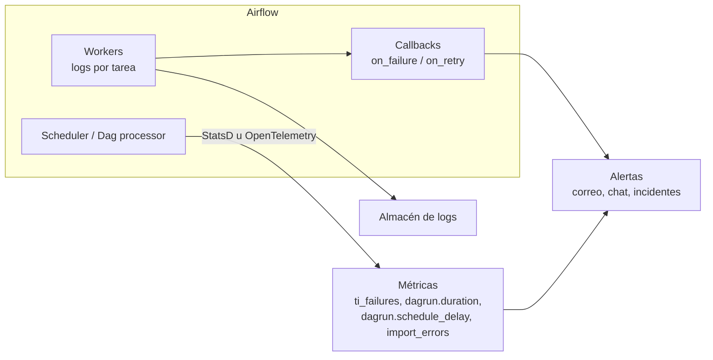

## 1. Resumen

Los flujos orquestados corren sin nadie mirando, así que hay que saber por otros medios si están sanos. La documentación de Airflow lo dice de forma directa: la observabilidad es crítica. Cuatro piezas:

- **logs** por instancia de tarea, para diagnosticar;
- **métricas** del orquestador: fallos, duración, retraso de inicio, errores al parsear Dags;
- **callbacks** que alertan cuando una tarea falla o se reintenta;
- **límites de tiempo** (`execution_timeout`, `dagrun_timeout`) que convierten una tarea colgada en un fallo visible.

En los servicios administrados, la plataforma recoge parte de esto. Cada página lo describe a su manera: Cloud Logging y Cloud Monitoring en Managed Service for Apache Airflow, CloudWatch en MWAA. En la tabla del Apache Airflow job de Fabric, los logs y métricas de diagnóstico figuran como no disponibles.

## 2. Qué es

- **Logs de tarea:** la salida de cada instancia, en la UI del orquestador y en su almacenamiento de logs.
- **Métricas** (Airflow 3.3.2, hacia StatsD u OpenTelemetry), entre otras:
  - `ti_failures` y `ti_successes`, por Dag y tarea;
  - `dagrun.duration.success` y `dagrun.duration.failed`;
  - `dagrun.schedule_delay`: cuánto tarda en empezar una corrida respecto de su hora programada;
  - `dag_processing.import_errors`: Dag files que no se pudieron parsear.
- **Callbacks:**
  - `on_success_callback` y `on_failure_callback`, para un Dag o una tarea;
  - `on_retry_callback`, `on_execute_callback` y `on_skipped_callback`, solo para tareas;
  - se declaran en el Dag, en `default_args` o en cada tarea.
- **Límites de tiempo:** `execution_timeout` por tarea y `dagrun_timeout` por corrida. Al vencer `dagrun_timeout`, las instancias que estaban corriendo quedan `skipped`.
- **Plazos:** la función de SLA se eliminó en Airflow 3.0; su reemplazo son las *DeadlineAlert* (parámetro `deadline` del Dag), desde 3.1.

## 3. Problema que resuelve

Sin observabilidad, los problemas se descubren tarde y por terceros: el reporte de la mañana está vacío porque una tarea quedó colgada desde las 3:00, o un Dag dejó de aparecer porque su archivo tiene un error de import. Con logs, métricas y alertas:

- el fallo avisa en el momento, con el Dag, la tarea y la corrida;
- las tendencias anticipan problemas: corridas cada vez más largas, retrasos de inicio que crecen;
- los errores de parseo se ven antes de que falte una corrida.

## 4. Cómo funciona

1. Cada instancia escribe su log; el orquestador lo asocia al Dag, la tarea, la corrida y el intento.
2. Los componentes de Airflow emiten métricas a StatsD u OpenTelemetry, según `[metrics]`. Con varios schedulers, la documentación indica OpenTelemetry para distinguir de qué proceso sale cada serie, porque StatsD no lo hace.
3. Cuando una tarea cambia de estado **por ejecución en un worker**, Airflow llama a sus callbacks. Un cambio manual desde la UI o la CLI no los dispara.
4. Si un callback falla, el error queda en los logs del dag processor, no en los de la tarea.
5. Si una tarea supera `execution_timeout`, falla con `AirflowTaskTimeout`, y su `on_failure_callback` puede alertar.

## 5. Cuándo utilizarlo

Siempre en producción. Como mínimo:

- alerta por tarea fallida;
- métrica de duración de corridas;
- retraso de inicio;
- errores de parseo.

## 6. Cuándo no utilizarlo

- No alertar por cada reintento de un error transitorio que se resuelve solo: genera ruido. Basta registrarlo y alertar si se agotan los reintentos.
- No usar callbacks para lógica de negocio (cargar datos, decidir qué procesar). Son para avisar, y sus errores no aparecen en el log de la tarea.

## 7. Ejemplo sencillo

Una tarea de carga queda esperando una base que no responde. Sin `execution_timeout`, aparece como `running` durante horas. Con `execution_timeout` de una hora, falla a la hora, `on_failure_callback` envía la alerta con el Dag, la tarea y la corrida, y el equipo actúa antes de que se note la falta del reporte.

## 8. Ejemplo de producción

El Dag `ventas_con_alertas` declara:

- `on_success_callback` a nivel de Dag, para registrar la corrida exitosa;
- en `default_args`, `on_failure_callback`, `on_retry_callback`, `execution_timeout` de una hora y dos reintentos;
- `dagrun_timeout` de tres horas.

Las métricas de Airflow van a OpenTelemetry. El tablero muestra por Dag la tasa de fallos, la duración p95 y `dagrun.schedule_delay`. Una regla avisa cuando `dag_processing.import_errors` es mayor que cero, porque un Dag que no parsea no falla: simplemente no aparece.

## 9. Arquitectura



## 10. Código

```python
# Airflow 3.3.2 (cargado en la CI con DagBag, sin errores de import; las tareas no se ejecutan): callbacks a nivel
# de Dag y de tarea, y límites de tiempo que convierten una tarea o una corrida colgada en un fallo visible.
import datetime
import logging
from typing import Any

from airflow.providers.standard.operators.bash import BashOperator
from airflow.sdk import DAG

log = logging.getLogger(__name__)


def avisar_fallo(context: Any) -> None:
    ti = context["task_instance"]
    # En producción, aquí se envía la alerta (correo, chat, herramienta de incidentes) con estos datos.
    log.error("tarea fallida dag=%s tarea=%s run=%s", ti.dag_id, ti.task_id, ti.run_id)


def avisar_reintento(context: Any) -> None:
    ti = context["task_instance"]
    log.warning("reintento dag=%s tarea=%s intento=%s", ti.dag_id, ti.task_id, ti.try_number)


def registrar_exito(context: Any) -> None:
    log.info("corrida exitosa run=%s", context["run_id"])


with DAG(
    dag_id="ventas_con_alertas",
    start_date=datetime.datetime(2026, 10, 1),
    schedule="@daily",
    catchup=False,
    dagrun_timeout=datetime.timedelta(hours=3),         # una corrida que pasa de 3 horas falla
    on_success_callback=registrar_exito,                # a nivel de Dag
    default_args={                                      # a nivel de cada tarea
        "retries": 2,
        "retry_delay": datetime.timedelta(minutes=5),
        "execution_timeout": datetime.timedelta(hours=1),
        "on_failure_callback": avisar_fallo,
        "on_retry_callback": avisar_reintento,
    },
):
    extraer = BashOperator(task_id="extraer", bash_command="extraer_ventas --fecha {{ ds }}")
    cargar = BashOperator(task_id="cargar", bash_command="cargar_ventas --fecha {{ ds }}")
    extraer >> cargar
```

```python
# Python 3.12, solo biblioteca estándar (ejecutado; mypy --strict sin errores): tres señales de salud de un flujo
# calculadas sobre el historial de corridas: tasa de fallos, duración p95 y retraso de inicio (como la métrica
# dagrun.schedule_delay de Airflow). Los datos son inventados para el ejemplo.
import statistics
from dataclasses import dataclass


@dataclass(frozen=True)
class Corrida:
    estado: str
    duracion_min: float
    retraso_inicio_min: float     # inicio real menos inicio programado


historial = [Corrida("success", d, r) for d, r in [(32, 1), (35, 1), (31, 2), (33, 1), (36, 1), (34, 2), (30, 1)]]
historial += [Corrida("failed", 61, 1), Corrida("success", 58, 14), Corrida("success", 62, 18)]

fallos = sum(c.estado == "failed" for c in historial) / len(historial)
p95 = statistics.quantiles([c.duracion_min for c in historial], n=20)[-1]
ultimo_retraso = historial[-1].retraso_inicio_min
print(f"fallos {fallos:.0%}, duración p95 {p95:.0f} min, último retraso de inicio {ultimo_retraso:.0f} min")
# fallos 10%, duración p95 62 min, último retraso de inicio 18 min
alertas = [n for n, mal in [("fallos > 5 %", fallos > 0.05), ("p95 > 45 min", p95 > 45), ("retraso > 10 min", ultimo_retraso > 10)] if mal]
print(alertas)
# ['fallos > 5 %', 'p95 > 45 min', 'retraso > 10 min']
```

El primer bloque es un Dag de **Airflow 3.3.2**. La CI lo carga con `DagBag` en cada push (`make check-airflow-dag`, entorno aparte con la versión fijada). La prueba verifica:

- que no haya errores de import;
- el `on_success_callback` del Dag;
- `on_failure_callback` y `on_retry_callback` en las tareas;
- `retries` y `execution_timeout` heredados de `default_args`.

Los callbacks no se ejecutan, los comandos son ilustrativos y el Dag no se cargó en local.

El segundo bloque, en Python 3.12 sin Airflow, está ejecutado y pasa `mypy --strict` sin errores. Calcula tres señales sobre un historial inventado: tasa de fallos, duración p95 y último retraso de inicio. Los umbrales son de ejemplo.

## 11. GCP

**Managed Service for Apache Airflow.** Según su página de introducción, el clúster del entorno aloja componentes como *Airflow Monitoring*, que recogen logs para Cloud Logging y métricas para Cloud Monitoring. Los logs de cada tarea se ven en la interfaz de Airflow y en la carpeta `logs` del bucket del entorno.

## 12. AWS

**Amazon MWAA.** Su documentación indica que envía automáticamente las métricas del entorno a Amazon CloudWatch, y también los logs de Apache Airflow si se habilitan, para identificar retrasos de tareas y errores.

## 13. Azure

**Apache Airflow job (Microsoft Fabric).** En la tabla de funciones de su página, comparado con Workflow Orchestration Manager de Azure Data Factory, «Diagnostic logs and metrics» figura como **No** para el Apache Airflow job y **Sí** para Workflow Orchestration Manager. Conviene confirmarlo en la página vigente antes de diseñar el monitoreo.

## 14. Buenas prácticas

- `on_failure_callback` en `default_args`, para que ninguna tarea quede sin alerta.
- `execution_timeout` en cada tarea y `dagrun_timeout` en cada Dag.
- Alertar al agotar reintentos, no en cada reintento.
- Vigilar `dag_processing.import_errors`.
- Seguir tendencias: la duración p95 y el retraso de inicio, no solo los fallos.
- OpenTelemetry si hay varios schedulers.
- **Seguridad:** los logs pueden contener datos o secretos que imprimió una tarea; enmascarar en el código (ver `python-logging`) y limitar quién lee los logs.
- **Observabilidad:** las alertas incluyen Dag, tarea, corrida e intento, para ir directo al log.
- **Costo:** los logs y métricas se almacenan y, en la nube, se pagan por volumen; definir retención y evitar logs verbosos en tareas que corren miles de veces.

## 15. Errores frecuentes

- Esperar que un callback se dispare al marcar una tarea como fallida desde la UI: solo se dispara con la ejecución en un worker.
- Buscar el error de un callback en el log de la tarea, cuando está en el del dag processor.
- Tareas sin `execution_timeout` que quedan colgadas sin fallar.
- No vigilar los errores de parseo: el Dag desaparece en silencio.
- Alertar en cada reintento y acostumbrar al equipo a ignorar las alertas.

## 16. Trade-offs

Más señales dan diagnósticos más rápidos, a cambio de costo de almacenamiento y de ruido si las alertas no se afinan. Los callbacks son simples y quedan en el código del Dag, pero corren después de la tarea y sus errores son menos visibles. Las métricas centralizadas detectan tendencias que un callback no ve. En un servicio administrado, la integración con la nube viene hecha, pero se limita a lo que el servicio expone.

## 17. Conceptos relacionados

- `orchestration-task` y `retries`: estados e intentos.
- `dag` y `scheduler`: corridas y retraso de inicio.
- `python-logging`: logs estructurados y enmascarado.
- `open-source-vs-managed-orchestration`: qué trae cada servicio.

## 18. Preguntas técnicas abiertas

1. ¿Cuánto tardaría tu equipo en enterarse de que un Dag dejó de parsear?
2. ¿Qué tareas de tu entorno no tienen `execution_timeout`?
3. ¿Qué umbral de retraso de inicio indicaría que tu orquestador está saturado?

## 19. Laboratorio relacionado

Pendiente (F4).

## 20. Fuentes

- Apache Airflow 3.3.2: *Logging & Monitoring*, *Metrics Configuration*, *Callbacks* y *Tasks*; Task SDK 1.3.2: referencia de `DAG`.
- Google Cloud: *Managed Airflow overview* (Managed Service for Apache Airflow, Gen 3).
- AWS: *What Is Amazon Managed Workflows for Apache Airflow?*
- Microsoft Learn: *What is an Apache Airflow job?* (Fabric).

El detalle de cada fuente está en `sources` del frontmatter.

## 21. Fecha de última verificación

2026-10-11. Pasa a `verified`: revisión B-F3.1 del lote F3b-06a aplicada, sin VERIFY pendientes.

## 22. Historial de cambios importantes

- 2026-10-11: creación (lote F3b-06a).
- 2026-10-11: revisión B-F3.1 del lote F3b-06a aplicada (docs/reviews/cards-f3b-06a.md): filas aprobadas sin cambios en esta ficha.
- 2026-10-11: `verification_status: verified` (sin VERIFY pendientes).
