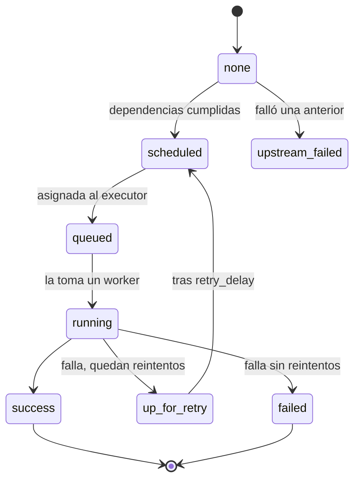

## 1. Resumen

Una **tarea** es la unidad de ejecución de un orquestador: un paso que el orquestador lanza, vigila, reintenta y marca como exitoso o fallido. En Airflow 3.3.2 hay tres tipos:

- **operadores**, plantillas predefinidas como `BashOperator`;
- **sensores**, que solo esperan a que algo ocurra;
- **funciones `@task`**, código Python propio (TaskFlow).

Cada corrida de un Dag crea una **instancia** de cada tarea, con su propio estado. Como Airflow puede reintentar una tarea que falló, la documentación pide que cada tarea produzca **el mismo resultado en cada re-ejecución**. Esta ficha trata la tarea; el grafo que las une está en `dag` y sus dependencias en `pipeline-dependencies`.

## 2. Qué es

- **Tarea:** la unidad básica de ejecución. En Airflow, los tres tipos son subclases de `BaseOperator`; un operador o sensor es la plantilla, y al usarlo en un Dag se crea la tarea.
- **Instancia de tarea:** la ejecución de esa tarea en una corrida concreta del Dag, con un estado. El recorrido ideal es `none` → `scheduled` → `queued` → `running` → `success`. Otros estados:
  - `up_for_retry`: falló y le quedan reintentos;
  - `upstream_failed`: falló una tarea anterior que la regla de disparo necesitaba;
  - `up_for_reschedule`: un sensor en modo reschedule entre revisiones;
  - `deferred`: la espera se delegó al triggerer;
  - `skipped`: se saltó, por ejemplo por una bifurcación.
- **Parámetros de ejecución:**
  - `retries` y `retry_delay`: cuántas veces reintentar y cada cuánto;
  - `execution_timeout`: el tiempo máximo de cada ejecución; al pasarlo, Airflow lanza `AirflowTaskTimeout`.
- **Comunicación:** las tareas están aisladas y pueden correr en máquinas distintas. Se pasan valores pequeños por **XCom**; los datos grandes van al almacenamiento, no por XCom.

## 3. Problema que resuelve

Un script largo que hace todo de una vez falla entero y se relanza entero. Dividido en tareas:

- cada paso se reintenta solo, sin repetir los que ya terminaron;
- el orquestador muestra en qué paso falló y con qué estado;
- los pasos independientes corren en paralelo;
- cada paso tiene su propio límite de tiempo, así una espera colgada no bloquea todo.

## 4. Cómo funciona

1. El Dag declara las tareas y sus dependencias.
2. En cada corrida, el scheduler crea una instancia por tarea, en estado `none`.
3. Cuando se cumplen sus dependencias, pasa a `scheduled` y luego a `queued`: el executor la asigna a un worker.
4. La tarea corre (`running`). Si termina bien, `success`.
5. Si falla y le quedan reintentos, pasa a `up_for_retry` y se vuelve a ejecutar tras `retry_delay`. Sin reintentos, queda `failed` y las que dependen de ella, `upstream_failed`.
6. Desde el código se puede forzar el resultado: `AirflowSkipException` la marca `skipped` y `AirflowFailException` la marca `failed` sin gastar los reintentos (útil, por ejemplo, con una clave de API inválida, que un reintento no arregla).

## 5. Cuándo utilizarlo

- Un paso por cada cosa que tiene sentido reintentar sola: extraer, cargar una partición, validar.
- Un sensor cuando un paso tiene que esperar a que algo exista (ver `sensors`).
- Un operador cuando ya hay uno para el sistema destino; una función `@task` para lógica propia en Python.

## 6. Cuándo no utilizarlo

- No partir en tareas lo que no se puede reintentar por separado: si dos pasos solo tienen sentido juntos, son una tarea.
- No crear una tarea por fila o por archivo pequeño en un Dag fijo; para una cantidad variable, ver `dynamic-workflows`.
- No pasar datos grandes entre tareas por XCom.

## 7. Ejemplo sencillo

Una tarea carga las ventas del 10 de octubre y se corta la conexión justo después de escribir. Airflow la reintenta:

- si la tarea **agrega** filas, la tabla queda con las ventas del día dos veces;
- si la tarea **reemplaza la partición** del día, el reintento deja la misma tabla que una sola ejecución correcta.

## 8. Ejemplo de producción

El Dag `ventas_por_particion` corre cada día y tiene tres tareas:

1. Un **sensor** espera el archivo del día.
2. Un **operador** carga la partición de la fecha lógica de la corrida (`{{ ds }}`) en modo de reemplazo, con `execution_timeout` de 30 minutos.
3. Una **función `@task`** verifica el conteo.

`default_args` da a todas tres reintentos con cinco minutos entre intentos. Un reintento o un backfill del mismo día deja la partición igual, porque la tarea escribe en una partición concreta en lugar de agregar.

## 9. Arquitectura



## 10. Código

```python
# Airflow 3.3.2 (cargado en la CI con DagBag, sin errores de import; las tareas no se ejecutan): los tres tipos
# de tarea (sensor, operador y función @task) y los parámetros que hacen a una tarea reintentable sin duplicar.
import datetime

from airflow.providers.standard.operators.bash import BashOperator
from airflow.providers.standard.sensors.filesystem import FileSensor
from airflow.sdk import DAG, task

with DAG(
    dag_id="ventas_por_particion",
    start_date=datetime.datetime(2026, 10, 1),
    schedule="@daily",
    catchup=False,
    default_args={"retries": 3, "retry_delay": datetime.timedelta(minutes=5)},   # cada tarea, hasta 3 reintentos
):
    # Sensor: espera a que exista el archivo del día ({{ ds }} es la fecha lógica de la corrida).
    esperar = FileSensor(task_id="esperar_archivo", filepath="/datos/entrada/{{ ds }}/ventas.csv", mode="reschedule")

    # Operador: plantilla predefinida. Reescribe la partición del día (overwrite) en vez de agregar filas,
    # así un reintento deja el mismo resultado. execution_timeout convierte una tarea colgada en un fallo.
    cargar = BashOperator(
        task_id="cargar_particion",
        bash_command="cargar_ventas --fecha {{ ds }} --modo overwrite",
        execution_timeout=datetime.timedelta(minutes=30),
    )

    @task
    def verificar_conteo(**context: object) -> None:   # TaskFlow: una función de Python como tarea
        print(f"verificando la partición de la corrida {context['run_id']}")

    esperar >> cargar >> verificar_conteo()
```

```python
# Python 3.12, solo biblioteca estándar (ejecutado; mypy --strict sin errores): por qué una tarea reintentable debe
# ser idempotente. La carga falla después de escribir y el orquestador la reintenta. Simulación didáctica.
tabla: dict[str, list[int]] = {}          # partición (fecha) -> filas
intentos = {"n": 0}


def cargar(fecha: str, filas: list[int], modo: str) -> None:
    intentos["n"] += 1
    if modo == "append":
        tabla.setdefault(fecha, []).extend(filas)      # INSERT: agrega a lo que ya había
    else:
        tabla[fecha] = list(filas)                     # overwrite: reemplaza la partición completa
    if intentos["n"] == 1:
        raise TimeoutError("se cortó la conexión después de escribir")


def correr_con_reintentos(fecha: str, filas: list[int], modo: str, retries: int = 3) -> None:
    for intento in range(retries + 1):
        try:
            cargar(fecha, filas, modo)
            return
        except TimeoutError:
            if intento == retries:
                raise


for modo in ("append", "overwrite"):
    tabla.clear()
    intentos["n"] = 0
    correr_con_reintentos("2026-10-10", [10, 20, 30], modo)
    print(modo, intentos["n"], tabla)
# append 2 {'2026-10-10': [10, 20, 30, 10, 20, 30]}
# overwrite 2 {'2026-10-10': [10, 20, 30]}
```

El primer bloque es un Dag de **Airflow 3.3.2**. La CI lo carga con `DagBag` en cada push (`make check-airflow-dag`, en un entorno aparte con la versión fijada). La prueba verifica:

- que no haya errores de import;
- el tipo de cada tarea (`FileSensor`, `BashOperator`);
- `retries=3` y `execution_timeout` de 30 minutos en la carga;
- que la verificación dependa de la carga.

Las tareas no se ejecutan, y el comando `cargar_ventas` es ilustrativo. El Dag no se cargó en local.

El segundo bloque, en Python 3.12 sin Airflow, está ejecutado y pasa `mypy --strict` sin errores. Es una simulación didáctica: la misma carga reintentada duplica filas si agrega, y no las duplica si reemplaza la partición.

## 11. GCP

No aplica de forma específica: la tarea es un concepto del orquestador. Dónde corre Airflow en cada nube está en `airflow-architecture` y `open-source-vs-managed-orchestration`.

## 12. AWS

No aplica de forma específica (ver §11).

## 13. Azure

No aplica de forma específica (ver §11).

## 14. Buenas prácticas

- Una tarea, un paso reintentable con un resultado claro.
- Escribir en una partición concreta (la fecha lógica de la corrida), no «lo último»; reemplazar o hacer upsert en vez de agregar.
- `execution_timeout` en todas las tareas que hablan con sistemas externos.
- `AirflowFailException` para errores que un reintento no arregla.
- Valores pequeños por XCom; datos, en el almacenamiento.
- **Seguridad:** las credenciales de cada tarea salen de una Connection o de un gestor de secretos, no del código del Dag; cada tarea con los permisos mínimos para su paso.
- **Observabilidad:** el estado de cada instancia (`up_for_retry`, `upstream_failed`) y sus logs son la primera señal de un problema; ver `orchestration-observability`.
- **Costo:** un reintento que repite trabajo cuesta cómputo; tareas pequeñas reintentan menos trabajo, pero cada tarea agrega sobrecarga de programación y arranque.

## 15. Errores frecuentes

- Tareas que agregan filas y duplican datos al reintentarse.
- Usar `now()` dentro de la tarea para decidir qué procesar: cada reintento procesa otra cosa.
- No poner `execution_timeout` y dejar una tarea colgada ocupando un worker.
- Pasar dataframes por XCom.
- Reintentar errores permanentes (credenciales inválidas) en vez de fallar de inmediato.

## 16. Trade-offs

Tareas pequeñas dan reintentos baratos y fallos localizados, pero más sobrecarga y un grafo más grande. Tareas grandes simplifican el Dag, a cambio de repetir más trabajo al reintentar. Los operadores predefinidos ahorran código, pero atan la tarea a lo que el operador expone; una función `@task` da control total y exige escribir y probar ese código.

## 17. Conceptos relacionados

- `dag` y `pipeline-dependencies`: cómo se unen las tareas.
- `retries` e `idempotency`: reintentar sin duplicar.
- `sensors`: tareas que esperan.
- `airflow-operators-and-hooks`: operadores, hooks y operadores propios.
- `dynamic-workflows`: una cantidad de tareas que se decide al ejecutar.

## 18. Preguntas técnicas abiertas

1. ¿Qué tarea de tu pipeline duplicaría datos si se reintentara hoy?
2. ¿Qué errores de tus tareas no se arreglan con un reintento, y cómo los marcarías?
3. ¿Dónde partirías en dos una tarea que hoy hace demasiado?

## 19. Laboratorio relacionado

Pendiente (F4).

## 20. Fuentes

- Apache Airflow 3.3.2: *Tasks*, *Best Practices*, *TaskFlow* y *XComs*.

El detalle de cada fuente está en `sources` del frontmatter.

## 21. Fecha de última verificación

2026-10-11. Pasa a `verified`: revisión B-F3.1 del lote F3b-06a aplicada, sin VERIFY pendientes.

## 22. Historial de cambios importantes

- 2026-10-11: creación (lote F3b-06a).
- 2026-10-11: revisión B-F3.1 del lote F3b-06a aplicada (docs/reviews/cards-f3b-06a.md): filas aprobadas sin cambios en esta ficha.
- 2026-10-11: `verification_status: verified` (sin VERIFY pendientes).
