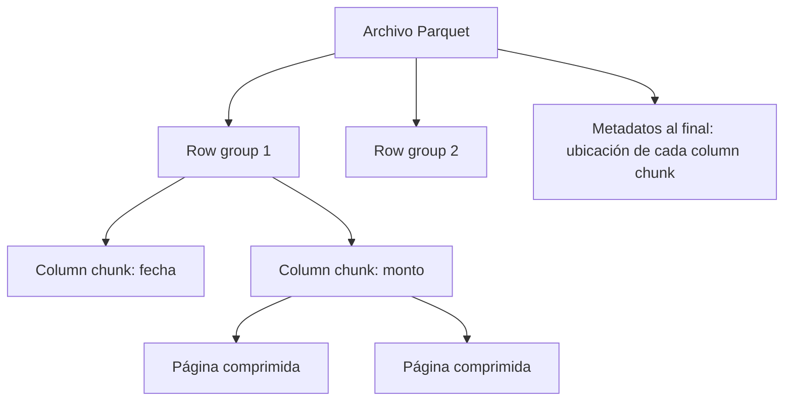

## 1. Resumen

Parquet es un formato de archivo **columnar** y abierto de Apache. Guarda los datos por columna dentro de bloques de filas (row groups), comprime y codifica por páginas dentro de cada columna y escribe al final del archivo los metadatos con la ubicación de cada column chunk. Por eso un motor puede leer solo las columnas que pide la consulta y saltar bloques cuyo rango de valores no cumple el filtro.

## 2. Qué es

Según su documentación, un formato de archivo open source y orientado a columnas, diseñado para almacenar y recuperar datos de forma eficiente. Su estructura:

- **archivo:** uno o más row groups y, al final, los metadatos;
- **row group:** partición horizontal lógica de filas;
- **column chunk:** los datos de una columna dentro de un row group, contiguos en el archivo;
- **página:** la unidad indivisible de compresión y codificación dentro de un column chunk.

## 3. Problema que resuelve

En un formato por filas (CSV, JSON), leer 3 columnas de una tabla de 200 obliga a leer las 200. Además, cada valor se guarda como texto sin tipos ni compresión por columna. Parquet guarda cada columna junta, con su tipo y con estadísticas, y así reduce el espacio en disco y los datos leídos.

## 4. Cómo funciona

1. **Escritura:** las filas se agrupan en row groups; dentro de cada uno, cada columna se escribe como un column chunk, dividido en páginas comprimidas y codificadas.
2. **Metadatos al final:** se escriben después de los datos, lo que permite escribir en una sola pasada. Incluyen la ubicación de cada column chunk; el detalle completo está en la definición Thrift del formato.
3. **Lectura:** el lector lee primero los metadatos para encontrar los column chunks que le interesan y luego lee solo esos.
4. **Salto de bloques:** los motores usan estadísticas por bloque (mínimo y máximo) para decidir si leen o saltan un bloque según el filtro (*predicate pushdown*).

## 5. Cuándo utilizarlo

- Tablas analíticas en un data lake consultadas por columnas y con filtros.
- Intercambio de datos entre motores (BigQuery, Athena, Synapse, Spark, pandas vía PyArrow).
- Capas raw o curated que deben ser eficientes en espacio y lectura.

## 6. Cuándo no utilizarlo

- Escrituras fila a fila o actualizaciones frecuentes de registros individuales: el archivo se escribe en una pasada con los metadatos al final, así que cambiar un registro implica reescribir el archivo.
- Datos que se leen siempre como registros completos y de a uno (por ejemplo, mensajes de una cola): un formato por filas como Avro o JSON suele encajar mejor.
- Archivos diminutos: con row groups muy pequeños se pierde la ventaja (BigQuery recomienda al menos 16 MiB por row group).

## 7. Ejemplo sencillo

Una tabla de ventas con 50 columnas guardada en Parquet. La consulta `SELECT tienda, SUM(monto) ... WHERE fecha = '2026-09-30'` lee solo las columnas `tienda`, `monto` y `fecha`, y salta los row groups cuyo rango de `fecha` no incluye ese día.

## 8. Ejemplo de producción

Un pipeline escribe cada día los pedidos a `gs://lake/pedidos/fecha=AAAA-MM-DD/` en Parquet, con archivos de cientos de MB y row groups grandes. La carga a BigQuery usa `LOAD DATA OVERWRITE` sobre la partición del día, así que repetirla reemplaza en lugar de agregar. Los analistas consultan la misma carpeta desde Athena o Synapse sin convertir formatos.

## 9. Arquitectura



## 10. Código

```sql
-- BigQuery: cargar Parquet reemplazando la tabla destino (idempotente: repetir deja el mismo resultado).
-- El esquema se toma de los propios archivos Parquet (autodescriptivos).
LOAD DATA OVERWRITE mydataset.pedidos_20260930
FROM FILES (
  format = 'PARQUET',
  uris = ['gs://lake/pedidos/fecha=2026-09-30/*.parquet']
);
```

```sql
-- Synapse serverless SQL pool: consultar Parquet en el lake leyendo solo las columnas necesarias.
-- Requiere: un external data source 'lake' que apunte a la carpeta raíz del almacenamiento.
SELECT tienda, SUM(monto) AS total
FROM OPENROWSET(
  BULK 'pedidos/fecha=2026-09-30/*.parquet',
  DATA_SOURCE = 'lake',
  FORMAT = 'PARQUET'
) WITH (tienda VARCHAR(50), monto DECIMAL(18, 2)) AS filas
GROUP BY tienda;
```

`LOAD DATA OVERWRITE` reemplaza; `LOAD DATA INTO` y `bq load` sin `--replace` **agregan**, así que repetirlos duplica filas.

## 11. GCP

En **BigQuery**, el esquema de una carga Parquet se toma de los datos autodescriptivos; si hay varios archivos, del alfabéticamente último. BigQuery recomienda row groups de **al menos 16 MiB**: los más chicos aumentan la E/S y enlentecen cargas y consultas. `LOAD DATA OVERWRITE` reemplaza la tabla; `bq load` agrega por defecto y reemplaza con `--replace`.

## 12. AWS

En **Athena**, Parquet (y ORC) comprimen por columna, y el *predicate pushdown* usa estadísticas por bloque (mínimo y máximo) para leer o saltar bloques. La división de archivos permite repartir la lectura entre varios lectores. Para convertir CSV o JSON a Parquet en un paso se usa `CREATE TABLE AS` (CTAS) o un job de AWS Glue. A diferencia de una carga en BigQuery, Athena consulta los datos donde están, en S3, organizados en particiones por carpeta.

## 13. Azure

En **Synapse**, el serverless SQL pool consulta Parquet en el lake con `OPENROWSET(... FORMAT = 'PARQUET')`, y con `WITH` se indican solo las columnas de interés. Como Athena, lee los archivos donde están; `DATA_SOURCE` apunta a un *external data source* creado sobre la carpeta raíz del almacenamiento.

## 14. Buenas prácticas

- Escribir archivos grandes con row groups grandes (en BigQuery, al menos 16 MiB por row group), no miles de archivos pequeños.
- Ordenar o agrupar los datos antes de escribir por la columna de filtro habitual, para que las estadísticas por bloque sirvan.
- Combinar Parquet con particiones por carpeta (`fecha=...`).
- Cargar con operaciones que reemplazan (`LOAD DATA OVERWRITE`, sobrescritura de partición) para que repetir sea seguro.
- **Seguridad:** Parquet no controla el acceso por sí mismo; aplicar permisos en el bucket o contenedor y en el catálogo, y cifrado del almacenamiento.
- **Observabilidad:** vigilar el tamaño medio de archivo y de row group por tabla; una caída indica un problema de "archivos pequeños".
- **Costo:** en motores que cobran por bytes leídos (Athena, BigQuery sobre tablas externas), Parquet reduce el costo al leer solo las columnas y bloques necesarios.

## 15. Errores frecuentes

- Escribir un archivo por registro o por lote diminuto.
- Usar `LOAD DATA INTO` o `bq load` sin `--replace` en una carga que se reejecuta y duplicar filas.
- Tratar archivos Parquet como si admitieran actualizaciones de registros individuales.
- Tipos distintos para la misma columna en archivos de la misma tabla.

## 16. Trade-offs

Parquet optimiza la lectura analítica y el espacio, a cambio de escrituras más costosas (hay que agrupar filas antes de escribir) y de no permitir actualizaciones en su lugar. Los formatos por filas (CSV, JSON, Avro) son más simples de escribir y de leer registro a registro, pero leen todo aunque se pidan pocas columnas.

## 17. Conceptos relacionados

- `partitioning`: carpetas por partición sobre archivos Parquet.
- `partition-pruning`: poda de particiones, complementaria al salto de bloques.
- `schema-evolution`: cómo cambia el esquema entre archivos.
- Del blueprint, pendientes de ficha: `row-vs-columnar-formats`, `avro-format`, `compression`.

## 18. Preguntas técnicas abiertas

1. ¿Qué harías si una tabla del lake tiene cientos de miles de archivos Parquet de pocos KB?
2. ¿Cómo elegirías la columna por la que ordenar antes de escribir los archivos?
3. ¿Por qué cargarías a BigQuery en lugar de consultar los archivos como tabla externa, o al revés?

## 19. Laboratorio relacionado

Pendiente (F4): lab de tipo B sobre una consulta cara en BigQuery.

## 20. Fuentes

- Apache Parquet: *Overview*, *Concepts* y *File Format*.
- Google Cloud: *Load Parquet data from Cloud Storage* (BigQuery).
- AWS: *Use columnar storage formats* y *Partition your data* (Athena).
- Microsoft Learn: *Query Parquet files using serverless SQL pool* (Synapse).

El detalle de cada fuente está en `sources` del frontmatter.

## 21. Fecha de última verificación

2026-09-30. La ficha queda en `review_required` hasta la revisión humana (B-F3.1).

## 22. Historial de cambios importantes

- 2026-09-30: creación (lote 3 de F3).
