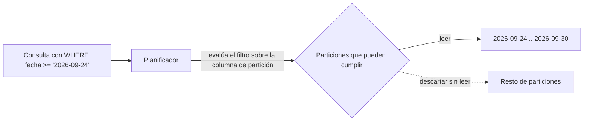

## 1. Resumen

Partition pruning es cuando el motor descarta, antes de leer, las particiones que no pueden cumplir el filtro de la consulta. Es la razón por la que particionar ahorra tiempo y dinero. Pero no es automático: depende de filtrar por la columna de partición con una condición que el motor pueda evaluar antes de ejecutar la consulta.

## 2. Qué es

Es una optimización del planificador de consultas. Con la condición del `WHERE` sobre la columna de partición, el motor calcula qué particiones pueden contener filas que la cumplan y lee solo esas. Las particiones descartadas no se leen y, en motores que cobran por datos escaneados, tampoco se cobran.

## 3. Problema que resuelve

Una tabla de eventos con años de historia puede pesar terabytes. Una consulta sobre "la última semana" que lea la tabla entera es lenta y cara. Con pruning, lee solo siete particiones.

## 4. Cómo funciona

1. El motor lee el filtro sobre la columna de partición.
2. Si la condición se puede evaluar sin leer datos (una expresión constante o una función soportada sobre la columna), calcula qué particiones la cumplen.
3. Planifica leer solo esas particiones.

El pruning se pierde cuando el filtro no se puede evaluar de antemano. En **BigQuery**:

- un filtro que depende de valores de la propia tabla (dinámico, por ejemplo una subconsulta sobre otra columna) no limita las particiones escaneadas;
- hay que dejar la columna de partición aislada a un lado del operador, o envuelta solo en funciones soportadas;
- en tablas particionadas por tiempo de ingestión, el filtro va sobre la pseudocolumna `_PARTITIONTIME` o `_PARTITIONDATE`.

## 5. Cuándo utilizarlo

Siempre que se consulte una tabla particionada: todo filtro habitual debería incluir la columna de partición con una condición podable. Es especialmente importante en motores que cobran por bytes escaneados.

## 6. Cuándo no utilizarlo

No es algo que se active o desactive, pero no siempre aporta:

- consultas que necesitan toda la historia no se benefician;
- en tablas pequeñas, la diferencia es despreciable;
- en Synapse con clustered columnstore, el beneficio del pruning por partición es menor.

## 7. Ejemplo sencillo

La tabla `eventos` está particionada por `fecha`.

- `WHERE fecha >= '2026-09-01'` lee solo las particiones de septiembre en adelante.
- `WHERE CAST(fecha AS STRING) LIKE '2026-09%'` envuelve la columna en una transformación que no está entre las funciones soportadas y puede leer la tabla entera.

## 8. Ejemplo de producción

Un tablero consulta `pedidos` (particionada por día, varios años) y filtra la fecha con una subconsulta: `WHERE fecha >= (SELECT MAX(fecha) FROM pedidos) - 7`. El dry run muestra que escanea toda la tabla. Se reescribe con una expresión constante relativa a la fecha actual (la documentación de BigQuery muestra una vista `past_week` que poda con `CURRENT_TIMESTAMP`), y el dry run baja a siete particiones. Además, se activa **Require partition filter** en la tabla para que ninguna consulta sin filtro de partición pueda ejecutarse.

## 9. Arquitectura



## 10. Código

```sql
-- BigQuery: el primer filtro poda particiones; el segundo no, porque depende de valores de la tabla.
-- Requiere: tabla particionada por la columna fecha.

-- Poda: filtro constante sobre la columna de partición aislada.
SELECT tienda_id, SUM(monto) AS total
FROM `proyecto.dwh.pedidos`
WHERE fecha BETWEEN '2026-09-24' AND '2026-09-30'
GROUP BY tienda_id;

-- No poda: el límite sale de una subconsulta sobre la misma tabla (filtro dinámico).
-- Alternativa podable: una expresión constante, p. ej. fecha >= DATE_SUB(DATE(CURRENT_TIMESTAMP()), INTERVAL 7 DAY).
SELECT tienda_id, SUM(monto) AS total
FROM `proyecto.dwh.pedidos`
WHERE fecha >= (SELECT DATE_SUB(MAX(fecha), INTERVAL 7 DAY) FROM `proyecto.dwh.pedidos`)
GROUP BY tienda_id;
```

Hay que verificar cada caso con un dry run, que estima los bytes a procesar antes de ejecutar.

## 11. GCP

En **BigQuery**, las particiones podadas no cuentan en los bytes escaneados, así que el pruning reduce directamente el costo en el modelo por bytes. El comportamiento varía según el tipo de partición. Un dry run permite verificar si el pruning aplica, y la opción **Require partition filter** hace fallar las consultas sin filtro de partición.

## 12. AWS

En **Athena**, particionar los datos en S3 restringe la cantidad de datos escaneados por consulta, lo que mejora el rendimiento y reduce el costo. Se puede particionar por cualquier clave, habitualmente por tiempo. A diferencia de BigQuery, las particiones siguen la estructura de carpetas en S3 y hay que cargarlas en el catálogo antes de consultarlas: `MSCK REPAIR TABLE` para carpetas estilo Hive (`clave=valor`) o `ALTER TABLE ADD PARTITION` para las demás. La alternativa es *partition projection*.

## 13. Azure

En **Synapse** (dedicated SQL pool), filtrar por la columna de partición limita el escaneo a las particiones que califican. Con clustered columnstore el beneficio es menor, y demasiadas particiones pueden empeorar el rendimiento: se recomienda al menos 1 millón de filas por distribución y partición, y cada tabla ya se divide en 60 distribuciones.

## 14. Buenas prácticas

- Filtrar siempre por la columna de partición con expresiones constantes o funciones soportadas.
- No envolver la columna de partición en transformaciones arbitrarias.
- Verificar con dry run o `EXPLAIN` los bytes o particiones escaneados de las consultas frecuentes.
- Exigir filtro de partición en tablas grandes (Require partition filter en BigQuery).
- **Costo:** en motores por bytes escaneados, el pruning es el control de costo más directo; revisar periódicamente las consultas más caras.
- **Observabilidad:** vigilar los bytes escaneados por consulta en las vistas de jobs; un salto suele indicar un filtro que dejó de podar.
- **Seguridad:** el pruning no es un control de acceso: limitar qué datos ve cada usuario requiere permisos, vistas o políticas de filas.

## 15. Errores frecuentes

- Filtrar por una columna de fecha que no es la de partición.
- Calcular el límite con una subconsulta sobre la tabla.
- Transformar la columna de partición en el filtro.
- Olvidar cargar las particiones nuevas en el catálogo (Athena) y creer que no hay datos.

## 16. Trade-offs

Particiones más finas permiten podar con más precisión, a cambio de más metadatos y posibles problemas con muchas particiones pequeñas. Particiones gruesas son más simples de mantener, pero cada consulta lee más datos de los necesarios.

## 17. Conceptos relacionados

- `partitioning`: el requisito del pruning.
- `bigquery-partitioning`: los tipos de partición en BigQuery.
- `bigquery-clustering`: poda de bloques dentro de cada partición.
- Del blueprint, pendientes de ficha: `query-plans`, `predicate-pushdown`, `query-cost-optimization`.

## 18. Preguntas técnicas abiertas

1. ¿Cómo encontrarías las consultas más caras que no están podando particiones?
2. ¿Qué harías si el filtro que el negocio necesita es sobre una columna distinta de la de partición?
3. ¿Cómo explicarías a un analista por qué su consulta con subconsulta escanea toda la tabla?

## 19. Laboratorio relacionado

Pendiente (F4): lab de tipo B sobre una consulta cara que no poda particiones.

## 20. Fuentes

- Google Cloud: *Query partitioned tables* (BigQuery).
- AWS: *Partition your data* (Athena).
- Microsoft Learn: *Partitioning tables in dedicated SQL pool* (Synapse).

El detalle de cada fuente está en `sources` del frontmatter.

## 21. Fecha de última verificación

2026-09-30. Pasa a `verified`: revisión B-F3.1 del lote 2 aplicada, sin VERIFY pendientes.

## 22. Historial de cambios importantes

- 2026-09-30: creación (lote 2 de F3).
- 2026-09-30: `verification_status: verified` (revisión B-F3.1 del lote 2 aplicada; sin VERIFY pendientes).
