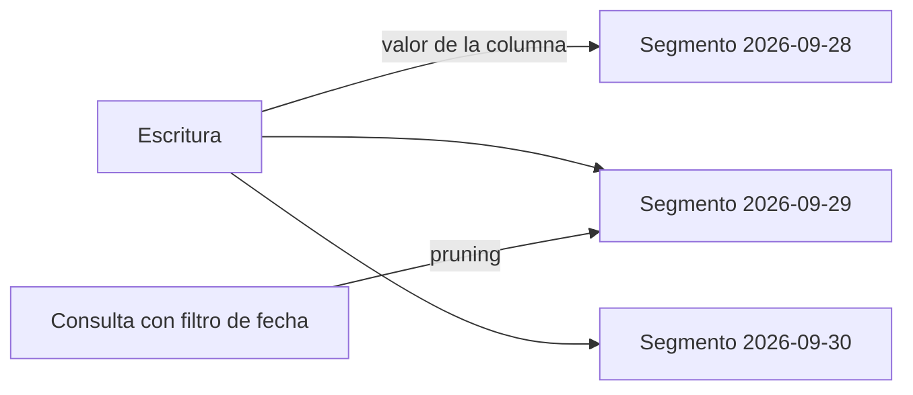

## 1. Resumen

Particionar es dividir físicamente los datos de una tabla según el valor de una columna (casi siempre, una fecha). Así las consultas que filtran por esa columna leen solo los segmentos necesarios, y cada segmento puede cargarse, reemplazarse o borrarse por separado.

## 2. Qué es

Es una decisión de **layout físico**, no de modelo lógico: la tabla sigue siendo una sola para quien la consulta. Cada motor lo implementa distinto: particiones gestionadas por el warehouse, carpetas en un data lake (`dt=2026-09-30/`) o particiones de tabla en un motor relacional.

## 3. Problema que resuelve

- **Lectura**: sin partición, cualquier filtro por fecha recorre toda la tabla.
- **Operación**: reemplazar un día o borrar datos viejos obliga a reescribir o filtrar la tabla entera.
- **Costo**: en motores que cobran por datos escaneados, leer de más cuesta dinero.

## 4. Cómo funciona

Al escribir, cada fila va al segmento que le corresponde según la columna de partición. Al leer, el motor compara el filtro de la consulta con los límites de cada segmento y salta los que no pueden contener filas (*partition pruning*). Las operaciones de mantenimiento (reemplazar, expirar, mover) trabajan con segmentos completos.

## 5. Cuándo utilizarlo

- Tablas grandes que se consultan casi siempre por un rango de fechas u otra columna de baja cardinalidad.
- Datos con ciclo de vida por tiempo (retención, archivado).
- Cargas incrementales por período, donde reemplazar el segmento del período hace la carga idempotente.

## 6. Cuándo no utilizarlo

- Tablas pequeñas: el costo de gestión supera el beneficio.
- Columnas de alta cardinalidad (IDs): generan demasiados segmentos pequeños. Para esos filtros suele convenir clustering u ordenamiento.
- Cuando las consultas casi nunca filtran por la columna candidata.

## 7. Ejemplo sencillo

Una tabla de ventas particionada por día: `SELECT SUM(monto) WHERE fecha = '2026-09-29'` lee un solo segmento en vez de años de historia.

## 8. Ejemplo de producción

Un data lake guarda eventos en `s3://bucket/eventos/dt=YYYY-MM-DD/`. El pipeline diario reescribe solo la carpeta del día (idempotente) y las consultas de Athena filtran por `dt`. Una regla de ciclo de vida archiva las carpetas de más de 400 días. Además, se controla que ningún día quede vacío o duplicado.

## 9. Arquitectura



## 10. Código

```sql
-- BigQuery (ejecutable adaptando nombres): partición diaria y reemplazo idempotente de un día.
CREATE TABLE IF NOT EXISTS `proyecto.dataset.ventas` (venta_id STRING, fecha DATE, monto NUMERIC)
PARTITION BY fecha;

DELETE FROM `proyecto.dataset.ventas` WHERE fecha = '2026-09-29';
INSERT INTO `proyecto.dataset.ventas`
SELECT venta_id, fecha, monto FROM `proyecto.dataset.ventas_stg` WHERE fecha = '2026-09-29';
```

## 11. GCP

**BigQuery** particiona por columna de tiempo, por momento de ingesta o por rangos de enteros, con pruning y gestión por partición (expiración, escritura en una partición concreta). El detalle está en `bigquery-partitioning`.

## 12. AWS

En **Athena**, particionar los datos de S3 por cualquier clave (a menudo en carpetas estilo Hive) limita los datos escaneados por consulta, mejora el rendimiento y reduce el costo. La partición vive en la estructura de carpetas y en el catálogo, no en un almacenamiento administrado como el de BigQuery: hay que mantener sincronizados datos y metadatos.

## 13. Azure

El dedicated SQL pool de **Azure Synapse** admite particiones de tabla, con splitting, merging y switching para mover o reemplazar segmentos rápidamente. La documentación advierte que demasiadas particiones perjudican el rendimiento en tablas columnstore, porque cada tabla ya está repartida en 60 distribuciones. El criterio de tamaño es muy distinto al de BigQuery.

## 14. Buenas prácticas

- Elegir la columna por los filtros reales de las consultas, no por intuición.
- Mantener un tamaño de segmento sano: ni demasiados segmentos diminutos ni uno gigante.
- Escribir por segmento completo para que las cargas sean idempotentes.
- Verificar el pruning en el plan o en los bytes escaneados.

## 15. Errores frecuentes

- Particionar por una columna de alta cardinalidad.
- Filtros que envuelven la columna en una función e impiden el pruning.
- Particionar por la fecha de carga cuando las consultas usan la fecha del evento.
- En un data lake, escribir archivos nuevos sin registrar la partición en el catálogo.

## 16. Trade-offs

Menos datos leídos y operaciones por segmento, a cambio de rigidez: la partición se define al crear la tabla, cada motor impone límites y un mal diseño se paga en cada consulta. Clustering y ordenamiento complementan la partición para filtros de alta cardinalidad.

## 17. Conceptos relacionados

- `bigquery-partitioning`: implementación en BigQuery.
- `incremental-load`: carga por segmento.
- Del blueprint, pendientes de ficha: `partition-pruning`, `clustering`, `parquet-format`.

## 18. Preguntas técnicas abiertas

1. ¿Qué columna usarías para particionar una tabla de eventos que se consulta por fecha y por cliente, y por qué?
2. ¿Cómo afecta el particionamiento a la idempotencia de una carga diaria?
3. ¿Qué señales te indicarían que una tabla tiene demasiadas particiones?

## 19. Laboratorio relacionado

Pendiente (F4): lab de tipo C sobre reducción de datos escaneados (§25).

## 20. Fuentes

- Google Cloud: *Introduction to partitioned tables* (BigQuery).
- AWS: *Partition your data* (Amazon Athena).
- Microsoft Learn: *Partitioning tables in dedicated SQL pool* (Azure Synapse).

El detalle de cada fuente está en `sources` del frontmatter.

## 21. Fecha de última verificación

2026-09-30. La ficha queda en `review_required` hasta la revisión humana (B-F3.1).

## 22. Historial de cambios importantes

- 2026-09-30: creación (lote 1 de F3).
