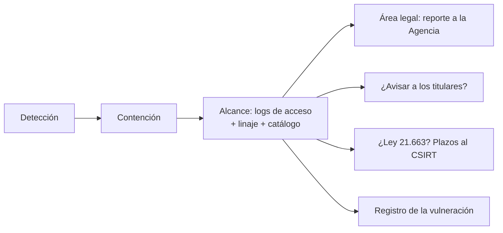

## 1. Resumen

Esta ficha no es asesoría legal: cubre lo que ingeniería de datos necesita tener listo antes de una vulneración.

La ley pide reportar a la Agencia, sin dilaciones indebidas, las vulneraciones con riesgo razonable para los titulares, registrarlas con las categorías de datos y el número aproximado de titulares, y avisar a los titulares cuando hay datos sensibles, de menores de catorce años o de obligaciones económicas o financieras. Si la institución está entre las que la Ley 21.663 obliga a reportar al CSIRT Nacional, corren además sus plazos: tres horas, setenta y dos horas y quince días.

Nada de eso se puede responder en horas sin **logs de acceso activados**, **linaje** y un **catálogo con categorías**. La preparación es técnica y se hace antes.

## 2. Qué es

- **[Obligación legal · Ley 19.628, art. 14 sexies]** Reportar a la Agencia las vulneraciones con riesgo razonable, registrar naturaleza, efectos, categorías, número aproximado de titulares y medidas, y comunicarlas a los titulares si hay datos sensibles, de menores de catorce años o de obligaciones económicas o financieras.
- **[Obligación legal · Ley 21.663, art. 9]** Las instituciones del art. 4 de esa ley reportan al CSIRT Nacional los incidentes con efectos significativos: alerta temprana en tres horas, actualización en setenta y dos (veinticuatro para operadores de importancia vital) e informe final en quince días corridos.
- **[Decisión de arquitectura]** El alcance se calcula desde logs de acceso, linaje y catálogo; si alguno falta, el alcance es una estimación.

## 3. Problema que resuelve

**[Buena práctica]** A las 8:30 alguien descubre un bucket público con un export. Las preguntas son inmediatas: qué datos, de cuántas personas, desde cuándo, quién más los leyó. Sin logs de acceso a datos, la respuesta honesta es «no sabemos», y el reporte sale tarde o sin datos.

## 4. Cómo funciona

1. **[Buena práctica]** Detectar y contener: revocar la credencial, cerrar el acceso, preservar los logs.
2. **[Decisión de arquitectura]** Filtrar los logs de acceso por la cuenta o el recurso comprometido.
3. **[Obligación legal · Ley 19.628, art. 14 sexies]** Calcular titulares afectados, categorías de datos (con el catálogo) y desde cuándo.
4. **[Obligación legal · Ley 19.628, art. 14 sexies]** Si hay categorías que obligan a avisar a los titulares, preparar la comunicación.
5. **[Obligación legal · Ley 21.663, art. 9]** Si la institución está obligada, calcular los plazos desde la detección.
6. **[Buena práctica]** Escalar al área legal con el alcance y registrar la vulneración.

## 5. Cuándo utilizarlo

- Al diseñar la plataforma: decidir qué logs de acceso se activan y cuánto se guardan.
- En cada simulacro de incidentes.

## 6. Cuándo no utilizarlo

- Para decidir si hay «riesgo razonable» o si la institución está obligada por la Ley 21.663: lo decide el área legal.
- Como sustituto del runbook de incidentes: lo complementa con el paso de datos personales.

## 7. Ejemplo sencillo

| Pregunta | Respuesta |
|---|---|
| Titulares afectados | 4 |
| Desde cuándo | 2026-12-03 22:10 |
| Categorías | contacto, identificación, obligaciones económicas y financieras |
| ¿Avisar a los titulares? | Sí (obligaciones económicas) |
| Plazos al CSIRT, detección 2026-12-04 08:30 | 11:30 · 2026-12-07 08:30 · 2026-12-19 08:30 |

## 8. Ejemplo de producción

- Logs de acceso a datos activados en las tablas con datos personales y guardados fuera del alcance de las cuentas de los pipelines.
- Linaje y catálogo con categorías al día.
- Un script de alcance probado en simulacros, que entrega el informe en minutos.

### Evidencia de cumplimiento

| Evidencia | Dónde queda | Quién la produce |
|---|---|---|
| Registro de la vulneración: naturaleza, efectos, categorías, titulares, medidas | Registro de vulneraciones | Seguridad, con el alcance de datos |
| Informe de alcance reproducible | Log del script | Ingeniería de datos |
| Fechas de detección y de cada reporte | Registro de vulneraciones | Seguridad y área legal |

## 9. Arquitectura



## 10. Código

```python
# Python 3.12, biblioteca estándar (ejecutado en la CI): alcance de una vulneración desde los logs de acceso y el
# catálogo. Responde qué datos, de cuántos titulares, desde cuándo y por qué vía; decide qué comunicaciones
# preparar y calcula los plazos de la Ley 21.663 si la institución está entre las obligadas a reportar al CSIRT.
import datetime as dt
import json

CATALOGO = {  # columnas por tabla y sus categorías (las mantiene el dueño del dato)
    "clientes": {"email": "contacto", "rut": "identificación"},
    "creditos": {"deuda": "obligaciones económicas y financieras"},
    "salud_beneficios": {"diagnostico": "dato sensible: salud"},
}
COMUNICAR_A_TITULARES = ("dato sensible", "obligaciones económicas")  # categorías que obligan a avisar a los titulares
LOG = """\
{"ts": "2026-12-03T22:10:00", "cuenta": "sa-export", "tabla": "clientes", "titulares": [1, 2, 3], "via": "bucket público"}
{"ts": "2026-12-03T22:40:00", "cuenta": "sa-export", "tabla": "creditos", "titulares": [2, 3, 4], "via": "bucket público"}
{"ts": "2026-12-04T09:00:00", "cuenta": "ana", "tabla": "clientes", "titulares": [9], "via": "consola"}
"""
COMPROMETIDA, DETECCION = "sa-export", dt.datetime(2026, 12, 4, 8, 30)
OBLIGADA_LEY_21663 = True  # la institución está entre las del art. 4 de la Ley 21.663 (lo determina el área legal)

eventos = [e for e in map(json.loads, LOG.splitlines()) if e["cuenta"] == COMPROMETIDA]
titulares = sorted({t for e in eventos for t in e["titulares"]})
categorias = sorted({c for e in eventos for c in CATALOGO[e["tabla"]].values()})
desde = min(e["ts"] for e in eventos)
print(f"alcance: {len(titulares)} titulares {titulares}; desde {desde}; vía {sorted({e['via'] for e in eventos})}")
print("categorías afectadas:", categorias)
avisar = [c for c in categorias if c.startswith(COMUNICAR_A_TITULARES)]
print("preparar comunicación a los titulares:", bool(avisar), avisar)
registro = {"naturaleza": "acceso no autorizado por bucket público", "categorias": categorias,
            "titulares_aprox": len(titulares), "medidas": ["revocar credenciales de sa-export", "cerrar el bucket"]}
print("registro de la vulneración:", json.dumps(registro, ensure_ascii=False))
if OBLIGADA_LEY_21663:
    plazos = {"alerta temprana": DETECCION + dt.timedelta(hours=3), "actualización": DETECCION + dt.timedelta(hours=72),
              "informe final": DETECCION + dt.timedelta(days=15)}
    print("plazos al CSIRT Nacional:", {k: v.isoformat(timespec="minutes") for k, v in plazos.items()})
```

El script se **ejecuta en la CI** con la biblioteca estándar y pasa `mypy --strict`. Imprime 4 titulares afectados desde 2026-12-03 22:10 por un bucket público, las categorías, que corresponde preparar la comunicación a los titulares, el registro de la vulneración y los tres plazos al CSIRT Nacional.

## 11. GCP

En GCP, **Cloud Audit Logs**. Según *Ley 19628 SOBRE PROTECCION DE LOS DATOS PERSONALES* y *Cloud Audit Logs overview* (no ejecutado):

| | Logs del ejemplo | Cloud Audit Logs | Etiqueta |
|---|---|---|---|
| Accesos a datos | Siempre registrados | Data Access audit logs desactivados por defecto, salvo en BigQuery; hay que activarlos | **[Decisión de arquitectura]** |
| Para qué | Calcular el alcance | Quién hizo qué, dónde y cuándo | **[Buena práctica]** |

## 12. AWS

En AWS, **AWS CloudTrail**. Según *Ley 19628 SOBRE PROTECCION DE LOS DATOS PERSONALES* y *Logging data events* (no ejecutado):

| | Logs del ejemplo | CloudTrail | Etiqueta |
|---|---|---|---|
| Accesos a datos | Siempre registrados | Data events no registrados por defecto; tienen cargos adicionales | **[Decisión de arquitectura]** |
| Para qué | Calcular el alcance | Operaciones sobre los recursos, como lecturas de objetos | **[Buena práctica]** |

## 13. Azure

En Azure, **auditoría de Azure SQL Database**. Según *Ley 19628 SOBRE PROTECCION DE LOS DATOS PERSONALES* y *Auditing for Azure SQL Database* (no ejecutado):

| | Logs del ejemplo | Auditoría de Azure SQL | Etiqueta |
|---|---|---|---|
| Destino | Archivo de log | Azure Storage, Log Analytics o Event Hubs | **[Buena práctica]** |
| Para qué | Calcular el alcance | Entender la actividad y detectar anomalías | **[Buena práctica]** |

## 14. Buenas prácticas

- **[Decisión de arquitectura]** Activar los logs de acceso a datos en las tablas con datos personales; en varias nubes no vienen activos.
- **[Obligación legal · Ley 19.628, art. 14 sexies]** Tener las categorías de cada tabla en el catálogo: deciden si hay que avisar a los titulares.
- **[Buena práctica]** **Seguridad:** los logs de acceso, fuera del alcance de las cuentas que pueden quedar comprometidas.
- **[Buena práctica]** **Observabilidad:** alertar por lecturas masivas o desde vías inusuales (buckets públicos, cuentas nuevas).
- **[Buena práctica]** **Costo:** los logs de acceso a datos tienen volumen y, en algunas nubes, cargos; activarlos donde hay datos personales y no en todo.

## 15. Errores frecuentes

- Descubrir durante el incidente que los logs de acceso a datos no estaban activos.
- Calcular el alcance a mano, mirando tablas.
- Confundir el reporte a la Agencia con el reporte al CSIRT: son leyes y plazos distintos.

## 16. Trade-offs

Más logs de acceso permiten un alcance exacto y cuestan almacenamiento; menos logs ahorran y obligan a estimar el peor caso, que suele ser más titulares que los reales.

## 17. Conceptos relacionados

- `incident-response`: el runbook.
- `observability-logs`: los logs.
- `data-lineage`: las copias derivadas.
- `pii-identification`: las categorías.

## 18. Preguntas técnicas abiertas

1. ¿Tienes activos los logs de acceso a datos en tus tablas con datos personales?
2. ¿Cuánto tardarías en saber cuántos titulares afectó una filtración?
3. ¿Tu institución está entre las obligadas por la Ley 21.663? (lo responde el área legal)

## 19. Laboratorio relacionado

Pendiente (F4).

## 20. Fuentes

- BCN Ley Chile: *Ley 19628 SOBRE PROTECCION DE LOS DATOS PERSONALES* (versión con vigencia diferida desde 2026-12-01) y *Ley 21663 LEY MARCO DE CIBERSEGURIDAD*.
- Google Cloud: *Cloud Audit Logs overview*.
- AWS: *Logging data events*.
- Microsoft Learn: *Auditing for Azure SQL Database*.

El detalle de cada fuente está en `sources` del frontmatter.

## 21. Fecha de última verificación

2026-10-21: textos legales consultados ese día en BCN. `review_required`: pendiente de revisión B-F3.1 del lote F3b-19c; pasa a `verified` solo con la aprobación explícita de Felipe (`owner_approved_at`). Revisión mensual.

## 22. Historial de cambios importantes

- 2026-10-21: creación (lote F3b-19c).
