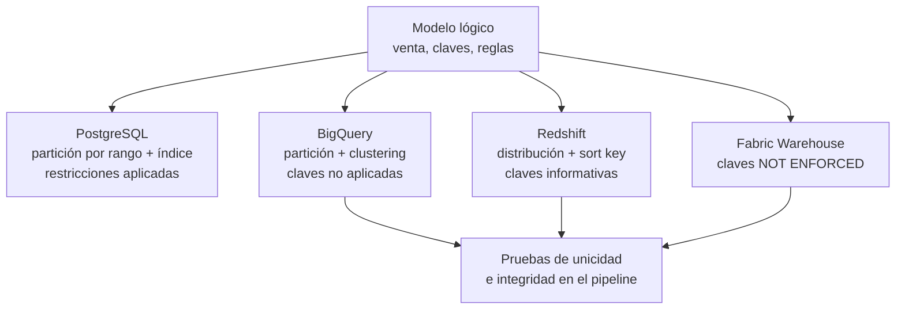

## 1. Resumen

El modelo físico es el modelo lógico escrito para un motor concreto, con sus tipos, particiones, índices u ordenamiento, y distribución. Es donde se decide el rendimiento y el costo. También es donde cambia el significado de las restricciones:

- PostgreSQL **aplica** las claves y rechaza las filas que no cumplen.
- BigQuery, Redshift y Fabric Warehouse **no las aplican**. Las declaradas sirven de información o de pista para el optimizador, y la integridad la tiene que garantizar el pipeline.

## 2. Qué es

Según AWS, el modelo físico mapea el lógico a una tecnología de base de datos concreta, con su terminología: tipos de campo, relaciones como las representa el motor, y detalles como el ajuste de rendimiento.

Las decisiones físicas típicas:

- **Tipos del motor:** `numeric(12,2)` en PostgreSQL, `NUMERIC` en BigQuery.
- **Partición:** dividir una tabla grande en piezas por una columna, normalmente la fecha.
- **Índices** (PostgreSQL), **clustering** (BigQuery), **sort keys** (Redshift): qué orden físico acelera las consultas frecuentes.
- **Distribución** (Redshift): cómo se reparten las filas entre nodos.
- **Restricciones:** si el motor las aplica, las usa como pista o las ignora.

## 3. Problema que resuelve

Un modelo lógico correcto puede ser lento o caro si se implementa sin pensar en el motor:

- una tabla de ventas sin partición se lee entera para consultar un día;
- una dimensión pequeña mal distribuida obliga a mover datos entre nodos en cada join;
- una clave primaria declarada en un warehouse que no la aplica da una falsa sensación de unicidad.

El modelo físico toma esas decisiones a propósito y las documenta.

## 4. Cómo funciona

1. Se parte de las tablas, claves y reglas del modelo lógico.
2. Se traduce cada tipo al del motor.
3. Se eligen la columna de partición (la del filtro más frecuente, normalmente fecha) y el orden físico (índice, clustering o sort key) según las consultas reales.
4. En motores distribuidos se elige la distribución. En Redshift, `AUTO` deja que el motor la elija según el tamaño de la tabla.
5. Se decide qué hacer con cada restricción:
   - en PostgreSQL se declara y el motor la aplica;
   - en BigQuery, Redshift y Fabric se declara (`NOT ENFORCED` donde corresponde) como información para el optimizador, y se agrega una **prueba** en el pipeline (ver `sql-quality-checks`).
6. Se verifica con el plan de ejecución que la consulta frecuente use la partición o el orden elegidos.

## 5. Cuándo utilizarlo

- Al implementar el modelo lógico por primera vez en un motor.
- Cuando una tabla crece y las consultas leen más de lo necesario.
- Al migrar de un motor a otro: el lógico se mantiene y el físico se rehace.

## 6. Cuándo no utilizarlo

- No para cambiar reglas de negocio: eso es del modelo lógico y conceptual.
- No particionar ni indexar tablas pequeñas «por si acaso»: cada partición e índice tiene costo de mantenimiento, y en motores con opciones automáticas, como `AUTO` en Redshift, la elección manual puede no mejorar nada.
- No copiar el diseño físico de un motor a otro: las palancas son distintas.

## 7. Ejemplo sencillo

La misma clave primaria en tres motores:

- **PostgreSQL:** `PRIMARY KEY (venta_id, fecha)`, aplicada. Un duplicado se rechaza.
- **BigQuery:** clave declarada y no aplicada. El duplicado se inserta.
- **Fabric Warehouse:** `PRIMARY KEY NONCLUSTERED ... NOT ENFORCED`. Solo se admite así.

## 8. Ejemplo de producción

La tabla de ventas de un retailer tiene el mismo modelo lógico en dos motores:

- **PostgreSQL**, para la aplicación: particionada por mes, con un índice `(sucursal_id, fecha)` y todas las restricciones aplicadas.
- **Warehouse**, para análisis: particionada por día, con clustering o sort key por sucursal y claves declaradas solo como información. Una prueba diaria verifica que no haya `venta_id` duplicados ni sucursales inexistentes.

## 9. Arquitectura



## 10. Código

```sql
-- PostgreSQL 17 (ejecutado): la entidad Venta del modelo lógico, en su forma física para un motor concreto.
-- Decisiones físicas: tipos del motor, partición por mes (fecha), índice para la consulta frecuente.
CREATE TABLE venta (
  venta_id    bigint        NOT NULL,
  fecha       date          NOT NULL,
  sucursal_id integer       NOT NULL,
  cliente_id  integer       NOT NULL,
  monto       numeric(12,2) NOT NULL CHECK (monto > 0),
  PRIMARY KEY (venta_id, fecha)              -- en una tabla particionada, la PK incluye la columna de partición
) PARTITION BY RANGE (fecha);

CREATE TABLE venta_2026_09 PARTITION OF venta FOR VALUES FROM ('2026-09-01') TO ('2026-10-01');
CREATE TABLE venta_2026_10 PARTITION OF venta FOR VALUES FROM ('2026-10-01') TO ('2026-11-01');
CREATE INDEX venta_sucursal_fecha_idx ON venta (sucursal_id, fecha);   -- se crea en cada partición

INSERT INTO venta
SELECT g, DATE '2026-09-01' + (g % 60), 1 + g % 5, 1000 + g % 300, 1000 + g
FROM generate_series(1, 20000) AS g;
ANALYZE venta;

EXPLAIN (COSTS OFF)
SELECT sucursal_id, sum(monto) FROM venta
WHERE fecha >= '2026-10-01' AND fecha < '2026-10-08'
GROUP BY sucursal_id;
-- El plan solo recorre venta_2026_10: la partición de septiembre se descarta (partition pruning).

SELECT tableoid::regclass AS particion, count(*) FROM venta GROUP BY 1 ORDER BY 1;
-- venta_2026_09 | 10010
-- venta_2026_10 |  9990
```

Ejecutado en PostgreSQL 17.11 local, en un esquema desechable. El plan muestra un `Seq Scan on venta_2026_10` y ninguna lectura de septiembre: la partición se descartó. La clave primaria incluye `fecha` porque PostgreSQL exige que una clave sobre una tabla particionada contenga las columnas de partición. La implementación en BigQuery, Redshift y Fabric se describe en §11–13 con su documentación; el DDL de esos motores no se escribió ni se ejecutó aquí.

## 11. GCP

En **BigQuery**, una tabla particionada se divide en segmentos que reducen los bytes leídos, con menos tiempo y menos costo. El clustering ordena los bloques de almacenamiento por columnas elegidas. BigQuery **no aplica** claves primarias ni foráneas: hay que asegurar que los datos las cumplan. Pero puede usar las restricciones declaradas para optimizar consultas, por ejemplo eliminando joins. Para unicidad, la documentación sugiere una columna de identidad. Detalle en `bigquery-partitioning` y `bigquery-clustering`.

## 12. AWS

En **Redshift**:

- la distribución puede ser `AUTO`, `EVEN`, `KEY` o `ALL`. Sin especificarla se usa `AUTO`, que elige según el tamaño de la tabla, y puede convenir `ALL` para dimensiones pequeñas;
- las sort keys informan al planificador, y se recomienda `SORTKEY AUTO`;
- las claves primarias, únicas y foráneas son **solo informativas**: no se aplican al cargar, pero el planificador las usa como pistas. Conviene declararlas solo si el ETL garantiza su integridad.

## 13. Azure

En **Fabric Warehouse**, `PRIMARY KEY` y `UNIQUE` solo se admiten con `NONCLUSTERED` y `NOT ENFORCED` a la vez, y `FOREIGN KEY` solo con `NOT ENFORCED`. Diferencia con PostgreSQL: la clave existe como metadato pero no impide duplicados. La unicidad se verifica en el pipeline.

## 14. Buenas prácticas

- Partición por la columna del filtro más frecuente; verificar en el plan que se descartan particiones.
- Orden físico (índice, clustering, sort key) según las consultas reales, revisado cuando cambian.
- En warehouses que no aplican claves: declararlas como información y probar la unicidad y la integridad en cada carga.
- Documentar cada decisión física con su motivo junto al DDL.
- **Seguridad:** las decisiones físicas incluyen dónde viven los datos sensibles; separar columnas o tablas sensibles facilita aplicar permisos o enmascaramiento a nivel de tabla o columna en el motor.
- **Observabilidad:** revisar periódicamente los planes y los bytes o filas leídos de las consultas frecuentes; una consulta que deja de descartar particiones es una regresión del modelo físico.
- **Costo:** en motores que cobran por datos leídos o por cómputo, partición y orden bien elegidos son la principal palanca de costo; los índices y particiones de más agregan costo de escritura y mantenimiento.

## 15. Errores frecuentes

- Suponer que una `PRIMARY KEY` declarada en BigQuery, Redshift o Fabric evita duplicados.
- Particionar por una columna que las consultas no filtran.
- Tablas con miles de particiones minúsculas.
- Llevar el mismo DDL de PostgreSQL a un warehouse sin revisar tipos, distribución ni restricciones.

## 16. Trade-offs

Cada decisión física acelera unas consultas a costa de otras, de la escritura o del mantenimiento. Las restricciones aplicadas protegen los datos pero cuestan en cada escritura. Su ausencia en los warehouses agiliza la carga, pero traslada la responsabilidad de la integridad al pipeline. Las opciones automáticas, como `AUTO` en Redshift, reducen decisiones manuales a cambio de menos control explícito.

## 17. Conceptos relacionados

- `logical-data-model`: lo que el físico implementa.
- `partitioning`, `partition-pruning` y `clustering`: las palancas principales.
- `sql-quality-checks`: pruebas donde las claves no se aplican.
- `bigquery-partitioning` y `bigquery-clustering`: el detalle en BigQuery.

## 18. Preguntas técnicas abiertas

1. ¿Qué tabla de tu warehouse tiene una clave declarada que nadie verifica?
2. ¿Por qué columna particionarías una tabla de eventos que se consulta por fecha de evento pero llega por fecha de carga?
3. ¿Cómo detectarías que una decisión física dejó de servir porque cambiaron las consultas?

## 19. Laboratorio relacionado

Pendiente (F4).

## 20. Fuentes

- AWS: *What is Data Modeling?*
- PostgreSQL 17: *Table Partitioning* y *Constraints*.
- Google Cloud: *Introduction to partitioned tables*, *Introduction to clustered tables* y *Use primary and foreign keys* (BigQuery).
- AWS: *Distribution styles*, *Sort keys* y *Table constraints* (Redshift).
- Microsoft Learn: *Tables in Fabric Data Warehouse*.

El detalle de cada fuente está en `sources` del frontmatter.

## 21. Fecha de última verificación

2026-10-11. Pasa a `verified`: revisión B-F3.1 del lote F3b-04a aplicada, sin VERIFY pendientes.

## 22. Historial de cambios importantes

- 2026-10-10: creación (lote F3b-04a).
- 2026-10-11: revisión B-F3.1 del lote F3b-04a aplicada (docs/reviews/cards-f3b-04a.md): filas aprobadas sin cambios en esta ficha.
- 2026-10-11: `verification_status: verified` (sin VERIFY pendientes).
