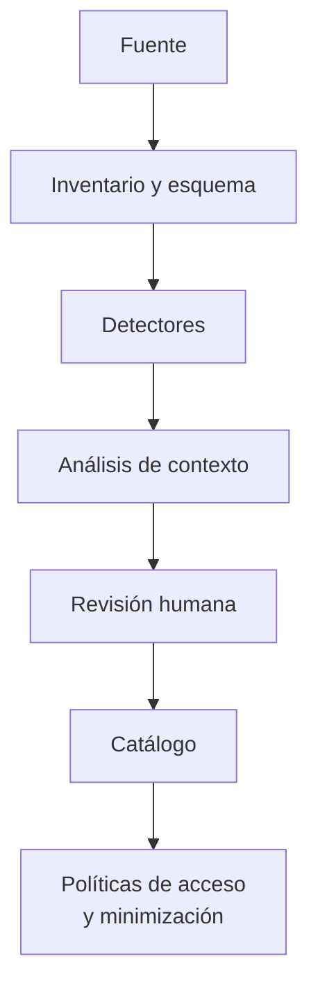

## 1. Resumen

Esta ficha no es asesoría legal: cubre la parte técnica de identificar datos personales y sensibles. Seudonimización, minimización, derechos e incidentes van en sus fichas hijas.

**Cómo leerla.** *Comprender* (§1–6): qué es un dato personal y uno sensible. *Aplicar* (§7–13): cómo se detecta y clasifica. *Demostrar*: la evidencia del §8, el detector del §10 y las preguntas del §18.

**Identificar** es determinar qué información permite reconocer a una persona, por sí sola o combinada con otros datos. **Clasificar** es registrar esa conclusión con contexto y evidencia. No basta buscar RUT y correos: identificadores internos, texto libre y combinaciones de atributos también pueden identificar.

**Resultado esperado:** un catálogo que diga qué activos tienen datos personales o sensibles, con qué fundamento se clasificaron, quién revisó los casos dudosos y cuándo se actualizó el análisis.

## 2. Qué es

- **[Obligación legal · art. 2]** Dato personal es información vinculada o referida a una persona natural identificada o identificable; es identificable quien puede determinarse directa o indirectamente, y se consideran los medios que razonablemente se podrían usar, así que una combinación de columnas también puede serlo.
- **[Obligación legal · art. 2]** El art. 2 g) dice, tal cual: «Datos personales sensibles: tendrán esta condición aquellos datos personales que se refieren a las características físicas o morales de las personas o a hechos o circunstancias de su vida privada o intimidad, que revelen el origen étnico o racial, la afiliación política, sindical o gremial, la situación socioeconómica, las convicciones ideológicas o filosóficas, las creencias religiosas, los datos relativos a la salud, al perfil biológico humano, los datos biométricos, y la información relativa a la vida sexual, a la orientación sexual y a la identidad de género de una persona natural.»
- **[Obligación legal · art. 16]** Los datos sensibles tienen una regla propia: consentimiento expreso del titular, salvo los casos que la ley enumera.
- **[Buena práctica]** **Identificador directo:** RUT, correo personal, nombre junto a otros datos. **Identificador indirecto:** un código de cliente, una ubicación o una combinación de edad, comuna y otros atributos, cuando permiten identificar razonablemente a alguien.
- **[Buena práctica]** Un dato seudonimizado sigue siendo personal si se puede reidentificar al titular con información adicional (`chilean-identifier-pseudonymization`).
- **[Decisión de arquitectura]** **Distinción crítica:** una etiqueta técnica de riesgo (por ejemplo `HIGH`) no equivale a la categoría jurídica «dato sensible»; el catálogo guarda las dos por separado.
- **[Buena práctica]** El RUT tiene un dígito verificador (módulo 11) que separa un RUT bien escrito de un número cualquiera; un DV inválido no prueba que el dato no sea personal.

## 3. Problema que resuelve

**[Buena práctica]** Una ingesta trae `cliente_id`, `correo`, `tramo_ingreso`, `comuna` y `comentarios`. Un detector solo de expresiones regulares encuentra el correo, pero no ve que `tramo_ingreso` revela situación socioeconómica (sensible según el art. 2 g)), que `comentarios` trae texto libre sobre la salud de un cliente y que `cliente_id` se enlaza con la tabla que identifica a la persona.

**[Buena práctica]** **Riesgo:** publicar una tabla analítica o compartirla con un proveedor creyendo que no contiene datos personales.

## 4. Cómo funciona

1. **[Buena práctica]** **Inventariar:** fuentes, tablas, vistas, archivos, eventos, logs y exportaciones, con su esquema y su responsable.
2. **[Buena práctica]** **Detectar candidatos:** patrones sobre los valores, nombres de columna, diccionarios, detectores de la nube y conocimiento del dominio.
3. **[Buena práctica]** **Evaluar el contexto:** enlaces con otras tablas, texto libre, campos codificados y posibilidad razonable de identificación.
4. **[Decisión de arquitectura]** **Clasificar y revisar:** categoría (personal, sensible) y confianza; lo ambiguo va al dueño del dato y a privacidad.
5. **[Decisión de arquitectura]** **Registrar:** etiqueta, fundamento, método, fecha, revisor y versión del esquema en el catálogo.
6. **[Buena práctica]** **Mantener:** reanalizar ante cambios de esquema, fuentes nuevas, transformaciones y revisiones periódicas según el riesgo.

**[Buena práctica]** No hay un umbral universal (por ejemplo, «el 60 % de la muestra»): un solo valor sensible en mil filas puede importar. Cuántos valores calzan sirve para priorizar la revisión, no para decidir que la columna no tiene datos personales.

## 5. Cuándo utilizarlo

- Antes de incorporar una fuente o de habilitar un consumidor nuevo.
- Cuando cambia un esquema o una finalidad.
- En migraciones, copias a ambientes de desarrollo e integraciones con APIs.
- En el escaneo periódico de las capas, para encontrar datos personales donde no deberían estar.

## 6. Cuándo no utilizarlo

- Como certificación de que no hay datos personales: «sin hallazgos» no significa anónimo.
- Para decidir la base de licitud de un dato sensible: eso lo decide el área legal.
- Como única prueba: un patrón no reconoce una combinación de columnas que identifica.

## 7. Ejemplo sencillo

| Columna | Clasificación preliminar | Motivo o precaución |
|---|---|---|
| `cliente_id` | Personal si es vinculable | Una clave interna se enlaza con la persona en otra tabla |
| `diagnostico` | Sensible | Datos relativos a la salud (art. 2 g)) |
| `tramo_ingreso` | Sensible si se asocia a un titular | Situación socioeconómica (art. 2 g)); confirmar qué significa |
| `comuna` | Depende del contexto | Sola no identifica; combinada puede reidentificar |
| `comentarios` | Revisión necesaria | El texto libre puede traer datos personales o sensibles |
| `rut_malformado` | No descartar | Un DV inválido no elimina el carácter personal: puede ser un error de captura |

## 8. Ejemplo de producción

Escenario genérico: un pipeline de reservas y CRM alimenta un warehouse por capas.

- **Ingesta y bronze:** registrar el esquema, detectar identificadores y restringir el acceso mientras se revisan los campos nuevos.
- **Silver:** enriquecer el catálogo con las relaciones entre tablas; detectar identificadores indirectos y campos sensibles aunque vengan codificados.
- **Gold:** cada vista expone solo lo necesario; agregar no garantiza anonimato (`data-minimization-by-layer`).
- **Operación:** si aparece `observacion_medica` en una fuente, alerta y revisión antes de habilitar consumos.

### Evidencia de cumplimiento

| Evidencia | Dónde queda | Quién la produce |
|---|---|---|
| Inventario de activos con esquema y responsable | Catálogo | Ingeniería de datos |
| Hallazgos del detector, sin valores personales | Log del job | Pipeline de clasificación |
| Decisión de clasificación con fundamento, revisor y fecha | Catálogo | Dueño del dato y privacidad |
| Registro de cambios de esquema y reclasificaciones | Catálogo, versionado | Pipeline y dueño del dato |

## 9. Arquitectura



La clasificación alimenta los controles, pero no los implementa: hace falta una integración explícita con permisos, contratos de datos y monitoreo (`privacy-controls-as-code`).

## 10. Código

```python
# Python 3.12, biblioteca estándar (ejecutado en la CI): detector didáctico de candidatos a datos personales y
# sensibles. Genera hallazgos para revisión humana; no declara que una columna sea legalmente sensible. Una columna
# puede producir más de un hallazgo. No hay umbral: cuántos valores calzan sirve para priorizar, no para descartar.
# El reporte nunca imprime valores, solo columna, candidato, motivo y conteo.
import re
from dataclasses import dataclass


@dataclass(frozen=True)
class Hallazgo:
    columna: str
    candidato: str      # "personal", "revisión personal" o "revisión sensible"
    motivo: str
    coincidencias: int  # valores de la muestra que calzan (0 si el hallazgo es por el nombre)


def dv(cuerpo: str) -> str:
    """Dígito verificador del RUT: módulo 11 con factores 2 a 7."""
    suma = sum(int(d) * f for d, f in zip(reversed(cuerpo), [2, 3, 4, 5, 6, 7] * 2))
    resto = 11 - suma % 11
    return {11: "0", 10: "K"}.get(resto, str(resto))


def forma_rut(valor: str) -> tuple[str, str] | None:
    """(cuerpo, dv) si el valor tiene forma de RUT, con o sin puntos y guion."""
    m = re.fullmatch(r"(\d{7,8})([\dK])", re.sub(r"[.\-\s]", "", valor).upper())
    return (m.group(1), m.group(2)) if m else None


def rut_valido(valor: str) -> bool:
    partes = forma_rut(valor)
    return partes is not None and dv(partes[0]) == partes[1]


def rut_dv_invalido(valor: str) -> bool:
    partes = forma_rut(valor)
    return partes is not None and dv(partes[0]) != partes[1]


def correo(valor: str) -> bool:
    return re.search(r"[^@\s]+@[^@\s]+\.[a-z]{2,}", valor, re.I) is not None  # también dentro de texto libre


SENSIBLES = {  # palabra en el nombre de la columna -> categoría del art. 2 g) a revisar
    "diagnostico": "datos relativos a la salud", "salud": "datos relativos a la salud",
    "ingreso": "situación socioeconómica", "religion": "creencias religiosas", "huella": "datos biométricos",
}
INDIRECTOS = ("cliente_id", "usuario_id", "comentario", "observacion")


def detectar(columnas: dict[str, list[str]]) -> list[Hallazgo]:
    hallazgos: list[Hallazgo] = []
    for nombre, valores in columnas.items():
        n = nombre.lower()
        for clave, categoria in SENSIBLES.items():
            if clave in n:
                hallazgos.append(Hallazgo(nombre, "revisión sensible", f"nombre asociado a {categoria}", 0))
        for candidato, motivo, prueba in (("personal", "correo en el valor", correo),
                                          ("personal", "RUT con DV válido", rut_valido),
                                          ("revisión personal", "forma de RUT con DV inválido", rut_dv_invalido)):
            if k := sum(map(prueba, valores)):
                hallazgos.append(Hallazgo(nombre, candidato, motivo, k))
        if any(clave in n for clave in INDIRECTOS):
            hallazgos.append(Hallazgo(nombre, "revisión personal", "posible identificador indirecto o texto libre", 0))
    return hallazgos


def ficticio(numero: int) -> str:
    """RUT ficticio de dígitos repetidos, con su DV calculado (no usar RUT reales en ejemplos)."""
    return f"{numero:,}".replace(",", ".") + "-" + dv(str(numero))


MUESTRA = {  # valores ficticios: RUT de dígitos repetidos y correos en dominios reservados
    "rut_cliente": [ficticio(11_111_111), ficticio(22_222_222).replace(".", "").replace("-", "")],
    "contacto": ["ana@example.com", "sin correo"],
    "cliente_id": ["C001", "C002"],
    "diagnostico": ["J45", "E11"],
    "tramo_ingreso": ["A", "B"],
    "comuna": ["Ñuñoa", "Maipú"],
    "comentarios": ["Cliente pide cambio de fecha", "Avisar a luis@example.org"],
    "rut_malformado": [ficticio(33_333_333)[:-1] + ("0" if dv("33333333") != "0" else "1")],
    "producto": ["Notebook", "Monitor"],
}

hallazgos = detectar(MUESTRA)
for h in hallazgos:
    conteo = f" ({h.coincidencias} de {len(MUESTRA[h.columna])})" if h.coincidencias else ""
    print(f"{h.columna}: {h.candidato}: {h.motivo}{conteo}")
sin = [c for c in MUESTRA if all(h.columna != c for h in hallazgos)]
print(f"sin hallazgos (no significa anónimo): {sin}")
```

El script se **ejecuta en la CI** con la biblioteca estándar y pasa `mypy --strict`. Los RUT son ficticios, de dígitos repetidos, con el DV calculado por módulo 11; `rut_malformado` tiene el DV cambiado a propósito. Imprime ocho hallazgos: `comentarios` produce dos (un correo dentro del texto y texto libre), `rut_malformado` queda en revisión y `comuna` y `producto` quedan «sin hallazgos (no significa anónimo)».

Limitaciones:

- **RUT:** valida forma y DV, no que exista ni a quién pertenece.
- **Correo:** reconoce el formato, no que la dirección exista.
- **Sensibles:** por el nombre de la columna; la clasificación jurídica exige revisar contenido y contexto.
- **Combinaciones:** no analiza combinaciones de columnas ni relaciones entre tablas.
- **Logs:** el reporte no imprime valores; en producción, muestras minimizadas o sintéticas.

## 11. GCP

En GCP, **Sensitive Data Protection**. Según *InfoType detector reference*, consultada el 2026-10-27, e *InfoTypes and infoType detectors* (no ejecutado):

| | Detector propio (este ejemplo) | Sensitive Data Protection | Etiqueta |
|---|---|---|---|
| Identificador chileno | RUT con DV módulo 11 | `CHILE_CDI_NUMBER` (Cédula de Identidad), en las categorías GOVERNMENT_ID, PII y SPII | **[Buena práctica]** |
| Otros datos | Por nombre de columna | infoTypes incorporados y personalizados, con probabilidad ajustable | **[Buena práctica]** |

## 12. AWS

En AWS, **Amazon Macie**. Según *Quick reference: Managed data identifiers by type*, consultada el 2026-10-27 (no ejecutado):

| | Detector propio (este ejemplo) | Amazon Macie | Etiqueta |
|---|---|---|---|
| Identificador chileno | RUT con DV módulo 11 | `CHILE_RUT_NUMBER`, en número nacional de identificación y de identificación tributaria, con Chile entre los países | **[Buena práctica]** |
| Alcance | Una muestra en memoria | Objetos de Amazon S3 | **[Buena práctica]** |

## 13. Azure

En Azure, **Microsoft Purview**. Según *Chile identity card number*, consultada el 2026-10-27 (no ejecutado):

| | Detector propio (este ejemplo) | Purview | Etiqueta |
|---|---|---|---|
| Patrón | Siete u ocho dígitos y DV, con o sin puntos y guion | Siete a ocho dígitos con delimitadores opcionales y un dígito o letra verificador; checksum | **[Buena práctica]** |
| Confianza | Conteo para priorizar | Alta con patrón, palabra clave a 300 caracteres o menos y checksum; media sin la palabra clave | **[Buena práctica]** |

**Criterio de selección:** cobertura real de las fuentes, formatos locales, falsos negativos medidos, permisos y si los resultados llegan al catálogo. Ningún servicio sustituye la revisión de contexto.

## 14. Buenas prácticas

- **[Buena práctica]** Priorizar activos con datos de clientes, trabajadores o pacientes y con texto libre.
- **[Buena práctica]** Probar formatos locales y datos malformados, no solo coincidencias perfectas.
- **[Buena práctica]** Usar la lista de sensibles del art. 2 g) tal cual: incluye la situación socioeconómica.
- **[Buena práctica]** Registrar «no detectado» como resultado técnico, no como certificación de anonimato.
- **[Decisión de arquitectura]** Conectar la clasificación con controles por finalidad y mínimo privilegio.
- **[Buena práctica]** **Seguridad:** muestras, resultados del escaneo y reportes también son potencialmente personales.
- **[Buena práctica]** **Observabilidad:** alertar cuando aparece una columna personal nueva en una capa que no debería tenerla.
- **[Buena práctica]** **Costo:** escaneo selectivo por riesgo y completo donde importa; el volumen crece con cada capa y copia.

## 15. Errores frecuentes

- Clasificar solo por el nombre de la columna.
- Tratar `cliente_id` o un hash como no personal sin analizar la reidentificación.
- Equiparar cualquier dato financiero con sensible sin revisar qué revela; ojo: la situación socioeconómica sí es sensible según el art. 2 g).
- Creer que un DV inválido elimina el carácter personal del dato.
- Usar un umbral de coincidencias para descartar columnas.
- No revisar columnas nuevas ni texto libre; clasificar una vez y no volver a escanear.

## 16. Trade-offs

- **Cobertura frente a costo:** muestrear reduce volumen y puede omitir casos raros; combinar escaneo selectivo y completo según el riesgo.
- **Precisión frente a sensibilidad:** reglas estrictas reducen alertas y aumentan omisiones; ajustar por categoría y contexto.
- **Automatización frente a revisión:** los detectores escalan; las personas resuelven lo ambiguo y mantienen las reglas.
- **Detector propio frente a la nube:** el propio entiende formatos locales; el de la nube escala y cubre más tipos.

## 17. Conceptos relacionados

- `chile-data-protection`: ficha padre.
- `data-classification`: la clasificación general.
- `data-masking`: qué hacer con lo detectado al mostrarlo.
- `data-minimization-by-layer`: qué columnas pasan de capa.
- `chilean-identifier-pseudonymization`: el RUT detectado.
- `privacy-controls-as-code`: cobertura de etiquetas.
- `data-breach-response`: categorías y aviso a titulares.

Nota editorial: esta ficha cubre identificar y clasificar; la seudonimización, la minimización, los derechos y los incidentes se profundizan en sus fichas hijas.

## 18. Preguntas técnicas abiertas

1. Ante una fuente nueva, ¿hay identificadores indirectos o texto libre?
2. ¿Alguna columna se puede enlazar con otra tabla que identifica a la persona?
3. ¿Qué formatos locales no cubren tus detectores?
4. ¿Quién confirma los casos dudosos y con qué evidencia?
5. ¿Cómo se actualiza la etiqueta si cambia el esquema?

## 19. Laboratorio relacionado

Propuesta para F4: un dataset sintético con correos, RUT ficticios en formatos distintos (con y sin puntos, con DV inválido), identificadores internos, texto libre y campos socioeconómicos. Comparar la detección por patrón con la de contexto y registrar hallazgos y falsos negativos en un catálogo simulado. Sin datos personales reales.

## 20. Fuentes

- BCN Ley Chile: *Ley 19628 SOBRE PROTECCION DE LOS DATOS PERSONALES* (versión con vigencia diferida desde 2026-12-01).
- Google Cloud: *InfoType detector reference* e *InfoTypes and infoType detectors*.
- AWS: *Quick reference: Managed data identifiers by type*.
- Microsoft Learn: *Chile identity card number*.

El detalle de cada fuente está en `sources` del frontmatter.

## 21. Fecha de última verificación

2026-10-25: textos legales vueltos a consultar en BCN, sin cambios. Antes, 2026-10-21: texto legal consultado ese día en BCN. `review_required`: pasa a `verified` solo con la aprobación explícita de Felipe (`owner_approved_at`). Revisión mensual.

## 22. Historial de cambios importantes

- 2026-10-21: creación (lote F3b-19a).
- 2026-10-22: upgrade de 19: pasa a ser ficha hija de `chile-data-protection`; relaciones con `chilean-identifier-pseudonymization`, `privacy-controls-as-code` y `data-breach-response`. Sin cambios de contenido legal ni de código.
- 2026-10-24: `PART_OF` hacia `chile-data-protection` (ADR-024) e `implication` por artículo en `legal_basis` (enmienda de ADR-023). Sin cambios de contenido legal ni de código.
- 2026-10-25: revisión del upgrade (`docs/reviews/cards-f3b-19-upgrade.md`) y auditoría de las etiquetas «Obligación legal»: cada una afirma solo lo que dice su artículo; lo demás pasa a buena práctica o decisión de arquitectura. Textos de BCN y del Senado consultados el 2026-10-25, sin cambios desde el 2026-10-22.
- 2026-10-27: mejora de contenido con tres niveles de lectura: §1 (definición de identificar y resultado esperado), §2 (art. 2 g) citado tal cual desde BCN, identificador directo e indirecto, dato seudonimizado, etiqueta técnica frente a categoría jurídica), §3 (caso de cinco columnas), §4 (seis pasos; se quita el umbral del 60 %), §5, §6, §7, §8 (escenario por capas y evidencia sin valores personales), §9 (cadena fuente → políticas), §10 (detector con varios hallazgos por columna, sin umbral ni valores en el reporte, con limitaciones), §11–13 (páginas consultadas el 2026-10-27 y criterio de selección), §14–16, §17 (nota editorial), §18 y §19 (laboratorio para F4). Sin cambios en `legal_basis`, aviso ni vigencia.
