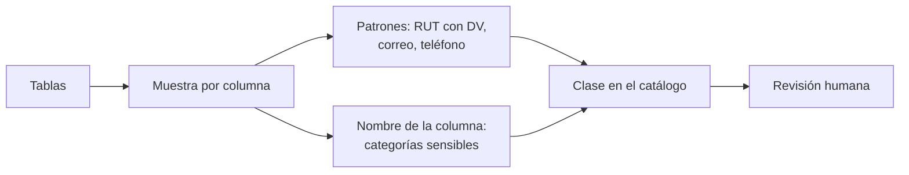

## 1. Resumen

Esta ficha no es asesoría legal: cubre la parte técnica de identificar datos personales y sensibles.

Ningún control sirve si no se sabe **dónde** están los datos personales. La ley define dato personal (cualquier información vinculada a una persona identificada o identificable, también de forma indirecta) y enumera los datos **sensibles**, entre ellos la situación socioeconómica y los datos de salud. Identificarlos en una plataforma combina:

- **patrones** sobre los valores: RUT con dígito verificador, correo, teléfono;
- **el nombre y el contexto** de la columna: `diagnostico`, `tramo_ingreso`;
- **revisión humana**, porque la detección automática tiene falsos negativos.

## 2. Qué es

- **[Obligación legal · art. 2]** Dato personal es información vinculada a una persona natural identificada o identificable; para decidir si es identificable se consideran los medios que razonablemente se podrían usar, así que una combinación de columnas también puede serlo.
- **[Obligación legal · art. 2]** Los datos sensibles son una lista cerrada: origen étnico o racial, afiliación política, sindical o gremial, situación socioeconómica, convicciones, creencias religiosas, salud, perfil biológico, biometría, vida sexual, orientación sexual e identidad de género.
- **[Obligación legal · art. 16]** Los datos sensibles tienen una regla propia: consentimiento expreso del titular, salvo los casos que la ley enumera.
- **[Buena práctica]** El RUT tiene un dígito verificador (módulo 11) que permite separar un RUT válido de un número cualquiera.

## 3. Problema que resuelve

**[Buena práctica]** Una tabla `clientes` tiene columnas obvias (`rut`, `email`) y otras que no lo parecen: `tramo_ingreso` revela situación socioeconómica, que la ley trata como sensible. Sin una clasificación por columna, esa tabla se copia completa a la capa de análisis.

## 4. Cómo funciona

1. **[Buena práctica]** Tomar una muestra de cada columna.
2. **[Buena práctica]** Aplicar patrones: RUT con dígito verificador válido, correo, teléfono; marcar la columna si calza al menos el 60 % de la muestra.
3. **[Obligación legal · art. 2]** Marcar como sensibles las columnas cuyo nombre o contenido corresponde a una categoría de la lista de la ley.
4. **[Decisión de arquitectura]** Guardar la clase (sensible, personal, sin datos personales detectados) en el catálogo, para que los demás controles la lean.
5. **[Buena práctica]** Revisar a mano lo que la heurística no ve: formatos raros, texto libre, combinaciones de columnas.

## 5. Cuándo utilizarlo

- Al ingerir una fuente nueva y antes de copiar una tabla a otra capa.
- En un escaneo periódico, para encontrar datos personales donde no deberían estar.

## 6. Cuándo no utilizarlo

- Como única prueba: un patrón no reconoce una combinación de columnas que identifica.
- Para decidir la base de licitud de un dato sensible: eso lo decide el área legal.

## 7. Ejemplo sencillo

| Columna | Resultado |
|---|---|
| `rut_cliente` | personal (RUT con DV válido 100 %) |
| `contacto` | personal (correo 75 %) |
| `diagnostico_principal` | sensible (salud) |
| `tramo_ingreso` | sensible (situación socioeconómica) |
| `rut_sin_guion` | no detectado: falso negativo |
| `rut_dv_cambiado` | no detectado: el DV no es válido |

## 8. Ejemplo de producción

- Escaneo al ingerir y semanal sobre todas las capas.
- Detectores de la nube para el volumen y un detector propio para formatos locales.
- Resultado en el catálogo como etiqueta de columna, con revisión del dueño del dato.

### Evidencia de cumplimiento

| Evidencia | Dónde queda | Quién la produce |
|---|---|---|
| Clase por columna (sensible, personal, sin datos personales) | Catálogo | Escaneo y dueño del dato |
| Informe del último escaneo | Log del job | Pipeline de clasificación |
| Revisiones manuales de falsos negativos | Catálogo, con fecha | Dueño del dato |

## 9. Arquitectura



## 10. Código

```python
# Python 3.12, biblioteca estándar (ejecutado en la CI): clasificación de columnas en datos personales y sensibles.
# RUT con dígito verificador (módulo 11), correo y teléfono por patrón; categorías sensibles por el nombre de la
# columna. Es una heurística: muestra sus falsos negativos y no reemplaza la revisión humana.
import re

UMBRAL = 0.6  # proporción de valores que deben calzar


def dv(numero: int) -> str:
    """Dígito verificador del RUT: módulo 11 con factores 2 a 7."""
    suma, factor = 0, 2
    for digito in reversed(str(numero)):
        suma += int(digito) * factor
        factor = 2 if factor == 7 else factor + 1
    resto = 11 - suma % 11
    return {11: "0", 10: "K"}.get(resto, str(resto))


def rut(numero: int) -> str:
    return f"{numero:,}".replace(",", ".") + "-" + dv(numero)


def rut_valido(valor: str) -> bool:
    limpio = valor.replace(".", "").upper()
    m = re.fullmatch(r"(\d{7,8})-([\dK])", limpio)
    return m is not None and dv(int(m.group(1))) == m.group(2)


PATRONES = {
    "RUT con DV válido": rut_valido,
    "correo": lambda v: re.fullmatch(r"[^@\s]+@[^@\s]+\.[a-z]{2,}", v, re.I) is not None,
    "teléfono": lambda v: re.fullmatch(r"\+?56 ?9 ?\d{4} ?\d{4}", v) is not None,
}
SENSIBLES = {  # palabra en el nombre de la columna -> categoría del art. 2 g)
    "salud": "datos relativos a la salud", "diagnostico": "datos relativos a la salud",
    "ingreso": "situación socioeconómica", "deuda": "situación socioeconómica",
    "religion": "creencias religiosas", "huella": "datos biométricos",
}

# Valores ficticios: RUT de dígitos repetidos, correos en dominios reservados y teléfonos de prueba.
MUESTRA = {
    "rut_cliente": [rut(11_111_111), rut(22_222_222), rut(33_333_333)],
    "contacto": ["ana@example.com", "luis@example.org", "sin correo", "bea@example.net"],
    "fono": ["+56 9 1234 5678", "+56912345678", "sin fono"],
    "diagnostico_principal": ["J45", "E11", "I10"],
    "tramo_ingreso": ["A", "B", "C"],
    "rut_sin_guion": [rut(11_111_111).replace(".", "").replace("-", "")],
    "rut_dv_cambiado": [rut(44_444_444)[:-1] + ("0" if dv(44_444_444) != "0" else "1")],
    "comuna": ["Ñuñoa", "Maipú", "Temuco"],
}

for columna, valores in MUESTRA.items():
    sensible = next((cat for clave, cat in SENSIBLES.items() if clave in columna), None)
    tipos = [f"{t} {sum(map(f, valores)) / len(valores):.0%}" for t, f in PATRONES.items()
             if sum(map(f, valores)) / len(valores) >= UMBRAL]
    clase = "sensible" if sensible else "personal" if tipos else "sin datos personales detectados"
    print(f"{columna}: {clase} ({sensible or ', '.join(tipos) or 'nada calza'})")
```

El script se **ejecuta en la CI** con la biblioteca estándar y pasa `mypy --strict`. Los RUT de la muestra son ficticios (dígitos repetidos) y su dígito verificador se calcula con módulo 11. Imprime `rut_cliente` como personal, `diagnostico_principal` y `tramo_ingreso` como sensibles, y los falsos negativos: `rut_sin_guion` y `rut_dv_cambiado`.

## 11. GCP

En GCP, **Sensitive Data Protection**. Según *Ley 19628 SOBRE PROTECCION DE LOS DATOS PERSONALES*, *InfoType detector reference* e *InfoTypes and infoType detectors* (no ejecutado):

| | Detector propio (este ejemplo) | Sensitive Data Protection | Etiqueta |
|---|---|---|---|
| Identificador chileno | RUT con DV módulo 11 | `CHILE_CDI_NUMBER` (Cédula de Identidad), en las categorías GOVERNMENT_ID, PII y SPII | **[Buena práctica]** |
| Datos sensibles | Por nombre de columna | infoTypes incorporados y personalizados | **[Buena práctica]** |

## 12. AWS

En AWS, **Amazon Macie**. Según *Ley 19628 SOBRE PROTECCION DE LOS DATOS PERSONALES* y *Quick reference: Managed data identifiers by type* (no ejecutado):

| | Detector propio (este ejemplo) | Amazon Macie | Etiqueta |
|---|---|---|---|
| Identificador chileno | RUT con DV módulo 11 | `CHILE_RUT_NUMBER`, como identificador nacional y tributario | **[Buena práctica]** |
| Alcance | Una muestra en memoria | Objetos de Amazon S3 | **[Buena práctica]** |

## 13. Azure

En Azure, **Microsoft Purview**. Según *Ley 19628 SOBRE PROTECCION DE LOS DATOS PERSONALES* y *Chile identity card number* (no ejecutado):

| | Detector propio (este ejemplo) | Purview | Etiqueta |
|---|---|---|---|
| Patrón | Siete u ocho dígitos, guion y DV | Siete a ocho dígitos con delimitadores opcionales y dígito o letra verificador | **[Buena práctica]** |
| Confianza | Proporción de la muestra | Alta con patrón, palabra clave cercana y checksum; media sin la palabra clave | **[Buena práctica]** |

## 14. Buenas prácticas

- **[Buena práctica]** Validar el dígito verificador: reduce los falsos positivos de un número cualquiera de 8 dígitos.
- **[Obligación legal · art. 2]** Usar la lista de sensibles de la ley, no una propia: incluye la situación socioeconómica.
- **[Buena práctica]** **Seguridad:** la muestra del escaneo también tiene datos personales; se procesa con los mismos controles.
- **[Buena práctica]** **Observabilidad:** alertar cuando aparece una columna personal nueva en una capa que no debería tenerla.
- **[Buena práctica]** **Costo:** escanear muestras y no tablas completas; el volumen inspeccionado crece con cada capa y cada copia.

## 15. Errores frecuentes

- Buscar solo `rut` y `email` y no ver `tramo_ingreso`.
- Confiar en que un RUT siempre viene con puntos y guion.
- Clasificar una vez y no volver a escanear.

## 16. Trade-offs

Un umbral bajo encuentra más columnas y genera más falsos positivos que revisar; uno alto pasa por alto columnas mezcladas. El detector propio entiende formatos locales; el de la nube escala y cubre más tipos.

## 17. Conceptos relacionados

- `data-classification`: clasificación general.
- `data-masking`: qué hacer con lo detectado al mostrarlo.
- `chile-data-protection`: el panorama.
- `data-minimization-by-layer`: qué columnas pasan de capa.

## 18. Preguntas técnicas abiertas

1. ¿Qué columnas tuyas revelan situación socioeconómica sin decirlo en el nombre?
2. ¿Tus detectores validan el dígito verificador del RUT?
3. ¿Cuándo escaneaste por última vez tus capas de análisis?

## 19. Laboratorio relacionado

Pendiente (F4).

## 20. Fuentes

- BCN Ley Chile: *Ley 19628 SOBRE PROTECCION DE LOS DATOS PERSONALES* (versión con vigencia diferida desde 2026-12-01).
- Google Cloud: *InfoType detector reference* e *InfoTypes and infoType detectors*.
- AWS: *Quick reference: Managed data identifiers by type*.
- Microsoft Learn: *Chile identity card number*.

El detalle de cada fuente está en `sources` del frontmatter.

## 21. Fecha de última verificación

2026-10-21: texto legal consultado ese día en BCN. `review_required`: pendiente de revisión B-F3.1 del lote F3b-19a; pasa a `verified` solo con la aprobación explícita de Felipe (`owner_approved_at`). Revisión mensual.

## 22. Historial de cambios importantes

- 2026-10-21: creación (lote F3b-19a).
