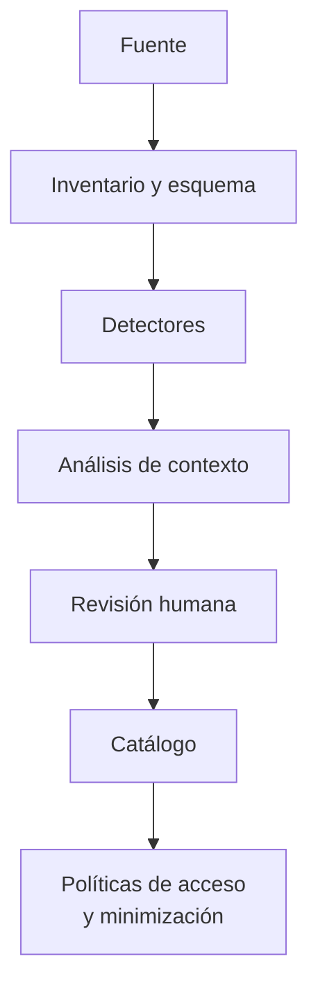

## 1. Resumen

Esta ficha no es asesoría legal: cubre la parte técnica de identificar datos personales y sensibles. Seudonimización, minimización, derechos e incidentes van en sus fichas hijas.

**Identificar** es determinar qué información permite reconocer a una persona, por sí sola o combinada con otros datos. **Clasificar** es registrar esa conclusión con contexto y evidencia. No basta buscar RUT y correos: identificadores internos, texto libre y combinaciones de atributos también pueden identificar.

**Resultado esperado:** un catálogo que diga qué activos tienen datos personales o sensibles, con qué fundamento se clasificaron, quién revisó los casos dudosos y cuándo se actualizó el análisis.

## 2. Qué es

- **[Obligación legal · art. 2]** Dato personal es información vinculada o referida a una persona natural identificada o identificable; es identificable quien puede determinarse directa o indirectamente, y se consideran los medios y factores que razonablemente se podrían usar para identificarla.
- **[Obligación legal · art. 2]** El art. 2 g) dice, tal cual: «Datos personales sensibles: tendrán esta condición aquellos datos personales que se refieren a las características físicas o morales de las personas o a hechos o circunstancias de su vida privada o intimidad, que revelen el origen étnico o racial, la afiliación política, sindical o gremial, la situación socioeconómica, las convicciones ideológicas o filosóficas, las creencias religiosas, los datos relativos a la salud, al perfil biológico humano, los datos biométricos, y la información relativa a la vida sexual, a la orientación sexual y a la identidad de género de una persona natural.»
- **[Obligación legal · art. 16]** Los datos sensibles tienen una regla propia: consentimiento expreso del titular, salvo los casos que la ley enumera.
- **[Buena práctica]** **Identificador directo:** RUT, correo personal, nombre junto a otros datos. **Identificador indirecto:** un código de cliente, una ubicación o una combinación de edad, comuna y otros atributos, cuando permiten identificar razonablemente a alguien.
- **[Buena práctica]** Un dato seudonimizado sigue siendo personal si se puede reidentificar al titular con información adicional (`chilean-identifier-pseudonymization`).
- **[Decisión de arquitectura]** **Distinción crítica:** una etiqueta técnica de riesgo (por ejemplo `HIGH`) no equivale a la categoría jurídica «dato sensible»; el catálogo guarda las dos por separado.

## 3. Problema que resuelve

**[Buena práctica]** Una ingesta trae `cliente_id`, `correo`, `tramo_ingreso`, `comuna` y `comentarios`. Un detector solo de expresiones regulares encuentra el correo, pero no ve que `tramo_ingreso` revela situación socioeconómica (sensible según el art. 2 g)), que `comentarios` trae texto libre sobre la salud de un cliente y que `cliente_id` se enlaza con la tabla que identifica a la persona.

**[Buena práctica]** **Riesgo:** publicar una tabla analítica o compartirla con un proveedor creyendo que no contiene datos personales.

## 4. Cómo funciona

1. **[Buena práctica]** **Inventariar:** fuentes, tablas, vistas, archivos, eventos, logs y exportaciones, con su esquema y su responsable.
2. **[Buena práctica]** **Detectar candidatos:** patrones sobre los valores, nombres de columna, diccionarios, detectores de la nube y conocimiento del dominio.
3. **[Buena práctica]** **Evaluar el contexto:** enlaces con otras tablas, texto libre, campos codificados y posibilidad razonable de identificación.
4. **[Decisión de arquitectura]** **Clasificar y revisar:** categoría (personal, sensible) y confianza; lo ambiguo va al dueño del dato y a privacidad.
5. **[Decisión de arquitectura]** **Registrar:** etiqueta, fundamento, método, fecha, revisor y versión del esquema en el catálogo.
6. **[Buena práctica]** **Mantener:** reanalizar ante cambios de esquema, fuentes nuevas, transformaciones y revisiones periódicas según el riesgo.

**[Buena práctica]** No hay un umbral universal (por ejemplo, «el 60 % de la muestra»): un solo valor sensible en mil filas puede importar. Cuántos valores calzan sirve para priorizar la revisión, no para decidir que la columna no tiene datos personales.

## 5. Cuándo utilizarlo

- Antes de incorporar una fuente o de habilitar un consumidor nuevo.
- Cuando cambia un esquema o una finalidad.
- En migraciones, copias a ambientes de desarrollo e integraciones con APIs.
- En el escaneo periódico de las capas, para encontrar datos personales donde no deberían estar.

## 6. Cuándo no utilizarlo

- Como certificación de que no hay datos personales: «sin hallazgos» no significa anónimo.
- Para decidir la base de licitud de un dato sensible: eso lo decide el área legal.
- Como única prueba: un patrón no reconoce una combinación de columnas que identifica.

## 7. Ejemplo sencillo

| Columna | Clasificación preliminar | Motivo o precaución |
|---|---|---|
| `cliente_id` | Personal si es vinculable | Una clave interna se enlaza con la persona en otra tabla |
| `diagnostico` | Sensible | Datos relativos a la salud (art. 2 g)) |
| `tramo_ingreso` | Sensible si se asocia a un titular | Situación socioeconómica (art. 2 g)); confirmar qué significa |
| `comuna` | Depende del contexto | Sola no identifica; combinada puede reidentificar |
| `comentarios` | Revisión necesaria | El texto libre puede traer datos personales o sensibles |
| `rut_malformado` | No descartar | Un DV inválido no elimina el carácter personal: puede ser un error de captura |

## 8. Ejemplo de producción

Escenario genérico: un pipeline de reservas y CRM alimenta un warehouse por capas.

- **Ingesta y bronze:** registrar el esquema, detectar identificadores y restringir el acceso mientras se revisan los campos nuevos.
- **Silver:** enriquecer el catálogo con las relaciones entre tablas; detectar identificadores indirectos y campos sensibles aunque vengan codificados.
- **Gold:** cada vista expone solo lo necesario; agregar no garantiza anonimato (`data-minimization-by-layer`).
- **Operación:** si aparece `observacion_medica` en una fuente, alerta y revisión antes de habilitar consumos.

### Evidencia de cumplimiento

| Evidencia | Dónde queda | Quién la produce |
|---|---|---|
| Inventario de activos con esquema y responsable | Catálogo | Ingeniería de datos |
| Hallazgos del detector, sin valores personales | Log del job | Pipeline de clasificación |
| Decisión de clasificación con fundamento, revisor y fecha | Catálogo | Dueño del dato y privacidad |
| Resultado de la puerta de habilitación (0 o 1) y las columnas que la bloquean | Log del job o de la CI | Pipeline de clasificación |
| Registro de cambios de esquema y reclasificaciones | Catálogo, versionado | Pipeline y dueño del dato |

## 9. Arquitectura



La clasificación alimenta los controles, pero no los implementa: hace falta una integración explícita con permisos, contratos de datos y monitoreo (`privacy-controls-as-code`).

## 10. Código

```python
# Python 3.12+, biblioteca estándar. De punta a punta: muestra de columnas → detección en cuatro frentes →
# clasificación → registro en el catálogo → puerta de habilitación → código de salida (0 habilita, 1 bloquea).
# Uso: python detector.py muestra | revisado | fuente-nueva. Didáctico: produce candidatos para revisión humana, no
# declara que una columna sea legalmente sensible. El reporte nunca imprime valores, solo columna, método y conteos.
import re
import sys
import unicodedata
from dataclasses import dataclass, replace
from datetime import date
from typing import Literal

# @paso 1 Reglas
Categoria = Literal["personal", "sensible", "revisión"]
EstadoRut = Literal["valido", "dv_invalido", "no_rut"]
REFERENCIA = date(2026, 11, 3)   # fecha fija: resultado reproducible
CAPA = "silver.clientes"         # la capa que se va a habilitar para consumo
PERSONAL = "art. 2 f)"           # dato personal: persona identificada o identificable
SALUD, SOCIOECONOMICA = "datos relativos a la salud", "situación socioeconómica"
REGLAS_NOMBRE: list[tuple[frozenset[str], str]] = [   # tokens que deben estar todos en el nombre -> categoría art. 2 g)
    (frozenset({"diagnostico"}), SALUD), (frozenset({"medica"}), SALUD), (frozenset({"salud"}), SALUD),
    (frozenset({"tramo", "ingreso"}), SOCIOECONOMICA), (frozenset({"ingresos"}), SOCIOECONOMICA),
    (frozenset({"renta"}), SOCIOECONOMICA), (frozenset({"sueldo"}), SOCIOECONOMICA),
    (frozenset({"religion"}), "creencias religiosas"), (frozenset({"huella"}), "datos biométricos"),
]
TERMINOS = {SALUD: ("diagnóstico", "licencia médica")}   # diccionario mínimo por categoría del art. 2 g)
CUASI_IDENTIFICADORES = ("comuna", "edad")


def dv(cuerpo: str) -> str:
    """Dígito verificador del RUT: módulo 11 con factores 2 a 7."""
    suma = sum(int(d) * f for d, f in zip(reversed(cuerpo), [2, 3, 4, 5, 6, 7] * 2))
    resto = 11 - suma % 11
    return {11: "0", 10: "K"}.get(resto, str(resto))


RUT = re.compile(r"(\d{1,2})\.?(\d{3})\.?(\d{3})-?([\dK])")   # 11.111.111-1 o 111111111; una fecha no calza


def clasificar_rut(valor: str) -> EstadoRut:
    m = RUT.fullmatch(valor.strip().upper())
    if m is None:
        return "no_rut"
    if dv("".join(m.groups()[:3])) == m.group(4):
        return "valido"
    return "dv_invalido"


def ficticio(numero: int) -> str:
    """RUT ficticio de dígitos repetidos, con su DV calculado (no usar RUT reales en ejemplos)."""
    return f"{numero:,}".replace(",", ".") + "-" + dv(str(numero))


def con_dv_alterado(rut: str) -> str:
    """El mismo RUT con otro dígito verificador: forma de RUT, DV inválido."""
    otro = "1" if rut[-1] != "1" else "2"
    return rut[:-1] + otro


def es_correo(valor: str) -> bool:
    return re.search(r"[^@\s]+@[^@\s]+\.[a-z]{2,}", valor, re.I) is not None   # también dentro de texto libre


def sin_tildes(texto: str) -> str:
    return unicodedata.normalize("NFKD", texto).encode("ascii", "ignore").decode().lower()


# @paso 2 Detección
@dataclass(frozen=True)
class Hallazgo:
    columna: str
    categoria: Categoria
    fundamento: str
    metodo: str


def identificadores_directos(columna: str, valores: list[str]) -> list[Hallazgo]:
    """RUT (válido o con DV inválido) y correo, también dentro del texto libre."""
    hallazgos = []
    estados = [clasificar_rut(v) for v in valores]
    if validos := estados.count("valido"):
        hallazgos.append(Hallazgo(columna, "personal", PERSONAL, f"RUT con DV válido ({validos} de {len(valores)})"))
    if invalidos := estados.count("dv_invalido"):
        hallazgos.append(Hallazgo(columna, "revisión", PERSONAL,
                                  f"forma de RUT con DV inválido ({invalidos} de {len(valores)})"))
    if correos := sum(map(es_correo, valores)):
        hallazgos.append(Hallazgo(columna, "personal", PERSONAL, f"correo en el valor ({correos} de {len(valores)})"))
    return hallazgos


def sensibles_por_nombre(columna: str) -> list[Hallazgo]:
    """Compara por token (split por «_»): fecha_ingreso no es socioeconómica; tramo_ingreso sí."""
    tokens = set(sin_tildes(columna).split("_"))
    return [Hallazgo(columna, "sensible", f"art. 2 g), {categoria}", f"nombre de columna ({', '.join(sorted(regla))})")
            for regla, categoria in REGLAS_NOMBRE if regla <= tokens]


def sensibles_en_contenido(columna: str, valores: list[str]) -> list[Hallazgo]:
    """Términos del diccionario mínimo por categoría, buscados en el texto libre."""
    hallazgos = []
    for categoria, terminos in TERMINOS.items():
        calzan = sum(1 for v in valores if any(sin_tildes(t) in sin_tildes(v) for t in terminos))
        if calzan:
            hallazgos.append(Hallazgo(columna, "sensible", f"art. 2 g), {categoria}",
                                      f"términos en el texto ({calzan} de {len(valores)})"))
    return hallazgos


def identificacion_indirecta(muestra: dict[str, list[str]]) -> list[Hallazgo]:
    """Combinaciones únicas de cuasi-identificadores: una fila única puede identificar a alguien (art. 2 f)."""
    if not all(c in muestra for c in CUASI_IDENTIFICADORES):
        return []
    filas = list(zip(*(muestra[c] for c in CUASI_IDENTIFICADORES)))
    unicas = sum(1 for f in filas if filas.count(f) == 1)
    if not unicas:
        return []
    return [Hallazgo(" + ".join(CUASI_IDENTIFICADORES), "revisión", PERSONAL,
                     f"combinación única en {unicas} de {len(filas)} filas")]


def detectar(muestra: dict[str, list[str]]) -> list[Hallazgo]:
    hallazgos = []
    for columna, valores in muestra.items():
        hallazgos += identificadores_directos(columna, valores)
        hallazgos += sensibles_por_nombre(columna)
        hallazgos += sensibles_en_contenido(columna, valores)
    return hallazgos + identificacion_indirecta(muestra)


# @paso 3 Catálogo
@dataclass(frozen=True)
class Entrada:
    columna: str
    categoria: Categoria
    fundamento: str
    metodo: str
    fecha: date = REFERENCIA
    revisor: str = "pendiente"


def registrar(hallazgos: list[Hallazgo], revisados: dict[tuple[str, str], str]) -> list[Entrada]:
    """Una entrada por hallazgo; conserva el revisor de lo que ya se revisó (misma columna y método)."""
    catalogo = []
    for h in hallazgos:
        entrada = Entrada(h.columna, h.categoria, h.fundamento, h.metodo)
        if revisor := revisados.get((h.columna, h.metodo)):
            entrada = replace(entrada, revisor=revisor)
        catalogo.append(entrada)
    return catalogo


# @paso 4 Puerta y reporte
def puerta(catalogo: list[Entrada]) -> list[str]:
    """Bloquea la capa si un candidato sensible o de revisión no tiene revisor."""
    pendientes = [f"{e.columna} ({e.categoria})" for e in catalogo
                  if e.categoria != "personal" and e.revisor == "pendiente"]
    return list(dict.fromkeys(pendientes))   # una vez por columna y categoría


def etiqueta(e: Entrada) -> str:
    if e.categoria == "revisión":
        return "revisión personal"
    return e.categoria


MUESTRA = {   # cuatro filas ficticias: RUT de dígitos repetidos y correos en example.test
    "rut_cliente": [ficticio(11_111_111), ficticio(22_222_222).replace(".", "").replace("-", ""),
                    con_dv_alterado(ficticio(33_333_333)), "sin dato"],
    "contacto": ["ana@example.test", "sin correo", "bruno@example.test", ""],
    "comentarios": ["Cliente pide cambio de fecha", "Avisar a luis@example.test", "Presenta licencia médica", ""],
    "diagnostico": ["J45", "E11", "", "J45"],
    "tramo_ingreso": ["A", "B", "A", "C"],
    "fecha_ingreso": ["2026-01-10", "2026-03-02", "2026-03-02", "2026-05-20"],
    "comuna": ["Ñuñoa", "Ñuñoa", "Maipú", "Ñuñoa"],
    "edad": ["34", "34", "51", "29"],
    "producto": ["Notebook", "Monitor", "Notebook", "Teclado"],
}
NUEVA = {"observacion_medica": ["Control por licencia médica", "", "Diagnóstico pendiente", ""]}


def main(escenario: str) -> int:
    revisados = {(h.columna, h.metodo): "equipo-privacidad" for h in detectar(MUESTRA)}
    muestras = {"muestra": (MUESTRA, {}), "revisado": (MUESTRA, revisados),
                "fuente-nueva": ({**MUESTRA, **NUEVA}, revisados)}
    muestra, previos = muestras[escenario]
    catalogo = registrar(detectar(muestra), previos)
    print(f"catálogo de {CAPA} · {len(next(iter(muestra.values())))} filas · referencia {REFERENCIA}")
    for e in catalogo:
        print(f"  {e.columna}: {etiqueta(e)}: {e.metodo} · {e.fundamento} · revisor: {e.revisor}")
    cubiertas = {c for e in catalogo for c in e.columna.split(" + ")}
    print(f"sin hallazgos (no significa anónimo): {[c for c in muestra if c not in cubiertas]}")
    bloqueos = puerta(catalogo)
    if bloqueos:
        print(f"puerta de {CAPA}: bloqueada (1), sin revisor: {', '.join(bloqueos)}")
        return 1
    print(f"puerta de {CAPA}: habilitada (0)")
    return 0


if __name__ == "__main__":
    sys.exit(main(sys.argv[1] if len(sys.argv) > 1 else "muestra"))
```

El script se **ejecuta en la CI** con la biblioteca estándar y pasa `mypy --strict`. Recorre cuatro pasos: las reglas, la detección en cuatro frentes (una función por frente), el registro en el catálogo y la puerta que decide si la capa se habilita. Los RUT son ficticios, de dígitos repetidos y con el DV calculado por módulo 11; `con_dv_alterado()` arma el RUT malformado; los correos usan `example.test`. El reporte nunca imprime valores.

En la muestra, la detección encuentra:

- **Identificadores directos:** RUT válidos y uno con DV inválido en `rut_cliente` (este queda en revisión), y correos en `contacto` y dentro del texto libre de `comentarios`.
- **Sensibles por nombre de columna:** `diagnostico` (salud) y `tramo_ingreso` (situación socioeconómica). La comparación es por token, y una regla puede pedir varios tokens juntos: `tramo_ingreso` calza con `tramo` e `ingreso`; `fecha_ingreso` no.
- **Sensibles en el contenido:** el término «licencia médica» en `comentarios`, con el diccionario mínimo de salud.
- **Identificación indirecta:** `comuna` + `edad` forman una combinación única en 2 de 4 filas.

Cada hallazgo es una entrada de catálogo con categoría, método, fundamento, fecha de referencia y revisor «pendiente». La puerta bloquea `silver.clientes` mientras haya un candidato sensible o de revisión sin revisor, y dice cuál. Termina con código 1:

```text
$ python detector.py muestra
catálogo de silver.clientes · 4 filas · referencia 2026-11-03
  rut_cliente: personal: RUT con DV válido (2 de 4) · art. 2 f) · revisor: pendiente
  rut_cliente: revisión personal: forma de RUT con DV inválido (1 de 4) · art. 2 f) · revisor: pendiente
  contacto: personal: correo en el valor (2 de 4) · art. 2 f) · revisor: pendiente
  comentarios: personal: correo en el valor (1 de 4) · art. 2 f) · revisor: pendiente
  comentarios: sensible: términos en el texto (1 de 4) · art. 2 g), datos relativos a la salud · revisor: pendiente
  diagnostico: sensible: nombre de columna (diagnostico) · art. 2 g), datos relativos a la salud · revisor: pendiente
  tramo_ingreso: sensible: nombre de columna (ingreso, tramo) · art. 2 g), situación socioeconómica · revisor: pendiente
  comuna + edad: revisión personal: combinación única en 2 de 4 filas · art. 2 f) · revisor: pendiente
sin hallazgos (no significa anónimo): ['fecha_ingreso', 'producto']
puerta de silver.clientes: bloqueada (1), sin revisor: rut_cliente (revisión), comentarios (sensible), diagnostico (sensible), tramo_ingreso (sensible), comuna + edad (revisión)
```

Con las mismas columnas revisadas, la puerta habilita la capa. Termina con código 0:

```text
$ python detector.py revisado
catálogo de silver.clientes · 4 filas · referencia 2026-11-03
  rut_cliente: personal: RUT con DV válido (2 de 4) · art. 2 f) · revisor: equipo-privacidad
  rut_cliente: revisión personal: forma de RUT con DV inválido (1 de 4) · art. 2 f) · revisor: equipo-privacidad
  contacto: personal: correo en el valor (2 de 4) · art. 2 f) · revisor: equipo-privacidad
  comentarios: personal: correo en el valor (1 de 4) · art. 2 f) · revisor: equipo-privacidad
  comentarios: sensible: términos en el texto (1 de 4) · art. 2 g), datos relativos a la salud · revisor: equipo-privacidad
  diagnostico: sensible: nombre de columna (diagnostico) · art. 2 g), datos relativos a la salud · revisor: equipo-privacidad
  tramo_ingreso: sensible: nombre de columna (ingreso, tramo) · art. 2 g), situación socioeconómica · revisor: equipo-privacidad
  comuna + edad: revisión personal: combinación única en 2 de 4 filas · art. 2 f) · revisor: equipo-privacidad
sin hallazgos (no significa anónimo): ['fecha_ingreso', 'producto']
puerta de silver.clientes: habilitada (0)
```

Si la fuente trae una columna nueva, `observacion_medica`, aparece como sensible por su nombre y por su contenido, sin revisor. La puerta vuelve a bloquear, como pide la operación del §8, aunque el resto ya esté revisado:

```text
$ python detector.py fuente-nueva
catálogo de silver.clientes · 4 filas · referencia 2026-11-03
  rut_cliente: personal: RUT con DV válido (2 de 4) · art. 2 f) · revisor: equipo-privacidad
  rut_cliente: revisión personal: forma de RUT con DV inválido (1 de 4) · art. 2 f) · revisor: equipo-privacidad
  contacto: personal: correo en el valor (2 de 4) · art. 2 f) · revisor: equipo-privacidad
  comentarios: personal: correo en el valor (1 de 4) · art. 2 f) · revisor: equipo-privacidad
  comentarios: sensible: términos en el texto (1 de 4) · art. 2 g), datos relativos a la salud · revisor: equipo-privacidad
  diagnostico: sensible: nombre de columna (diagnostico) · art. 2 g), datos relativos a la salud · revisor: equipo-privacidad
  tramo_ingreso: sensible: nombre de columna (ingreso, tramo) · art. 2 g), situación socioeconómica · revisor: equipo-privacidad
  observacion_medica: sensible: nombre de columna (medica) · art. 2 g), datos relativos a la salud · revisor: pendiente
  observacion_medica: sensible: términos en el texto (2 de 4) · art. 2 g), datos relativos a la salud · revisor: pendiente
  comuna + edad: revisión personal: combinación única en 2 de 4 filas · art. 2 f) · revisor: equipo-privacidad
sin hallazgos (no significa anónimo): ['fecha_ingreso', 'producto']
puerta de silver.clientes: bloqueada (1), sin revisor: observacion_medica (sensible)
```

Limitaciones:

- **RUT:** valida la forma y el DV, no que exista ni a quién pertenece. Un DV inválido no descarta el dato: queda en revisión.
- **Correo:** reconoce el formato, no que la dirección exista.
- **Sensibles:** el nombre de columna y un diccionario mínimo dan candidatos. Un término ausente del diccionario no se detecta, y la clasificación jurídica exige revisar contenido y contexto.
- **Identificación indirecta:** solo prueba la combinación declarada (`comuna` + `edad`) en la muestra. No busca otras combinaciones ni relaciones entre tablas, y en una muestra chica casi toda combinación parece única.
- **Identificadores internos:** un `cliente_id` vinculable no se detecta aquí; se clasifica en el catálogo por conocimiento del dominio.
- **Logs:** el reporte no imprime valores; en producción, muestras minimizadas o sintéticas.

## 11. GCP

En GCP, **Sensitive Data Protection**. Según *InfoType detector reference*, consultada el 2026-10-27, e *InfoTypes and infoType detectors* (no ejecutado):

|  | Detector propio (este ejemplo) | Sensitive Data Protection |
|---|---|---|
| Identificador chileno | RUT con DV módulo 11 | `CHILE_CDI_NUMBER` (Cédula de Identidad), en las categorías GOVERNMENT_ID, PII y SPII |
| Otros datos | Por nombre de columna | infoTypes incorporados y personalizados, con probabilidad ajustable |

## 12. AWS

En AWS, **Amazon Macie**. Según *Quick reference: Managed data identifiers by type*, consultada el 2026-10-27 (no ejecutado):

|  | Detector propio (este ejemplo) | Amazon Macie |
|---|---|---|
| Identificador chileno | RUT con DV módulo 11 | `CHILE_RUT_NUMBER`, en número nacional de identificación y de identificación tributaria, con Chile entre los países |
| Alcance | Una muestra en memoria | Objetos de Amazon S3 |

## 13. Azure

En Azure, **Microsoft Purview**. Según *Chile identity card number*, consultada el 2026-10-27 (no ejecutado):

|  | Detector propio (este ejemplo) | Purview |
|---|---|---|
| Patrón | Siete u ocho dígitos y DV, con o sin puntos y guion | Siete a ocho dígitos con delimitadores opcionales y un dígito o letra verificador; checksum |
| Confianza | Conteo para priorizar | Alta con patrón, palabra clave a 300 caracteres o menos y checksum; media sin la palabra clave |

**Criterio de selección:** cobertura real de las fuentes, formatos locales, falsos negativos medidos, permisos y si los resultados llegan al catálogo. Ningún servicio sustituye la revisión de contexto.

## 14. Buenas prácticas

- **[Buena práctica]** Priorizar activos con datos de clientes, trabajadores o pacientes y con texto libre.
- **[Buena práctica]** Probar formatos locales y datos malformados, no solo coincidencias perfectas.
- **[Buena práctica]** Usar la lista de sensibles del art. 2 g) tal cual: incluye la situación socioeconómica.
- **[Buena práctica]** Registrar «no detectado» como resultado técnico, no como certificación de anonimato.
- **[Decisión de arquitectura]** Conectar la clasificación con controles por finalidad y mínimo privilegio.
- **[Buena práctica]** **Seguridad:** muestras, resultados del escaneo y reportes también son potencialmente personales.
- **[Buena práctica]** **Observabilidad:** alertar cuando aparece una columna personal nueva en una capa que no debería tenerla.
- **[Buena práctica]** **Costo:** escaneo selectivo por riesgo y completo donde importa; el volumen crece con cada capa y copia.

## 15. Errores frecuentes

- Clasificar solo por el nombre de la columna.
- Comparar nombres por substring: «ingreso» calza en `fecha_ingreso` y «renta» en `rentabilidad_producto`, que no son datos socioeconómicos de una persona. Se compara por token (split por «_») y con reglas de varios tokens, como `tramo` + `ingreso`.
- Tratar `cliente_id` o un hash como no personal sin analizar la reidentificación.
- Equiparar cualquier dato financiero con sensible sin revisar qué revela; ojo: la situación socioeconómica sí es sensible según el art. 2 g).
- Creer que un DV inválido elimina el carácter personal del dato.
- Usar un umbral de coincidencias para descartar columnas.
- No revisar columnas nuevas ni texto libre; clasificar una vez y no volver a escanear.

## 16. Trade-offs

- **Cobertura frente a costo:** muestrear reduce volumen y puede omitir casos raros; combinar escaneo selectivo y completo según el riesgo.
- **Precisión frente a sensibilidad:** reglas estrictas reducen alertas y aumentan omisiones; ajustar por categoría y contexto.
- **Automatización frente a revisión:** los detectores escalan; las personas resuelven lo ambiguo y mantienen las reglas.
- **Detector propio frente a la nube:** el propio entiende formatos locales; el de la nube escala y cubre más tipos.

## 17. Conceptos relacionados

- `chile-data-protection`: ficha padre.
- `data-classification`: la clasificación general.
- `data-masking`: qué hacer con lo detectado al mostrarlo.
- `data-minimization-by-layer`: qué columnas pasan de capa.
- `chilean-identifier-pseudonymization`: el RUT detectado.
- `privacy-controls-as-code`: cobertura de etiquetas.
- `data-breach-response`: categorías y aviso a titulares.

Nota editorial: esta ficha cubre identificar y clasificar; la seudonimización, la minimización, los derechos y los incidentes se profundizan en sus fichas hijas.

## 18. Preguntas técnicas abiertas

1. Ante una fuente nueva, ¿hay identificadores indirectos o texto libre?
2. ¿Alguna columna se puede enlazar con otra tabla que identifica a la persona?
3. ¿Qué formatos locales no cubren tus detectores?
4. ¿Quién confirma los casos dudosos y con qué evidencia?
5. ¿Cómo se actualiza la etiqueta si cambia el esquema?

## 19. Laboratorio relacionado

Propuesta para F4: un dataset sintético con correos, RUT ficticios en formatos distintos (con y sin puntos, con DV inválido), identificadores internos, texto libre y campos socioeconómicos. Comparar la detección por patrón con la de contexto y registrar hallazgos y falsos negativos en un catálogo simulado. Sin datos personales reales.

## 20. Fuentes

- BCN Ley Chile: *Ley 19628 SOBRE PROTECCION DE LOS DATOS PERSONALES* (versión con vigencia diferida desde 2026-12-01).
- Google Cloud: *InfoType detector reference* e *InfoTypes and infoType detectors*.
- AWS: *Quick reference: Managed data identifiers by type*.
- Microsoft Learn: *Chile identity card number*.

El detalle de cada fuente está en `sources` del frontmatter.

## 21. Fecha de última verificación

2026-10-25: textos legales vueltos a consultar en BCN, sin cambios. Antes, 2026-10-21: texto legal consultado ese día en BCN. `verified`: aprobada de nuevo el 2026-11-04 (`owner_approved_at`), con el §10 revisado en P10. Revisión mensual.

## 22. Historial de cambios importantes

- 2026-10-21: creación (lote F3b-19a).
- 2026-10-22: upgrade de 19: pasa a ser ficha hija de `chile-data-protection`; relaciones con `chilean-identifier-pseudonymization`, `privacy-controls-as-code` y `data-breach-response`. Sin cambios de contenido legal ni de código.
- 2026-10-24: `PART_OF` hacia `chile-data-protection` (ADR-024) e `implication` por artículo en `legal_basis` (enmienda de ADR-023). Sin cambios de contenido legal ni de código.
- 2026-10-25: revisión del upgrade (`docs/reviews/cards-f3b-19-upgrade.md`) y auditoría de las etiquetas «Obligación legal»: cada una afirma solo lo que dice su artículo; lo demás pasa a buena práctica o decisión de arquitectura. Textos de BCN y del Senado consultados el 2026-10-25, sin cambios desde el 2026-10-22.
- 2026-10-27: mejora de contenido con tres niveles de lectura: §1 (definición de identificar y resultado esperado), §2 (art. 2 g) citado tal cual desde BCN, identificador directo e indirecto, dato seudonimizado, etiqueta técnica frente a categoría jurídica), §3 (caso de cinco columnas), §4 (seis pasos; se quita el umbral del 60 %), §5, §6, §7, §8 (escenario por capas y evidencia sin valores personales), §9 (cadena fuente → políticas), §10 (detector con varios hallazgos por columna, sin umbral ni valores en el reporte, con limitaciones), §11–13 (páginas consultadas el 2026-10-27 y criterio de selección), §14–16, §17 (nota editorial), §18 y §19 (laboratorio para F4). Sin cambios en `legal_basis`, aviso ni vigencia.
- 2026-10-27: se revierte un `verified` registrado por error: no hubo aprobación (el mensaje se refería solo al criterio de los RUT ficticios). Sigue en `review_required`, sin `owner_approved_at`.
- 2026-10-27: revisión `docs/reviews/pii-v2.md` aplicada: la etiqueta **[Obligación legal · art. 2]** del §2 dice solo lo del art. 2 f); la combinación de columnas queda en la buena práctica del identificador indirecto.
- 2026-10-28: pasa al dominio 24-privacy-engineering, tramo `fundamentos` (ADR-027), desde 19-compliance; sin cambios de contenido. La URL de la ficha (`/concepts/pii-identification/`) no cambia.
- 2026-10-30: Enmienda 3 de ADR-023: en §11, §12, §13, la tabla con la misma etiqueta en todas sus filas pasa a la línea «Etiqueta: […]» antes de la tabla, sin columna. Sin cambios de contenido.
- 2026-10-30: Enmienda 4 de ADR-023: 3 tabla(s) sin columna ni línea «Etiqueta»; la fila con origen legal lleva «Obligación legal» al inicio de su primera celda. Sin cambios de contenido.
- 2026-11-01: aprobada con lista explícita (`owner_approved_at: 2026-11-01`); pasa a `verified` (ADR-023).
- 2026-11-03: se quita del resumen «**Cómo leerla.** *Comprender* (§1–6): qué es un dato personal y uno sensible. *Aplicar* (§7–13): cómo se detecta y clasifica. *Demostrar*: la evidencia del §8, el detector del §10 y las preguntas del §18.» y, del §2, la buena práctica «El RUT tiene un dígito verificador (módulo 11) que separa un RUT bien escrito de un número cualquiera; un DV inválido no prueba que el dato no sea personal.»
- 2026-11-03: §10 reescrito de punta a punta: muestra → detección en cuatro frentes (identificadores directos con `clasificar_rut` y correo; sensibles por nombre comparando por token; sensibles en el contenido con un diccionario mínimo; combinación única de `comuna` + `edad`) → catálogo con fundamento, fecha y revisor → puerta con código de salida 0/1; marcadores `# @paso 1–4` y tres escenarios (`muestra`, `revisado`, `fuente-nueva`) con su línea `$ python detector.py <escenario>`, iguales a la salida de la CI. §15 suma el falso positivo por substring y §8 la evidencia de la puerta. Vuelve a `review_required` hasta la aprobación.
- 2026-11-03: aprobada con el §10 nuevo (`owner_approved_at: 2026-11-03`); vuelve a `verified` (ADR-023).
- 2026-11-04: revisión `docs/reviews/p10.md` aplicada: en §15, el ejemplo falso «renta» en `herramienta_id` pasa a `rentabilidad_producto`, que sí contiene la subcadena; un test lo comprueba contra la ficha. Vuelve a `review_required`.
- 2026-11-04: aprobada con la revisión P10 aplicada (`owner_approved_at: 2026-11-04`); vuelve a `verified` (ADR-023).
