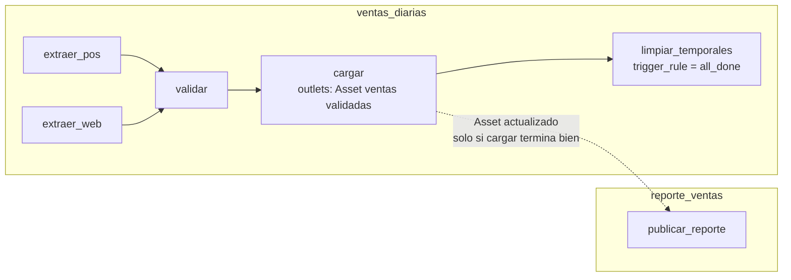

## 1. Resumen

Un pipeline tiene pasos que dependen de otros: validar después de extraer, cargar después de validar. Esas dependencias forman un **grafo dirigido sin ciclos** que el orquestador recorre:

- un paso corre solo cuando terminan bien los anteriores;
- si uno falla, los que dependen de él no corren (`upstream_failed` en Airflow);
- algunos pasos, como limpiar temporales, deben correr igual (`trigger_rule=all_done`).

Entre flujos distintos, la dependencia puede ser de **datos**: en Airflow, un Dag se ejecuta cuando otro actualiza un Asset. Esta ficha trata las dependencias; las tareas y el scheduler están en el dominio de orquestación.

## 2. Qué es

- **Dependencia entre tareas:** «B corre después de A». En Airflow, `a >> b`; en Azure Data Factory, `dependsOn` en la actividad.
- **Regla de disparo:**
  - cuándo una tarea con varias anteriores puede correr;
  - en Airflow, por defecto `all_success` (todas terminaron bien);
  - `all_done` corre cuando todas terminaron, sin importar cómo;
  - hay otras, como `one_failed` o `none_failed`.
- **Dependencia de datos entre flujos:**
  - en Airflow 3.3.2, una tarea declara `outlets=[Asset(...)]` y otro Dag usa `schedule=[Asset(...)]`;
  - el Asset solo se marca actualizado si la tarea termina con éxito.
- **Grafo sin ciclos:** si A depende de B y B de A, no hay orden posible. `graphlib` lanza `CycleError`.

## 3. Problema que resuelve

Sin dependencias explícitas, un pipeline se arma con horarios («extraer a las 2:00, cargar a las 3:00»). Si la extracción se atrasa, la carga trabaja con datos incompletos. Con dependencias:

- cada paso espera a que el anterior termine de verdad;
- un fallo detiene lo que depende de él, sin propagar datos malos;
- un flujo consumidor se dispara cuando su dato de entrada está listo, no a una hora supuesta.

## 4. Cómo funciona

1. Se declara el grafo: tareas y aristas («B depende de A»).
2. El orquestador calcula qué tareas están listas: las que no tienen anteriores, o cuyas anteriores cumplen la regla de disparo.
3. Las tareas independientes pueden correr en paralelo, como dos extracciones.
4. Si una tarea falla y se agotan sus reintentos (`retries`), las que dependen de ella quedan en `upstream_failed` y no se ejecutan. Las que tienen `all_done` corren igual.
5. Al terminar con éxito una tarea con `outlets`, el Asset se marca actualizado y los Dags que lo tienen en su `schedule` se programan.

## 5. Cuándo utilizarlo

- Siempre que un paso necesite el resultado de otro: extraer → validar → cargar.
- Pasos de limpieza o aviso que deben correr aunque algo falle (`all_done`).
- Flujos de distintos equipos que se encadenan por un dato, sin acoplar horarios (Assets).

## 6. Cuándo no utilizarlo

- No encadenar por horario lo que tiene una dependencia real de datos.
- No crear dependencias que no existen: serializar pasos independientes alarga el pipeline sin motivo.
- No meter en un solo grafo flujos de equipos distintos con ciclos de vida distintos; conectarlos por datos (Assets) los mantiene independientes.

## 7. Ejemplo sencillo

`[extraer_pos, extraer_web] >> validar >> cargar >> limpiar_temporales`:

- validar espera a las dos extracciones;
- si `extraer_web` falla, validar y cargar no corren;
- limpiar corre igual, porque su regla es `all_done`.

## 8. Ejemplo de producción

El Dag `ventas_diarias` extrae de dos fuentes en paralelo, valida, carga y limpia temporales. La carga declara como salida el Asset de ventas validadas. El equipo de reportes mantiene otro Dag, `reporte_ventas`, programado por ese Asset: corre cuando la carga terminó bien y no corre si la carga falló. No hay horario compartido entre los dos equipos. Una prueba en la CI carga ambos Dags con `DagBag` y verifica que no haya errores de import y que las dependencias sean las esperadas.

## 9. Arquitectura



## 10. Código

```python
# Airflow 3.3.2 (cargado en la CI con DagBag, sin errores de import; las tareas no se ejecutan): dependencias
# entre tareas dentro de un Dag y una dependencia de datos entre Dags con un Asset.
import datetime

from airflow.providers.standard.operators.empty import EmptyOperator
from airflow.sdk import DAG, Asset, TriggerRule

VENTAS_VALIDADAS = Asset("s3://datos/validado/ventas")

with DAG(
    dag_id="ventas_diarias",
    start_date=datetime.datetime(2026, 10, 1),
    schedule="@daily",
    catchup=False,
    default_args={"retries": 2, "retry_delay": datetime.timedelta(minutes=5)},   # se aplican a cada tarea
):
    extraer_pos = EmptyOperator(task_id="extraer_pos")
    extraer_web = EmptyOperator(task_id="extraer_web")
    validar = EmptyOperator(task_id="validar")                          # espera a las dos extracciones
    cargar = EmptyOperator(task_id="cargar", outlets=[VENTAS_VALIDADAS])  # al terminar, actualiza el Asset
    limpiar = EmptyOperator(task_id="limpiar_temporales", trigger_rule=TriggerRule.ALL_DONE)  # corre aunque algo falle
    [extraer_pos, extraer_web] >> validar >> cargar >> limpiar

with DAG(
    dag_id="reporte_ventas",
    start_date=datetime.datetime(2026, 10, 1),
    schedule=[VENTAS_VALIDADAS],                 # se ejecuta cuando ventas_diarias actualiza el Asset
):
    EmptyOperator(task_id="publicar_reporte")
```

```python
# Python 3.12, solo biblioteca estándar (ejecutado; mypy --strict sin errores): la misma lógica de dependencias
# del Dag, ejecutable sin Airflow. Orden topológico, propagación de fallos aguas abajo y una tarea "all_done".
from graphlib import TopologicalSorter

dependencias = {                       # tarea -> tareas de las que depende (upstream)
    "extraer_pos": set(),
    "extraer_web": set(),
    "validar": {"extraer_pos", "extraer_web"},
    "cargar": {"validar"},
    "limpiar_temporales": {"cargar"},
}
siempre = {"limpiar_temporales"}       # como trigger_rule=ALL_DONE: corre cuando las anteriores terminaron, como sea


def correr(fallan: set[str]) -> dict[str, str]:
    estado: dict[str, str] = {}
    for tarea in TopologicalSorter(dependencias).static_order():
        arriba = [estado[t] for t in dependencias[tarea]]
        if tarea not in siempre and any(e != "ok" for e in arriba):
            estado[tarea] = "upstream_failed"          # no se ejecuta si una dependencia no terminó bien
        else:
            estado[tarea] = "failed" if tarea in fallan else "ok"
    return estado


print(list(TopologicalSorter(dependencias).static_order()))
# ['extraer_pos', 'extraer_web', 'validar', 'cargar', 'limpiar_temporales']
print(correr(fallan=set()))
# {'extraer_pos': 'ok', 'extraer_web': 'ok', 'validar': 'ok', 'cargar': 'ok', 'limpiar_temporales': 'ok'}
print(correr(fallan={"extraer_web"}))
# {'extraer_pos': 'ok', 'extraer_web': 'failed', 'validar': 'upstream_failed', 'cargar': 'upstream_failed', 'limpiar_temporales': 'ok'}
try:
    TopologicalSorter({"a": {"b"}, "b": {"a"}}).prepare()
except Exception as error:
    print(type(error).__name__)                    # CycleError: un ciclo no tiene orden de ejecución
```

El primer bloque es un Dag de **Airflow 3.3.2**. La CI lo carga con `DagBag` en cada push: `make check-airflow-dag` instala `apache-airflow==3.3.2` con las restricciones oficiales para Python 3.12, en un entorno aparte. La prueba verifica que no haya errores de import, que existan los dos Dags, que `validar` dependa de las dos extracciones y que `limpiar_temporales` tenga `all_done`. Las tareas no se ejecutan, y el Dag no se cargó en local.

El segundo bloque es la misma lógica en Python 3.12 sin Airflow, ejecutado y con `mypy --strict` sin errores: orden topológico, propagación de un fallo (`upstream_failed`) y la tarea que corre igual. Es una simulación didáctica; los estados reales los maneja el orquestador.

## 11. GCP

No aplica de forma específica: las dependencias son del orquestador. Dónde corre Airflow en cada nube está en `airflow-architecture`.

## 12. AWS

No aplica de forma específica (ver §11).

## 13. Azure

En **Azure Data Factory**, cada actividad declara sus dependencias en la propiedad `dependsOn`, que define cómo las actividades siguientes dependen de las anteriores. Es la misma idea que `>>` en Airflow, expresada en la definición JSON del pipeline.

## 14. Buenas prácticas

- Dependencias por datos reales, no por horarios.
- Pasos independientes en paralelo; solo serializar lo necesario.
- `all_done` (o equivalente) para limpieza y avisos; el resto con la regla por defecto.
- Dependencias entre equipos por datos (Assets), no metiendo todo en un mismo grafo.
- Probar los Dags en la CI con `DagBag` (sin errores de import, tareas y dependencias esperadas).
- **Seguridad:** cada tarea con las credenciales mínimas para su paso; un Dag consumidor no necesita los permisos del productor, solo leer el dato que este publica.
- **Observabilidad:** alertar sobre tareas en `upstream_failed` y sobre Dags consumidores que no se programaron porque el Asset no se actualizó; ambas son señales de un fallo aguas arriba.
- **Costo:** paralelizar pasos independientes acorta el tiempo total; dependencias de más alargan cada corrida y el tiempo de recursos ocupados.

## 15. Errores frecuentes

- Encadenar por horario y cargar datos incompletos cuando la extracción se atrasa.
- Dependencias circulares que el orquestador rechaza o que bloquean el flujo.
- Limpieza sin `all_done`, que no corre cuando algo falla y deja temporales.
- Suponer que el Dag consumidor corre aunque la tarea productora falle: Airflow no marca el Asset como actualizado en ese caso.

## 16. Trade-offs

Las dependencias explícitas dan corridas correctas y fallos contenidos, a cambio de modelar el grafo y mantenerlo. Un grafo grande y muy conectado es difícil de leer. Separar en varios flujos conectados por datos los independiza, pero el recorrido completo ya no se ve en un solo lugar. Las reglas de disparo distintas de la por defecto resuelven casos reales, aunque hacen menos obvio qué corre cuando algo falla.

## 17. Conceptos relacionados

- `dag`, `data-orchestration` y `scheduler`: el contexto de orquestación.
- `airflow-architecture`: cómo ejecuta Airflow los Dags.
- `event-driven-pipelines`: disparar por eventos.
- `failure-recovery`: qué relanzar cuando algo falla.

## 18. Preguntas técnicas abiertas

1. ¿Qué paso de tu pipeline está encadenado por horario cuando en realidad depende de un dato?
2. ¿Qué pasos deberían correr aunque algo falle, y con qué regla?
3. ¿Separarías en dos flujos conectados por un Asset algún pipeline que hoy es un solo grafo? ¿Por qué?

## 19. Laboratorio relacionado

Pendiente (F4).

## 20. Fuentes

- Apache Airflow 3.3.2: *Dags*, *Tasks*, *Asset-Aware Scheduling* y *Best Practices*.
- Python 3.12: *graphlib*.
- Microsoft Learn: *Pipelines and Activities* (Azure Data Factory).

El detalle de cada fuente está en `sources` del frontmatter.

## 21. Fecha de última verificación

2026-10-11. Pasa a `verified`: revisión B-F3.1 del lote F3b-05a aplicada, sin VERIFY pendientes.

## 22. Historial de cambios importantes

- 2026-10-11: creación (lote F3b-05a).
- 2026-10-11: revisión B-F3.1 del lote F3b-05a aplicada (docs/reviews/cards-f3b-05a.md): filas aprobadas sin cambios en esta ficha.
- 2026-10-11: `verification_status: verified` (sin VERIFY pendientes).
