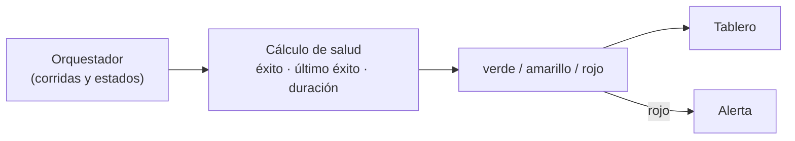

## 1. Resumen

La **salud de un pipeline** resume en pocas señales si viene funcionando bien. Con lo que el orquestador ya registra de cada corrida (estado, inicio, fin) alcanzan tres:

- **tasa de éxito** de las últimas corridas;
- **tiempo desde el último éxito**: un pipeline que falla siempre, aunque se reintente, deja las tablas viejas;
- **duración** de la última corrida contra la mediana: una corrida que tarda el triple es una señal aunque termine bien.

Con esas señales se asigna un estado: **verde**, **amarillo** o **rojo**. `orchestration-observability` trata lo que muestra el orquestador; esta ficha, cómo resumirlo en una señal de salud por pipeline.

## 2. Qué es

| Señal | Mide | Ejemplo de umbral |
|---|---|---|
| Tasa de éxito | Corridas `success` sobre las últimas N | < 80 % |
| Último éxito | Ahora − fin de la última corrida exitosa | > 26 h en un pipeline diario |
| Duración | Última corrida / mediana de las anteriores | > 2 veces |

Los estados de una tarea en Airflow incluyen `success`, `failed`, `up_for_retry` y `upstream_failed`, entre otros (*Tasks*, Airflow 3.3.2).

## 3. Problema que resuelve

Hay 120 Dags. El orquestador muestra cientos de cuadros verdes y rojos, y nadie sabe cuáles importan. Un Dag que falla los fines de semana y se arregla el lunes pasa inadvertido; otro que tarda cada vez más termina chocando con el siguiente. Una señal de salud por pipeline, con un estado, ordena la atención.

## 4. Cómo funciona

1. Se leen las corridas recientes de cada pipeline (estado, fin, duración).
2. Se calculan las tres señales.
3. Reglas: cualquier señal fuera de umbral → amarillo; dos señales, o el último éxito demasiado viejo → rojo.
4. El estado se publica como métrica o en un tablero; los rojos alertan (`alerting`).
5. Los callbacks del orquestador (`on_failure_callback`, por ejemplo) avisan de cada falla individual; la salud mira la tendencia.

## 5. Cuándo utilizarlo

- Con muchos pipelines y poca atención disponible.
- Para detectar degradación lenta (duración creciente).
- Como vista diaria del equipo de datos.

## 6. Cuándo no utilizarlo

- Como único indicador: un pipeline verde puede cargar datos malos (para eso, data quality).
- Con umbrales iguales para todos: un Dag horario y uno mensual no se miden igual.

## 7. Ejemplo sencillo

| Pipeline | Corridas recientes | Estado |
|---|---|---|
| `ventas_diarias` | Todas exitosas; la última tardó 98 min con mediana de 30 | amarillo |
| `clientes` | 3 de 7 exitosas; sin éxito hace 79 h | rojo |
| `inventario` | Todas exitosas, duración estable | verde |

## 8. Ejemplo de producción

- Un job lee cada hora las corridas de los últimos 7 días desde la API del orquestador.
- Calcula la salud de cada Dag con umbrales por frecuencia (horario, diario, semanal).
- Publica una métrica de salud por Dag y un tablero ordenado por estado.
- Rojo alerta a la guardia; amarillo va a un canal que se revisa cada mañana.

## 9. Arquitectura



## 10. Código

```python
"""Salud de pipelines a partir de sus corridas: tasa de éxito, antigüedad del último éxito y duración contra la mediana."""
from datetime import datetime, timedelta
from statistics import median

AHORA = datetime(2026, 10, 20, 9, 0)
CORRIDAS = {   # dag -> (fin de la corrida, estado, minutos), de la más vieja a la más nueva
    "ventas_diarias": [(datetime(2026, 10, d, 6, 30), "success", m) for d, m in
                       [(14, 31), (15, 29), (16, 30), (17, 33), (18, 30), (19, 32)]] + [(datetime(2026, 10, 20, 7, 40), "success", 98)],
    "clientes": [(datetime(2026, 10, d, 2, 0), s, 12) for d, s in
                 [(14, "success"), (15, "success"), (16, "failed"), (17, "success"), (18, "failed"), (19, "failed"), (20, "failed")]],
    "inventario": [(datetime(2026, 10, d, 5, 0), "success", 8) for d in range(14, 21)],
}


def salud(corridas: list[tuple[datetime, str, int]]) -> tuple[str, list[str]]:
    exitos = [c for c in corridas if c[1] == "success"]
    tasa = len(exitos) / len(corridas)
    sin_exito = AHORA - exitos[-1][0] if exitos else timedelta.max
    base = median(m for _, s, m in corridas[:-1] if s == "success")
    ultima = corridas[-1][2]
    motivos = []
    if tasa < 0.8:
        motivos.append(f"éxito {tasa:.0%}")
    if sin_exito > timedelta(hours=26):
        motivos.append(f"sin éxito hace {sin_exito.total_seconds() / 3600:.0f} h")
    if corridas[-1][1] == "success" and ultima > 2 * base:
        motivos.append(f"última corrida {ultima} min vs mediana {base:.0f}")
    estado = "rojo" if len(motivos) > 1 or sin_exito > timedelta(hours=26) else ("amarillo" if motivos else "verde")
    return estado, motivos


for dag, corridas in CORRIDAS.items():
    estado, motivos = salud(corridas)
    print(f"{dag}: {estado}" + (f" ({'; '.join(motivos)})" if motivos else ""))
```

El script se **ejecuta en la CI** y pasa `mypy --strict`. Imprime `ventas_diarias: amarillo (última corrida 98 min vs mediana 30)`, `clientes: rojo (éxito 43%; sin éxito hace 79 h)` e `inventario: verde`.

## 11. GCP

En GCP, **Managed Service for Apache Airflow** mide la salud del entorno; la página dice que Cloud Composer «is evolving to become» Managed Service for Apache Airflow. Según *Tasks* y *Monitor environments with Cloud Monitoring* (no ejecutado):

| | Salud de cada pipeline (este concepto) | Salud del entorno en Managed Airflow |
|---|---|---|
| Qué mide | Cada Dag del equipo | El entorno: la métrica `environment/healthy` |
| Cómo | Señales de sus corridas | Un Dag de liveness (`airflow_monitoring`): True si su corrida termina bien, False si falla |
| Qué no ve | — | Que un Dag propio falle o se atrase |

## 12. AWS

En AWS, **Amazon MWAA** publica métricas de Airflow en CloudWatch. Según *Tasks* y *Monitoring and metrics for Amazon Managed Workflows for Apache Airflow* (no ejecutado):

| | Salud de cada pipeline (este concepto) | MWAA |
|---|---|---|
| Datos | Corridas del orquestador | Métricas y logs de Airflow en CloudWatch, con tableros y alarmas |
| Costo | Lo que cueste el cálculo | Precio estándar de CloudWatch para métricas y logs |

## 13. Azure

En Azure, **Azure Data Factory**. Según *Tasks* y *Visually monitor Azure Data Factory* (no ejecutado):

| | Salud de cada pipeline (este concepto) | Monitor de Data Factory |
|---|---|---|
| Vista | Un estado por pipeline | La grilla de corridas, con inicio y fin, y acciones como rerun |
| Resumen | Verde, amarillo o rojo | La página citada no describe un estado de salud por pipeline |

## 14. Buenas prácticas

- Tres señales simples antes que un índice compuesto opaco.
- Umbrales por frecuencia del pipeline.
- Separar la salud del entorno de la de cada pipeline.
- **Seguridad:** el job que calcula la salud solo necesita leer el historial de corridas.
- **Observabilidad:** la salud como métrica, con historia.
- **Costo:** leer el historial cada hora es barato; consultar cada tarea de cada corrida, no.

## 15. Errores frecuentes

- Mirar solo la última corrida.
- Confundir «el entorno está sano» con «mis pipelines están sanos».
- Contar reintentos exitosos como si no hubiera problemas.

## 16. Trade-offs

Un estado simple ordena la atención y esconde matices; las señales detrás permiten ver por qué. Umbrales estrictos detectan antes y alertan más.

## 17. Conceptos relacionados

- `orchestration-observability`: lo que registra el orquestador.
- `data-observability`: el panorama.
- `alerting`: cuándo avisar.
- `data-freshness`: lo que pasa con las tablas cuando el pipeline falla.

## 18. Preguntas técnicas abiertas

1. ¿Cuál de tus pipelines está hoy en amarillo sin que nadie lo sepa?
2. ¿Mides la duración de las corridas a lo largo del tiempo?
3. ¿Distingues la salud del orquestador de la de tus pipelines?

## 19. Laboratorio relacionado

Pendiente (F4).

## 20. Fuentes

- Apache Airflow 3.3.2: *Tasks* y *Callbacks*.
- Google Cloud: *Monitor environments with Cloud Monitoring* (Managed Service for Apache Airflow).
- AWS: *Monitoring and metrics for Amazon Managed Workflows for Apache Airflow*.
- Microsoft Learn: *Visually monitor Azure Data Factory*.

El detalle de cada fuente está en `sources` del frontmatter.

## 21. Fecha de última verificación

2026-10-20. Pasa a `verified`: revisión B-F3.1 del lote F3b-16b sin hallazgos en esta ficha, sin VERIFY pendientes.

## 22. Historial de cambios importantes

- 2026-10-20: creación (lote F3b-16b).
- 2026-10-20: revisión B-F3.1 del lote F3b-16b (docs/reviews/cards-f3b-16b.md), sin hallazgos que corregir.
- 2026-10-20: `verification_status: verified` (sin VERIFY pendientes).
