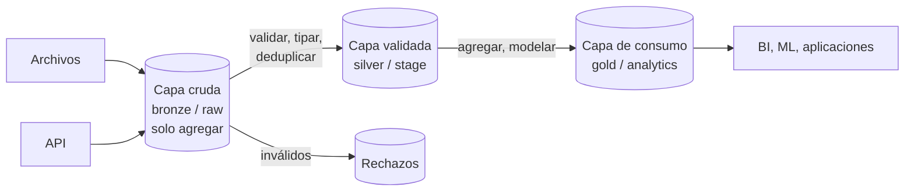

## 1. Resumen

Un pipeline robusto no transforma los datos en un solo paso desde la fuente hasta el tablero. Los hace pasar por capas, cada una con una garantía distinta:

- **cruda:** conserva lo recibido tal cual, solo se agrega;
- **validada:** datos tipados, limpios y deduplicados;
- **consumo:** listos para el negocio, a menudo agregados.

Cada proveedor les pone su nombre:

- Azure Databricks y Fabric las llaman **bronze, silver y gold** («medallion»). Azure Databricks aclara que es una práctica recomendada, no un requisito.
- AWS Prescriptive Guidance las llama **raw, stage y analytics**.

Esta ficha usa nombres neutros, para no presentar ninguno como estándar.

## 2. Qué es

- **Capa cruda** (bronze en Databricks y Fabric, raw en AWS):
  - los datos como llegan, en su formato original;
  - se agrega de forma incremental;
  - permite reprocesar y auditar.

  Azure Databricks recomienda guardar casi todo como texto, `VARIANT` o binario, más metadatos de procedencia, y no dar acceso a los analistas.
- **Capa validada** (silver, stage):
  - limpieza, validación, tipado y deduplicación;
  - a veces, integración de varias fuentes. Azure Databricks dice que aquí se usa a menudo 3NF o Data Vault.
- **Capa de consumo** (gold, analytics):
  - datos refinados para tableros, ML y aplicaciones;
  - a menudo agregados y alineados con funciones del negocio.

## 3. Problema que resuelve

Cargar directamente de la fuente a tablas limpias hace que cualquier sorpresa de la fuente (un campo nuevo, un registro corrupto) rompa la carga o se pierda. Azure Databricks no recomienda escribir en silver directamente desde la ingesta por ese motivo. Con capas:

- lo recibido queda guardado aunque no pase la validación;
- un error de transformación se corrige reprocesando desde la capa cruda, sin volver a pedirle los datos a la fuente;
- el consumo solo ve datos que pasaron por la validación.

## 4. Cómo funciona

1. La ingesta escribe en la capa cruda, **solo agregando**, con metadatos (archivo, fecha de carga). Re-cargar lo mismo no duplica.
2. Un paso de promoción lee la capa cruda, valida y tipa:
   - lo válido va a la capa validada, deduplicado y con upsert;
   - lo inválido va a una tabla de rechazos con su motivo.
3. La capa de consumo se define **sobre la validada** (vistas o tablas agregadas), nunca sobre la cruda.
4. Cada capa puede vivir en un esquema, un bucket o un lakehouse distinto, con permisos distintos. Fabric recomienda un workspace separado por lakehouse; AWS, un bucket por capa.
5. Re-ejecutar cualquier paso con la misma entrada deja el mismo resultado (ver `idempotency`).

## 5. Cuándo utilizarlo

- En cualquier pipeline con fuentes que pueden cambiar de forma o traer datos inválidos.
- Cuando se necesita reprocesar o auditar lo que llegó.
- Cuando distintos consumidores necesitan distintos niveles de refinamiento, y distintos permisos.

## 6. Cuándo no utilizarlo

- No crear tres copias completas de cada tabla «porque sí»: una capa que no agrega garantías es solo costo.
- No exponer la capa cruda a analistas: Azure Databricks la describe como pensada para alimentar silver, no para análisis.
- Para un flujo de un solo paso, pequeño y desechable, una capa validada puede bastar.

## 7. Ejemplo sencillo

Un archivo de ventas llega a la capa cruda tal cual. Una línea con `"monto": "N/D"` queda allí y en rechazos, pero no pasa a la capa validada. La tabla de ventas por tienda y día se calcula desde la validada.

## 8. Ejemplo de producción

Un retailer recibe ventas por archivo y por API. Ambas fuentes caen en la capa cruda de su lakehouse, una tabla por fuente, con el nombre del archivo o el id de la página y la fecha de carga. Un job cada hora promueve a la capa validada: tipa, deduplica por `venta_id` (gana la última versión) y separa los rechazos. La capa de consumo tiene marts dimensionales y agregados para el BI. Cuando se descubrió un error de redondeo en la promoción, el equipo corrigió el código y reprocesó tres meses desde la capa cruda, sin pedir nada a las fuentes.

## 9. Arquitectura



## 10. Código

```sql
-- PostgreSQL 17 (ejecutado): tres capas de un pipeline en esquemas separados. Crudo (bronze/raw):
-- tal como llega, solo se agrega. Validado (silver/stage): tipado, deduplicado. Consumo (gold/analytics): agregado.
CREATE SCHEMA crudo; CREATE SCHEMA validado; CREATE SCHEMA consumo;

CREATE TABLE crudo.ventas (                      -- todo como texto o JSON: un cambio de esquema no hace perder datos
  archivo text NOT NULL, linea integer NOT NULL, payload jsonb NOT NULL,
  cargado timestamptz NOT NULL DEFAULT now(), PRIMARY KEY (archivo, linea));
CREATE TABLE validado.ventas (
  venta_id text PRIMARY KEY, tienda text NOT NULL, fecha date NOT NULL, monto numeric(12,2) NOT NULL CHECK (monto >= 0),
  archivo text NOT NULL);                          -- procedencia: de qué archivo crudo vino la versión vigente
CREATE TABLE validado.rechazos (archivo text, linea integer, motivo text, PRIMARY KEY (archivo, linea));

CREATE PROCEDURE cargar_crudo(p_archivo text, p_lineas jsonb) LANGUAGE sql AS $$
  INSERT INTO crudo.ventas (archivo, linea, payload)
  SELECT p_archivo, n::integer, v FROM jsonb_array_elements(p_lineas) WITH ORDINALITY AS t(v, n)
  ON CONFLICT (archivo, linea) DO NOTHING;       -- re-cargar el mismo archivo no duplica
$$;

CREATE PROCEDURE promover() LANGUAGE sql AS $$
  INSERT INTO validado.rechazos
  SELECT archivo, linea, 'monto no numérico o negativo' FROM crudo.ventas
  WHERE NOT (payload->>'monto' ~ '^[0-9]+(\.[0-9]+)?$')
  ON CONFLICT DO NOTHING;
  INSERT INTO validado.ventas
  SELECT DISTINCT ON (payload->>'venta_id') payload->>'venta_id', payload->>'tienda', (payload->>'fecha')::date,
         (payload->>'monto')::numeric, archivo
  FROM crudo.ventas WHERE payload->>'monto' ~ '^[0-9]+(\.[0-9]+)?$'
  ORDER BY payload->>'venta_id', cargado DESC, archivo DESC, linea DESC        -- gana la última versión recibida
  ON CONFLICT (venta_id) DO UPDATE SET tienda = EXCLUDED.tienda, fecha = EXCLUDED.fecha,
                                       monto = EXCLUDED.monto, archivo = EXCLUDED.archivo
  WHERE (validado.ventas.tienda, validado.ventas.fecha, validado.ventas.monto)
        IS DISTINCT FROM (EXCLUDED.tienda, EXCLUDED.fecha, EXCLUDED.monto);
$$;

CREATE VIEW consumo.ventas_por_tienda_dia AS    -- consumo: definido sobre la capa validada, nunca sobre la cruda
SELECT tienda, fecha, count(*) AS ventas, sum(monto) AS monto FROM validado.ventas GROUP BY tienda, fecha;

CALL cargar_crudo('ventas-2026-10-07.json', '[{"venta_id":"v1","tienda":"T1","fecha":"2026-10-07","monto":"100"},
  {"venta_id":"v2","tienda":"T2","fecha":"2026-10-07","monto":"40"},{"venta_id":"v3","tienda":"T1","fecha":"2026-10-07","monto":"N/D"}]');
CALL promover();
CALL cargar_crudo('ventas-2026-10-07.json', '[]');           -- reenvío vacío: nada cambia
CALL cargar_crudo('ventas-2026-10-07b.json', '[{"venta_id":"v1","tienda":"T1","fecha":"2026-10-07","monto":"120"}]');
CALL promover(); CALL promover();                           -- promover dos veces no cambia el resultado

SELECT (SELECT count(*) FROM crudo.ventas) AS crudo, (SELECT count(*) FROM validado.ventas) AS validado,
       (SELECT count(*) FROM validado.rechazos) AS rechazos;               -- 4 | 2 | 1
SELECT * FROM consumo.ventas_por_tienda_dia ORDER BY tienda;
-- T1 | 2026-10-07 | 1 | 120.00   (v1 corregida; v3 quedó en rechazos)
-- T2 | 2026-10-07 | 1 |  40.00
DROP SCHEMA crudo CASCADE; DROP SCHEMA validado CASCADE; DROP SCHEMA consumo CASCADE;
```

Ejecutado en PostgreSQL 17.11 local, en un esquema desechable:

- La capa cruda guarda las 4 líneas recibidas, incluida la inválida y la corrección de `v1`.
- La validada tiene 2 ventas, con `v1` en su última versión.
- Los rechazos guardan la línea con `N/D`.
- Re-cargar el archivo y promover dos veces no cambia nada.

Los esquemas `crudo`, `validado` y `consumo` son nombres neutros. En Azure Databricks o Fabric serían bronze, silver y gold, y en AWS, raw, stage y analytics.

## 11. GCP

Esta ficha no cita una fuente de Google Cloud que defina capas de datos con nombre propio.

## 12. AWS

**AWS Prescriptive Guidance** recomienda, para un data lake en S3, **al menos tres** capas, cada una en su propio bucket, y más según la complejidad y los casos de uso. Si hay datos sensibles (PII), agrega un bucket de **landing** antes de raw, donde los datos se enmascaran antes de pasar a la capa raw. Las tres capas:

- **Raw:** datos sin procesar, con el formato original y el versionado del bucket activado.
- **Stage:** datos procesados y optimizados. Por ejemplo, un job de AWS Glue que valida, convierte CSV a Parquet y registra la tabla en el Glue Data Catalog.
- **Analytics:** datos agregados para casos de uso, en formato listo para consumo.

La guía propone políticas de ciclo de vida por capa, a evaluar según la organización, la regulación, las consultas y el costo.

## 13. Azure

**Azure Databricks** llama a la arquitectura **medallion**: bronze, silver y gold, también «multi-hop». La recomienda como buena práctica y aclara que no es un requisito. **Microsoft Fabric** usa los mismos nombres y la recomienda como enfoque de diseño. Plantea dos patrones de despliegue: (1) cada capa como lakehouse, o (2) bronze y silver como lakehouses y gold como data warehouse. Recomienda un workspace separado por lakehouse para gobernar cada capa por separado. Diferencia con AWS: Microsoft organiza las capas como lakehouses y workspaces; AWS, como buckets de S3.

## 14. Buenas prácticas

- Capa cruda solo de agregar, con procedencia (archivo, página, fecha de carga) y sin acceso de analistas.
- Promoción idempotente: re-ejecutar no duplica ni reescribe lo que no cambió.
- Rechazos con motivo en lugar de descartar.
- Consumo definido siempre sobre la capa validada.
- **Seguridad:** permisos distintos por capa; la cruda suele tener los datos más sensibles y sin enmascarar, así que su acceso es el más restringido.
- **Observabilidad:** conteos por capa y por ejecución (recibidos, promovidos, rechazados); una diferencia que crece entre cruda y validada es la primera señal de un cambio en la fuente.
- **Costo:** cada capa es almacenamiento y cómputo; políticas de ciclo de vida por capa (como propone AWS) y no guardar copias que no agregan garantías.

## 15. Errores frecuentes

- Escribir directamente desde la ingesta a la capa validada y perder lo que no pasó la validación.
- Modificar o borrar la capa cruda y quedarse sin poder reprocesar.
- Reportes que leen la capa cruda «porque es más rápido».
- Llamar «gold» a cualquier tabla final sin acordar qué garantiza.

## 16. Trade-offs

Las capas dan auditoría, reproceso y aislamiento de errores, a cambio de más almacenamiento, más pasos y más latencia hasta el consumo. Más capas significan más control, pero también más lugares donde una definición puede divergir. Los nombres de proveedor (medallion; raw, stage, analytics) ayudan a comunicarse dentro de cada plataforma. Mezclarlos sin acordar qué garantiza cada capa genera confusión.

## 17. Conceptos relacionados

- `data-pipeline`: el contexto general.
- `data-lake` y `lakehouse`: dónde viven las capas.
- `replay` e `idempotency`: reprocesar desde la capa cruda sin duplicar.
- `data-vault`: un modelo posible para la capa validada.
- Del blueprint (dominio 07), pendiente de ficha: `medallion-architecture`.

## 18. Preguntas técnicas abiertas

1. ¿Cuánto tiempo conservarías la capa cruda y qué te obliga a decidirlo (auditoría, regulación, costo)?
2. ¿Quién debería tener acceso a cada capa en tu organización?
3. ¿Qué validaciones pondrías entre la capa cruda y la validada, y cuáles entre la validada y la de consumo?

## 19. Laboratorio relacionado

Pendiente (F4).

## 20. Fuentes

- Microsoft Learn: *What is the medallion lakehouse architecture?* y *Data warehousing architecture* (Azure Databricks), e *Implement Medallion Lakehouse Architecture in Fabric*.
- AWS Prescriptive Guidance: *Recommended data layers*.

El detalle de cada fuente está en `sources` del frontmatter.

## 21. Fecha de última verificación

2026-10-11. Pasa a `verified`: revisión B-F3.1 del lote F3b-05a aplicada, sin VERIFY pendientes.

## 22. Historial de cambios importantes

- 2026-10-11: creación (lote F3b-05a).
- 2026-10-11: revisión B-F3.1 del lote F3b-05a aplicada (docs/reviews/cards-f3b-05a.md): AWS recomienda al menos tres capas y, con datos sensibles, un bucket de landing antes de raw; Fabric con sus dos patrones de despliegue (cada capa como lakehouse, o gold como warehouse) y un workspace por lakehouse.
- 2026-10-11: `verification_status: verified` (sin VERIFY pendientes).
