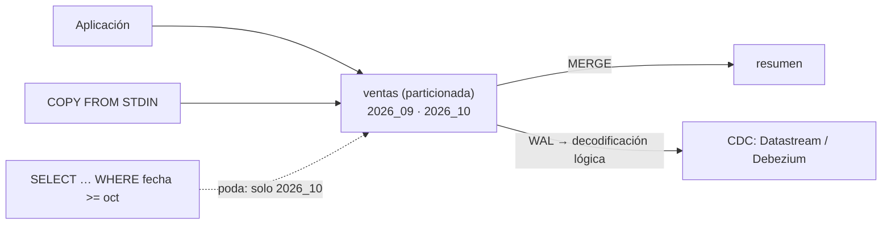

## 1. Resumen

PostgreSQL aparece en casi todo pipeline: como origen de datos de una aplicación, como base de metadatos de herramientas (Airflow, por ejemplo) o como destino chico. Para un equipo de datos, seis funciones pesan más:

- **particionado declarativo**, con **poda** de particiones en el plan;
- **`COPY`** para cargar o exportar en bloque;
- **`EXPLAIN`** para leer el plan;
- **índices** adecuados, como BRIN para tablas grandes cuyos datos llegan en orden;
- **`MERGE`** para upserts en una sola sentencia;
- **decodificación lógica** del WAL, la base del CDC.

## 2. Qué es

- **Tabla particionada:** una tabla lógica repartida en particiones por rango, lista o hash.
- **Poda de particiones:** el planner excluye las particiones que no pueden tener filas del `WHERE`.
- **`COPY`:** mueve datos entre una tabla y un archivo o un stream.
- **BRIN:** índice por rangos de bloques, chico, útil cuando la columna se correlaciona con el orden físico (por ejemplo, la fecha de inserción).
- **`MERGE`:** `INSERT`, `UPDATE` o `DELETE` según condiciones, en una sentencia.
- **WAL y decodificación lógica:** el registro de cambios y su traducción a cambios por fila.

## 3. Problema que resuelve

Una tabla de ventas de una aplicación crece a cientos de millones de filas. Las consultas por mes leen toda la tabla, borrar los datos viejos bloquea horas y la carga al warehouse hace un `SELECT *` cada noche. Con particiones por mes, la consulta lee solo su mes y borrar un mes es quitar una partición. Con `COPY` la exportación es en bloque, y con decodificación lógica el warehouse recibe solo los cambios.

## 4. Cómo funciona

1. La tabla se crea `PARTITION BY RANGE (fecha)` con una partición por mes.
2. `COPY ... FROM STDIN` carga filas en bloque; cada fila va a su partición.
3. `EXPLAIN` muestra que una consulta por octubre solo recorre la partición de octubre.
4. Un `MERGE` actualiza o inserta los totales en una tabla de resumen; repetirlo deja lo mismo.
5. Para CDC, un slot de replicación lógica entrega los cambios del WAL a un consumidor (por ejemplo, Debezium o Datastream).

## 5. Cuándo utilizarlo

- Tablas grandes con un criterio claro de consulta y de borrado (fecha): particionado.
- Cargas o exportaciones masivas: `COPY` antes que `INSERT` fila por fila.
- Upserts en tablas de resumen: `MERGE` o `INSERT ... ON CONFLICT`.
- CDC desde la base de una aplicación: decodificación lógica.

## 6. Cuándo no utilizarlo

- PostgreSQL como data warehouse de grandes volúmenes analíticos: es una base transaccional.
- Particionar tablas chicas: suma complejidad sin ganancia.
- Activar la replicación lógica sin necesidad: en RDS, aumenta la generación de WAL.

## 7. Ejemplo sencillo

Cuatro ventas, una de septiembre y tres de octubre, cargadas con `COPY` en una tabla particionada por mes. La consulta de octubre solo recorre `ventas_2026_10`. Un `MERGE` arma el resumen de octubre (`norte` 40, `sur` 10); correrlo dos veces deja lo mismo.

## 8. Ejemplo de producción

La base de pedidos de una aplicación, como origen del lake:

- `pedidos` particionada por mes; las particiones de más de dos años se separan con `DETACH PARTITION` y se archivan;
- índice BRIN sobre `created_at`, que llega en orden;
- un slot de replicación lógica para que Datastream o Debezium lleven los cambios al lake;
- monitoreo del tamaño del WAL retenido por el slot.

## 9. Arquitectura



## 10. Código

```python
# Python 3.12 y psycopg 3 contra PostgreSQL 17 (ejecutado en la CI con el servicio postgres:17; mypy --strict sin
# errores): una tabla particionada por mes, carga con COPY, poda de particiones en el plan y un MERGE idempotente.
# PG_DSN apunta a una base vacía que el test crea y borra.
from __future__ import annotations

import json
import os
from datetime import date

import psycopg

SALES = [(1, "norte", date(2026, 9, 30), 40), (2, "norte", date(2026, 10, 1), 25),
         (3, "sur", date(2026, 10, 2), 10), (4, "norte", date(2026, 10, 2), 15)]

with psycopg.connect(os.environ["PG_DSN"], autocommit=True) as conn:
    conn.execute("""
        CREATE TABLE ventas (id int, tienda text, fecha date, monto int) PARTITION BY RANGE (fecha);
        CREATE TABLE ventas_2026_09 PARTITION OF ventas FOR VALUES FROM ('2026-09-01') TO ('2026-10-01');
        CREATE TABLE ventas_2026_10 PARTITION OF ventas FOR VALUES FROM ('2026-10-01') TO ('2026-11-01');
        CREATE TABLE resumen (tienda text PRIMARY KEY, total int NOT NULL);
    """)
    with conn.cursor() as cur, cur.copy("COPY ventas (id, tienda, fecha, monto) FROM STDIN") as copy:
        for row in SALES:   # COPY carga filas en bloque, sin un INSERT por fila
            copy.write_row(row)
    conn.execute("ANALYZE ventas")

    plan = conn.execute("EXPLAIN (FORMAT JSON) SELECT sum(monto) FROM ventas WHERE fecha >= '2026-10-01'").fetchone()
    scanned = sorted({n for n in json.dumps(plan).split('"') if n.startswith("ventas_")})
    print(f"particiones en el plan: {scanned}")   # poda: la de septiembre no se lee

    merge = """
        MERGE INTO resumen AS r
        USING (SELECT tienda, sum(monto)::int AS total FROM ventas WHERE fecha >= '2026-10-01' GROUP BY tienda) AS s
        ON r.tienda = s.tienda
        WHEN MATCHED THEN UPDATE SET total = s.total
        WHEN NOT MATCHED THEN INSERT (tienda, total) VALUES (s.tienda, s.total)
    """
    for _ in range(2):   # correrlo dos veces deja lo mismo: idempotente
        conn.execute(merge)
    print(f"resumen de octubre: {conn.execute('SELECT tienda, total FROM resumen ORDER BY tienda').fetchall()}")
```

El script se **ejecuta en la CI contra el servicio postgres:17**, en una base vacía que el test crea y borra, y pasa `mypy --strict`. Imprime `particiones en el plan: ['ventas_2026_10']` y `resumen de octubre: [('norte', 40), ('sur', 10)]`. La decodificación lógica **no se ejecutó**: necesita `wal_level=logical` (*29.11. Configuration Settings*), y el PostgreSQL de la CI corre con `replica`.

## 11. GCP

En GCP, **Cloud SQL para PostgreSQL** como origen de CDC. Según *Configure a Cloud SQL for PostgreSQL database for CDC* (no ejecutado):

| | PostgreSQL propio | Cloud SQL para PostgreSQL |
|---|---|---|
| Activar la decodificación lógica | `wal_level=logical` en la configuración | Marca `cloudsql.logical_decoding` en `on`, con reinicio de la instancia |
| Qué se crea | Publicación y slot lógico | Una publicación para las tablas a replicar y un slot con el plugin `pgoutput`, uno por stream |

## 12. AWS

En AWS, **Amazon RDS para PostgreSQL**. Según *Performing logical replication for Amazon RDS for PostgreSQL* (no ejecutado):

| | PostgreSQL propio | RDS para PostgreSQL |
|---|---|---|
| Activar | `wal_level=logical` | Parámetro estático `rds.logical_replication = 1`, que ajusta `wal_level` y los límites de slots y senders, con reinicio |
| Advertencia | — | Aumenta la generación de WAL: activarlo solo si se usan slots lógicos |

## 13. Azure

En Azure, **Azure Database for PostgreSQL**. Según *Logical replication and logical decoding in Azure Database for PostgreSQL flexible server* (no ejecutado):

| | PostgreSQL propio | Azure Database for PostgreSQL |
|---|---|---|
| Métodos | Replicación lógica nativa y decodificación lógica | Los dos, más la extensión pglogical |
| Qué no se replica | DDL | Igual: ni la replicación lógica ni la decodificación replican DDL |

## 14. Buenas prácticas

- Particionar por la columna por la que se consulta y se borra, y comprobar la poda con `EXPLAIN`.
- `COPY` para cargas masivas; `MERGE` o `ON CONFLICT` para upserts idempotentes.
- Índices según el patrón de acceso; BRIN para columnas que crecen en orden.
- **Seguridad:** el usuario de CDC con permiso de replicación y acceso solo a sus tablas.
- **Observabilidad:** planes de las consultas críticas y WAL retenido por los slots.
- **Costo:** un slot sin consumidor retiene WAL y llena el disco; en servicios administrados, eso es almacenamiento cobrado.

## 15. Errores frecuentes

- Un slot de replicación abandonado que retiene WAL.
- `WHERE` sobre una expresión de la columna de partición que impide la poda.
- Cargar con `INSERT` fila por fila.
- Esperar que el CDC lleve los cambios de esquema (DDL): no lo hace.

## 16. Trade-offs

Particionar acelera consultas y borrados por la clave de partición y complica las que no la usan. `COPY` es rápido y menos flexible que `INSERT` con lógica. La decodificación lógica da cambios en tiempo casi real, a cambio de WAL retenido y de una pieza más que operar.

## 17. Conceptos relacionados

- `change-data-capture`: CDC en general.
- `partitioning`: particionado.
- `partition-pruning`: poda de particiones.
- `query-plans`: leer un plan.
- `sql-merge`: `MERGE` en SQL.
- `upsert`: escrituras idempotentes.
- `database-ingestion`: PostgreSQL como origen.

## 18. Preguntas técnicas abiertas

1. ¿Qué tabla de tu base de origen se beneficiaría de particiones por fecha?
2. ¿Tienes slots de replicación y sabes cuánto WAL retienen?
3. ¿Cómo cargas hoy los datos masivos en PostgreSQL?

## 19. Laboratorio relacionado

Pendiente (F4).

## 20. Fuentes

- PostgreSQL 17: *5.12. Table Partitioning*, *PostgreSQL: Documentation: 17: COPY*, *14.1. Using EXPLAIN*, *64.5. BRIN Indexes*, *PostgreSQL: Documentation: 17: MERGE*, *47.2. Logical Decoding Concepts* y *29.11. Configuration Settings*.
- Google Cloud: *Configure a Cloud SQL for PostgreSQL database for CDC*.
- AWS: *Performing logical replication for Amazon RDS for PostgreSQL*.
- Microsoft Learn: *Logical replication and logical decoding in Azure Database for PostgreSQL flexible server*.

El detalle de cada fuente está en `sources` del frontmatter.

## 21. Fecha de última verificación

2026-10-20. `review_required`: pendiente de revisión B-F3.1 del lote F3b-20a.

## 22. Historial de cambios importantes

- 2026-10-20: creación (lote F3b-20a).
