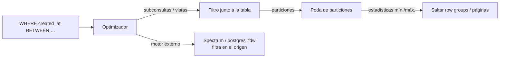

## 1. Resumen

*Predicate pushdown* es aplicar un filtro (`WHERE`) lo antes posible: dentro de una subconsulta o vista, en el lector de archivos o incluso en el sistema de origen, en vez de leer todo y filtrar al final. Cuanto antes se filtra, menos datos se leen, se transfieren y se procesan.

Ocurre en varios niveles:

- **en el optimizador:** el filtro de la consulta externa se aplica dentro de la subconsulta;
- **en los archivos:** el lector de Parquet salta páginas cuyos mínimos y máximos no incluyen el valor buscado;
- **en el origen:** Redshift Spectrum o `postgres_fdw` envían el filtro al sistema externo.

No todo filtro se puede empujar. Depende del motor y de la expresión: funciones no admitidas, valores dinámicos o datos sin estadísticas útiles lo impiden.

## 2. Qué es

| Nivel | Qué se empuja | Ejemplo documentado |
|---|---|---|
| Plan de la consulta | Filtros hacia subconsultas | Observado en la prueba de PostgreSQL de la sección 10 |
| Archivos columnares | Filtros contra estadísticas mín./máx. | Page index de Parquet; Athena |
| Motor externo | Filtros, proyecciones, agregaciones | Redshift Spectrum; `postgres_fdw` |
| Particiones | Filtros sobre la columna de partición | Poda de particiones (ver `partition-pruning`) |

## 3. Problema que resuelve

En lagos de datos y tablas externas, leer es lo caro: transferir archivos y parsearlos. Si el filtro se aplica después de leer, se paga la lectura de todo. El pushdown traslada el filtro hasta donde puede evitar la lectura.

## 4. Cómo funciona

1. **El optimizador** reescribe la consulta para aplicar los filtros cerca de las tablas.
2. **El lector de archivos** compara el filtro con las estadísticas guardadas: mínimo y máximo por página en el page index de Parquet, por row group en sus metadatos. Si el rango no incluye el valor, salta esa parte. Athena documenta que ordenar los datos por la columna filtrada hace estos rangos más estrechos y útiles.
3. **El motor externo** recibe las condiciones que puede ejecutar:
   - `postgres_fdw` solo envía las que usan tipos, operadores y funciones integrados o declarados, e inmutables;
   - Redshift Spectrum empuja comparaciones, `LIKE`, agregaciones y `GROUP BY`, pero no `DISTINCT` ni `ORDER BY`.
4. **Lo que no se empuja** se ejecuta después de leer, sobre todos los datos.

## 5. Cuándo utilizarlo

El pushdown lo hace el motor. Lo que se decide es escribir consultas y datos que lo permitan:

- filtros simples sobre columnas (`col = valor`, `col BETWEEN a AND b`);
- datos ordenados o clusterizados por las columnas que se filtran;
- formatos columnares con estadísticas (Parquet, ORC) en tablas externas;
- solo las columnas necesarias.

## 6. Cuándo no utilizarlo

No es algo que se active o desactive, pero hay situaciones que lo anulan:

- funciones sobre la columna filtrada o funciones no admitidas por el motor externo;
- comparar con valores que se conocen recién al ejecutar, como una subconsulta;
- datos desordenados: los mínimos y máximos de cada página cubren casi todo el rango y no se salta nada;
- archivos columnares diminutos, cuya sobrecarga supera el beneficio, según Athena.

## 7. Ejemplo sencillo

```sql
-- El filtro externo se aplica dentro de la subconsulta (PostgreSQL, ejecutado).
EXPLAIN (COSTS OFF)
SELECT * FROM (SELECT usuario, valor FROM eventos) AS s WHERE s.usuario = 7;
--   ->  Seq Scan on eventos_2026_09 eventos_1   Filter: (usuario = 7)
--   ->  Seq Scan on eventos_2026_10 eventos_2   Filter: (usuario = 7)
```

## 8. Ejemplo de producción

Una tabla externa de eventos en Parquet se consulta casi siempre por un rango de `created_at`. Los archivos se escribían en el orden de llegada, desordenado por `created_at`, y los mínimos y máximos de cada página cubrían casi todo el día: el filtro no saltaba nada.

El job que escribe los archivos pasó a ordenar por `created_at` dentro de cada partición, como sugiere la documentación de Athena. Las consultas por rangos de una hora pasaron a leer una fracción de las páginas.

## 9. Arquitectura



## 10. Código

```sql
-- PostgreSQL (ejecutado): el filtro de la consulta externa se aplica dentro de la subconsulta,
-- en cada partición, en lugar de leer todo y filtrar al final.
EXPLAIN (COSTS OFF)
SELECT * FROM (SELECT usuario, valor FROM eventos) AS s WHERE s.usuario = 7;
--  Append
--    ->  Seq Scan on eventos_2026_09 eventos_1
--          Filter: (usuario = 7)
--    ->  Seq Scan on eventos_2026_10 eventos_2
--          Filter: (usuario = 7)

-- Redshift Spectrum (sintaxis documentada; no ejecutado aquí): filtros y agregación que la capa Spectrum
-- puede ejecutar según su documentación (comparación, LIKE, COUNT/SUM, GROUP BY).
-- SELECT pais, COUNT(*) FROM spectrum.eventos
-- WHERE fecha = '2026-10-07' AND url LIKE '/checkout%'
-- GROUP BY pais;
```

El plan de PostgreSQL muestra el filtro en cada lectura de partición. El ejemplo de Spectrum solo usa operaciones que su documentación lista como empujables. No se ejecutó: requiere AWS.

## 11. GCP

En **BigQuery**, las tablas externas y BigLake pueden usar caché de metadatos: las consultas evitan listar millones de archivos del origen y pueden particionar y podar archivos más rápido. El detalle de BigLake y de la lectura de archivos externos corresponde a fichas del dominio 08.

## 12. AWS

**Redshift Spectrum** mejora cuando el procesamiento se empuja a su capa. Se empujan:

- `GROUP BY`;
- comparaciones y `LIKE`;
- agregaciones (`COUNT`, `SUM`, `AVG`, `MIN`, `MAX`);
- funciones de texto.

`DISTINCT` y `ORDER BY` no se empujan. Con Parquet, Spectrum elimina columnas del escaneo. **Athena** usa los mínimos y máximos de los metadatos de los archivos columnares para saltar páginas, y recomienda ordenar los datos por la columna filtrada y evitar archivos pequeños.

## 13. Azure

**Fabric Warehouse** recomienda filtrar antes de los joins. Las columnas usadas en `WHERE` se benefician de que el predicado se aplique en una etapa temprana. Para saltar archivos, Fabric usa el data clustering (ver `scan-reduction`). Su documentación de rendimiento no usa el término *pushdown* como Spectrum o Athena.

## 14. Buenas prácticas

- Filtrar columnas directamente, sin funciones encima.
- Ordenar o clusterizar los datos por las columnas de filtro al escribirlos.
- Usar formatos columnares con estadísticas en tablas externas, con archivos de tamaño razonable.
- Revisar en el plan dónde se aplica cada filtro.
- **Seguridad:** cuando el filtro se ejecuta en un sistema externo, ese sistema ve la consulta y sus literales; revisar que la cuenta con que se conecta tenga el mínimo acceso.
- **Observabilidad:** comparar bytes o filas leídos con los devueltos; una relación muy alta indica filtros que no se empujan.
- **Costo:** en motores que cobran por datos leídos o transferidos, el pushdown es la diferencia entre leer una página y leer el archivo.

## 15. Errores frecuentes

- Envolver la columna de filtro en una función o en un `CAST`.
- Archivos desordenados por la columna de filtro, con estadísticas inútiles.
- Muchos archivos pequeños en formato columnar.
- Suponer que el motor externo ejecuta cualquier condición; cada uno tiene su lista.

## 16. Trade-offs

Ordenar o clusterizar al escribir hace efectivos los filtros por esas columnas, a cambio de costo al escribir y de favorecer unas columnas sobre otras. Empujar trabajo a un motor externo reduce la transferencia, a cambio de depender de lo que ese motor admite y de que interprete igual tipos y collations, un riesgo que `postgres_fdw` advierte.

## 17. Conceptos relacionados

- `scan-reduction`: el objetivo.
- `parquet-format`: estadísticas por página y row group.
- `partition-pruning`: pushdown al nivel de la partición.
- `query-plans`: cómo verificarlo.

## 18. Preguntas técnicas abiertas

1. ¿Por qué columnas están ordenados hoy tus archivos Parquet y por cuáles se filtra?
2. ¿Cómo comprobarías si un filtro se está aplicando en el origen o después de leer?
3. ¿Qué tamaño de archivo usarías para tus tablas externas y por qué?

## 19. Laboratorio relacionado

Pendiente (F4).

## 20. Fuentes

- Apache Parquet: *Page Index*.
- AWS: *Optimize data* (Amazon Athena) e *Improving Amazon Redshift Spectrum query performance*.
- PostgreSQL: *postgres_fdw*.
- Google Cloud: *Use metadata caching for external data sources* (BigQuery).
- Microsoft Learn: *Performance guidelines in Fabric Data Warehouse*.

El detalle de cada fuente está en `sources` del frontmatter.

## 21. Fecha de última verificación

2026-10-07. Pasa a `verified`: revisión B-F3.1 del lote F3b-02b aplicada, sin VERIFY pendientes.

## 22. Historial de cambios importantes

- 2026-10-05: esqueleto creado desde el blueprint (rama `f/sql`).
- 2026-10-07: ficha completa (lote F3b-02b, dominio 02-sql).
- 2026-10-07: revisión B-F3.1 del lote F3b-02b aplicada (docs/reviews/cards-f3b-02b.md): «sintaxis documentada» en el ejemplo de Spectrum; el pushdown a subconsultas se atribuye a la prueba de PostgreSQL, no a «optimizadores en general».
- 2026-10-07: `verification_status: verified` (sin VERIFY pendientes).
- 2026-10-13: `page_title` en cada cita, con el título de la página citada (ADR-012); sin cambios de contenido.
