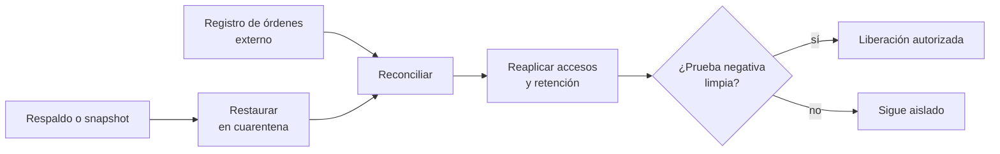

## 1. Resumen

Esta ficha no es asesoría legal: qué se conserva en los respaldos, por cuánto tiempo y qué excepciones aplican lo decide el responsable con el área legal; aquí se explica cómo restaurar sin deshacer las decisiones de privacidad.

**Cómo leerla.** *Comprender* (§1–6): RPO, RTO y el punto de control de privacidad. *Aplicar* (§7–13): cuarentena, reproducción de órdenes, accesos vigentes y liberación. *Demostrar*: la evidencia del §8, el código del §10 y los criterios del §18.

Una restauración puede reintroducir datos suprimidos, permisos antiguos o retenciones vencidas. El plan de recuperación incluye una **reconciliación de privacidad** después de restaurar y antes de liberar el sistema a los consumidores.

**Idea central:** el respaldo es una foto del pasado; las decisiones aprobadas después de la foto viven fuera de él y se vuelven a aplicar antes de que nadie lea.

## 2. Qué es

- **[Obligación legal · art. 14 quinquies]** Entre las medidas de seguridad, la capacidad de restaurar la disponibilidad y el acceso a los datos de forma rápida ante un incidente (letra c)) y la verificación regular de la eficacia de las medidas (letra d)).
- **[Obligación legal · art. 7]** La supresión procede por las causales del artículo y no procede en los casos que enumera.
- **[Obligación legal · art. 3]** Los datos se conservan solo el tiempo necesario y luego se suprimen o anonimizan (letra c)).
- **[Buena práctica]** Cuatro nociones:

| Noción | Qué es | Etiqueta |
|---|---|---|
| RPO | Pérdida máxima de datos tolerada en una recuperación | **[Buena práctica]** |
| RTO | Tiempo objetivo para recuperar el servicio | **[Buena práctica]** |
| Punto de control de privacidad | Última orden aplicada cuando se tomó el respaldo | **[Decisión de arquitectura]** |
| Reconciliación | Reproducir las órdenes posteriores y comprobar que lo restaurado las cumple | **[Decisión de arquitectura]** |

## 3. Problema que resuelve

**[Buena práctica]** Un respaldo de enero se restaura en marzo, pero en febrero se aprobó una supresión. Si el registro de órdenes estaba dentro del sistema restaurado, también volvió a enero: la supresión se perdió y el dato vuelve a circular con los permisos de entonces.

## 4. Cómo funciona

1. **[Buena práctica]** Inventariar respaldos, snapshots, réplicas y exportaciones, con su retención y su responsable.
2. **[Decisión de arquitectura]** Guardar el registro de órdenes de privacidad fuera del dominio que se respalda, protegido del mismo incidente.
3. **[Decisión de arquitectura]** Restaurar en cuarentena, sin lectores ni ingesta.
4. **[Decisión de arquitectura]** Reproducir, en orden e idempotentemente, las órdenes aprobadas después del punto del respaldo.
5. **[Buena práctica]** Reaplicar los accesos, la clasificación, la retención y las llaves vigentes, no los del momento del respaldo.
6. **[Buena práctica]** Correr la prueba negativa: ningún titular con supresión aprobada en lo restaurado, incluidos derivados y copias.
7. **[Buena práctica]** Liberar con aprobación operativa y registrar resultados, incertidumbres y excepciones.
   **[Decisión de arquitectura]** No se declara verificado lo que depende de la expiración de copias: un respaldo inmutable o una ventana de soft delete deja ese destino en `pendiente_expiracion_copias` hasta que vence (`retention-and-erasure`).
8. **[Obligación legal · art. 14 quinquies]** Verificar regularmente la eficacia de las medidas (letra d)). **[Buena práctica]** Ensayar restauración y reconciliación juntas, y medir el tiempo de reconciliación además del RTO y el RPO.

## 5. Cuándo utilizarlo

- En planes de recuperación ante desastres, restauraciones de tablas, incidentes de ransomware, migraciones y reconstrucción de ambientes.
- Al definir la retención de respaldos que contienen datos personales.

## 6. Cuándo no utilizarlo

- Para prometer la purga inmediata de todos los respaldos: hay ventanas de recuperación y restricciones técnicas, y su tratamiento lo decide el área legal.
- Como sustituto de la supresión en los sistemas activos: es lo que impide que una restauración la deshaga.

## 7. Ejemplo sencillo

| Paso | Qué se hace | Resultado |
|---|---|---|
| Restaurar | Bronze desde una copia con punto en la orden 10, en cuarentena | Tres titulares, sin lectores |
| Prueba negativa sin reconciliar | Buscar titulares con supresión aprobada | Reaparecen `t-02` y `t-03`: no se libera |
| Reproducir | Órdenes 11, 12 y 13: dos supresiones y una rectificación | Queda `t-01` |
| Accesos | Reaplicar los lectores vigentes | Sale `grp-ex-proveedor` |
| Liberar | La prueba negativa no encuentra suprimidos | Se libera |

## 8. Ejemplo de producción

Escenario genérico: una aerolínea restaura una tabla histórica de BigQuery en un dataset aislado. Un job de reconciliación aplica las órdenes vigentes desde el registro de órdenes, que está en otro proyecto; se corren las pruebas de no reintroducción y los controles de IAM; solo después se habilita la vista de consumo.

| Componente | Implementación posible |
|---|---|
| Registro de órdenes | Base transaccional en otro proyecto o cuenta, con su propio respaldo |
| Cuarentena | Dataset o bucket aislado, sin lectores ni ingesta |
| Reconciliación | Job idempotente que lee las órdenes posteriores al punto del respaldo |
| Accesos | IaC con los permisos vigentes, aplicada sobre lo restaurado |
| Liberación | Aprobación operativa con el resultado de la prueba negativa |

### Evidencia de cumplimiento

| Evidencia | Dónde queda | Quién la produce | Qué demuestra | Qué no demuestra |
|---|---|---|---|---|
| Punto del respaldo | Metadatos del respaldo | Plataforma | Desde qué fecha y qué orden se recuperó | Que el respaldo esté completo |
| Órdenes reproducidas | Log del job de reconciliación | Plataforma | Qué decisiones posteriores se aplicaron | Que no haya órdenes fuera del registro |
| Prueba negativa | Log del job | Plataforma | Que los suprimidos no reaparecen en lo restaurado | Que otras copias no los tengan |
| Validación de accesos | Configuración aplicada | Seguridad | Que rigen los permisos vigentes | El acceso de los consumidores fuera de la plataforma |
| Acta de liberación | Gestión de incidentes | Operación | Quién autorizó reabrir y cuándo | Que la restauración era necesaria |
| Ensayo periódico | Reporte del ejercicio | Seguridad e ingeniería | Cuánto tarda y qué cubre la reconciliación (art. 14 quinquies d)) | El comportamiento ante un incidente real |

## 9. Arquitectura



## 10. Código

```python
# Python 3.12+, biblioteca estándar. Restaurar con privacidad: el respaldo se restaura en cuarentena; se reproducen,
# en orden e idempotentemente, las órdenes aprobadas después del punto del respaldo (supresiones y rectificaciones),
# que viven en un registro fuera del dominio restaurado; se reaplican los accesos vigentes; una prueba negativa
# comprueba que nada suprimido reaparece, y solo entonces se libera a los consumidores.
from dataclasses import dataclass


@dataclass(frozen=True)
class Orden:
    secuencia: int            # orden total del registro de órdenes, externo al respaldo
    titular: str              # llave seudónima
    accion: str               # "suprimir" o "rectificar"
    valor: str | None = None  # valor rectificado


@dataclass(frozen=True)
class Respaldo:
    punto: int                # última secuencia de órdenes aplicada cuando se tomó
    filas: dict[str, str]
    lectores: frozenset[str]  # permisos del momento del respaldo


RESPALDO = Respaldo(10, {"t-01": "SCL-LIM", "t-02": "SCL-PMC", "t-03": "SCL-ANF"},
                    frozenset({"grp-soporte", "grp-ex-proveedor"}))
ORDENES = [Orden(8, "t-04", "suprimir"), Orden(11, "t-02", "suprimir"), Orden(12, "t-03", "rectificar", "SCL-CJC"),
           Orden(13, "t-03", "suprimir")]
LECTORES_VIGENTES = frozenset({"grp-soporte"})


def reconciliar(filas: dict[str, str], ordenes: list[Orden], punto: int) -> dict[str, str]:
    actual = dict(filas)
    for o in sorted(ordenes, key=lambda o: o.secuencia):
        if o.secuencia <= punto:
            continue                                  # ya estaba aplicada cuando se tomó el respaldo
        if o.accion == "suprimir":
            actual.pop(o.titular, None)
        elif o.accion == "rectificar" and o.titular in actual and o.valor is not None:
            actual[o.titular] = o.valor
    return actual


def reaparecen(filas: dict[str, str]) -> list[str]:
    """Prueba negativa antes de liberar: ningún titular con supresión aprobada puede estar en lo restaurado."""
    return sorted({o.titular for o in ORDENES if o.accion == "suprimir"} & set(filas))


def main() -> None:
    restaurado = dict(RESPALDO.filas)                 # en cuarentena: sin lectores
    print("sin reconciliar, reaparecen:", reaparecen(restaurado), "→ no se libera")
    print("órdenes posteriores al respaldo:", [o.secuencia for o in ORDENES if o.secuencia > RESPALDO.punto])
    filas = reconciliar(restaurado, ORDENES, RESPALDO.punto)
    print("filas tras reconciliar:", filas)
    print("¿idempotente?:", reconciliar(filas, ORDENES, RESPALDO.punto) == filas)
    print("lectores del respaldo:", sorted(RESPALDO.lectores), "| se reaplican los vigentes:", sorted(LECTORES_VIGENTES))
    print("liberar a consumidores:", "sí" if not reaparecen(filas) else "no, sigue aislado")


if __name__ == "__main__":
    main()
```

El script se **ejecuta en la CI** con la biblioteca estándar y pasa `mypy --strict`:

```text
sin reconciliar, reaparecen: ['t-02', 't-03'] → no se libera
órdenes posteriores al respaldo: [11, 12, 13]
filas tras reconciliar: {'t-01': 'SCL-LIM'}
¿idempotente?: True
lectores del respaldo: ['grp-ex-proveedor', 'grp-soporte'] | se reaplican los vigentes: ['grp-soporte']
liberar a consumidores: sí
```

**Limitaciones:** el ejemplo no representa excepciones, respaldos físicos ni garantías de eliminación en los respaldos: ilustra la reproducción de órdenes y la prueba que decide la liberación.

## 11. GCP

En GCP, **BigQuery** y **Cloud Storage**. Según *Introduction to table snapshots* y *Object Versioning* (no ejecutado):

| Necesidad | Servicio | Etiqueta |
|---|---|---|
| Respaldo de una tabla | Table snapshot: preserva el contenido en un momento, con expiración opcional; se restaura a una tabla estándar | **[Buena práctica]** |
| Más allá de la ventana | Time travel llega hasta siete días; el snapshot dura lo que se configure, y con él, los datos personales que contiene | **[Decisión de arquitectura]** |
| Objetos | Con Object Versioning las versiones no actuales siguen accesibles hasta borrarlas; la página recomienda soft delete contra la pérdida de datos | **[Buena práctica]** |

## 12. AWS

En AWS, **AWS Backup** y **Amazon S3**. Según *What is AWS Backup?* y *Locking objects with Object Lock* (no ejecutado):

| Necesidad | Servicio | Etiqueta |
|---|---|---|
| Respaldos centralizados | AWS Backup: políticas de respaldo y monitoreo en un solo lugar | **[Buena práctica]** |
| Inmutabilidad | Object Lock: modelo WORM con períodos de retención y legal holds | **[Buena práctica]** |
| Supresión en un respaldo inmutable | No se borra antes del plazo: se documenta la ventana y se reproduce la orden en toda restauración | **[Decisión de arquitectura]** |

## 13. Azure

En Azure, **Azure Storage**. Según *Soft delete for blobs* (no ejecutado):

| Necesidad | Servicio | Etiqueta |
|---|---|---|
| Recuperar un blob borrado | Soft delete: mantiene lo borrado durante el período de retención y se puede restaurar; al vencer, se borra en forma permanente | **[Buena práctica]** |
| Supresión de un titular | El dato sigue recuperable hasta que vence el período; la orden se reproduce si se restaura | **[Decisión de arquitectura]** |

**Criterio común:** las tres plataformas restauran datos; ninguna sabe qué decisiones de privacidad se tomaron después del respaldo. Ese registro y su reproducción son de la arquitectura propia.

## 14. Buenas prácticas

- **[Decisión de arquitectura]** Restaurar primero en cuarentena.
- **[Decisión de arquitectura]** Proteger el registro de órdenes fuera del dominio restaurado.
- **[Buena práctica]** Ensayar restauración y reconciliación juntas.
- **[Buena práctica]** **Seguridad:** la evidencia no lleva identificadores directos; los permisos se reaplican desde la IaC vigente.
- **[Buena práctica]** **Observabilidad:** tiempo de reconciliación, órdenes reproducidas y resultado de la prueba negativa en cada ensayo.
- **[Buena práctica]** **Costo:** la retención de los respaldos define cuánto dura cada dato personal fuera de los sistemas activos; acortarla reduce el alcance de cada reproducción.
- **[Buena práctica]** Incluir a proveedores y exportaciones en el alcance de la restauración.
- **[Buena práctica]** Fijar RPO y RTO con el tiempo de reconciliación incluido: el servicio no está recuperado mientras siga en cuarentena.

## 15. Errores frecuentes

- **Reabrir consultas apenas termina la restauración:** los consumidores leen datos suprimidos.
- **Restaurar las políticas de IAM del respaldo:** vuelven accesos revocados.
- **Confiar solo en el historial de la tabla:** el registro de órdenes no está ahí.
- **Registro de órdenes dentro del sistema que se respalda:** la restauración también lo devuelve al pasado.
- **No verificar que la lista de supresión esté al día:** la prueba negativa compara contra una lista vieja.

## 16. Trade-offs

| Decisión | Beneficio | Costo |
|---|---|---|
| Respaldos inmutables | Resiliencia ante ransomware | La supresión física espera al plazo |
| Respaldos con retención corta | Menos datos personales fuera de los sistemas | Menos puntos de recuperación |
| Cuarentena antes de liberar | No se exponen datos suprimidos | Más RTO |

## 17. Conceptos relacionados

- `chile-data-protection`: ficha padre.
- `retention-and-erasure`: ventanas de recuperación y purga.
- `distributed-erasure-propagation`: el registro de órdenes.
- `data-subject-rights-pipeline`: las decisiones que la restauración no deshace.
- `incident-response`: la restauración ante un incidente.
- `privacy-controls-as-code`: la prueba negativa como control.

## 18. Preguntas técnicas abiertas

1. ¿Qué decisiones posteriores al respaldo se pierden hoy si restauras?
2. ¿Dónde vive el registro de órdenes y qué respaldo tiene?
3. ¿Se puede restaurar sin reabrir datos a los consumidores?

**Criterio de dominio:** dominas esta ficha si puedes explicar qué es el punto de control de privacidad, por qué el registro de órdenes vive fuera de lo restaurado, qué comprueba la prueba negativa y por qué se reaplican los permisos vigentes.

## 19. Laboratorio relacionado

Propuesta para F4 (laboratorio integral, `docs/briefs/privacy-program/06-laboratorio-integral-gcp.md`): respaldo y restauración con datos ficticios; comprobar que la reintroducción se detecta antes de liberar el dataset.

## 20. Fuentes

- BCN Ley Chile: *Ley 19628 SOBRE PROTECCION DE LOS DATOS PERSONALES* (versión con vigencia diferida desde 2026-12-01).
- Google Cloud: *Introduction to table snapshots* y *Object Versioning*.
- AWS: *What is AWS Backup?* y *Locking objects with Object Lock*.
- Microsoft Learn: *Soft delete for blobs*.

El detalle de cada fuente está en `sources` del frontmatter.

## 21. Fecha de última verificación

2026-10-28: arts. 3, 7 y 14 quinquies consultados ese día en BCN; páginas de BigQuery, Cloud Storage, AWS Backup, Amazon S3 y Azure Storage consultadas ese día. `review_required`: pasa a `verified` solo con la aprobación explícita de Felipe (`owner_approved_at`). Revisión mensual.

## 22. Historial de cambios importantes

- 2026-10-28: creación (lote P2, dominio 24, ADR-027) desde `docs/briefs/privacy-program/05-recuperacion-respaldos-privacidad.md`, que es un guion, no una fuente.
- 2026-10-28: completada con lo que pedía el prompt de P2: regla «no se declara verificado lo que depende de la expiración de copias» en el §4 y RPO y RTO con la reconciliación en el §14. RPO y RTO ya estaban definidos en el §2.
