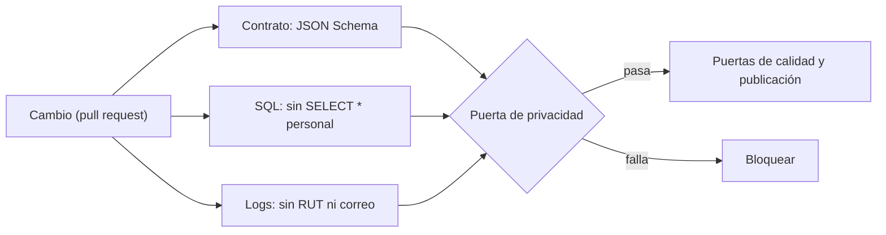

## 1. Resumen

Esta ficha no es asesoría legal: cubre cómo se revisa la privacidad desde el diseño en cada pipeline.

La ley pide medidas **desde el diseño**, antes y durante el tratamiento, y que **por defecto** solo se traten los datos estrictamente necesarios. En ingeniería de datos, la forma de cumplir eso en cada cambio es una **puerta de privacidad en la CI**, junto a las de calidad:

- el **contrato de datos** declara finalidad, base de licitud, retención y columnas personales;
- el **SQL** no copia tablas personales completas (`SELECT *`);
- los **logs** no tienen RUT ni correos en claro.

Si algo falla, el cambio no se publica.

## 2. Qué es

- **[Obligación legal · art. 14 quáter]** Medidas técnicas y organizativas desde el diseño, antes y durante el tratamiento; por defecto, solo los datos estrictamente necesarios.
- **[Obligación legal · art. 3]** Fines específicos y explícitos, y datos limitados a los necesarios por el tiempo necesario.
- **[Decisión de arquitectura]** La revisión de privacidad es automática y forma parte de la definición de terminado de cada pipeline.

## 3. Problema que resuelve

**[Buena práctica]** La revisión de privacidad es una reunión que ocurre a veces. Mientras tanto, un cambio agrega `SELECT *` de bronze a silver y un log de error imprime el RUT del cliente; nadie lo nota hasta una auditoría.

## 4. Cómo funciona

1. **[Obligación legal · art. 3]** El contrato del dataset declara finalidad, base, retención y columnas personales; un JSON Schema lo valida.
2. **[Obligación legal · art. 14 quáter]** El SQL del pipeline se revisa: nada de `SELECT *` sobre tablas marcadas como personales.
3. **[Buena práctica]** Los logs de la ejecución de prueba se escanean en busca de RUT y correos.
4. **[Decisión de arquitectura]** Cualquier hallazgo hace fallar la CI; las excepciones se aprueban y quedan registradas.

## 5. Cuándo utilizarlo

- En todo repositorio de pipelines con datos personales.
- Desde el primer pipeline: agregarla después obliga a corregir todo lo anterior.

## 6. Cuándo no utilizarlo

- Como única revisión: no ve combinaciones de columnas que identifican ni decide la base de licitud.
- Para tablas sin datos personales: la puerta se aplica según el catálogo.

## 7. Ejemplo sencillo

| Revisión | Hallazgo |
|---|---|
| Contrato de `silver.clientes` | Falta `base_licitud` y `retencion_dias` |
| SQL | `SELECT *` sobre `bronze.clientes` |
| Logs | Dos líneas con datos personales en claro |
| Puerta | Falla (5 hallazgos) |

## 8. Ejemplo de producción

- Contratos de datos versionados junto al pipeline.
- La puerta corre en cada pull request, antes de las pruebas de calidad.
- Las excepciones aprobadas viven en un archivo revisado por el dueño del dato.

### Evidencia de cumplimiento

| Evidencia | Dónde queda | Quién la produce |
|---|---|---|
| Resultado de la puerta por cambio | Log de la CI | CI |
| Contratos con finalidad, base y retención | Repositorio | Dueño del dato |
| Excepciones aprobadas | Repositorio, con quién y cuándo | Dueño del dato |

## 9. Arquitectura



## 10. Código

```python
# Python 3.12 y jsonschema (ejecutado en la CI): puerta de privacidad de un pipeline. Falla si el contrato de datos
# no declara finalidad, base, retención y columnas personales; si el SQL hace SELECT * sobre una tabla personal;
# o si los logs tienen un RUT o un correo en claro.
import re

from jsonschema import Draft202012Validator

CONTRATO_SCHEMA = {
    "type": "object",
    "required": ["dataset", "finalidad", "base_licitud", "retencion_dias", "columnas_personales"],
    "properties": {
        "finalidad": {"type": "string", "minLength": 1}, "base_licitud": {"type": "string", "minLength": 1},
        "retencion_dias": {"type": "integer", "minimum": 1}, "columnas_personales": {"type": "array", "items": {"type": "string"}},
    },
}
CONTRATO = {"dataset": "silver.clientes", "finalidad": "venta y despacho", "columnas_personales": ["cliente_key", "comuna"]}
TABLAS_PERSONALES = {"bronze.clientes", "silver.clientes"}
SQL = """
INSERT INTO silver.clientes SELECT * FROM bronze.clientes;
INSERT INTO gold.ventas SELECT comuna, sum(monto) FROM silver.clientes GROUP BY comuna;
"""
LOGS = ["cargando 120 filas", "error al validar cliente 11.111.111-1", "reintento para ana@example.com"]  # valores ficticios
EN_CLARO = re.compile(r"\d{1,2}\.?\d{3}\.?\d{3}-[\dkK]|[^@\s]+@[^@\s]+\.[a-z]{2,}", re.I)

hallazgos = [f"contrato: {e.message}" for e in Draft202012Validator(CONTRATO_SCHEMA).iter_errors(CONTRATO)]
for tabla in TABLAS_PERSONALES:
    if re.search(rf"SELECT\s+\*\s+FROM\s+{re.escape(tabla)}\b", SQL, re.I):
        hallazgos.append(f"SQL: SELECT * sobre la tabla personal {tabla}")
hallazgos += [f"log {i}: dato personal en claro" for i, linea in enumerate(LOGS) if EN_CLARO.search(linea)]
for h in sorted(hallazgos):
    print("-", h)
print(f"puerta de privacidad: {'falla' if hallazgos else 'pasa'} ({len(hallazgos)} hallazgos)")
```

El script se **ejecuta en la CI** con `jsonschema` (ya en `requirements.txt`). Como en `schema-validation`, no pasa por `mypy`, porque `jsonschema` no trae tipos. Imprime los 5 hallazgos (dos campos faltantes del contrato, el `SELECT *` y dos líneas de log) y que la puerta falla.

## 11. GCP

En GCP, **Sensitive Data Protection** como escaneo programado. Según *Ley 19628 SOBRE PROTECCION DE LOS DATOS PERSONALES* y *Sensitive Data Protection overview* (no ejecutado):

| | Puerta (este ejemplo) | Sensitive Data Protection | Etiqueta |
|---|---|---|---|
| Cuándo revisa | En cada cambio | Perfilado continuo de BigQuery, Cloud SQL y Cloud Storage | **[Buena práctica]** |
| Qué revisa | Contrato, SQL y logs | Datos sensibles en los datos | **[Decisión de arquitectura]** |

## 12. AWS

En AWS, **Amazon Macie**. Según *Ley 19628 SOBRE PROTECCION DE LOS DATOS PERSONALES* y *What is Amazon Macie?* (no ejecutado):

| | Puerta (este ejemplo) | Amazon Macie | Etiqueta |
|---|---|---|---|
| Cuándo revisa | En cada cambio | Sobre los objetos de Amazon S3 | **[Buena práctica]** |
| Qué revisa | Contrato, SQL y logs | Datos sensibles y seguridad de los buckets | **[Decisión de arquitectura]** |

## 13. Azure

En Azure, **Microsoft Purview** (Data Map). Según *Ley 19628 SOBRE PROTECCION DE LOS DATOS PERSONALES* y *Data classification in Data Map* (no ejecutado):

| | Puerta (este ejemplo) | Purview Data Map | Etiqueta |
|---|---|---|---|
| Cuándo revisa | En cada cambio | Al escanear los activos | **[Buena práctica]** |
| Qué revisa | Contrato, SQL y logs | Clasificación de los activos | **[Decisión de arquitectura]** |

## 14. Buenas prácticas

- **[Obligación legal · art. 14 quáter]** Que la opción por defecto de un dataset nuevo sea sin columnas personales.
- **[Buena práctica]** La puerta en la CI y el escaneo de la nube en producción: uno previene, el otro detecta.
- **[Buena práctica]** **Seguridad:** las excepciones son explícitas, con dueño y fecha de revisión.
- **[Buena práctica]** **Observabilidad:** contar hallazgos por equipo y por tipo, para ver dónde se repiten.
- **[Buena práctica]** **Costo:** la puerta es barata (revisa código y metadatos); el escaneo de datos se reserva para producción.

## 15. Errores frecuentes

- Una lista de verificación en un documento que nadie mira.
- Revisar solo el SQL y olvidar los logs.
- Excepciones permanentes sin dueño.

## 16. Trade-offs

Una puerta estricta frena cambios legítimos hasta que se aprueba la excepción; una puerta laxa deja pasar lo que después cuesta corregir en producción.

## 17. Conceptos relacionados

- `quality-gate`: las puertas de la CI.
- `data-contracts`: el contrato del dataset.
- `data-minimization-by-layer`: sin `SELECT *` sobre tablas personales.
- `pii-identification`: los patrones de RUT y correo.
- `schema-validation`: el contrato validado con JSON Schema.

## 18. Preguntas técnicas abiertas

1. ¿Tus contratos de datos declaran finalidad y retención?
2. ¿Tu CI falla si alguien hace `SELECT *` sobre una tabla con datos personales?
3. ¿Revisas los logs de tus pipelines en busca de datos personales?

## 19. Laboratorio relacionado

Pendiente (F4).

## 20. Fuentes

- BCN Ley Chile: *Ley 19628 SOBRE PROTECCION DE LOS DATOS PERSONALES* (versión con vigencia diferida desde 2026-12-01).
- jsonschema: *Schema Validation*.
- Google Cloud: *Sensitive Data Protection overview*.
- AWS: *What is Amazon Macie?*.
- Microsoft Learn: *Data classification in Data Map*.

El detalle de cada fuente está en `sources` del frontmatter.

## 21. Fecha de última verificación

2026-10-21: texto legal consultado ese día en BCN. `review_required`: pendiente de revisión B-F3.1 del lote F3b-19c; pasa a `verified` solo con la aprobación explícita de Felipe (`owner_approved_at`). Revisión mensual.

## 22. Historial de cambios importantes

- 2026-10-21: creación (lote F3b-19c).
