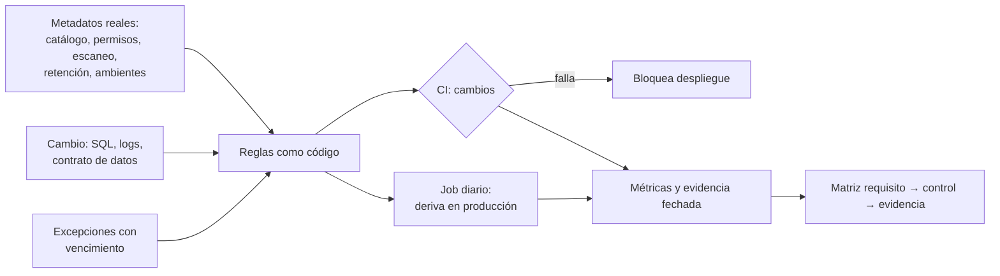

## 1. Resumen

Esta ficha no es asesoría legal: explica cómo convertir los requisitos de la ley en reglas verificables que corren en la CI y en producción.

Un control documentado no es un control implementado. La ley pide verificar regularmente que las medidas funcionan y, si después de un incidente hay una controversia judicial o administrativa, acreditar que existían y funcionaban. Eso se resuelve como cualquier otro requisito de ingeniería: **reglas como código** que leen el **estado real** de la plataforma (etiquetas, máscaras, permisos, retención, ambientes) y el **cambio** que se quiere desplegar (SQL, logs, contrato de datos), fallan la CI cuando algo no cumple y publican métricas de cobertura.

## 2. Qué es

- **[Obligación legal · art. 14 quinquies]** Las medidas de seguridad incluyen un proceso de verificación, evaluación y valoración regulares de su eficacia (letra d)); ante un incidente, si hay controversia judicial o administrativa, el responsable acredita que existían y funcionaban.
- **[Obligación legal · art. 14 quáter]** Medidas desde el diseño y, por defecto, solo los datos necesarios.
- **[Decisión de arquitectura]** **Política como código:** regla versionada que evalúa metadatos o el cambio y devuelve cumple o no cumple.
- **[Buena práctica]** **Dos momentos de evaluación:** en la CI (cambios de esquema, SQL y pipelines nuevos) y programada en producción (deriva de configuración, permisos agregados a mano).
- **[Buena práctica]** **Métricas:** cobertura de clasificación, de máscaras, de retención y de dueños; edad de la evidencia.

## 3. Problema que resuelve

**[Buena práctica]** La planilla dice «datos cifrados y con acceso restringido»; la realidad es una columna nueva sin etiqueta, 14 personas leyendo teléfonos sin máscara, una copia de producción en desarrollo y un log de error que imprime el RUT. Nadie lo nota hasta el incidente.

## 4. Cómo funciona

1. **[Buena práctica]** Extraer metadatos reales: catálogo, permisos, configuración de retención, resultados del escaneo de datos personales.
2. **[Obligación legal · art. 3]** Solo los datos necesarios para el fin (letra c)), y quienes tratan los datos responden por el cumplimiento (letra e)). **[Buena práctica]** Expresar cada requisito como regla con umbral: «toda tabla con retención y dueño», «sin `SELECT *` sobre tablas personales», «contrato con finalidad, base y retención».
3. **[Buena práctica]** Correr las reglas en la CI sobre los cambios y diariamente sobre producción.
4. **[Buena práctica]** Fallar con código distinto de cero; las excepciones se aprueban explícitamente, con fecha de vencimiento.
5. **[Buena práctica]** Publicar métricas y guardar los resultados como evidencia fechada: alimentan la matriz de `chile-data-protection` y, si el responsable adopta el modelo de prevención de infracciones, que es voluntario (art. 49), sirven a su certificación, que opera como atenuante (art. 36 n.º 5).

## 5. Cuándo utilizarlo

- En plataformas con varios equipos, donde los cambios manuales y la deriva de permisos son inevitables.
- Al preparar un modelo de prevención de infracciones (art. 49 y Decreto 662).

## 6. Cuándo no utilizarlo

- No reemplaza las decisiones del área legal ni la revisión de diseño: verifica que lo decidido esté aplicado.

## 7. Ejemplo sencillo

| Regla | Requisito | Fuente del metadato |
|---|---|---|
| Toda columna con datos personales tiene etiqueta | Art. 14 quáter | Escaneo de clasificación + catálogo |
| Datos de contacto con máscara | Art. 14 quinquies | Políticas de columna |
| Lectores sin máscara ≤ umbral | Art. 14 quinquies | Permisos |
| Sin datos personales reales fuera de producción | Art. 14 quinquies | Escaneo de ambientes |
| Toda tabla con retención y dueño | Art. 3 c) y e) | Catálogo |
| Sin `SELECT *` sobre tablas personales | Art. 14 quáter | SQL del cambio |
| Sin RUT ni correos en logs | Art. 14 quinquies | Logs de la ejecución de prueba |
| Contrato con finalidad, base y retención | Art. 3 c) | Contrato de datos |

## 8. Ejemplo de producción

| Componente | Implementación posible |
|---|---|
| Extracción | Job que lee el catálogo, las tablas de sistema y los permisos |
| Reglas | Python, SQL, OPA/Rego o tests de dbt |
| CI | Job bloqueante en el pipeline de despliegue |
| Producción | Job diario en el orquestador |
| Métricas | Tablero de cobertura y alertas por regresión |
| Excepciones | Archivo versionado con dueño, motivo y fecha de vencimiento |

### Evidencia de cumplimiento

| Evidencia | Dónde queda | Quién la produce |
|---|---|---|
| Resultado de cada evaluación | Log de la CI y tabla de resultados | CI, job diario |
| Métricas de cobertura en el tiempo | Tablero | Ingeniería |
| Excepciones aprobadas | Repositorio | Dueño del dato, seguridad |

## 9. Arquitectura



## 10. Código

```python
# Python 3.12+, biblioteca estándar. Políticas como código sobre metadatos reales de la plataforma
# (en producción: INFORMATION_SCHEMA, Unity Catalog, IAM). Verifica el estado configurado, no lo documentado,
# calcula métricas de cobertura y falla la CI si una regla no se cumple.
import re
import sys
from collections.abc import Callable
from dataclasses import dataclass


@dataclass(frozen=True)
class Columna:
    tabla: str
    nombre: str
    ambiente: str           # "prod" o "dev"
    pii: bool               # según el escaneo de clasificación
    etiqueta: str | None    # policy tag / tag de Unity Catalog
    mascara: bool           # máscara o política de columna activa
    lectores: int           # principals con lectura directa sin máscara


@dataclass(frozen=True)
class TablaMeta:
    nombre: str
    retencion_dias: int | None
    dueno: str | None


COLUMNAS = [
    Columna("silver.pasajeros", "rut_token", "prod", True, "pii.seudonimo", False, 3),
    Columna("silver.pasajeros", "email", "prod", True, "pii.contacto", True, 1),
    Columna("silver.pasajeros", "telefono", "prod", True, None, False, 14),
    Columna("dev.pasajeros_copia", "email", "dev", True, None, False, 40),
]
TABLAS = [TablaMeta("silver.pasajeros", 730, "equipo-clientes"), TablaMeta("dev.pasajeros_copia", None, None)]
MAX_LECTORES_SIN_MASCARA = 5
TABLAS_PII = {c.tabla for c in COLUMNAS if c.pii}
SQL_DEL_CAMBIO = "INSERT INTO gold.ventas SELECT * FROM silver.pasajeros;"  # el cambio que revisa la CI
LOGS = ["cargando 120 filas", "error al validar 11.111.111-1", "reintento para ana@example.com"]  # valores ficticios
EN_CLARO = re.compile(r"\d{1,2}\.?\d{3}\.?\d{3}-[\dkK]|[^@\s]+@[^@\s]+\.[a-z]{2,}", re.I)
CONTRATO = {"dataset": "gold.ventas", "finalidad": "reportes de venta"}  # le faltan base y retención
CAMPOS_CONTRATO = ("finalidad", "base_licitud", "retencion_dias")

REGLAS: dict[str, Callable[[Columna], bool]] = {
    "PII sin etiqueta": lambda c: c.pii and c.etiqueta is None,
    "PII de contacto sin máscara": lambda c: c.pii and c.etiqueta == "pii.contacto" and not c.mascara,
    "PII con demasiados lectores sin máscara": lambda c: c.pii and not c.mascara and c.lectores > MAX_LECTORES_SIN_MASCARA,
    "PII real en ambiente no productivo": lambda c: c.pii and c.ambiente != "prod",
}


def main() -> int:
    fallas = [f"{n}: {c.tabla}.{c.nombre}" for c in COLUMNAS for n, regla in REGLAS.items() if regla(c)]
    fallas += [f"tabla sin retención o dueño: {t.nombre}" for t in TABLAS if t.retencion_dias is None or not t.dueno]
    fallas += [f"SELECT * sobre tabla con PII: {t}" for t in sorted(TABLAS_PII)
               if re.search(rf"SELECT\s+\*\s+FROM\s+{re.escape(t)}\b", SQL_DEL_CAMBIO, re.I)]
    fallas += [f"PII en claro en el log {i}" for i, linea in enumerate(LOGS) if EN_CLARO.search(linea)]
    fallas += [f"contrato de {CONTRATO['dataset']} sin {c}" for c in CAMPOS_CONTRATO if c not in CONTRATO]
    pii = [c for c in COLUMNAS if c.pii]
    print(f"cobertura de etiquetas: {sum(c.etiqueta is not None for c in pii)}/{len(pii)}; "
          f"columnas PII con máscara: {sum(c.mascara for c in pii)}/{len(pii)}")
    for f in fallas:
        print("FALLA", f)
    return 1 if fallas else 0


if __name__ == "__main__":
    sys.exit(main())
```

El script se **ejecuta en la CI** con la biblioteca estándar y pasa `mypy --strict`. Imprime la cobertura (2 de 4 columnas personales con etiqueta, 1 de 4 con máscara) y 11 fallas: las seis del estado de la plataforma (la copia en desarrollo falla en cuatro reglas a la vez) y cinco del cambio (`SELECT *` sobre `silver.pasajeros`, dos líneas de log con datos en claro y el contrato sin base ni retención); termina con código 1. Las reglas leen el estado configurado y el cambio, no lo que dice la documentación.

## 11. GCP

En GCP, **BigQuery**. Según *Ley 19628 SOBRE PROTECCION DE LOS DATOS PERSONALES* e *Introduction to data masking* (no ejecutado):

| Necesidad | Servicio | Etiqueta |
|---|---|---|
| Políticas de columna | Enmascaramiento por columna sobre policy tags y data policies | **[Buena práctica]** |
| Reglas | Leer esas políticas y compararlas con la clasificación | **[Decisión de arquitectura]** |

## 12. AWS

En AWS, **Amazon Macie** y **Lake Formation**. Según *Ley 19628 SOBRE PROTECCION DE LOS DATOS PERSONALES*, *What is Amazon Macie?* y *Data filtering and cell-level security in Lake Formation* (no ejecutado):

| Necesidad | Servicio | Etiqueta |
|---|---|---|
| Escaneo de datos personales | Amazon Macie en S3 | **[Buena práctica]** |
| Permisos de datos | Filtros de columna, fila y celda en Lake Formation | **[Buena práctica]** |

## 13. Azure

En Azure, **Unity Catalog** y **Azure Policy**. Según *Ley 19628 SOBRE PROTECCION DE LOS DATOS PERSONALES*, *Row filters and column masks* y *Azure Policy built-in policy definitions* (no ejecutado):

| Necesidad | Servicio | Etiqueta |
|---|---|---|
| Máscaras y filtros | Row filters y column masks de Unity Catalog | **[Buena práctica]** |
| Políticas de recursos | Azure Policy con efectos Audit o Deny | **[Buena práctica]** |

## 14. Buenas prácticas

- **[Buena práctica]** Empezar con pocas reglas bloqueantes y muchas informativas; endurecer cuando la cobertura suba.
- **[Buena práctica]** **Seguridad:** el job de reglas usa una identidad de solo lectura sobre metadatos, sin acceso a los datos.
- **[Buena práctica]** **Observabilidad:** alertar por regresión de cobertura, no solo por fallas.
- **[Obligación legal · art. 14 septies]** La Agencia fijará por instrucción general estándares diferenciados según el tipo de dato, el tamaño de la entidad y el volumen. **[Buena práctica]** Ajustar los umbrales cuando se publiquen.
- **[Obligación legal · art. 36]** Es atenuante haber cumplido diligentemente los deberes de dirección y supervisión, lo que se verifica con el certificado del art. 51 (n.º 5). **[Buena práctica]** Las métricas y su historial respaldan ese cumplimiento.
- **[Buena práctica]** **Costo:** evaluar sobre metadatos, no escanear datos completos en cada corrida.

## 15. Errores frecuentes

- Reglas que leen un archivo de configuración y no el estado real.
- Correr solo en la CI y no detectar cambios manuales en producción.
- Excepciones sin dueño ni vencimiento.
- Métricas que nadie revisa.

## 16. Trade-offs

Reglas estrictas detienen despliegues y generan fricción; reglas laxas no protegen. Conviene empezar informativo, medir y volver bloqueante cada regla cuando el equipo puede cumplirla.

## 17. Conceptos relacionados

- `chile-data-protection`: ficha padre (la matriz).
- `quality-gate`: las puertas de la CI.
- `data-contracts`: el contrato del dataset.
- `data-minimization-by-layer`: sin `SELECT *` sobre tablas personales.
- `pii-identification`: columnas personales y patrones.
- `column-level-security`: máscaras y lectores.

## 18. Preguntas técnicas abiertas

1. ¿Qué porcentaje de tus columnas con datos personales tiene etiqueta y máscara hoy?
2. ¿Detectarías un permiso agregado a mano ayer?
3. ¿Tu CI falla si un cambio hace `SELECT *` sobre una tabla personal?

## 19. Laboratorio relacionado

Pendiente (F4).

## 20. Fuentes

- BCN Ley Chile: *Ley 19628 SOBRE PROTECCION DE LOS DATOS PERSONALES* (versión con vigencia diferida desde 2026-12-01) y *Decreto 662*.
- Google Cloud: *Introduction to data masking*.
- AWS: *What is Amazon Macie?* y *Data filtering and cell-level security in Lake Formation*.
- Microsoft Learn: *Row filters and column masks* y *Azure Policy built-in policy definitions*.

El detalle de cada fuente está en `sources` del frontmatter.

## 21. Fecha de última verificación

2026-10-25: textos legales vueltos a consultar en BCN, sin cambios. Antes, 2026-10-22: arts. 3, 14 quáter, 14 quinquies, 14 septies, 36 y 49 y Decreto 662 consultados ese día en BCN. `review_required`: pasa a `verified` solo con la aprobación explícita de Felipe (`owner_approved_at`). Revisión mensual.

## 22. Historial de cambios importantes

- 2026-10-22: creación (upgrade de 19); reemplaza a `privacy-by-design-checklist`, que queda como alias; rescata sus reglas de `SELECT *`, datos en logs y contrato de datos.
- 2026-10-24: `PART_OF` hacia `chile-data-protection` (ADR-024) e `implication` por artículo en `legal_basis` (enmienda de ADR-023). Sin cambios de contenido legal ni de código.
- 2026-10-25: revisión del upgrade (`docs/reviews/cards-f3b-19-upgrade.md`) y auditoría de las etiquetas «Obligación legal»: cada una afirma solo lo que dice su artículo; lo demás pasa a buena práctica o decisión de arquitectura. Textos de BCN y del Senado consultados el 2026-10-25, sin cambios desde el 2026-10-22.
