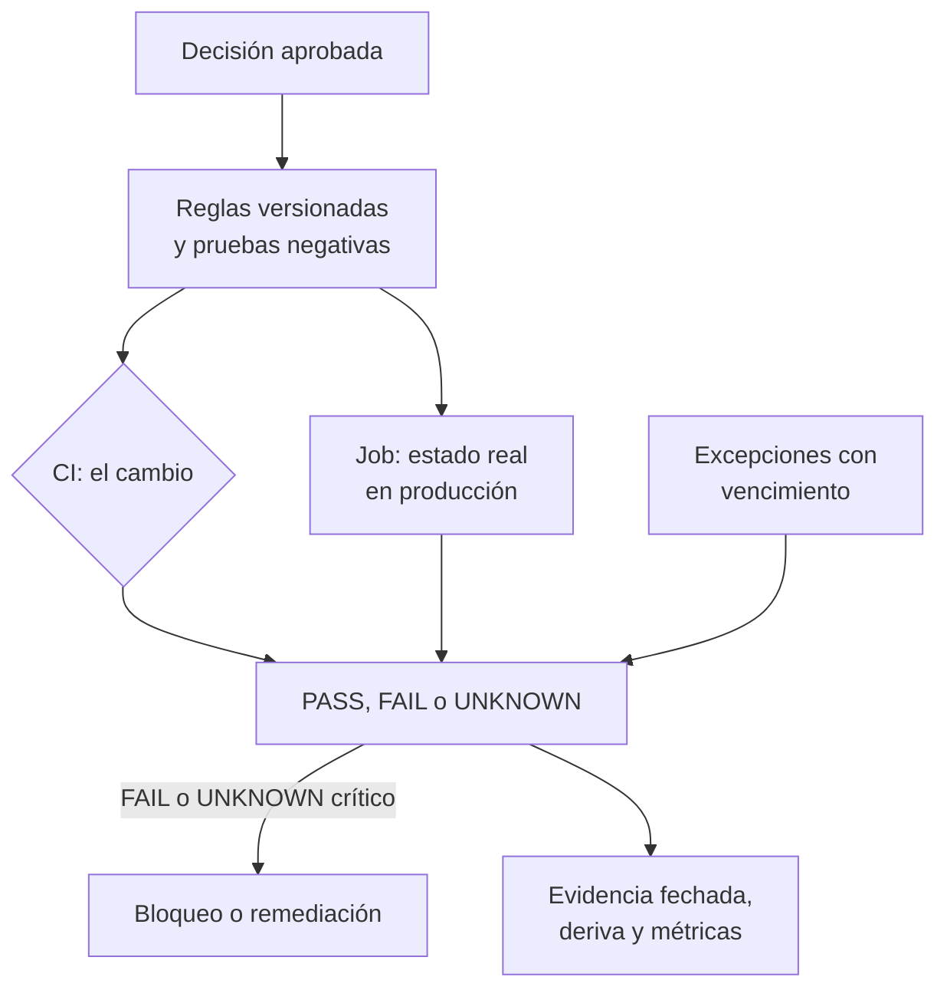

## 1. Resumen

Esta ficha no es asesoría legal: explica cómo convertir decisiones aprobadas (por el responsable, el área legal, seguridad y gobierno) en reglas verificables que corren en la CI y en producción. Un check, una máscara o una métrica no son exigencias tecnológicas literales de la ley.

**Cómo leerla.** *Comprender* (§1–6): qué es un control verificable, por qué hay tres resultados y no dos, y qué es la deriva. *Aplicar* (§7–13): reglas sobre el cambio y sobre el estado real, excepciones con vencimiento y pruebas negativas. *Demostrar*: la evidencia del §8, el código del §10 y los criterios del §18.

Un control documentado no es un control implementado. La ley pide verificar regularmente que las medidas funcionan y, si después de un incidente hay una controversia judicial o administrativa, acreditar que existían y funcionaban. Eso se resuelve como cualquier otro requisito de ingeniería: **reglas como código** que evalúan el **cambio** que se quiere desplegar (SQL, logs, contrato de datos) y el **estado real** de la plataforma (etiquetas, máscaras, permisos, retención, ambientes), fallan la CI cuando algo no cumple y publican métricas de cobertura. Su valor no es afirmar «cumplimos la ley», sino detectar desviaciones, prevenir despliegues riesgosos y producir evidencia reproducible.

## 2. Qué es

- **[Obligación legal · art. 14 quinquies]** Las medidas de seguridad incluyen un proceso de verificación, evaluación y valoración regulares de su eficacia (letra d)); ante un incidente, si hay controversia judicial o administrativa, el responsable acredita que existían y funcionaban.
- **[Obligación legal · art. 14 quáter]** Medidas desde el diseño y, por defecto, solo los datos necesarios.
- **[Decisión de arquitectura]** **Control verificable:** objetivo, alcance, fuente confiable del metadato, regla, resultado esperado, severidad, responsable, evidencia y tratamiento de excepciones, versionados.
- **[Buena práctica]** Tres niveles que no se mezclan: la **decisión aprobada** (área legal, gobierno), el **control** (cómo se implementa) y la **prueba** (cómo se demuestra). Minimizar el acceso no obliga a enmascarar todas las columnas personales: puede resolverse con vistas, roles, separación de ambientes o quitando atributos.
- **[Decisión de arquitectura]** **Tres resultados:**

| Resultado | Significa | Tratamiento | Etiqueta |
|---|---|---|---|
| PASS | La regla se verificó y se cumple | Registrar la evidencia | **[Decisión de arquitectura]** |
| FAIL | Hay evidencia de que la regla técnica no se cumple | Bloquear el cambio o abrir la remediación | **[Decisión de arquitectura]** |
| UNKNOWN | No hubo información suficiente para comprobarla (API sin respuesta, metadato faltante u obsoleto) | Nunca cuenta como PASS; en reglas críticas bloquea | **[Decisión de arquitectura]** |

- **[Buena práctica]** **Dos momentos de evaluación:** en la CI (cambios de esquema, SQL, IaC y pipelines nuevos) y programada en producción (deriva de configuración, permisos agregados a mano). **Deriva** es la diferencia entre lo aprobado en Git y lo observado en la plataforma.
- **[Buena práctica]** **Métricas:** cobertura de clasificación, de máscaras, de retención y de dueños; edad de la evidencia; tiempo de corrección.
- **[Buena práctica]** Como referencia conceptual (Nivel 4), el Privacy Engineering Program del NIST trata la privacidad como un riesgo que se identifica, evalúa y prioriza con ingeniería de sistemas, y la guía de la CNIL para desarrolladores propone Privacy by Design y pruebas automatizadas; la guía de la CNIL describe el RGPD: no son obligaciones chilenas.

## 3. Problema que resuelve

**[Buena práctica]** La planilla dice «datos cifrados y con acceso restringido»; la realidad es una columna nueva sin etiqueta, 14 personas leyendo teléfonos sin máscara, un permiso dado a mano fuera de Terraform, una copia de producción en desarrollo y un log de error que imprime el RUT. El repositorio y la CI pueden estar en verde mientras el entorno real no lo está. Nadie lo nota hasta el incidente.

## 4. Cómo funciona

1. **[Buena práctica]** Definir el control desde una decisión aprobada, con dueño, alcance y criterio de aprobación: una matriz riesgo → decisión → control → consulta verificadora → evidencia.
2. **[Buena práctica]** Extraer metadatos reales: catálogo, permisos efectivos, configuración de retención, resultados del escaneo de datos personales; leer datos solo cuando sea necesario y esté autorizado.
3. **[Obligación legal · art. 3]** Solo los datos necesarios para el fin (letra c)), y quienes tratan los datos responden por el cumplimiento (letra e)). **[Buena práctica]** Expresar cada requisito como regla: «toda tabla con retención y dueño», «sin `SELECT *` sobre tablas personales», «contrato con finalidad, base y retención».
4. **[Buena práctica]** Correr las reglas en la CI sobre los cambios y programadas sobre producción; comparar lo declarado en Git con lo observado.
5. **[Decisión de arquitectura]** Emitir PASS, FAIL o UNKNOWN con severidad; fallar cerrado en las reglas críticas cuando no hay evidencia confiable.
6. **[Buena práctica]** Las excepciones se aprueban explícitamente, con dueño, motivo, alcance, compensación y fecha de vencimiento; una excepción vencida vuelve a ser FAIL.
7. **[Buena práctica]** Probar cada regla con un caso que debe fallar (prueba negativa) y uno que debe pasar; medir la eficacia con ejercicios de acceso, no solo con la presencia de etiquetas.
8. **[Buena práctica]** Publicar métricas y guardar los resultados como evidencia fechada, con versión de la regla, activos evaluados y fuente: alimentan la matriz de `chile-data-protection` y, si el responsable adopta el modelo de prevención de infracciones, que es voluntario (art. 49), sirven a su certificación, que opera como atenuante (art. 36 n.º 5).

**[Buena práctica]** El análisis estático de SQL, los escaneos de datos personales y la lectura de permisos tienen falsos positivos y negativos; ninguno reemplaza las pruebas de ejecución ni la revisión de contexto.

## 5. Cuándo utilizarlo

- En plataformas con varios equipos, ambientes y automatizaciones, donde los cambios manuales y la deriva de permisos son inevitables.
- En despliegues de datos, infraestructura y modelos, fuentes nuevas, cambios de acceso y migraciones.
- Al preparar un modelo de prevención de infracciones (art. 49 y Decreto 662).

## 6. Cuándo no utilizarlo

- No reemplaza las decisiones del área legal ni la revisión de diseño: verifica que lo decidido esté aplicado. No decide la base de licitud, el plazo legal, la procedencia de una solicitud ni la categoría jurídica de un campo ambiguo.
- Cuando la fuente de metadatos está incompleta o el control no puede observar el comportamiento real: el resultado es UNKNOWN, no PASS.
- Un regex sobre SQL no prueba la minimización, y pasar los controles no demuestra el cumplimiento legal.

## 7. Ejemplo sencillo

| Regla | Requisito | Fuente del metadato |
|---|---|---|
| Toda columna con datos personales tiene etiqueta | Art. 14 quáter | Escaneo de clasificación + catálogo |
| Datos de contacto con máscara | Art. 14 quinquies | Políticas de columna |
| Lectores sin máscara ≤ umbral interno | Art. 14 quinquies | Permisos |
| Sin datos personales reales fuera de producción | Art. 14 quinquies | Escaneo de ambientes |
| Toda tabla con retención y dueño | Art. 3 c) y e) | Catálogo |
| Sin `SELECT *` sobre tablas personales | Art. 14 quáter | SQL del cambio |
| Sin RUT ni correos en logs | Art. 14 quinquies | Logs de la ejecución de prueba |
| Contrato con finalidad, base y retención | Art. 3 c) | Contrato de datos |

Las reglas son decisiones locales que implementan un requisito, no umbrales de la ley: «todas las PII con máscara», «máximo cinco lectores» o «prohibido todo `SELECT *`» se ajustan al contexto y, cuando la Agencia publique estándares (art. 14 septies), a ellos. Ejemplo de los tres resultados: si falta el dueño de un dataset personal, FAIL; si la API del catálogo no respondió, UNKNOWN, nunca PASS.

## 8. Ejemplo de producción

Escenario genérico: una aerolínea despliega `silver.pasajeros` en BigQuery. El contrato de datos declara finalidad, columnas autorizadas, consumidores, retención y dueño. La CI verifica esos metadatos y que el IaC no cree permisos incompatibles; un job programado contrasta lo declarado con los permisos y políticas efectivos, detecta una concesión manual y abre un ticket con la evidencia.

| Componente | Implementación posible |
|---|---|
| Extracción | Job de solo lectura sobre el catálogo, las vistas de metadatos y los permisos |
| Reglas | Python, SQL, OPA/Rego o tests de dbt, versionados con sus pruebas negativas |
| CI | Job bloqueante en el pipeline de despliegue |
| Producción | Job programado en el orquestador, con la fecha de captura de cada metadato |
| Métricas | Tablero de cobertura y alertas por regresión |
| Excepciones | Archivo versionado con dueño, motivo, compensación y fecha de vencimiento |

### Evidencia de cumplimiento

| Evidencia | Dónde queda | Quién la produce | Qué demuestra | Qué no demuestra |
|---|---|---|---|---|
| Resultado de la CI y versión del commit | Log de la CI | CI | Cómo se evaluó el cambio | El estado real en producción |
| Snapshot de permisos y políticas efectivos | Tabla de resultados del job | Job programado | Qué se observó en un momento | El acceso efectivo por todas las rutas |
| Prueba negativa de cada regla | Repositorio y log de la CI | Ingeniería | Que la regla detecta su caso malo | Que cubra todos los consumidores |
| Excepciones con vencimiento | Repositorio | Dueño del dato, seguridad | Una decisión trazable y acotada | Que el riesgo deje de existir |
| Hallazgos y remediaciones | Sistema de incidencias | Ingeniería | Qué se encontró y cómo se cerró | Una incidencia abierta no es un control resuelto |
| Métricas de cobertura en el tiempo | Tablero | Ingeniería | La evolución de la cobertura | Que los UNKNOWN estén resueltos |

## 9. Arquitectura



## 10. Código

```python
# Python 3.12+, biblioteca estándar. Políticas como código sobre metadatos reales de la plataforma
# (en producción: INFORMATION_SCHEMA, Unity Catalog, IAM) y sobre el cambio que se quiere desplegar. Cada regla
# devuelve PASS, FAIL o UNKNOWN (no se pudo verificar: nunca cuenta como PASS); las excepciones tienen dueño y
# vencimiento; se compara lo declarado en Git con lo observado en producción (deriva) y cada regla tiene una prueba
# negativa que debe fallar. La CI falla con un FAIL o con un UNKNOWN de una regla crítica.
import re
import sys
from collections import Counter
from collections.abc import Callable
from dataclasses import dataclass
from datetime import date
from typing import Literal

Estado = Literal["PASS", "FAIL", "UNKNOWN"]
HOY = date(2026, 10, 28)


@dataclass(frozen=True)
class Columna:
    tabla: str
    nombre: str
    ambiente: str           # "prod" o "dev"
    pii: bool               # según el escaneo de clasificación
    etiqueta: str | None    # policy tag / tag de Unity Catalog
    mascara: bool | None    # máscara o política de columna activa; None: la API no respondió
    lectores: int | None    # principals con lectura directa sin máscara; None: no se pudo leer

    @property
    def id(self) -> str:
        return f"{self.tabla}.{self.nombre}"


@dataclass(frozen=True)
class TablaMeta:
    nombre: str
    retencion_dias: int | None
    dueno: str | None


COLUMNAS = [  # estado observado en producción
    Columna("silver.pasajeros", "rut_token", "prod", True, "pii.seudonimo", False, 3),
    Columna("silver.pasajeros", "email", "prod", True, "pii.contacto", True, 1),
    Columna("silver.pasajeros", "telefono", "prod", True, None, False, 14),
    Columna("dev.pasajeros_copia", "email", "dev", True, None, False, 40),
    Columna("gold.clientes_contacto", "telefono", "prod", True, "pii.contacto", None, None),
]
TABLAS = [TablaMeta("silver.pasajeros", 730, "equipo-clientes"), TablaMeta("dev.pasajeros_copia", None, None)]
MASCARAS_EN_GIT = {"silver.pasajeros.email", "silver.pasajeros.telefono"}   # lo declarado en el repositorio
EXCEPCIONES = {  # (regla, activo) → (vencimiento, dueño)
    ("PII con demasiados lectores sin máscara", "silver.pasajeros.telefono"): (date(2026, 11, 30), "equipo-clientes"),
    ("PII real en ambiente no productivo", "dev.pasajeros_copia.email"): (date(2026, 10, 1), "qa"),
}
MAX_LECTORES_SIN_MASCARA = 5   # decisión interna, no un umbral de la ley
CRITICAS = {"PII de contacto sin máscara", "PII real en ambiente no productivo"}
SQL_DEL_CAMBIO = "INSERT INTO gold.ventas SELECT * FROM silver.pasajeros;"  # el cambio que revisa la CI
LOGS = ["cargando 120 filas", "error al validar 11.111.111-1", "reintento para ana@example.com"]  # valores ficticios
EN_CLARO = re.compile(r"\d{1,2}\.?\d{3}\.?\d{3}-[\dkK]|[^@\s]+@[^@\s]+\.[a-z]{2,}", re.I)
CONTRATO = {"dataset": "gold.ventas", "finalidad": "reportes de venta"}  # le faltan base y retención
CAMPOS_CONTRATO = ("finalidad", "base_licitud", "retencion_dias")


def sin_mascara(c: Columna) -> Estado:
    if not (c.pii and c.etiqueta == "pii.contacto"):
        return "PASS"
    return "UNKNOWN" if c.mascara is None else ("FAIL" if not c.mascara else "PASS")


def muchos_lectores(c: Columna) -> Estado:
    if not c.pii or c.mascara is True:
        return "PASS"
    if c.mascara is None or c.lectores is None:
        return "UNKNOWN"
    return "FAIL" if c.lectores > MAX_LECTORES_SIN_MASCARA else "PASS"


REGLAS: dict[str, Callable[[Columna], Estado]] = {
    "PII sin etiqueta": lambda c: "FAIL" if c.pii and c.etiqueta is None else "PASS",
    "PII de contacto sin máscara": sin_mascara,
    "PII con demasiados lectores sin máscara": muchos_lectores,
    "PII real en ambiente no productivo": lambda c: "FAIL" if c.pii and c.ambiente != "prod" else "PASS",
}
CASOS_MALOS = {  # prueba negativa: un caso que cada regla debe detectar
    "PII sin etiqueta": Columna("prueba.t", "c", "prod", True, None, True, 0),
    "PII de contacto sin máscara": Columna("prueba.t", "c", "prod", True, "pii.contacto", False, 0),
    "PII con demasiados lectores sin máscara": Columna("prueba.t", "c", "prod", True, "pii.otro", False, 99),
    "PII real en ambiente no productivo": Columna("prueba.t", "c", "dev", True, "pii.otro", True, 0),
}


def evaluar() -> list[tuple[str, str, str]]:
    """(estado, regla, activo); una excepción vigente cambia el FAIL por EXCEPCIÓN, una vencida no."""
    salida: list[tuple[str, str, str]] = []
    for c in COLUMNAS:
        for regla, f in REGLAS.items():
            estado: str = f(c)
            excepcion = EXCEPCIONES.get((regla, c.id))
            if estado == "FAIL" and excepcion:
                vence, dueno = excepcion
                if vence >= HOY:
                    estado = "EXCEPCIÓN"
                    regla += f" (vence {vence}, dueño {dueno})"
                else:
                    regla += f" (excepción vencida el {vence})"
            salida.append((estado, regla, c.id))
    salida += [("FAIL", "tabla sin retención o dueño", t.nombre) for t in TABLAS if t.retencion_dias is None or not t.dueno]
    salida += [("FAIL", "SELECT * sobre tabla con PII", t) for t in sorted({c.tabla for c in COLUMNAS if c.pii})
               if re.search(rf"SELECT\s+\*\s+FROM\s+{re.escape(t)}\b", SQL_DEL_CAMBIO, re.I)]
    salida += [("FAIL", "PII en claro en el log", f"línea {i}") for i, linea in enumerate(LOGS) if EN_CLARO.search(linea)]
    salida += [("FAIL", f"contrato sin {campo}", CONTRATO["dataset"]) for campo in CAMPOS_CONTRATO if campo not in CONTRATO]
    return salida


def main() -> int:
    resultados = evaluar()
    pii = [c for c in COLUMNAS if c.pii]
    print(f"cobertura de etiquetas: {sum(c.etiqueta is not None for c in pii)}/{len(pii)}; "
          f"columnas PII con máscara: {sum(c.mascara is True for c in pii)}/{len(pii)} "
          f"({sum(c.mascara is None for c in pii)} sin verificar)")
    for estado, regla, activo in resultados:
        if estado != "PASS":
            print(estado, f"{regla}: {activo}")
    observadas = {c.id for c in COLUMNAS if c.mascara}
    for activo in sorted(MASCARAS_EN_GIT - observadas):
        print(f"DERIVA {activo}: máscara declarada en Git y ausente en producción")
    detectan = [r for r, malo in CASOS_MALOS.items() if REGLAS[r](malo) == "FAIL"]
    print(f"pruebas negativas: {len(detectan)}/{len(REGLAS)} reglas detectan su caso malo")
    print("resultados:", dict(sorted(Counter(e for e, _, _ in resultados).items())))
    bloquea = any(e == "FAIL" or (e == "UNKNOWN" and r in CRITICAS) for e, r, _ in resultados)
    return 1 if bloquea or len(detectan) < len(REGLAS) else 0


if __name__ == "__main__":
    sys.exit(main())
```

El script se **ejecuta en la CI** con la biblioteca estándar y pasa `mypy --strict`. Los RUT y correos de los logs son ficticios. Imprime la cobertura (3 de 5 columnas personales con etiqueta, 1 de 5 con máscara y 1 sin verificar), los resultados que no son PASS, la deriva, las pruebas negativas y el resumen; termina con código 1:

```text
EXCEPCIÓN PII con demasiados lectores sin máscara (vence 2026-11-30, dueño equipo-clientes): silver.pasajeros.telefono
FAIL PII real en ambiente no productivo (excepción vencida el 2026-10-01): dev.pasajeros_copia.email
UNKNOWN PII de contacto sin máscara: gold.clientes_contacto.telefono
DERIVA silver.pasajeros.telefono: máscara declarada en Git y ausente en producción
pruebas negativas: 4/4 reglas detectan su caso malo
resultados: {'EXCEPCIÓN': 1, 'FAIL': 10, 'PASS': 13, 'UNKNOWN': 2}
```

Los diez FAIL vienen del estado de la plataforma (la copia en desarrollo falla en tres reglas y su tabla no tiene retención ni dueño; el teléfono de `silver.pasajeros` no tiene etiqueta) y del cambio (`SELECT *` sobre `silver.pasajeros`, dos líneas de log con datos en claro y el contrato sin base ni retención). El UNKNOWN de la máscara bloquea porque la regla es crítica: no se pudo verificar, y eso no es un PASS. **Limitaciones:** evalúa metadatos simulados; no consulta permisos reales ni verifica que una política sea jurídicamente suficiente.

## 11. GCP

En GCP, **BigQuery**. Según *Introduction to data masking* e *Introduction to INFORMATION_SCHEMA* (no ejecutado):

| Necesidad | Servicio | Etiqueta |
|---|---|---|
| Políticas de columna | Enmascaramiento por columna sobre policy tags y data policies | **[Buena práctica]** |
| Metadatos para las reglas | Vistas `INFORMATION_SCHEMA` de solo lectura sobre datasets, jobs y control de acceso (por ejemplo, `OBJECT_PRIVILEGES`) | **[Buena práctica]** |
| Reglas | Leer esas políticas y privilegios y compararlos con la clasificación y lo declarado en Git; si una vista no responde, UNKNOWN | **[Decisión de arquitectura]** |

## 12. AWS

En AWS, **Amazon Macie** y **Lake Formation**. Según *What is Amazon Macie?* y *Data filtering and cell-level security in Lake Formation* (no ejecutado):

| Necesidad | Servicio | Etiqueta |
|---|---|---|
| Escaneo de datos personales | Amazon Macie en los buckets de propósito general de S3 | **[Buena práctica]** |
| Permisos de datos | Filtros de columna, fila y celda en Lake Formation | **[Buena práctica]** |
| Lo que no cubre | Macie inventaría S3, no los demás almacenes: fuera de su alcance, el resultado de esa regla es UNKNOWN | **[Decisión de arquitectura]** |

## 13. Azure

En Azure, **Unity Catalog** y **Azure Policy**. Según *Row filters and column masks* y *Azure Policy built-in policy definitions* (no ejecutado):

| Necesidad | Servicio | Etiqueta |
|---|---|---|
| Máscaras y filtros | Row filters y column masks de Unity Catalog | **[Buena práctica]** |
| Políticas de recursos | Azure Policy con efectos Audit o Deny | **[Buena práctica]** |
| Lo que no cubre | Una política sobre recursos no equivale a un control de columna o de contenido | **[Decisión de arquitectura]** |

**Criterio común:** cada servicio aporta evidencia parcial; la regla declara qué fuente usó, cuándo la leyó y qué no cubre.

## 14. Buenas prácticas

- **[Buena práctica]** Trazabilidad decisión aprobada → control → implementación → evidencia → responsable; separar controles preventivos (CI), detectivos (producción) y correctivos (remediación).
- **[Buena práctica]** Empezar con pocas reglas bloqueantes y muchas informativas; endurecer cuando la cobertura suba. La severidad sigue al riesgo y a la confiabilidad de la señal: bloquear la exposición confirmada, revisar los hallazgos heurísticos.
- **[Buena práctica]** **Seguridad:** el job de reglas usa una identidad de solo lectura sobre metadatos, sin acceso a los datos; la evidencia también se protege, porque nombra recursos e identidades.
- **[Buena práctica]** **Observabilidad:** alertar por regresión de cobertura, por UNKNOWN persistentes, por activos no inventariados y por evidencia vencida, no solo por fallas.
- **[Obligación legal · art. 14 septies]** La Agencia fijará por instrucción general estándares diferenciados según el tipo de dato, el tamaño de la entidad y el volumen. **[Buena práctica]** Ajustar los umbrales cuando se publiquen.
- **[Obligación legal · art. 36]** Es atenuante haber cumplido diligentemente los deberes de dirección y supervisión, lo que se verifica con el certificado del art. 51 (n.º 5). **[Buena práctica]** Las métricas y su historial respaldan ese cumplimiento.
- **[Buena práctica]** **Costo:** evaluar sobre metadatos y por cambio, con barridos programados; no escanear datos completos en cada corrida.

## 15. Errores frecuentes

- **Reglas que leen un archivo de configuración y no el estado real:** los cambios manuales en producción pasan sin verse.
- **Correr solo en la CI:** la deriva aparece entre despliegues y nadie la detecta.
- **Tratar UNKNOWN como PASS:** un error de inventario o una API caída se reporta como cumplimiento.
- **Contar etiquetas como si fueran máscaras efectivas:** la cobertura reportada no protege nada.
- **Usar un regex para declarar ausencia de datos personales:** los falsos negativos quedan como certificados.
- **Imponer un número universal de lectores o tratar todo `SELECT *` como infracción legal:** se confunde una decisión local con la ley.
- **Excepciones sin dueño ni vencimiento:** el riesgo aceptado se vuelve permanente.
- **Reglas sin prueba negativa:** una regla que nunca falla puede estar rota.
- **Métricas que nadie revisa:** la evidencia existe, pero no cambia nada.

## 16. Trade-offs

| Decisión | Beneficio | Costo o riesgo |
|---|---|---|
| Checks bloqueantes | Previenen despliegues riesgosos | Los falsos positivos detienen entregas |
| Checks informativos | Adopción progresiva | Los hallazgos pueden quedar sin resolver |
| Fallar cerrado ante UNKNOWN | No se aprueba lo no verificado | Una API caída bloquea el despliegue |
| Escaneo de datos | Detecta atributos no declarados | Costo, exposición adicional y permisos |
| Solo metadatos | Rápido y poco intrusivo | No confirma el contenido real |
| Verificación diaria | Detecta la deriva | Queda una ventana entre el cambio y la detección |

## 17. Conceptos relacionados

- `chile-data-protection`: ficha padre (la matriz).
- `quality-gate`: las puertas de la CI.
- `data-contracts`: el contrato del dataset.
- `processing-activities-inventory`: finalidad, dueño y retención aprobados.
- `data-minimization-by-layer`: sin `SELECT *` sobre tablas personales.
- `pii-identification`: columnas personales y patrones.
- `column-level-security`: máscaras y lectores.
- `bigquery-information-schema`: metadatos para las reglas en GCP.

Nota editorial: esta ficha incluye el contenido avanzado de Privacy as Code (PASS/FAIL/UNKNOWN, excepciones con vencimiento, deriva y pruebas negativas); no hay una ficha aparte.

## 18. Preguntas técnicas abiertas

1. ¿Qué porcentaje de tus columnas con datos personales tiene etiqueta y máscara hoy, y cuántas no puedes verificar?
2. ¿Detectarías un permiso agregado a mano ayer?
3. ¿Qué hace tu CI si la API del catálogo no responde?
4. ¿Cuánto dura una excepción y quién la renueva?
5. ¿Qué reglas tienen una prueba negativa?

**Criterio de dominio:** dominas esta ficha si puedes explicar cómo se define un control a partir de una decisión aprobada, cómo consulta el estado efectivo, qué hace ante datos faltantes (UNKNOWN), cómo evita falsos positivos, cuándo bloquea un despliegue, cómo gestiona excepciones con vencimiento y cómo preserva la evidencia.

## 19. Laboratorio relacionado

Propuesta para F4: un inventario sintético de cinco datasets y tres reglas en la CI; introducir un dataset sin dueño, simular un permiso que no se puede verificar y una excepción vencida, y comprobar que el job falla. Después, reemplazar el inventario simulado por una extracción de solo lectura de metadatos de BigQuery, registrar la fecha de captura y publicar un reporte PASS, FAIL y UNKNOWN. Se aprueba si ninguna evaluación incompleta aparece como aprobada.

## 20. Fuentes

- BCN Ley Chile: *Ley 19628 SOBRE PROTECCION DE LOS DATOS PERSONALES* (versión con vigencia diferida desde 2026-12-01) y *Decreto 662*.
- Google Cloud: *Introduction to data masking* e *Introduction to INFORMATION_SCHEMA*.
- AWS: *What is Amazon Macie?* y *Data filtering and cell-level security in Lake Formation*.
- Microsoft Learn: *Row filters and column masks* y *Azure Policy built-in policy definitions*.
- Referencias conceptuales (Nivel 4): NIST, *Privacy engineering*; CNIL, *GDPR developer's guide* (no son obligaciones chilenas).

El detalle de cada fuente está en `sources` del frontmatter.

## 21. Fecha de última verificación

2026-10-28: *Introduction to INFORMATION_SCHEMA*, *Privacy engineering* (NIST) y *GDPR developer's guide* (CNIL) consultadas ese día. Antes, 2026-10-25: textos legales vueltos a consultar en BCN, sin cambios, y 2026-10-22: arts. 3, 14 quáter, 14 quinquies, 14 septies, 36 y 49 y Decreto 662 consultados ese día. `review_required`: pasa a `verified` solo con la aprobación explícita de Felipe (`owner_approved_at`). Revisión mensual.

## 22. Historial de cambios importantes

- 2026-10-22: creación (upgrade de 19); reemplaza a `privacy-by-design-checklist`, que queda como alias; rescata sus reglas de `SELECT *`, datos en logs y contrato de datos.
- 2026-10-24: `PART_OF` hacia `chile-data-protection` (ADR-024) e `implication` por artículo en `legal_basis` (enmienda de ADR-023). Sin cambios de contenido legal ni de código.
- 2026-10-25: revisión del upgrade (`docs/reviews/cards-f3b-19-upgrade.md`) y auditoría de las etiquetas «Obligación legal»: cada una afirma solo lo que dice su artículo; lo demás pasa a buena práctica o decisión de arquitectura. Textos de BCN y del Senado consultados el 2026-10-25, sin cambios desde el 2026-10-22.
- 2026-10-25: §9 con el estándar de diagramas (máximo 8 nodos, CLAUDE.md): TB; la matriz pasa a la etiqueta de la evidencia.
- 2026-10-28: mejora de contenido (lote P1) con tres niveles de lectura y fusión de la propuesta de Privacy as Code avanzado (no es una ficha aparte): §1, §2 (control verificable, decisión frente a control y prueba, tabla PASS/FAIL/UNKNOWN, deriva; NIST y CNIL como referencias conceptuales de Nivel 4), §3 (permiso dado a mano), §4 (matriz riesgo → evidencia, fallar cerrado, excepciones con vencimiento, pruebas negativas), §5, §6 (UNKNOWN cuando no se puede observar), §7 (las reglas son decisiones locales), §8 (escenario y evidencia «qué demuestra y qué no»), §9, §10 (PASS/FAIL/UNKNOWN, excepción vigente y vencida, deriva Git–producción y pruebas negativas sobre las mismas reglas de estado y de cambio), §11–13 (`INFORMATION_SCHEMA`, lo que no cubre cada servicio y criterio común), §14–16, §17 (relaciones con `processing-activities-inventory` y `bigquery-information-schema`; nota editorial), §18 (criterio de dominio) y §19 (laboratorio para F4). Fuentes nuevas: `nist-privacy-engineering` y `cnil-gdpr-developers-guide` (Nivel 4). Sin cambios en `legal_basis`, etiquetas, aviso ni vigencia.
