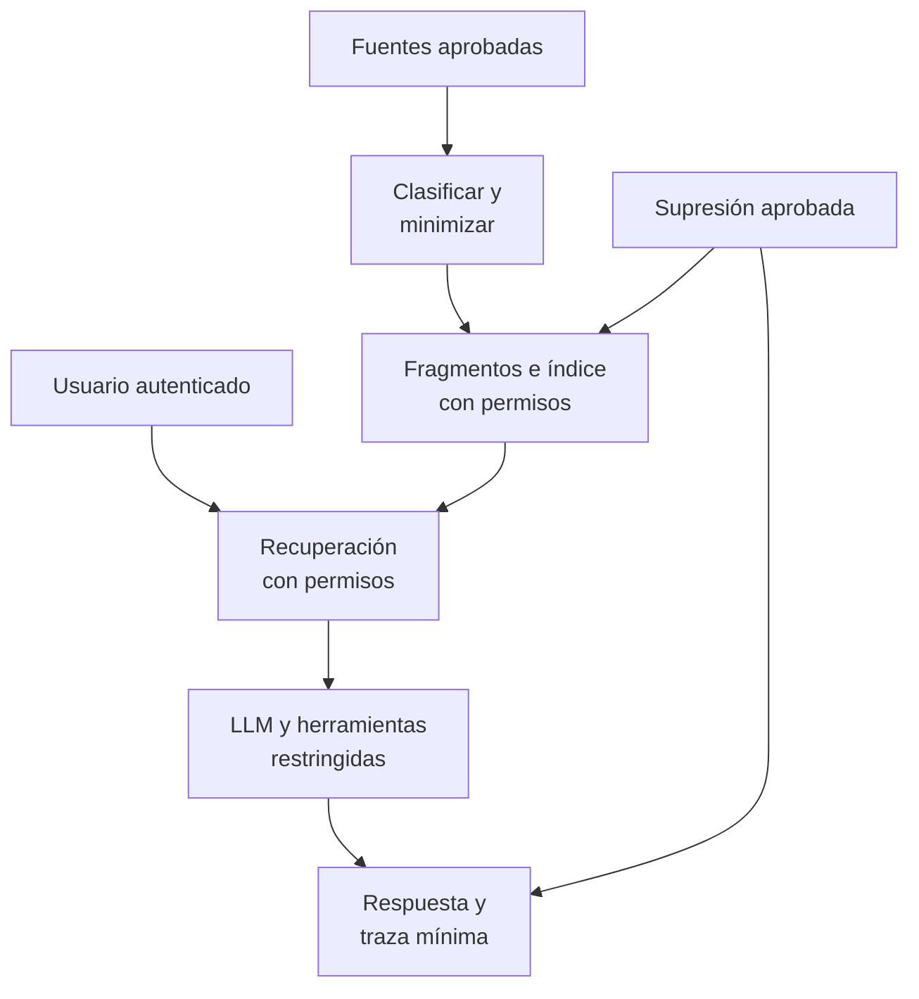

## 1. Resumen

Esta ficha no es asesoría legal: qué fuentes se pueden usar en un asistente, con qué finalidad y qué proveedores se aceptan lo decide el responsable con el área legal; aquí se explica cómo construir el pipeline para que esas decisiones se cumplan.

**Cómo leerla.** *Comprender* (§1–6): qué copias crea un pipeline de IA y por qué un embedding no es anónimo. *Aplicar* (§7–13): permisos en la recuperación, trazas mínimas y supresión con reconciliación. *Demostrar*: la evidencia del §8, el código del §10 y los criterios del §18.

Un pipeline de IA amplía la superficie de tratamiento: documentos, fragmentos (chunks), embeddings, índices vectoriales, prompts, respuestas, trazas, cachés, conjuntos de evaluación y herramientas externas. Cada una es una copia o un derivado que necesita finalidad, permisos, retención y respuesta a los derechos.

**Idea central:** el permiso se aplica al recuperar, no en el prompt; y suprimir un documento es suprimir todos sus derivados, comprobándolo.

## 2. Qué es

- **[Obligación legal · art. 3]** Fines específicos, explícitos y lícitos (letra b)) y solo los datos estrictamente necesarios, adecuados y pertinentes (letra c)).
- **[Obligación legal · art. 15 bis]** El encargado trata según el encargo; no puede tratar los datos para un objeto distinto del convenido ni cederlos o entregarlos sin autorización expresa y específica del responsable.
- **[Buena práctica]** Las piezas de un pipeline de IA:

| Pieza | Qué es | Por qué importa |
|---|---|---|
| RAG | Recuperar información para dar contexto a una respuesta | El contexto puede traer documentos que el usuario no debía ver |
| Fragmento y embedding | Trozo de un documento y su representación numérica | Derivados que pueden retener información del contenido; no se presumen anónimos |
| Recuperación con permisos | Filtrar por las autorizaciones del usuario o servicio al recuperar | El filtro en el prompt no es un control |
| Agente | Sistema que invoca herramientas | Puede llevar datos a servicios adicionales |
| Trazas y cachés | Registro de prompts, respuestas y resultados recuperados | Son copias personales si guardan el texto |

- **[Buena práctica]** Como referencias conceptuales (Nivel 4, no son normas chilenas): el OWASP Top 10 for LLM Applications nombra los riesgos que esta ficha controla, como LLM01:2025 Prompt Injection, LLM02:2025 Sensitive Information Disclosure, LLM06:2025 Excessive Agency y LLM08:2025 Vector and Embedding Weaknesses; el NIST AI RMF es un marco voluntario para gestionar los riesgos de los sistemas de IA.

## 3. Problema que resuelve

**[Buena práctica]** Borrar un documento de la fuente no borra sus fragmentos, embeddings, cachés ni trazas. Un agente puede enviar datos personales a una API externa. Un prompt puede incorporar texto de documentos que el usuario no tiene derecho a ver, si el filtro se le pide al modelo en lugar de aplicarse al recuperar.

## 4. Cómo funciona

1. **[Buena práctica]** Inventariar las fuentes, sus finalidades aprobadas, los proveedores y los destinos de inferencia (`processing-activities-inventory`).
2. **[Buena práctica]** Clasificar documentos y fragmentos antes de indexar y minimizar el texto y la metadata (`pii-identification`).
3. **[Decisión de arquitectura]** Indexar cada fragmento con `document_id`, clasificación, finalidad, grupos autorizados y fecha de retención.
4. **[Decisión de arquitectura]** Aplicar los permisos en la recuperación y validarlos otra vez sobre los documentos citados antes de responder; nunca confiar solo en instrucciones del prompt.
5. **[Buena práctica]** Versionar corpus, fragmentación, modelo de embeddings, índice, prompts, herramientas y políticas.
6. **[Buena práctica]** Tratar trazas, conversaciones, cachés y evaluaciones como posibles datos personales: identificadores en lugar de texto, y redacción de RUT y correos.
7. **[Decisión de arquitectura]** Diseñar la supresión y la reindexación por `document_id`, y reconciliar que no queden fragmentos, entradas de caché ni trazas.
8. **[Buena práctica]** No afirmar el borrado de lo que un modelo ya entrenado aprendió sin evidencia: borrar el índice no lo cubre.
9. **[Buena práctica]** Probar la inyección de prompt, la exfiltración por herramientas y las filtraciones entre usuarios (LLM01, LLM02 y LLM06 del OWASP Top 10 for LLM Applications).
10. **[Obligación legal · art. 8 bis]** El titular puede oponerse a decisiones basadas en tratamiento automatizado, incluidos los perfiles, con efectos jurídicos o significativos, y en todos los casos, incluidas las excepciones, tiene derecho a una explicación, a la intervención humana, a expresar su punto de vista y a pedir la revisión. **[Buena práctica]** Conectar esos casos con la evaluación de impacto (`dpia-and-automated-decisions`).

## 5. Cuándo utilizarlo

- En buscadores internos, copilotos, atención al cliente, procesamiento documental, agentes con herramientas y sistemas de recomendación.

## 6. Cuándo no utilizarlo

- Para afirmar que todos los embeddings identifican personas, o que ninguno lo hace: se evalúan contenido, contexto, accesos y posibilidad de vinculación.
- Como prueba de anonimización: RAG no anonimiza.
- Para decidir qué proveedor o qué transferencia es aceptable: lo decide el área legal (`processors-and-international-transfers`).

## 7. Ejemplo sencillo

| Paso | Qué pasa | Resultado |
|---|---|---|
| Consulta pública | «equipaje» con el grupo `publico` | Solo la política de equipaje |
| Consulta de soporte | «equipaje» con el grupo `soporte` | La política y el reclamo con RUT y correo ficticios |
| Traza | Se guardan los chunks y la respuesta redactada | `[REDACTADO]` en lugar del RUT y el correo |
| Supresión | Se suprime `reclamo-0042` | Dos fragmentos, una entrada de caché y una traza |
| Reconciliación | Se buscan restos | Ninguno; soporte ya no lo recupera |

## 8. Ejemplo de producción

Escenario genérico: una aerolínea con un asistente interno de atención al cliente. Cada documento tiene `document_id`, clasificación, finalidad, grupo autorizado y fecha de retención. El buscador filtra los permisos al recuperar y el servicio vuelve a validar los documentos citados antes de responder. El agente tiene herramientas con permisos mínimos y el proveedor del modelo es un encargado con contrato.

| Componente | Implementación posible |
|---|---|
| Ingesta al índice | Clasificación y minimización antes de fragmentar |
| Índice | Fragmentos con `document_id`, grupos y retención |
| Recuperación | Filtro por identidad o grupos del usuario |
| Trazas | Identificadores de chunks y respuesta redactada, con retención propia |
| Supresión | Por `document_id`: fragmentos, índice, caché y trazas, con reconciliación |

### Evidencia de cumplimiento

| Evidencia | Dónde queda | Quién la produce | Qué demuestra | Qué no demuestra |
|---|---|---|---|---|
| Prueba de usuario sin permiso | Log de la CI | CI | Que la recuperación no devuelve fragmentos protegidos | Que no haya otras rutas, como herramientas del agente |
| Supresión de un documento y su reconciliación | Log del job | Pipeline de derechos | Que no quedan fragmentos, caché ni trazas del documento | Que un modelo entrenado no lo recuerde |
| Prueba de inyección de prompt | Reporte de pruebas | Seguridad | Que las herramientas no entregan secretos ni ejecutan acciones no autorizadas en los casos probados | La resistencia a ataques nuevos |
| Versión de modelo, corpus e índice | Registro de versiones | Ingeniería | Con qué se generó cada respuesta | Que la respuesta sea correcta |

## 9. Arquitectura



## 10. Código

```python
# Python 3.12+, biblioteca estándar. Privacidad en un pipeline RAG: cada fragmento lleva document_id y los grupos
# autorizados; la recuperación filtra por los permisos del usuario antes de armar el prompt (no se le pide al modelo
# que «no muestre» algo); las trazas guardan identificadores y redactan RUT y correos; y suprimir un documento
# alcanza a sus fragmentos, el índice, la caché y las trazas, con una reconciliación que lo comprueba.
import re
from dataclasses import dataclass

EN_CLARO = re.compile(r"\d{1,2}\.?\d{3}\.?\d{3}-[\dkK]|[\w.+-]+@[\w-]+\.[\w.]+")


@dataclass(frozen=True)
class Fragmento:
    chunk_id: str
    document_id: str
    texto: str
    grupos: frozenset[str]
    vector: tuple[float, ...]   # embedding: un derivado, potencialmente personal


@dataclass(frozen=True)
class Traza:
    usuario: str
    chunks: tuple[str, ...]
    respuesta: str              # redactada


INDICE = {
    f.chunk_id: f for f in [
        Fragmento("c1", "politica-equipaje", "Equipaje de mano: 10 kg.", frozenset({"publico", "soporte"}), (0.9, 0.1)),
        Fragmento("c2", "reclamo-0042", "Reclamo de 11.111.111-1 (ana@example.com) por equipaje.", frozenset({"soporte"}),
                  (0.8, 0.2)),
        Fragmento("c3", "reclamo-0042", "Se ofrece compensación por el equipaje.", frozenset({"soporte"}), (0.7, 0.3)),
    ]
}
CACHE: dict[str, tuple[str, ...]] = {}   # consulta|grupos → chunks recuperados
TRAZAS: list[Traza] = []


def recuperar(consulta: str, grupos: frozenset[str]) -> list[Fragmento]:
    """Filtra por permisos en la recuperación; el modelo solo recibe lo que el usuario puede ver."""
    vistos = [f for f in INDICE.values() if f.grupos & grupos and consulta in f.texto.lower()]
    CACHE[f"{consulta}|{','.join(sorted(grupos))}"] = tuple(f.chunk_id for f in vistos)
    return vistos


def trazar(usuario: str, fragmentos: list[Fragmento], respuesta: str) -> None:
    TRAZAS.append(Traza(usuario, tuple(f.chunk_id for f in fragmentos), EN_CLARO.sub("[REDACTADO]", respuesta)))


def suprimir_documento(document_id: str) -> tuple[set[str], dict[str, int]]:
    chunks = {c for c, f in INDICE.items() if f.document_id == document_id}
    for c in chunks:
        del INDICE[c]
    claves = [k for k, v in CACHE.items() if chunks & set(v)]
    for k in claves:
        del CACHE[k]
    antes = len(TRAZAS)
    TRAZAS[:] = [t for t in TRAZAS if not chunks & set(t.chunks)]
    return chunks, {"fragmentos": len(chunks), "cache": len(claves), "trazas": antes - len(TRAZAS)}


def reconciliar(chunks: set[str]) -> list[str]:
    """Después de suprimir: ningún fragmento, entrada de caché ni traza puede seguir apuntando a esos chunks."""
    restos = [f"índice: {c}" for c in chunks if c in INDICE]
    restos += [f"caché: {k}" for k, v in CACHE.items() if chunks & set(v)]
    restos += [f"traza de {t.usuario}" for t in TRAZAS if chunks & set(t.chunks)]
    return restos


def main() -> None:
    print("público pregunta por equipaje:", [f.chunk_id for f in recuperar("equipaje", frozenset({"publico"}))])
    vistos = recuperar("equipaje", frozenset({"soporte"}))
    print("soporte pregunta por equipaje:", [f.chunk_id for f in vistos])
    trazar("agente-07", vistos, vistos[1].texto)
    print("traza guardada:", TRAZAS[0])
    chunks, conteo = suprimir_documento("reclamo-0042")
    print("supresión de reclamo-0042:", conteo)
    print("reconciliación, restos:", reconciliar(chunks) or "ninguno")
    print("soporte vuelve a preguntar:", [f.chunk_id for f in recuperar("equipaje", frozenset({"soporte"}))])


if __name__ == "__main__":
    main()
```

El script se **ejecuta en la CI** con la biblioteca estándar y pasa `mypy --strict`. El RUT y el correo son ficticios:

```text
público pregunta por equipaje: ['c1']
soporte pregunta por equipaje: ['c1', 'c2', 'c3']
traza guardada: Traza(usuario='agente-07', chunks=('c1', 'c2', 'c3'), respuesta='Reclamo de [REDACTADO] ([REDACTADO]) por equipaje.')
supresión de reclamo-0042: {'fragmentos': 2, 'cache': 1, 'trazas': 1}
reconciliación, restos: ninguno
soporte vuelve a preguntar: ['c1']
```

**Limitaciones:** el filtro del ejemplo no reemplaza la autorización del backend ni protege por sí solo un índice vectorial real; no hay modelo ni herramientas, y nada de esto cubre lo que un modelo ya entrenado haya aprendido.

## 11. GCP

En GCP, **Agent Search**. Según *Set up data source access control* (no ejecutado). La página marca el control de acceso como Preview («This feature is a Preview offering») y dice que se elige al crear el data store («you must select this setting during data store creation»):

| Necesidad | Servicio |
|---|---|
| Permisos en la recuperación | Control de acceso de la fuente: el usuario obtiene resultados solo de los documentos a los que su cuenta ya tiene acceso; para Cloud Storage, BigQuery, Google Drive y fuentes de terceros |
| Requisito | El proveedor de identidad de la organización configurado en Google Cloud |
| Supresión y trazas | Reindexación por `document_id` y retención de trazas, propias |

## 12. AWS

En AWS, **Amazon Bedrock** Knowledge Bases. Según *Configure and customize queries and response generation* (no ejecutado):

| Necesidad | Servicio |
|---|---|
| Permisos en la recuperación | Filtros sobre la metadata de los documentos al consultar (`equals`, `in`, `notIn`, entre otros) |
| Límite | El filtro es tan bueno como la metadata: los grupos autorizados se cargan con cada documento |

## 13. Azure

En Azure, **Azure AI Search**. Según *Security filters for trimming results in Azure AI Search* (no ejecutado):

| Necesidad | Servicio |
|---|---|
| Permisos en la recuperación | ACL integradas por documento o, si no se pueden usar, un filtro de seguridad con `search.in` sobre un campo de grupos o usuarios |
| Límite | La página describe el filtro como una simulación de la autorización por documento: el backend sigue validando |

**Criterio común:** los tres servicios filtran al recuperar; ninguno suprime por sí solo los derivados ni las trazas, ni convierte el índice en anónimo.

## 14. Buenas prácticas

- **[Decisión de arquitectura]** Nunca usar el prompt como único control de autorización.
- **[Buena práctica]** Probar el acceso cruzado entre usuarios y grupos.
- **[Buena práctica]** Tratar embeddings y memorias como derivados potencialmente personales.
- **[Buena práctica]** **Seguridad:** herramientas del agente con permisos mínimos y sin secretos en el contexto.
- **[Buena práctica]** **Observabilidad:** trazas con identificadores y datos redactados; retención propia y acceso restringido.
- **[Buena práctica]** **Costo:** reindexar por `document_id`, no el corpus completo, ante cada supresión.
- **[Obligación legal · art. 15 bis]** El encargado no trata los datos para otro objeto ni los cede o entrega sin autorización expresa y específica. **[Buena práctica]** Evaluar proveedores, retención y transferencias antes de habilitar herramientas o modelos externos.

## 15. Errores frecuentes

- **Confundir RAG con anonimización:** el índice sigue teniendo datos personales.
- **Indexar sin `document_id` ni permisos:** no se puede suprimir ni filtrar.
- **Filtrar en el prompt:** el modelo recibe lo que el usuario no debía ver.
- **Olvidar trazas, conjuntos de evaluación y cachés:** la supresión queda incompleta.
- **Suponer que borrar el índice borra lo que un modelo ya entrenado aprendió:** se afirma un borrado que no se puede probar.

## 16. Trade-offs

| Decisión | Beneficio | Costo |
|---|---|---|
| Más observabilidad de prompts y respuestas | Mejor auditoría | Acumula conversaciones personales |
| Filtrado estricto al recuperar | Menos exposición | Puede bajar la relevancia; medir ambos |
| Índice por grupo de permisos | Aislamiento fuerte | Más índices que mantener |

## 17. Conceptos relacionados

- `chile-data-protection`: ficha padre.
- `pii-identification`: clasificar antes de indexar.
- `data-minimization-by-layer`: indexar solo lo necesario.
- `processors-and-international-transfers`: proveedores de modelos y de búsqueda.
- `dpia-and-automated-decisions`: cuando el asistente decide sobre personas.
- `privacy-controls-as-code`: pruebas de acceso cruzado y de supresión.
- `processing-activities-inventory`: la finalidad de cada fuente.

## 18. Preguntas técnicas abiertas

1. ¿Se puede suprimir un documento y todos sus derivados, y probarlo?
2. ¿Un usuario puede recuperar información de otro?
3. ¿Qué herramientas externas reciben contexto, y con qué contrato?
4. ¿Qué guardan hoy las trazas de prompts y respuestas?

**Criterio de dominio:** dominas esta ficha si puedes enumerar las copias que crea un pipeline de IA, explicar por qué el permiso va en la recuperación y no en el prompt, mostrar cómo se suprime un documento con sus derivados y decir qué no cubre esa supresión.

## 19. Laboratorio relacionado

Propuesta para F4: un corpus ficticio con permisos por documento; usuarios con distintos grupos, reindexación, supresión de un documento y limpieza de caché y trazas, con reconciliación. Sin datos personales reales.

## 20. Fuentes

- BCN Ley Chile: *Ley 19628 SOBRE PROTECCION DE LOS DATOS PERSONALES* (versión con vigencia diferida desde 2026-12-01).
- Google Cloud: *Set up data source access control* (Agent Search).
- AWS: *Configure and customize queries and response generation* (Amazon Bedrock).
- Microsoft Learn: *Security filters for trimming results in Azure AI Search*.
- Referencias conceptuales (Nivel 4): OWASP, *LLMRisks Archive* (OWASP Top 10 for LLM Applications); NIST, *AI Risk Management Framework* (no son normas chilenas).

El detalle de cada fuente está en `sources` del frontmatter.

## 21. Fecha de última verificación

2026-10-28: arts. 3, 8 bis y 15 bis consultados ese día en BCN; páginas de Agent Search, Amazon Bedrock y Azure AI Search consultadas ese día (el nombre «Azure AI Search» se confirmó en su página), y OWASP Top 10 for LLM Applications y NIST AI RMF como referencias de Nivel 4. `review_required`: pasa a `verified` solo con la aprobación explícita de Felipe (`owner_approved_at`). Revisión mensual.

## 22. Historial de cambios importantes

- 2026-10-28: creación (lote P2, dominio 24, ADR-027) desde `docs/briefs/privacy-program/03-privacidad-ia-rag-llm.md`, que es un guion, no una fuente.
- 2026-10-28: completada con lo que pedía el prompt de P2: OWASP Top 10 for LLM Applications y NIST AI RMF como fuentes de Nivel 4, solo para conceptos (§2, §4, §20); el nombre «Azure AI Search» se confirmó en su página N1 ese día.
- 2026-10-28: revisión `docs/reviews/p2.md` aplicada: el art. 8 bis dice que sus salvaguardas, incluida expresar el punto de vista, aplican en todos los casos; el art. 15 bis incluye la prohibición de ceder o entregar sin autorización expresa; el art. 3 c) conserva «estrictamente»; el control de acceso de Agent Search se cita como Preview y elegido al crear el data store, con cita textual; `page_title` de Azure «Security Filter Pattern»; diagrama del §9 en TB.
- 2026-10-28: `page_title` de Azure según ADR-012 (encabezado principal de la página; `<title>` solo si no tiene): «Security filters for trimming results in Azure AI Search», el H1 consultado ese día; «Security Filter Pattern» es su `<title>`.
- 2026-10-30: Enmienda 4 de ADR-023: 4 tabla(s) sin columna ni línea «Etiqueta»; la fila con origen legal lleva «Obligación legal» al inicio de su primera celda. Sin cambios de contenido.
