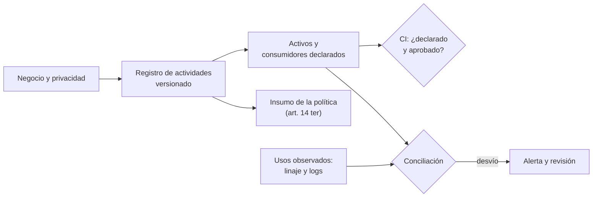

## 1. Resumen

Esta ficha no es asesoría legal: finalidad, base de licitud y plazo los definen el responsable, el negocio y el área legal; aquí se explica cómo modelarlos, vincularlos a la plataforma y controlarlos. Los ejemplos de bases y plazos son ilustrativos, no determinaciones legales.

El inventario explica **para qué** se tratan datos personales y lo vincula con **qué activos, procesos y consumidores** los usan. No es una lista de tablas ni un catálogo técnico duplicado: conecta decisiones de negocio y privacidad con operaciones observables. Es la base de casi todos los demás controles: sin saber qué actividad usa qué datos, con qué base y por cuánto tiempo, no se puede responder un acceso, aplicar retención, dimensionar una vulneración ni detectar un uso indebido.

**Idea central:** la finalidad y su fundamento pertenecen al tratamiento concreto; una tabla puede participar en varias actividades, y compartir una tabla no autoriza todos sus usos.

## 2. Qué es

- **[Obligación legal · art. 3]** El responsable debe poder acreditar la licitud (**licitud y lealtad**); no puede tratar los datos con fines distintos de los informados salvo las excepciones del principio de **finalidad**; y los datos que se traten deben limitarse estrictamente a los necesarios, adecuados y pertinentes en relación con los fines (**proporcionalidad**).
- **[Obligación legal · art. 12]** Si la base es el consentimiento, debe ser libre, informado, específico por finalidad, previo e inequívoco, y revocable; el responsable lo prueba.
- **[Obligación legal · art. 13]** Otras bases: obligaciones económicas, obligación legal, contrato, interés legítimo y defensa de un derecho.
- **[Decisión de arquitectura]** **Actividad de tratamiento:** unidad de gestión con identificador estable, responsable, finalidad, base validada, categorías de datos y de titulares, activos, destinatarios, transferencias, plazo, decisiones automatizadas, estado y versión.
- **[Decisión de arquitectura]** Cuatro entidades distintas, que no conviene mezclar en un solo campo:

| Entidad | Responde | Ejemplo |
|---|---|---|
| Actividad | Por qué se usan los datos | Gestionar una reserva |
| Activo | Dónde están | `silver.pasajeros` |
| Consumidor | Quién o qué los usa | `dag_reservas`, un dashboard, un servicio |
| Evidencia | Cómo se demuestra la aprobación y la operación | Ticket de aprobación, ejecución, registro de auditoría |

- **[Decisión de arquitectura]** **Relaciones muchos a muchos:** actividad ↔ activo y actividad ↔ consumidor. `silver.pasajeros` puede servir a venta de pasajes (contrato) y a marketing (consentimiento); un único `legal_basis` o `purpose` pegado a la tabla no alcanza.
- **[Buena práctica]** **Usos observados:** qué consumidores leen cada activo, desde el linaje y los logs de acceso; se comparan con los usos declarados.

## 3. Problema que resuelve

**[Buena práctica]** Una tabla de pasajeros sirve para gestionar reservas. Otro equipo crea un modelo de ofertas o de fraude y asume que, como la tabla ya está disponible, puede usarla. La disponibilidad técnica no demuestra autorización para una finalidad nueva. Con la base asignada al dataset, el modelo «hereda» la base de otra actividad y nadie lo nota; con actividades y consumidores explícitos, ese uso aparece como no vinculado o no aprobado.

**[Buena práctica]** Sin un inventario conectado a los procesos nadie puede contestar con seguridad: qué tratamiento justifica un consumo, qué datos necesita, quién lo aprobó y qué pasa si cambia la finalidad o se revoca un consentimiento.

**[Obligación legal · art. 34 ter]** Tratar datos sin base o con una finalidad distinta es infracción grave (letra a)). **[Buena práctica]** La falta de un registro técnico no demuestra por sí sola ese supuesto: es una señal que obliga a determinar los hechos y el fundamento con el área competente. **[Decisión de arquitectura]** Por eso la CI la muestra como brecha y la deriva a revisión, sin calificarla.

## 4. Cómo funciona

1. **[Decisión de arquitectura]** **Definir:** negocio y privacidad registran la actividad con su finalidad, base, plazo y destinatarios aprobados.
2. **[Buena práctica]** **Vincular:** ingeniería la asocia a los activos, campos relevantes, jobs, aplicaciones, consumidores y proveedores, y propaga plazo y finalidad como tags.
3. **[Decisión de arquitectura]** **Autorizar:** el uso propuesto se valida antes de conceder acceso o desplegar un consumidor nuevo; la CI verifica que la actividad exista, esté aprobada y declare al consumidor.
4. **[Buena práctica]** **Observar:** el linaje y los logs de acceso dan los usos reales (consumidor, activo).
5. **[Buena práctica]** **Gestionar desviaciones:** un consumo sin actividad vinculada o de una actividad no aprobada genera una alerta técnica; su licitud se investiga, no se presume.
6. **[Buena práctica]** **Mantener:** se versionan los cambios de finalidad, datos, destinatarios, retención y procesos, sin sobrescribir decisiones anteriores.
7. **[Obligación legal · art. 14 ter]** El responsable mantiene a disposición del público las categorías de datos, los destinatarios, las finalidades, la base de licitud y el plazo de conservación (letras d) e i)). **[Decisión de arquitectura]** El registro genera un insumo revisable para esa política; no la publica automáticamente.
8. **[Obligación legal · art. 14]** El responsable informa y pone a disposición los antecedentes de la licitud del tratamiento (letra a)). **[Buena práctica]** El registro, sus versiones y su evidencia se exportan bajo demanda.

**[Buena práctica]** Los logs y el linaje muestran operaciones y dependencias, no la intención jurídica de una consulta. La finalidad se declara y se asocia a identidades, servicios o procesos controlados; no se deduce del SQL.

## 5. Cuándo utilizarlo

- Antes de habilitar un pipeline, dashboard, modelo, API o transferencia nuevos que usen datos personales.
- Al modificar un tratamiento existente: finalidad, datos, destinatarios o plazo.
- Como fuente para derechos, retención, vulneraciones, evaluación de impacto y auditoría.

## 6. Cuándo no utilizarlo

- Para decidir si una finalidad es lícita, si una base aplica o cuánto se conserva cada dato: lo decide el área legal.
- Como reemplazo del sistema de consentimientos, de los controles de acceso, del catálogo técnico o de una evaluación de impacto: es el vínculo entre ellos.
- Como prueba de cumplimiento: una conciliación limpia muestra coherencia técnica, no licitud.

## 7. Ejemplo sencillo

| Actividad | Finalidad | Base (ilustrativa) | Activo compartido | Estado |
|---|---|---|---|---|
| venta_pasajes | Emitir y gestionar pasajes | Contrato (art. 13 c)), sujeto a validación | silver.pasajeros, silver.reservas | Aprobada; plazo ilustrativo de 5 años |
| marketing | Ofertas personalizadas | Consentimiento (art. 12), si corresponde y se acredita | silver.pasajeros | Aprobada; falta el plazo y el control de revocación |
| modelo_fraude | Detectar operaciones sospechosas | Pendiente de evaluación | silver.pasajeros | No habilitar hasta la revisión |

El mismo activo aparece tres veces: lo que cambia es la actividad y sus condiciones de uso. No hay un plazo universal; cada plazo se justifica y se aprueba según el contexto.

## 8. Ejemplo de producción

Escenario genérico: una aerolínea con BigQuery, Airflow (Cloud Composer) y dashboards pide un modelo de fraude sobre `silver.pasajeros`.

- Se abre una solicitud con un `activity_id` y la descripción del propósito.
- Privacidad y negocio evalúan base, atributos necesarios, destinatarios y plazo.
- Ingeniería asocia el `activity_id` al DAG, a su cuenta de servicio y a los activos permitidos; aplica IAM y minimización.
- Al desplegar, la CI comprueba que la actividad exista, esté aprobada y declare al consumidor.
- En operación, los jobs y los accesos se concilian con los consumidores declarados; una discrepancia abre una incidencia para análisis.

| Componente | Implementación posible |
|---|---|
| Registro de actividades | Tablas versionadas `activities`, `activity_assets`, `activity_consumers`, `approvals`, `observed_uses`, o el módulo de una herramienta de privacidad |
| Relación con activos | Tags en el catálogo: `actividad`, `plazo`, `finalidad` |
| Consentimientos | Tabla por titular, finalidad, versión del texto, fecha y canal; revocación con la misma facilidad (su detalle, en las fichas hermanas) |
| Usos observados | Linaje (del catálogo de la nube u OpenLineage) y logs de acceso |
| Control | Job programado que concilia declarados contra observados (alerta), y puerta de la CI para despliegues nuevos (bloqueo) |

### Evidencia de cumplimiento

| Evidencia | Dónde queda | Quién la produce | Qué demuestra | Qué no demuestra |
|---|---|---|---|---|
| Registro de actividades versionado | Registro gobernado o repositorio | Privacidad y negocio | Qué finalidad, base y plazo se aprobaron y cuándo | Que la base sea la correcta |
| Aprobación del uso nuevo | Sistema de solicitudes | Dueño del tratamiento | Quién autorizó el consumidor y con qué alcance | Que el consumidor use solo lo aprobado |
| Vínculo actividad–activo–consumidor | Catálogo o registro técnico | Ingeniería | Qué consumidores y activos cubre cada actividad | La intención real de cada consulta |
| Ejecuciones y accesos | Logs protegidos con retención definida | Plataforma | Qué consumidor leyó qué activo y cuándo | Por qué lo leyó |
| Desviaciones y su cierre | Gestión de incidencias | Ingeniería y privacidad | Que la alerta se analizó y cómo se resolvió | Que no haya usos fuera de la cobertura del linaje |
| Resultado de la conciliación (0 o 1) con sus hallazgos | Log del job de conciliación | Pipeline de conciliación | Qué usos y actividades no cuadran con el registro a una fecha | Que los usos sin registro en el linaje estén cubiertos |

## 9. Arquitectura



La puerta de la CI bloquea un despliegue nuevo no declarado o con su actividad no vigente. La conciliación revisa lo que ya corre en producción: no bloquea nada, y su resultado 1 dispara la alerta y la revisión. Para consentimientos y retención se integran las entidades de sus fichas hermanas, sin replicarlas.

## 10. Código

```python
# Python 3.12+, biblioteca estándar. De punta a punta: registro de actividades → usos observados → conciliación
# operacional (lo que ya corre) e insumo de la política (art. 14 ter), o puerta de despliegue de la CI (lo nuevo) →
# código de salida (0 sin hallazgos, 1 alerta o bloqueo). Uso: python inventario.py actual | corregido |
# despliegue-nuevo. La base de licitud vive en la actividad, no en la tabla. Las funciones reciben el
# registro como parámetro. Una brecha es una alerta técnica para revisar, no la conclusión de que hubo una infracción;
# UNKNOWN (falta el dato para decidir) nunca cuenta como OK. Datos ficticios.
import sys
from dataclasses import dataclass, field, replace
from datetime import date
from typing import Literal

# @paso 1 Registro
Base = Literal["consentimiento", "obligación legal", "contrato", "interés legítimo", "defensa de derechos",
               "obligaciones económicas"]
ARTICULO: dict[Base, str] = {"consentimiento": "art. 12", "obligaciones económicas": "art. 13 a)",
                             "obligación legal": "art. 13 b)", "contrato": "art. 13 c)",
                             "interés legítimo": "art. 13 d)", "defensa de derechos": "art. 13 e)"}
REFERENCIA = date(2026, 11, 3)   # fecha fija: resultado reproducible


@dataclass(frozen=True)
class Aprobacion:
    fecha: date
    vence: date


@dataclass(frozen=True)
class RegistroConsentimientos:   # por titular, finalidad, versión del texto y fecha (aquí, solo el vínculo)
    version_texto: str
    desde: date


@dataclass(frozen=True)
class Actividad:
    id: str
    finalidad: str
    base: Base | None              # None: pendiente de evaluación
    plazo_meses: int | None
    aprobacion: Aprobacion | None
    categorias: tuple[str, ...]
    destinatarios: tuple[str, ...]
    activos: frozenset[str]
    consumidores: frozenset[str]
    campos: frozenset[str]         # columnas que la finalidad necesita
    consentimientos: RegistroConsentimientos | None = None


@dataclass(frozen=True)
class Registro:
    actividades: tuple[Actividad, ...]
    tablas_con_pii: frozenset[str]
    identidades: dict[str, str] = field(default_factory=dict)   # cuenta de servicio -> consumidor declarado


@dataclass(frozen=True)
class Uso:   # desde logs de acceso y linaje: quién leyó qué activo y qué columnas
    cuenta: str
    activo: str
    columnas: frozenset[str]


@dataclass(frozen=True)
class Despliegue:   # un consumidor nuevo que se quiere desplegar
    consumidor: str
    activity_id: str | None


def vigente(a: Actividad, hoy: date) -> bool:
    return a.aprobacion is not None and a.aprobacion.vence >= hoy


# @paso 2 Usos observados
def consumidor_de(registro: Registro, uso: Uso) -> str | None:
    """El consumidor sale de una identidad confiable (cuenta de servicio), no del texto de la consulta."""
    return registro.identidades.get(uso.cuenta)


# @paso 3 Conciliación
@dataclass(frozen=True)
class Hallazgo:
    estado: Literal["BRECHA", "UNKNOWN"]
    detalle: str


def tablas_sin_actividad(registro: Registro) -> list[Hallazgo]:
    cubiertas = {t for a in registro.actividades for t in a.activos}
    sin_actividad = sorted(registro.tablas_con_pii - cubiertas)
    return [Hallazgo("BRECHA", f"tabla con PII sin actividad: {t}") for t in sin_actividad]


def actividades_incompletas(registro: Registro, hoy: date) -> list[Hallazgo]:
    """Una actividad aprobada necesita base y plazo; la aprobación vence y el consentimiento se registra."""
    hallazgos = []
    for a in registro.actividades:
        if a.aprobacion is None:
            continue
        if a.base is None:
            hallazgos.append(Hallazgo("BRECHA", f"{a.id}: aprobada sin base de licitud"))
        if a.plazo_meses is None:
            hallazgos.append(Hallazgo("BRECHA", f"{a.id}: sin plazo de conservación"))
        if a.aprobacion.vence < hoy:
            hallazgos.append(Hallazgo("BRECHA", f"{a.id}: aprobación vencida el {a.aprobacion.vence}"))
        if a.base == "consentimiento" and a.consentimientos is None:
            hallazgos.append(Hallazgo("BRECHA", f"{a.id}: base consentimiento sin registro de consentimientos"))
    return hallazgos


def conciliar(registro: Registro, usos: list[Uso], hoy: date) -> list[Hallazgo]:
    """Cada uso observado tiene que caer en una actividad vigente y leer solo los campos de su finalidad."""
    hallazgos = []
    for uso in usos:
        consumidor = consumidor_de(registro, uso)
        if consumidor is None:
            hallazgos.append(Hallazgo("UNKNOWN", f"consumidor no identificado: {uso.cuenta} → {uso.activo}"))
            continue
        vinculos = [a for a in registro.actividades if consumidor in a.consumidores and uso.activo in a.activos]
        if not vinculos:
            hallazgos.append(Hallazgo("BRECHA", f"sin vínculo: {consumidor} → {uso.activo}"))
            continue
        if not any(vigente(a, hoy) for a in vinculos):
            hallazgos.append(Hallazgo("BRECHA", f"sin aprobación vigente: {consumidor} → {uso.activo} "
                                                f"({', '.join(a.id for a in vinculos)})"))
        for a in vinculos:
            sobran = sorted(uso.columnas - a.campos)
            if a.campos and sobran:   # campos vacíos: la actividad todavía no se evalúa
                hallazgos.append(Hallazgo("BRECHA", f"proporcionalidad: {consumidor} lee {', '.join(sobran)}, "
                                                    f"no necesario para {a.id}"))
    return hallazgos


def verificar_despliegues(registro: Registro, despliegues: list[Despliegue], hoy: date) -> list[Hallazgo]:
    """Puerta de la CI: bloquea un despliegue sin activity_id, con una actividad que no declara al consumidor o con una
    actividad sin aprobación vigente; cada caso con su propio motivo."""
    hallazgos = []
    por_id = {a.id: a for a in registro.actividades}
    for d in despliegues:
        actividad = por_id.get(d.activity_id or "")
        if actividad is None:
            hallazgos.append(Hallazgo("BRECHA", f"despliegue bloqueado: {d.consumidor} sin activity_id válido"))
        elif d.consumidor not in actividad.consumidores:
            hallazgos.append(Hallazgo("BRECHA", f"despliegue bloqueado: {d.consumidor} no declarado en {actividad.id}"))
        elif not vigente(actividad, hoy):
            hallazgos.append(Hallazgo("BRECHA", f"despliegue bloqueado: {d.consumidor} → {actividad.id}: "
                                                "actividad no vigente"))
    return hallazgos


# @paso 4 Insumo y salida
def insumo_14_ter(registro: Registro, hoy: date) -> list[str]:
    """Insumo para la política pública (art. 14 ter): solo actividades con aprobación vigente."""
    filas = []
    for a in registro.actividades:
        if not vigente(a, hoy) or a.base is None:
            continue
        plazo = f"{a.plazo_meses} meses" if a.plazo_meses is not None else "POR DEFINIR"
        filas.append(f"- {a.finalidad} | base: {a.base} ({ARTICULO[a.base]}) | datos: {', '.join(a.categorias)} "
                     f"| destinatarios: {', '.join(a.destinatarios) or 'ninguno'} | plazo: {plazo}")
    return filas


def escenario(nombre: str) -> tuple[Registro, list[Uso], list[Despliegue]]:
    venta = Actividad("venta_pasajes", "emitir y gestionar pasajes", "contrato", 60,
                      Aprobacion(date(2026, 1, 15), date(2027, 1, 15)), ("identificación", "contacto", "itinerario"),
                      ("aerolíneas socias",), frozenset({"silver.pasajeros", "silver.reservas"}),
                      frozenset({"dag_reservas"}), frozenset({"pasajero_id", "nombre", "correo", "vuelo", "fecha"}))
    marketing = Actividad("marketing", "ofertas personalizadas", "consentimiento", None,
                          Aprobacion(date(2025, 10, 1), date(2026, 10, 1)), ("contacto", "preferencias"),
                          ("plataforma de email",), frozenset({"silver.pasajeros"}), frozenset({"dag_campanas"}),
                          frozenset({"pasajero_id", "correo", "preferencias"}))
    fraude = Actividad("modelo_fraude", "detectar operaciones sospechosas", None, None, None,
                       ("identificación", "pagos"), (), frozenset({"silver.pasajeros"}), frozenset({"job_fraude"}),
                       frozenset())
    pii = frozenset({"silver.pasajeros", "silver.reservas", "gold.score_fraude"})
    registro = Registro((venta, marketing, fraude), pii,
                        {"sa-reservas": "dag_reservas", "sa-campanas": "dag_campanas", "sa-fraude": "job_fraude",
                         "sa-bi": "dashboard_externo"})
    usos = [Uso("sa-reservas", "silver.pasajeros", frozenset({"pasajero_id", "nombre", "vuelo"})),
            Uso("sa-campanas", "silver.pasajeros", frozenset({"correo", "rut"})),
            Uso("sa-fraude", "silver.pasajeros", frozenset({"pasajero_id", "rut", "monto"})),
            Uso("sa-bi", "silver.pasajeros", frozenset({"vuelo", "fecha"})),
            Uso("sa-7f3c", "silver.reservas", frozenset({"pasajero_id"}))]
    if nombre == "actual":
        return registro, usos, []
    if nombre == "despliegue-nuevo":   # la puerta de la CI evalúa lo que se quiere desplegar contra el registro de hoy
        return registro, usos, [Despliegue("dag_reservas", "venta_pasajes"), Despliegue("dag_recomendaciones", None),
                                Despliegue("dag_segmentos", "venta_pasajes"), Despliegue("job_fraude", "modelo_fraude")]
    hoy_aprobada = Aprobacion(date(2026, 10, 30), date(2027, 10, 30))
    corregido = Registro((
        replace(venta, consumidores=venta.consumidores | {"dashboard_externo", "job_conciliacion"}),
        replace(marketing, plazo_meses=24, aprobacion=hoy_aprobada,
                consentimientos=RegistroConsentimientos("v3", date(2026, 9, 1))),
        replace(fraude, base="interés legítimo", plazo_meses=24, aprobacion=hoy_aprobada,
                activos=frozenset({"silver.pasajeros", "gold.score_fraude"}),
                campos=frozenset({"pasajero_id", "rut", "monto"}))),
        registro.tablas_con_pii, {**registro.identidades, "sa-7f3c": "job_conciliacion"})
    usos_corregidos = [replace(u, columnas=frozenset({"correo"})) if u.cuenta == "sa-campanas" else u for u in usos]
    return corregido, usos_corregidos, []


def puerta_ci(registro: Registro, despliegues: list[Despliegue]) -> int:
    """Lo nuevo: cada despliegue se evalúa antes de entrar a producción, y uno bloqueado no se despliega."""
    hallazgos = verificar_despliegues(registro, despliegues, REFERENCIA)
    for h in hallazgos:
        print(f"{h.estado} {h.detalle}")
    if hallazgos:
        print(f"puerta de la CI: rechazada (1): {len(hallazgos)} de {len(despliegues)} despliegues bloqueados")
        return 1
    print(f"puerta de la CI: aprobada (0): {len(despliegues)} despliegues declarados y vigentes")
    return 0


def conciliacion(registro: Registro, usos: list[Uso]) -> int:
    """Lo que ya corre: la conciliación no bloquea nada, levanta una alerta operacional para revisar."""
    print("insumo para la política (art. 14 ter), a revisar por privacidad antes de publicar:")
    print("\n".join(insumo_14_ter(registro, REFERENCIA)))
    hallazgos = (tablas_sin_actividad(registro) + actividades_incompletas(registro, REFERENCIA)
                 + conciliar(registro, usos, REFERENCIA))
    for h in hallazgos:
        print(f"{h.estado} {h.detalle}")
    if hallazgos:
        print(f"conciliación: alerta (1): {len(hallazgos)} hallazgo(s) en consumos que ya corren")
        return 1
    print("conciliación: sin hallazgos (0)")
    return 0


def main(nombre: str) -> int:
    registro, usos, despliegues = escenario(nombre)
    return puerta_ci(registro, despliegues) if despliegues else conciliacion(registro, usos)


if __name__ == "__main__":
    sys.exit(main(sys.argv[1] if len(sys.argv) > 1 else "actual"))
```

El script se **ejecuta en la CI** con la biblioteca estándar y pasa `mypy --strict`. Recorre cuatro pasos: el registro de actividades (con su base, plazo en meses, aprobación con vencimiento y campos permitidos), los usos observados (cuenta de servicio, activo y columnas leídas), la conciliación y el insumo del art. 14 ter con su código de salida. Hay dos momentos: la conciliación operacional (`actual` y `corregido`) revisa lo que ya corre y, con hallazgos, sale 1 como alerta; la puerta de la CI (`despliegue-nuevo`) evalúa lo que se quiere desplegar y bloquea. Las funciones reciben el registro como parámetro, y la base se guarda sin el artículo, que sale de un mapa aparte.

En el estado actual, la conciliación encuentra nueve hallazgos:

- `gold.score_fraude` tiene datos personales y ninguna actividad la cubre.
- `marketing` está aprobada pero incompleta: sin plazo de conservación, con la aprobación vencida a la fecha de referencia y con base consentimiento sin registro de consentimientos vinculado.
- `dag_campanas` lee `rut`, que su actividad no necesita (**proporcionalidad**).
- `job_fraude` consume una actividad pendiente de evaluación, y `dashboard_externo` lee datos sin ninguna actividad que lo declare.
- La cuenta `sa-7f3c` no está mapeada a ningún consumidor: queda en `UNKNOWN`, que nunca cuenta como OK.

El insumo de la política (art. 14 ter) solo incluye las actividades con aprobación vigente. Termina con código 1:

```text
$ python inventario.py actual
insumo para la política (art. 14 ter), a revisar por privacidad antes de publicar:
- emitir y gestionar pasajes | base: contrato (art. 13 c)) | datos: identificación, contacto, itinerario | destinatarios: aerolíneas socias | plazo: 60 meses
BRECHA tabla con PII sin actividad: gold.score_fraude
BRECHA marketing: sin plazo de conservación
BRECHA marketing: aprobación vencida el 2026-10-01
BRECHA marketing: base consentimiento sin registro de consentimientos
BRECHA sin aprobación vigente: dag_campanas → silver.pasajeros (marketing)
BRECHA proporcionalidad: dag_campanas lee rut, no necesario para marketing
BRECHA sin aprobación vigente: job_fraude → silver.pasajeros (modelo_fraude)
BRECHA sin vínculo: dashboard_externo → silver.pasajeros
UNKNOWN consumidor no identificado: sa-7f3c → silver.reservas
conciliación: alerta (1): 9 hallazgo(s) en consumos que ya corren
```

En el escenario corregido se evalúa y aprueba el modelo de fraude, con su base, plazo, activos y campos. También se vinculan el dashboard y la cuenta `sa-7f3c` a `venta_pasajes`, se define el plazo de `marketing`, se renueva su aprobación y se vincula su registro de consentimientos, y `dag_campanas` deja de leer `rut`. El insumo pasa a tres actividades. Termina con código 0:

```text
$ python inventario.py corregido
insumo para la política (art. 14 ter), a revisar por privacidad antes de publicar:
- emitir y gestionar pasajes | base: contrato (art. 13 c)) | datos: identificación, contacto, itinerario | destinatarios: aerolíneas socias | plazo: 60 meses
- ofertas personalizadas | base: consentimiento (art. 12) | datos: contacto, preferencias | destinatarios: plataforma de email | plazo: 24 meses
- detectar operaciones sospechosas | base: interés legítimo (art. 13 d)) | datos: identificación, pagos | destinatarios: ninguno | plazo: 24 meses
conciliación: sin hallazgos (0)
```

La puerta de la CI evalúa cuatro despliegues contra el registro de hoy, el del escenario actual. `dag_reservas` está declarado en `venta_pasajes`, vigente, y pasa. `dag_recomendaciones` no trae `activity_id`; `dag_segmentos` cita `venta_pasajes`, que no lo declara, y `job_fraude` cita `modelo_fraude`, que lo declara pero no tiene aprobación vigente: se informa como «actividad no vigente», no como «no declarado». Termina con código 1:

```text
$ python inventario.py despliegue-nuevo
BRECHA despliegue bloqueado: dag_recomendaciones sin activity_id válido
BRECHA despliegue bloqueado: dag_segmentos no declarado en venta_pasajes
BRECHA despliegue bloqueado: job_fraude → modelo_fraude: actividad no vigente
puerta de la CI: rechazada (1): 3 de 4 despliegues bloqueados
```

Limitaciones:

- **Consentimiento:** el ejemplo verifica que la actividad tenga un registro de consentimientos vinculado, con versión del texto y fecha; no que cada titular haya consentido ni que la revocación funcione.
- **Finalidad real:** los campos permitidos se declaran a mano, y el control ve las columnas que se leen, no para qué se usan.
- **Cobertura:** solo ve los usos que el linaje y los logs registran. Una cuenta sin mapear queda en `UNKNOWN` y bloquea, pero un uso que no deja registro no aparece.
- **Momento:** el código cubre los dos momentos, pero solo la puerta de la CI bloquea, y solo despliegues nuevos. La conciliación de lo que ya corre sale 1 con hallazgos; ese 1 es la alerta operacional del §9, no detiene un consumo en producción, y quién lo revisa y en qué plazo queda fuera del ejemplo.
- **Política:** el insumo del art. 14 ter es un borrador para que privacidad lo revise, no la política publicada.

## 11. GCP

En GCP, **Knowledge Catalog**. Según *About data lineage*, consultada el 2026-10-28 (no ejecutado):

| Necesidad | Servicio | Limitación |
|---|---|---|
| Usos observados | Linaje de datos de Knowledge Catalog, informado por BigQuery y Dataflow | Registra metadata del movimiento, no la finalidad; la información de linaje se retiene solo 30 días |
| Registro de actividades | Propio, con tags en el catálogo | Hay que mantenerlo enlazado a las ejecuciones |

## 12. AWS

En AWS, **Amazon DataZone**. Según *Data lineage in Amazon DataZone* (no ejecutado):

| Necesidad | Servicio | Limitación |
|---|---|---|
| Usos observados | Linaje de DataZone, compatible con OpenLineage | Muestra orígenes, transformaciones y consumo, no la aprobación |
| Registro de actividades | Propio, con metadatos de negocio | El catálogo no sustituye la aprobación del uso |

## 13. Azure

En Azure, **Unity Catalog** y **Purview Unified Catalog**. Según *Lineage in Unity Catalog* y *Learn about Microsoft Purview Unified Catalog* (no ejecutado):

| Necesidad | Servicio | Limitación |
|---|---|---|
| Usos observados | Unity Catalog: linaje automático de las consultas en Azure Databricks, hasta el nivel de columna | No se preserva para objetos renombrados; fuera de Databricks depende de integraciones |
| Catálogo corporativo | Purview Unified Catalog: inventario, metadata, linaje y governance domains | Organiza el ownership; no acredita la base de licitud |

**Criterio de selección:** un registro de actividades independiente del proveedor, con identificadores estables enlazados al catálogo y a las ejecuciones de cada nube.

## 14. Buenas prácticas

- **[Decisión de arquitectura]** La actividad es la unidad de licitud; el dataset solo la referencia.
- **[Buena práctica]** Exigir `activity_id` al registrar un consumidor nuevo de datos personales, antes de darle acceso.
- **[Decisión de arquitectura]** Mantener separadas la aprobación jurídica, la configuración técnica y la evidencia de ejecución.
- **[Buena práctica]** Versionar las actividades sin sobrescribir decisiones anteriores; definir quién revisa y qué pasa con las actividades descontinuadas.
- **[Buena práctica]** **Seguridad:** el acceso se concede por actividad y consumidor, no por dataset completo.
- **[Buena práctica]** **Observabilidad:** métricas de consumos sin vínculo, actividades incompletas y aprobaciones vencidas; deben tender a cero.
- **[Buena práctica]** **Costo:** empezar por las actividades con datos sensibles, decisiones automatizadas o terceros; conciliar primero las identidades y activos de mayor riesgo.

## 15. Errores frecuentes

- **Base de licitud por dataset:** todos los consumidores de la tabla quedan «cubiertos» y un uso nuevo pasa inadvertido.
- **Confundir un acceso permitido por IAM con un tratamiento autorizado:** el permiso técnico no dice para qué finalidad.
- **Creer que el linaje revela por qué se ejecutó una consulta:** muestra dependencias, no intención.
- **Publicar la política generada sin revisión:** el insumo del art. 14 ter puede estar incompleto o desactualizado.
- **Consentimiento genérico** para «mejorar nuestros servicios»: no es específico por finalidad.
- **Inventario en una planilla aislada:** no se actualiza cuando cambian los pipelines y deja de describir la plataforma.
- **No registrar los usos analíticos y de modelos:** son los que más cambian de finalidad.
- **Tratar un consumidor sin identificar como aprobado:** una cuenta de servicio sin mapear no prueba que el uso esté cubierto; queda en `UNKNOWN` y bloquea hasta que se identifica.

## 16. Trade-offs

- **Granularidad:** una actividad por consulta es inmanejable; una por sistema oculta finalidades distintas. Conviene una por finalidad coherente, con consumidores y activos trazables.
- **Observabilidad:** inspeccionar cada consulta cuesta; priorizar identidades, servicios y activos de mayor riesgo, sin suponer cobertura completa.
- **Control de despliegue:** bloquear cambios no aprobados reduce exposición, pero exige un proceso ágil para dar de alta y modificar actividades.

## 17. Conceptos relacionados

- `chile-data-protection`: ficha padre.
- `pii-identification`: qué activos contienen datos personales.
- `data-catalog`, `data-lineage`: catálogo y linaje.
- `data-subject-rights-pipeline`: localizar los tratamientos ante una solicitud.
- `retention-and-erasure`: aplicar el plazo de cada actividad.
- `dpia-and-automated-decisions`: evaluar las actividades de mayor riesgo.
- `processors-and-international-transfers`: destinatarios, encargados y transferencias.
- `privacy-controls-as-code`: automatizar las verificaciones.

Nota editorial: esta ficha cubre el inventario y la vinculación de usos; consentimiento, retención, derechos y transferencias se profundizan en sus fichas hermanas.

## 18. Preguntas técnicas abiertas

1. ¿Puedes listar las actividades que usan una tabla dada?
2. ¿Cuántos consumidores de datos personales no declaran actividad?
3. ¿Dónde se guarda hoy la prueba del consentimiento?
4. ¿Qué parte de los consumos reales cubre tu linaje y por cuánto tiempo lo retienes?

**Criterio de dominio:** dominas esta ficha si puedes explicar por qué una tabla no tiene una única base de licitud, cómo asociarías un DAG a una actividad aprobada, qué demuestran los logs y el linaje y qué no, y cómo actuarías ante un consumidor no registrado sin presumir una infracción.

## 19. Laboratorio relacionado

Propuesta para F4: tres actividades ficticias, dos consumidores aprobados y un consumidor nuevo simulado. Comprobar que la conciliación detecta la desviación y genera evidencia sin decidir su licitud. Sin datos personales reales.

## 20. Fuentes

- BCN Ley Chile: *Ley 19628 SOBRE PROTECCION DE LOS DATOS PERSONALES* (versión con vigencia diferida desde 2026-12-01).
- Google Cloud: *About data lineage*.
- AWS: *Data lineage in Amazon DataZone*.
- Microsoft Learn: *Lineage in Unity Catalog* y *Learn about Microsoft Purview Unified Catalog*.

El detalle de cada fuente está en `sources` del frontmatter.

## 21. Fecha de última verificación

2026-10-28: art. 3 c) consultado en BCN para agregarlo; *About data lineage* consultada de nuevo. Antes, 2026-10-25: textos legales vueltos a consultar en BCN, sin cambios, y 2026-10-22: arts. 3, 12, 13, 14, 14 ter y 34 ter consultados ese día. `review_required` desde el 2026-11-04: revisión P10 aplicada al §10; vuelve a `verified` cuando Felipe la apruebe (`owner_approved_at`). Revisión mensual.

## 22. Historial de cambios importantes

- 2026-10-21: creación (lote F3b-19a).
- 2026-10-22: upgrade de 19: la base de licitud pasa a la actividad de tratamiento, con usos observados contra registrados y resumen del art. 14 ter.
- 2026-10-24: `PART_OF` hacia `chile-data-protection` (ADR-024) e `implication` por artículo en `legal_basis` (enmienda de ADR-023). Sin cambios de contenido legal ni de código.
- 2026-10-25: revisión del upgrade (`docs/reviews/cards-f3b-19-upgrade.md`) y auditoría de las etiquetas «Obligación legal»: cada una afirma solo lo que dice su artículo; lo demás pasa a buena práctica o decisión de arquitectura. Textos de BCN y del Senado consultados el 2026-10-25, sin cambios desde el 2026-10-22.
- 2026-10-25: §9 con el estándar de diagramas (máximo 8 nodos, CLAUDE.md): tags y pipelines en un nodo; linaje y logs dentro de «usos observados».
- 2026-10-28: mejora de contenido (lote P1) con tres niveles de lectura: §1 (idea central), §2 (art. 3 c) verificado en BCN y agregado a `legal_basis`; actividad, activo, consumidor y evidencia como entidades distintas), §3 (caso del modelo nuevo sobre una tabla disponible; la falta de registro no prueba la infracción), §4 (ocho pasos con autorizar y gestionar desviaciones; el linaje no muestra intención), §6, §7 (tres actividades sobre el mismo activo), §8 (escenario con evidencia «qué demuestra y qué no»), §9 (consumidores declarados y conciliación), §10 (consumidores por actividad: brechas «sin vínculo» y «sin aprobación», insumo del art. 14 ter solo con actividades aprobadas), §11–13 (columna de limitaciones; retención de 30 días del linaje en GCP), §14–16, §17 (relaciones con `pii-identification` y `privacy-controls-as-code`), §18 (criterio de dominio) y §19 (laboratorio para F4). Sin cambios en las etiquetas existentes, aviso ni vigencia.
- 2026-10-28: pasa al dominio 24-privacy-engineering, tramo `fundamentos` (ADR-027), desde 19-compliance; sin cambios de contenido. La URL de la ficha (`/concepts/processing-activities-inventory/`) no cambia.
- 2026-10-30: Enmienda 3 de ADR-023: en §13, la tabla con la misma etiqueta en todas sus filas pasa a la línea «Etiqueta: […]» antes de la tabla, sin columna. Sin cambios de contenido.
- 2026-10-30: Enmienda 4 de ADR-023: 4 tabla(s) sin columna ni línea «Etiqueta»; la fila con origen legal lleva «Obligación legal» al inicio de su primera celda. Sin cambios de contenido.
- 2026-11-01: revisión `docs/reviews/p1.md` aplicada: el bloque `text` del §10 trae la salida completa que imprime el script, con todas las líneas que exige la CI.
- 2026-11-01: aprobada por Felipe con lista explícita (`owner_approved_at: 2026-11-01`); pasa a `verified` (ADR-023).
- 2026-11-03: a pedido de Felipe se quita del §1 el párrafo «Cómo leerla» (guía de lectura por tramos de secciones). Sin cambios de fondo; el estado no cambia.
- 2026-11-03: a pedido de Felipe, los principios del art. 3 se nombran (en negrita en el texto) en vez de por su letra, y se quita «(Título III)» de las otras bases del art. 13. Sin cambios de fondo; el estado no cambia.
- 2026-11-03: §10 reescrito de punta a punta (pedido de Felipe): registro → usos observados (cuenta, activo, columnas) → conciliación → insumo del art. 14 ter → código de salida 0/1, con funciones que reciben el registro como parámetro; `Base` como `Literal` con el artículo en un mapa aparte, plazo en meses, aprobación con vencimiento y campos permitidos; brechas nuevas de **proporcionalidad**, consentimiento sin registro, aprobación vencida y consumidor no identificado (`UNKNOWN`); marcadores `# @paso 1–4` y tres escenarios (`actual`, `corregido`, `despliegue-nuevo`) con su línea `$ python inventario.py <escenario>`, iguales a la salida de la CI. §8 suma la evidencia de la conciliación y §15 el consumidor sin identificar. Vuelve a `review_required` hasta la aprobación de Felipe.
- 2026-11-04: aprobada por Felipe con el §10 nuevo (`owner_approved_at: 2026-11-04`); vuelve a `verified` (ADR-023).
- 2026-11-04: revisión `docs/reviews/p10.md` aplicada (pedido de Felipe): el §10 separa la conciliación operacional (`actual` y `corregido`: alerta sobre consumos que ya corren, 1 con hallazgos) de la puerta de la CI (`despliegue-nuevo`: cuatro despliegues contra el registro de hoy, tres bloqueados); un despliegue con su actividad sin aprobación vigente se informa como «actividad no vigente», no como «no declarado». Limitación «Momento», §8 y §9 ajustados. Vuelve a `review_required`.
