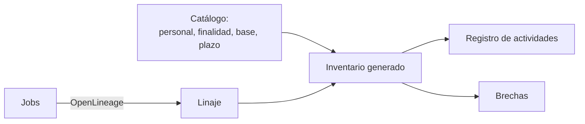

## 1. Resumen

Esta ficha no es asesoría legal: cubre cómo generar técnicamente el inventario de tratamientos.

La ley pide que el responsable pueda **acreditar** la licitud de lo que hace y que informe qué datos trata, para qué, con qué base, a quién los comunica y por cuánto tiempo los guarda. Una planilla hecha a mano envejece el día que se termina. Este patrón la **genera en cada ejecución**:

- el **linaje** dice qué job lee y escribe cada dataset;
- el **catálogo** dice si el dataset es personal, su finalidad, base, categorías, plazo y destinatarios (lo mantienen el dueño del dato y el área legal);
- el cruce produce una fila por actividad, y cada dato faltante es una **brecha**.

## 2. Qué es

- **[Obligación legal · art. 3]** El responsable debe poder acreditar la licitud del tratamiento y responde por el cumplimiento de los principios.
- **[Obligación legal · art. 14 ter]** Debe informar al público, entre otras cosas, las categorías de datos, las finalidades, la base de legitimidad, los destinatarios, las transferencias, el plazo de conservación y la fuente.
- **[Decisión de arquitectura]** El inventario es una vista derivada del linaje y del catálogo, no un documento aparte.

## 3. Problema que resuelve

**[Buena práctica]** Alguien pregunta para qué se usa la tabla de audiencias de marketing y con qué base. Nadie lo sabe: la tabla la creó un job hace un año y la planilla de tratamientos no la menciona.

**[Decisión de arquitectura]** Con el inventario generado, la tabla aparece en cuanto un job la escribe, y si le falta la finalidad aparece como brecha en la CI.

## 4. Cómo funciona

1. **[Buena práctica]** Cada job emite eventos de linaje con sus entradas y salidas (OpenLineage).
2. **[Decisión de arquitectura]** El catálogo marca los datasets personales y guarda finalidad, base, categorías, plazo y destinatarios.
3. **[Obligación legal · art. 14 ter]** Se arma una fila por actividad con lo que la ley pide informar.
4. **[Obligación legal · art. 3]** Cada dato faltante en un dataset personal es una brecha: sin finalidad o sin base no se puede acreditar la licitud.
5. **[Buena práctica]** El registro y las brechas quedan como artefacto de cada ejecución.

## 5. Cuándo utilizarlo

- Cuando hay más de unos pocos pipelines con datos personales.
- Cuando el linaje ya se emite (o se puede emitir) desde los jobs.

## 6. Cuándo no utilizarlo

- Sin catálogo: el linaje solo dice qué se mueve, no para qué.
- Para decidir finalidades o bases: el registro las muestra, no las decide.

## 7. Ejemplo sencillo

Tres jobs: `cargar_clientes`, `ventas_por_comuna` y `audiencia_campana`.

| Dataset | Personal | Resultado |
|---|---|---|
| `silver.clientes` | sí | Fila completa: finalidad, base, categorías, plazo, destinatarios |
| `gold.ventas_por_comuna` | no | No entra al registro |
| `mkt.audiencia_campana` | sí | Brechas: falta finalidad, base y plazo |

## 8. Ejemplo de producción

- Todos los jobs emiten linaje a un backend de linaje (el del catálogo de la nube o uno propio).
- Un job diario cruza linaje y catálogo, publica el registro y abre una alerta por cada brecha.
- El área legal revisa el registro y completa los metadatos en el catálogo.

### Evidencia de cumplimiento

| Evidencia | Dónde queda | Quién la produce |
|---|---|---|
| Registro de actividades con fecha | Almacenamiento versionado | Job del inventario |
| Lista de brechas | Alerta y log del job | Job del inventario |
| Metadatos de finalidad, base y plazo | Catálogo | Dueño del dato y área legal |

## 9. Arquitectura



## 10. Código

```python
# Python 3.12 y openlineage-python 1.54 (ejecutado en la CI; ADR-021): el registro de actividades de tratamiento
# se genera desde el linaje (qué job lee y escribe qué) y el catálogo (qué es personal, para qué, con qué base y
# por cuánto tiempo). Si a un dataset personal le falta un dato del registro, se lista como brecha.
import json
import sys
import tempfile
from datetime import datetime, timezone
from pathlib import Path
from typing import Any

from openlineage.client import OpenLineageClient
from openlineage.client.event_v2 import InputDataset, Job, OutputDataset, Run, RunEvent, RunState
from openlineage.client.uuid import generate_new_uuid

archivo = Path(sys.argv[1] if len(sys.argv) > 1 else tempfile.mkdtemp()) / "lineage.jsonl"
client = OpenLineageClient(config={"transport": {"type": "file", "log_file_path": str(archivo), "append": True}})
NS = "postgres://warehouse"
JOBS = {  # job -> (entradas, salidas)
    "cargar_clientes": (["crm.clientes"], ["silver.clientes"]),
    "ventas_por_comuna": (["silver.clientes", "silver.pedidos"], ["gold.ventas_por_comuna"]),
    "audiencia_campana": (["silver.clientes"], ["mkt.audiencia_campana"]),
}
CATALOGO: dict[str, dict[str, Any]] = {  # metadatos que mantienen el dueño y el área legal; el pipeline solo los lee
    "silver.clientes": {"personal": True, "categorias": ["identificación", "contacto"], "finalidad": "venta y despacho",
                        "base": "contrato", "retencion_dias": 1825, "destinatarios": ["operador logístico"]},
    "gold.ventas_por_comuna": {"personal": False},
    "mkt.audiencia_campana": {"personal": True, "categorias": ["contacto"], "finalidad": None,
                              "base": None, "retencion_dias": None, "destinatarios": []},
}
CAMPOS = ("categorias", "finalidad", "base", "retencion_dias")

for nombre, (entradas, salidas) in JOBS.items():
    client.emit(RunEvent(eventType=RunState.COMPLETE, eventTime=datetime.now(timezone.utc).isoformat(),
                         run=Run(runId=str(generate_new_uuid())), job=Job(namespace="ventas", name=nombre),
                         producer="https://example.com/pipelines/ventas",
                         inputs=[InputDataset(namespace=NS, name=n) for n in entradas],
                         outputs=[OutputDataset(namespace=NS, name=n) for n in salidas]))

registro: list[dict[str, Any]] = []
brechas: list[str] = []
for evento in (json.loads(linea) for linea in archivo.read_text(encoding="utf-8").splitlines()):
    for salida in evento["outputs"]:
        meta = CATALOGO.get(salida["name"], {})
        if not meta.get("personal"):
            continue
        faltan = [c for c in CAMPOS if not meta.get(c)]
        brechas += [f"{salida['name']}: falta {c}" for c in faltan]
        registro.append({"actividad": evento["job"]["name"], "dataset": salida["name"],
                         "origen": [e["name"] for e in evento["inputs"]], **{c: meta.get(c) for c in (*CAMPOS, "destinatarios")}})

print(f"actividades con datos personales: {len(registro)}")
print("primera actividad:", json.dumps(registro[0], ensure_ascii=False))
print("brechas del registro:", brechas)
```

El script se **ejecuta en la CI con openlineage-python 1.54** (ADR-021), con transporte a archivo, y pasa `mypy --strict`. Imprime 2 actividades con datos personales, la fila completa de `silver.clientes` y las tres brechas de `mkt.audiencia_campana`.

## 11. GCP

En GCP, **Knowledge Catalog**. Según *Ley 19628 SOBRE PROTECCION DE LOS DATOS PERSONALES* y *About metadata in Knowledge Catalog* (no ejecutado):

| | Inventario (este ejemplo) | Knowledge Catalog | Etiqueta |
|---|---|---|---|
| Metadatos legales | Diccionario `CATALOGO` | Aspect types propios (por ejemplo, clasificación de PII) sobre las entries | **[Decisión de arquitectura]** |
| Linaje | Eventos OpenLineage en un archivo | Linaje de datos del propio catálogo | **[Buena práctica]** |

## 12. AWS

En AWS, **Amazon SageMaker Catalog**. Según *Ley 19628 SOBRE PROTECCION DE LOS DATOS PERSONALES* y *Catalog in IDC-based domains* (no ejecutado):

| | Inventario (este ejemplo) | SageMaker Catalog | Etiqueta |
|---|---|---|---|
| Metadatos legales | Diccionario `CATALOGO` | Contexto de negocio de cada asset | **[Decisión de arquitectura]** |
| Visibilidad | Registro generado | Assets visibles en el proyecto hasta publicarlos | **[Buena práctica]** |

## 13. Azure

En Azure, **Purview Unified Catalog**. Según *Ley 19628 SOBRE PROTECCION DE LOS DATOS PERSONALES* y *Learn about Microsoft Purview Unified Catalog* (no ejecutado):

| | Inventario (este ejemplo) | Purview Unified Catalog | Etiqueta |
|---|---|---|---|
| Inventario | Generado desde linaje y catálogo | Inventario de activos, metadata y linaje | **[Buena práctica]** |
| Gobierno | Brechas en la CI | Governance domains, glossary terms y data products | **[Decisión de arquitectura]** |

## 14. Buenas prácticas

- **[Obligación legal · art. 14 ter]** Incluir en cada fila lo que la ley pide informar: categorías, finalidad, base, destinatarios, plazo y fuente.
- **[Buena práctica]** Tratar cada brecha como un error de la CI en los datasets nuevos.
- **[Buena práctica]** **Seguridad:** el registro describe datos personales sin contenerlos; no copiar valores.
- **[Buena práctica]** **Observabilidad:** alertar cuando aparece un dataset personal nuevo sin finalidad.
- **[Buena práctica]** **Costo:** el linaje ya existe para operar; reusarlo evita mantener un inventario aparte.

## 15. Errores frecuentes

- Una planilla mantenida a mano que nadie actualiza.
- Inventariar solo las tablas finales y no los exports ni las copias.
- Que el pipeline invente la finalidad cuando falta.

## 16. Trade-offs

Generar el registro exige que todos los jobs emitan linaje y que el catálogo esté al día; a cambio, el registro no envejece. Un documento manual es más rápido de empezar y deja de ser cierto con el primer job nuevo.

## 17. Conceptos relacionados

- `data-catalog`: dónde viven los metadatos.
- `data-lineage`: qué lee y escribe cada job.
- `chile-data-protection`: el panorama.
- `data-retention`: el plazo de conservación aplicado.

## 18. Preguntas técnicas abiertas

1. ¿Tus jobs emiten linaje hoy?
2. ¿Dónde está la finalidad de cada dataset personal?
3. ¿Cuántos datasets personales aparecerían como brecha?

## 19. Laboratorio relacionado

Pendiente (F4).

## 20. Fuentes

- BCN Ley Chile: *Ley 19628 SOBRE PROTECCION DE LOS DATOS PERSONALES* (versión con vigencia diferida desde 2026-12-01).
- OpenLineage: *Object Model* y *Configuration*.
- Google Cloud: *About metadata in Knowledge Catalog*.
- AWS: *Catalog in IDC-based domains*.
- Microsoft Learn: *Learn about Microsoft Purview Unified Catalog*.

El detalle de cada fuente está en `sources` del frontmatter.

## 21. Fecha de última verificación

2026-10-21: texto legal consultado ese día en BCN. `review_required`: pendiente de revisión B-F3.1 del lote F3b-19a; pasa a `verified` solo con la aprobación explícita de Felipe (`owner_approved_at`). Revisión mensual.

## 22. Historial de cambios importantes

- 2026-10-21: creación (lote F3b-19a).
