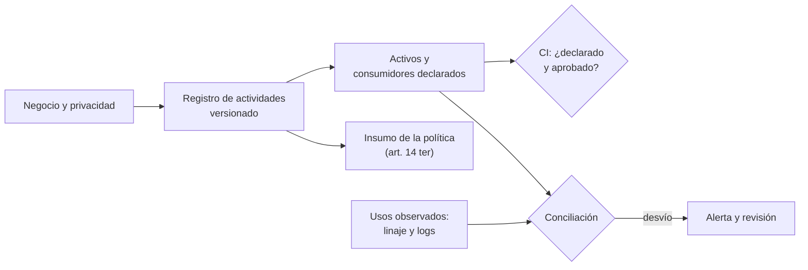

## 1. Resumen

Esta ficha no es asesoría legal: finalidad, base de licitud y plazo los definen el responsable, el negocio y el área legal; aquí se explica cómo modelarlos, vincularlos a la plataforma y controlarlos. Los ejemplos de bases y plazos son ilustrativos, no determinaciones legales.

**Cómo leerla.** *Comprender* (§1–6): qué es una actividad y por qué no es una tabla. *Aplicar* (§7–13): cómo se vincula con activos y consumidores y cómo se concilia con lo observado. *Demostrar*: la evidencia del §8, el control del §10 y los criterios del §18.

El inventario explica **para qué** se tratan datos personales y lo vincula con **qué activos, procesos y consumidores** los usan. No es una lista de tablas ni un catálogo técnico duplicado: conecta decisiones de negocio y privacidad con operaciones observables. Es la base de casi todos los demás controles: sin saber qué actividad usa qué datos, con qué base y por cuánto tiempo, no se puede responder un acceso, aplicar retención, dimensionar una vulneración ni detectar un uso indebido.

**Idea central:** la finalidad y su fundamento pertenecen al tratamiento concreto; una tabla puede participar en varias actividades, y compartir una tabla no autoriza todos sus usos.

## 2. Qué es

- **[Obligación legal · art. 3]** El responsable debe poder acreditar la licitud (letra a)); no puede tratar los datos con fines distintos de los informados salvo las excepciones de la letra b); y los datos que se traten deben limitarse estrictamente a los necesarios, adecuados y pertinentes en relación con los fines (letra c), proporcionalidad).
- **[Obligación legal · art. 12]** Si la base es el consentimiento, debe ser libre, informado, específico por finalidad, previo e inequívoco, y revocable; el responsable lo prueba.
- **[Obligación legal · art. 13]** Otras bases: obligaciones económicas (Título III), obligación legal, contrato, interés legítimo y defensa de un derecho.
- **[Decisión de arquitectura]** **Actividad de tratamiento:** unidad de gestión con identificador estable, responsable, finalidad, base validada, categorías de datos y de titulares, activos, destinatarios, transferencias, plazo, decisiones automatizadas, estado y versión.
- **[Decisión de arquitectura]** Cuatro entidades distintas, que no conviene mezclar en un solo campo:

| Entidad | Responde | Ejemplo | Etiqueta |
|---|---|---|---|
| Actividad | Por qué se usan los datos | Gestionar una reserva | **[Decisión de arquitectura]** |
| Activo | Dónde están | `silver.pasajeros` | **[Decisión de arquitectura]** |
| Consumidor | Quién o qué los usa | `dag_reservas`, un dashboard, un servicio | **[Decisión de arquitectura]** |
| Evidencia | Cómo se demuestra la aprobación y la operación | Ticket de aprobación, ejecución, registro de auditoría | **[Decisión de arquitectura]** |

- **[Decisión de arquitectura]** **Relaciones muchos a muchos:** actividad ↔ activo y actividad ↔ consumidor. `silver.pasajeros` puede servir a venta de pasajes (contrato) y a marketing (consentimiento); un único `legal_basis` o `purpose` pegado a la tabla no alcanza.
- **[Buena práctica]** **Usos observados:** qué consumidores leen cada activo, desde el linaje y los logs de acceso; se comparan con los usos declarados.

## 3. Problema que resuelve

**[Buena práctica]** Una tabla de pasajeros sirve para gestionar reservas. Otro equipo crea un modelo de ofertas o de fraude y asume que, como la tabla ya está disponible, puede usarla. La disponibilidad técnica no demuestra autorización para una finalidad nueva. Con la base asignada al dataset, el modelo «hereda» la base de otra actividad y nadie lo nota; con actividades y consumidores explícitos, ese uso aparece como no vinculado o no aprobado.

**[Buena práctica]** Sin un inventario conectado a los procesos nadie puede contestar con seguridad: qué tratamiento justifica un consumo, qué datos necesita, quién lo aprobó y qué pasa si cambia la finalidad o se revoca un consentimiento.

**[Obligación legal · art. 34 ter]** Tratar datos sin base o con una finalidad distinta es infracción grave (letra a)). **[Buena práctica]** La falta de un registro técnico no demuestra por sí sola ese supuesto: es una señal que obliga a determinar los hechos y el fundamento con el área competente. **[Decisión de arquitectura]** Por eso la CI la muestra como brecha y la deriva a revisión, sin calificarla.

## 4. Cómo funciona

1. **[Decisión de arquitectura]** **Definir:** negocio y privacidad registran la actividad con su finalidad, base, plazo y destinatarios aprobados.
2. **[Buena práctica]** **Vincular:** ingeniería la asocia a los activos, campos relevantes, jobs, aplicaciones, consumidores y proveedores, y propaga plazo y finalidad como tags.
3. **[Decisión de arquitectura]** **Autorizar:** el uso propuesto se valida antes de conceder acceso o desplegar un consumidor nuevo; la CI verifica que la actividad exista, esté aprobada y declare al consumidor.
4. **[Buena práctica]** **Observar:** el linaje y los logs de acceso dan los usos reales (consumidor, activo).
5. **[Buena práctica]** **Gestionar desviaciones:** un consumo sin actividad vinculada o de una actividad no aprobada genera una alerta técnica; su licitud se investiga, no se presume.
6. **[Buena práctica]** **Mantener:** se versionan los cambios de finalidad, datos, destinatarios, retención y procesos, sin sobrescribir decisiones anteriores.
7. **[Obligación legal · art. 14 ter]** El responsable mantiene a disposición del público las categorías de datos, los destinatarios, las finalidades, la base de licitud y el plazo de conservación (letras d) e i)). **[Decisión de arquitectura]** El registro genera un insumo revisable para esa política; no la publica automáticamente.
8. **[Obligación legal · art. 14]** El responsable informa y pone a disposición los antecedentes de la licitud del tratamiento (letra a)). **[Buena práctica]** El registro, sus versiones y su evidencia se exportan bajo demanda.

**[Buena práctica]** Los logs y el linaje muestran operaciones y dependencias, no la intención jurídica de una consulta. La finalidad se declara y se asocia a identidades, servicios o procesos controlados; no se deduce del SQL.

## 5. Cuándo utilizarlo

- Antes de habilitar un pipeline, dashboard, modelo, API o transferencia nuevos que usen datos personales.
- Al modificar un tratamiento existente: finalidad, datos, destinatarios o plazo.
- Como fuente para derechos, retención, vulneraciones, evaluación de impacto y auditoría.

## 6. Cuándo no utilizarlo

- Para decidir si una finalidad es lícita, si una base aplica o cuánto se conserva cada dato: lo decide el área legal.
- Como reemplazo del sistema de consentimientos, de los controles de acceso, del catálogo técnico o de una evaluación de impacto: es el vínculo entre ellos.
- Como prueba de cumplimiento: una conciliación limpia muestra coherencia técnica, no licitud.

## 7. Ejemplo sencillo

| Actividad | Finalidad | Base (ilustrativa) | Activo compartido | Estado |
|---|---|---|---|---|
| venta_pasajes | Emitir y gestionar pasajes | Contrato (art. 13 c)), sujeto a validación | silver.pasajeros, silver.reservas | Aprobada; plazo ilustrativo de 5 años |
| marketing | Ofertas personalizadas | Consentimiento (art. 12), si corresponde y se acredita | silver.pasajeros | Aprobada; falta el plazo y el control de revocación |
| modelo_fraude | Detectar operaciones sospechosas | Pendiente de evaluación | silver.pasajeros | No habilitar hasta la revisión |

El mismo activo aparece tres veces: lo que cambia es la actividad y sus condiciones de uso. No hay un plazo universal; cada plazo se justifica y se aprueba según el contexto.

## 8. Ejemplo de producción

Escenario genérico: una aerolínea con BigQuery, Airflow (Cloud Composer) y dashboards pide un modelo de fraude sobre `silver.pasajeros`.

- Se abre una solicitud con un `activity_id` y la descripción del propósito.
- Privacidad y negocio evalúan base, atributos necesarios, destinatarios y plazo.
- Ingeniería asocia el `activity_id` al DAG, a su cuenta de servicio y a los activos permitidos; aplica IAM y minimización.
- Al desplegar, la CI comprueba que la actividad exista, esté aprobada y declare al consumidor.
- En operación, los jobs y los accesos se concilian con los consumidores declarados; una discrepancia abre una incidencia para análisis.

| Componente | Implementación posible |
|---|---|
| Registro de actividades | Tablas versionadas `activities`, `activity_assets`, `activity_consumers`, `approvals`, `observed_uses`, o el módulo de una herramienta de privacidad |
| Relación con activos | Tags en el catálogo: `actividad`, `plazo`, `finalidad` |
| Consentimientos | Tabla por titular, finalidad, versión del texto, fecha y canal; revocación con la misma facilidad (su detalle, en las fichas hermanas) |
| Usos observados | Linaje (del catálogo de la nube u OpenLineage) y logs de acceso |
| Control | Job de la CI que concilia declarados contra observados |

### Evidencia de cumplimiento

| Evidencia | Dónde queda | Quién la produce | Qué demuestra | Qué no demuestra |
|---|---|---|---|---|
| Registro de actividades versionado | Registro gobernado o repositorio | Privacidad y negocio | Qué finalidad, base y plazo se aprobaron y cuándo | Que la base sea la correcta |
| Aprobación del uso nuevo | Sistema de solicitudes | Dueño del tratamiento | Quién autorizó el consumidor y con qué alcance | Que el consumidor use solo lo aprobado |
| Vínculo actividad–activo–consumidor | Catálogo o registro técnico | Ingeniería | Qué consumidores y activos cubre cada actividad | La intención real de cada consulta |
| Ejecuciones y accesos | Logs protegidos con retención definida | Plataforma | Qué consumidor leyó qué activo y cuándo | Por qué lo leyó |
| Desviaciones y su cierre | Gestión de incidencias | Ingeniería y privacidad | Que la alerta se analizó y cómo se resolvió | Que no haya usos fuera de la cobertura del linaje |

## 9. Arquitectura



La CI bloquea un despliegue nuevo no declarado; la conciliación cubre lo que ya corre en producción. Para consentimientos y retención se integran las entidades de sus fichas hermanas, sin replicarlas.

## 10. Código

```python
# Python 3.12+, biblioteca estándar. Registro de actividades de tratamiento: la base de licitud vive en la
# actividad, no en el dataset. Cada actividad declara sus activos y sus consumidores (DAG, job, dashboard). La CI
# compara los usos observados (consumidor, activo) contra lo declarado y falla con brechas: tablas con PII sin
# actividad, actividades aprobadas incompletas, consumos sin vínculo y consumos de una actividad no aprobada.
# Una brecha es una alerta técnica para revisar, no la conclusión de que hubo una infracción.
import sys
from dataclasses import dataclass

BASES = {"consentimiento (art. 12)", "obligación legal (art. 13 b)", "contrato (art. 13 c)",
         "interés legítimo (art. 13 d)", "defensa de derechos (art. 13 e)", "obligaciones económicas (art. 13 a)"}


@dataclass(frozen=True)
class Actividad:
    nombre: str
    finalidad: str
    base: str
    plazo: str
    aprobada: bool
    categorias: tuple[str, ...]
    destinatarios: tuple[str, ...]
    activos: frozenset[str]
    consumidores: frozenset[str]


ACTIVIDADES = [
    Actividad("venta_pasajes", "emitir y gestionar pasajes", "contrato (art. 13 c)", "5 años", True,
              ("identificación", "contacto", "itinerario"), ("aerolíneas socias",),
              frozenset({"silver.pasajeros", "silver.reservas"}), frozenset({"dag_reservas"})),
    Actividad("marketing", "ofertas personalizadas", "consentimiento (art. 12)", "", True,
              ("contacto", "preferencias"), ("plataforma de email",),
              frozenset({"silver.pasajeros"}), frozenset({"dag_campanas"})),
    Actividad("modelo_fraude", "detectar operaciones sospechosas", "pendiente de evaluación", "", False,
              ("identificación", "pagos"), (), frozenset({"silver.pasajeros"}), frozenset({"job_fraude"})),
]

TABLAS_CON_PII = {"silver.pasajeros", "silver.reservas", "gold.score_fraude"}
# Usos observados (consumidor, activo), desde logs de acceso y linaje. El consumidor sale de una identidad o
# configuración confiable (cuenta de servicio, nombre del DAG), no se deduce del texto de la consulta.
USOS_OBSERVADOS = [("dag_reservas", "silver.pasajeros"), ("job_fraude", "silver.pasajeros"),
                   ("dashboard_externo", "silver.pasajeros")]


def brechas() -> list[str]:
    salida: list[str] = []
    cubiertas = {t for a in ACTIVIDADES for t in a.activos}
    salida += [f"tabla con PII sin actividad: {t}" for t in sorted(TABLAS_CON_PII - cubiertas)]
    for a in (a for a in ACTIVIDADES if a.aprobada):
        if a.base not in BASES:
            salida.append(f"{a.nombre}: base no reconocida")
        if not a.plazo:
            salida.append(f"{a.nombre}: sin plazo de conservación")
    for consumidor, activo in USOS_OBSERVADOS:
        vinculos = [a for a in ACTIVIDADES if consumidor in a.consumidores and activo in a.activos]
        if not vinculos:
            salida.append(f"sin vínculo: {consumidor} → {activo}")
        elif not any(a.aprobada for a in vinculos):
            salida.append(f"sin aprobación: {consumidor} → {activo} ({', '.join(a.nombre for a in vinculos)})")
    return salida


def insumo_14_ter() -> None:
    print("insumo para la política (art. 14 ter), a revisar por privacidad antes de publicar:")
    for a in (a for a in ACTIVIDADES if a.aprobada):
        print(f"- {a.finalidad} | base: {a.base} | datos: {', '.join(a.categorias)} "
              f"| destinatarios: {', '.join(a.destinatarios)} | plazo: {a.plazo or 'POR DEFINIR'}")


if __name__ == "__main__":
    insumo_14_ter()
    b = brechas()
    for x in b:
        print("BRECHA", x)
    sys.exit(1 if b else 0)
```

El script se **ejecuta en la CI** con la biblioteca estándar y pasa `mypy --strict`. Imprime el insumo de las dos actividades aprobadas y cuatro brechas; termina con código 1:

```text
BRECHA tabla con PII sin actividad: gold.score_fraude
BRECHA marketing: sin plazo de conservación
BRECHA sin aprobación: job_fraude → silver.pasajeros (modelo_fraude)
BRECHA sin vínculo: dashboard_externo → silver.pasajeros
```

Las dos últimas son las importantes: con la base asignada al dataset, ambos consumos habrían pasado inadvertidos. **Limitaciones:** el ejemplo no prueba consentimiento, finalidad real ni cumplimiento; solo ve los usos que el linaje y los logs registran, y la CI bloquea despliegues nuevos, no consumos que ya corren (para eso, la alerta operacional del §9).

## 11. GCP

En GCP, **Knowledge Catalog**. Según *About data lineage*, consultada el 2026-10-28 (no ejecutado):

| Necesidad | Servicio | Limitación | Etiqueta |
|---|---|---|---|
| Usos observados | Linaje de datos de Knowledge Catalog, informado por BigQuery y Dataflow | Registra metadata del movimiento, no la finalidad; la información de linaje se retiene solo 30 días | **[Buena práctica]** |
| Registro de actividades | Propio, con tags en el catálogo | Hay que mantenerlo enlazado a las ejecuciones | **[Decisión de arquitectura]** |

## 12. AWS

En AWS, **Amazon DataZone**. Según *Data lineage in Amazon DataZone* (no ejecutado):

| Necesidad | Servicio | Limitación | Etiqueta |
|---|---|---|---|
| Usos observados | Linaje de DataZone, compatible con OpenLineage | Muestra orígenes, transformaciones y consumo, no la aprobación | **[Buena práctica]** |
| Registro de actividades | Propio, con metadatos de negocio | El catálogo no sustituye la aprobación del uso | **[Decisión de arquitectura]** |

## 13. Azure

En Azure, **Unity Catalog** y **Purview Unified Catalog**. Según *Lineage in Unity Catalog* y *Learn about Microsoft Purview Unified Catalog* (no ejecutado):

| Necesidad | Servicio | Limitación | Etiqueta |
|---|---|---|---|
| Usos observados | Unity Catalog: linaje automático de las consultas en Azure Databricks, hasta el nivel de columna | No se preserva para objetos renombrados; fuera de Databricks depende de integraciones | **[Buena práctica]** |
| Catálogo corporativo | Purview Unified Catalog: inventario, metadata, linaje y governance domains | Organiza el ownership; no acredita la base de licitud | **[Buena práctica]** |

**Criterio de selección:** un registro de actividades independiente del proveedor, con identificadores estables enlazados al catálogo y a las ejecuciones de cada nube.

## 14. Buenas prácticas

- **[Decisión de arquitectura]** La actividad es la unidad de licitud; el dataset solo la referencia.
- **[Buena práctica]** Exigir `activity_id` al registrar un consumidor nuevo de datos personales, antes de darle acceso.
- **[Decisión de arquitectura]** Mantener separadas la aprobación jurídica, la configuración técnica y la evidencia de ejecución.
- **[Buena práctica]** Versionar las actividades sin sobrescribir decisiones anteriores; definir quién revisa y qué pasa con las actividades descontinuadas.
- **[Buena práctica]** **Seguridad:** el acceso se concede por actividad y consumidor, no por dataset completo.
- **[Buena práctica]** **Observabilidad:** métricas de consumos sin vínculo, actividades incompletas y aprobaciones vencidas; deben tender a cero.
- **[Buena práctica]** **Costo:** empezar por las actividades con datos sensibles, decisiones automatizadas o terceros; conciliar primero las identidades y activos de mayor riesgo.

## 15. Errores frecuentes

- **Base de licitud por dataset:** todos los consumidores de la tabla quedan «cubiertos» y un uso nuevo pasa inadvertido.
- **Confundir un acceso permitido por IAM con un tratamiento autorizado:** el permiso técnico no dice para qué finalidad.
- **Creer que el linaje revela por qué se ejecutó una consulta:** muestra dependencias, no intención.
- **Publicar la política generada sin revisión:** el insumo del art. 14 ter puede estar incompleto o desactualizado.
- **Consentimiento genérico** para «mejorar nuestros servicios»: no es específico por finalidad.
- **Inventario en una planilla aislada:** no se actualiza cuando cambian los pipelines y deja de describir la plataforma.
- **No registrar los usos analíticos y de modelos:** son los que más cambian de finalidad.

## 16. Trade-offs

- **Granularidad:** una actividad por consulta es inmanejable; una por sistema oculta finalidades distintas. Conviene una por finalidad coherente, con consumidores y activos trazables.
- **Observabilidad:** inspeccionar cada consulta cuesta; priorizar identidades, servicios y activos de mayor riesgo, sin suponer cobertura completa.
- **Control de despliegue:** bloquear cambios no aprobados reduce exposición, pero exige un proceso ágil para dar de alta y modificar actividades.

## 17. Conceptos relacionados

- `chile-data-protection`: ficha padre.
- `pii-identification`: qué activos contienen datos personales.
- `data-catalog`, `data-lineage`: catálogo y linaje.
- `data-subject-rights-pipeline`: localizar los tratamientos ante una solicitud.
- `retention-and-erasure`: aplicar el plazo de cada actividad.
- `dpia-and-automated-decisions`: evaluar las actividades de mayor riesgo.
- `processors-and-international-transfers`: destinatarios, encargados y transferencias.
- `privacy-controls-as-code`: automatizar las verificaciones.

Nota editorial: esta ficha cubre el inventario y la vinculación de usos; consentimiento, retención, derechos y transferencias se profundizan en sus fichas hermanas.

## 18. Preguntas técnicas abiertas

1. ¿Puedes listar las actividades que usan una tabla dada?
2. ¿Cuántos consumidores de datos personales no declaran actividad?
3. ¿Dónde se guarda hoy la prueba del consentimiento?
4. ¿Qué parte de los consumos reales cubre tu linaje y por cuánto tiempo lo retienes?

**Criterio de dominio:** dominas esta ficha si puedes explicar por qué una tabla no tiene una única base de licitud, cómo asociarías un DAG a una actividad aprobada, qué demuestran los logs y el linaje y qué no, y cómo actuarías ante un consumidor no registrado sin presumir una infracción.

## 19. Laboratorio relacionado

Propuesta para F4: tres actividades ficticias, dos consumidores aprobados y un consumidor nuevo simulado. Comprobar que la conciliación detecta la desviación y genera evidencia sin decidir su licitud. Sin datos personales reales.

## 20. Fuentes

- BCN Ley Chile: *Ley 19628 SOBRE PROTECCION DE LOS DATOS PERSONALES* (versión con vigencia diferida desde 2026-12-01).
- Google Cloud: *About data lineage*.
- AWS: *Data lineage in Amazon DataZone*.
- Microsoft Learn: *Lineage in Unity Catalog* y *Learn about Microsoft Purview Unified Catalog*.

El detalle de cada fuente está en `sources` del frontmatter.

## 21. Fecha de última verificación

2026-10-28: art. 3 c) consultado en BCN para agregarlo; *About data lineage* consultada de nuevo. Antes, 2026-10-25: textos legales vueltos a consultar en BCN, sin cambios, y 2026-10-22: arts. 3, 12, 13, 14, 14 ter y 34 ter consultados ese día. `review_required`: pasa a `verified` solo con la aprobación explícita de Felipe (`owner_approved_at`). Revisión mensual.

## 22. Historial de cambios importantes

- 2026-10-21: creación (lote F3b-19a).
- 2026-10-22: upgrade de 19: la base de licitud pasa a la actividad de tratamiento, con usos observados contra registrados y resumen del art. 14 ter.
- 2026-10-24: `PART_OF` hacia `chile-data-protection` (ADR-024) e `implication` por artículo en `legal_basis` (enmienda de ADR-023). Sin cambios de contenido legal ni de código.
- 2026-10-25: revisión del upgrade (`docs/reviews/cards-f3b-19-upgrade.md`) y auditoría de las etiquetas «Obligación legal»: cada una afirma solo lo que dice su artículo; lo demás pasa a buena práctica o decisión de arquitectura. Textos de BCN y del Senado consultados el 2026-10-25, sin cambios desde el 2026-10-22.
- 2026-10-25: §9 con el estándar de diagramas (máximo 8 nodos, CLAUDE.md): tags y pipelines en un nodo; linaje y logs dentro de «usos observados».
- 2026-10-28: mejora de contenido (lote P1) con tres niveles de lectura: §1 (idea central), §2 (art. 3 c) verificado en BCN y agregado a `legal_basis`; actividad, activo, consumidor y evidencia como entidades distintas), §3 (caso del modelo nuevo sobre una tabla disponible; la falta de registro no prueba la infracción), §4 (ocho pasos con autorizar y gestionar desviaciones; el linaje no muestra intención), §6, §7 (tres actividades sobre el mismo activo), §8 (escenario con evidencia «qué demuestra y qué no»), §9 (consumidores declarados y conciliación), §10 (consumidores por actividad: brechas «sin vínculo» y «sin aprobación», insumo del art. 14 ter solo con actividades aprobadas), §11–13 (columna de limitaciones; retención de 30 días del linaje en GCP), §14–16, §17 (relaciones con `pii-identification` y `privacy-controls-as-code`), §18 (criterio de dominio) y §19 (laboratorio para F4). Sin cambios en las etiquetas existentes, aviso ni vigencia.
- 2026-10-28: pasa al dominio 24-privacy-engineering, tramo `fundamentos` (ADR-027), desde 19-compliance; sin cambios de contenido. La URL de la ficha (`/concepts/processing-activities-inventory/`) no cambia.
