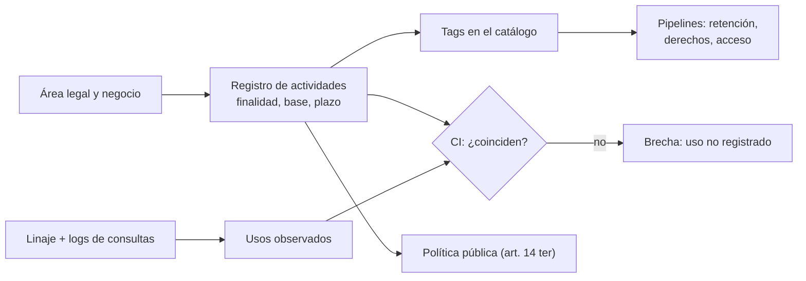

## 1. Resumen

Esta ficha no es asesoría legal: finalidad, base de licitud y plazo los definen el área legal y el negocio; aquí se explica cómo modelarlos y hacerlos cumplir en la plataforma.

El inventario es la base de casi todos los demás controles: sin saber **qué actividad** usa **qué datos**, con **qué base** y **por cuánto tiempo**, no se puede responder un acceso, aplicar retención, dimensionar una vulneración ni detectar un uso indebido. La clave de diseño es modelar la **actividad de tratamiento** como entidad propia y asociarla a los activos: un mismo dataset suele servir a varias actividades con bases distintas.

## 2. Qué es

- **[Obligación legal · art. 3]** El responsable debe poder acreditar la licitud, y no puede tratar los datos con fines distintos de los informados salvo las excepciones de la letra b).
- **[Obligación legal · art. 12]** Si la base es el consentimiento, debe ser libre, informado, específico por finalidad, previo e inequívoco, y revocable; el responsable lo prueba.
- **[Obligación legal · art. 13]** Otras bases: obligaciones económicas (Título III), obligación legal, contrato, interés legítimo y defensa de un derecho.
- **[Decisión de arquitectura]** **Actividad de tratamiento:** unidad con finalidad, base, categorías de datos y de titulares, destinatarios, plazo, transferencias y decisiones automatizadas.
- **[Decisión de arquitectura]** **Relación actividad ↔ activo:** muchos a muchos. `silver.pasajeros` puede servir a venta de pasajes (contrato) y a marketing (consentimiento).
- **[Buena práctica]** **Usos observados:** qué jobs, dashboards y modelos leen cada activo, desde el linaje y los logs de consultas; se comparan con los usos registrados.

## 3. Problema que resuelve

**[Buena práctica]** Con la base asignada al dataset, un modelo de fraude que lee la tabla de clientes «hereda» la base de marketing y nadie lo nota. Con actividades explícitas y usos observados, ese uso aparece como no registrado.

**[Obligación legal · art. 34 ter]** Tratar datos sin base o con una finalidad distinta es infracción grave (letra a)). **[Decisión de arquitectura]** Un uso no registrado es una brecha que la CI debe mostrar.

## 4. Cómo funciona

1. **[Decisión de arquitectura]** El área legal y el negocio crean la actividad: finalidad, base, plazo y destinatarios.
2. **[Buena práctica]** Ingeniería la asocia a los activos que usa y propaga plazo y finalidad como tags.
3. **[Buena práctica]** El linaje y los logs de consultas generan los usos observados.
4. **[Buena práctica]** La CI falla si hay tablas con datos personales sin actividad, actividades incompletas o usos no registrados.
5. **[Obligación legal · art. 14 ter]** El responsable mantiene a disposición del público las categorías de datos, los destinatarios, las finalidades, la base de licitud y el plazo de conservación (letras d) e i)). **[Decisión de arquitectura]** El catálogo genera ese resumen.
6. **[Obligación legal · art. 14]** El responsable informa y pone a disposición los antecedentes de la licitud del tratamiento (letra a)). **[Buena práctica]** El registro se exporta bajo demanda.

## 5. Cuándo utilizarlo

- Antes de construir un pipeline, dashboard o modelo nuevo que use datos personales.
- Como fuente para derechos, retención, vulneraciones y evaluación de impacto.

## 6. Cuándo no utilizarlo

- Para decidir la base de licitud o si un fin es compatible: lo decide el área legal.
- No reemplaza al catálogo técnico (esquemas, calidad); lo complementa.

## 7. Ejemplo sencillo

| Actividad | Finalidad | Base | Plazo | Activos |
|---|---|---|---|---|
| venta_pasajes | Emitir y gestionar pasajes | Contrato (art. 13 c)) | 5 años | silver.pasajeros, silver.reservas |
| marketing | Ofertas personalizadas | Consentimiento (art. 12) | Por definir | silver.pasajeros |
| riesgo_fraude | — no registrada — | — | — | gold.score_fraude (lee silver.pasajeros) |

## 8. Ejemplo de producción

| Componente | Implementación posible |
|---|---|
| Registro de actividades | Tabla `governance.actividades` versionada, o el módulo de una herramienta de privacidad |
| Relación con activos | Tags en el catálogo: `actividad`, `plazo`, `finalidad` |
| Consentimientos | Tabla por titular, finalidad, versión del texto, fecha y canal; revocación con la misma facilidad |
| Usos observados | Linaje (del catálogo de la nube u OpenLineage) y logs de consultas |
| Control | Job de la CI que compara registrados contra observados |

### Evidencia de cumplimiento

| Evidencia | Dónde queda | Quién la produce |
|---|---|---|
| Registro de actividades versionado | Repositorio o catálogo | Área legal, ingeniería |
| Consentimientos con versión y fecha | Tabla de consentimientos | Aplicación de origen |
| Resultado de la comparación de usos | Log de la CI | CI |

## 9. Arquitectura



## 10. Código

```python
# Python 3.12+, biblioteca estándar. Registro de actividades de tratamiento: la base de licitud vive en la
# actividad, no en el dataset. La CI falla si hay tablas con PII sin actividad, actividades incompletas o
# usos de un dataset para una finalidad no registrada. Además genera el resumen que exige el art. 14 ter d).
import sys
from dataclasses import dataclass

BASES = {"consentimiento (art. 12)", "obligación legal (art. 13 b)", "contrato (art. 13 c)",
         "interés legítimo (art. 13 d)", "defensa de derechos (art. 13 e)", "obligaciones económicas (art. 13 a)"}


@dataclass(frozen=True)
class Actividad:
    nombre: str
    finalidad: str
    base: str
    plazo: str
    categorias: tuple[str, ...]
    destinatarios: tuple[str, ...]
    activos: tuple[str, ...]


ACTIVIDADES = [
    Actividad("venta_pasajes", "emitir y gestionar pasajes", "contrato (art. 13 c)", "5 años",
              ("identificación", "contacto", "itinerario"), ("aerolíneas socias",),
              ("silver.pasajeros", "silver.reservas")),
    Actividad("marketing", "ofertas personalizadas", "consentimiento (art. 12)", "",
              ("contacto", "preferencias"), ("plataforma de email",), ("silver.pasajeros",)),
]

TABLAS_CON_PII = {"silver.pasajeros", "silver.reservas", "gold.score_fraude"}
USOS_OBSERVADOS = [("silver.pasajeros", "venta_pasajes"), ("silver.pasajeros", "riesgo_fraude")]  # desde logs/linaje


def brechas() -> list[str]:
    salida: list[str] = []
    cubiertas = {t for a in ACTIVIDADES for t in a.activos}
    salida += [f"tabla con PII sin actividad: {t}" for t in sorted(TABLAS_CON_PII - cubiertas)]
    for a in ACTIVIDADES:
        if a.base not in BASES:
            salida.append(f"{a.nombre}: base no reconocida")
        if not a.plazo:
            salida.append(f"{a.nombre}: sin plazo de conservación")
    registradas = {(t, a.nombre) for a in ACTIVIDADES for t in a.activos}
    salida += [f"uso no registrado: {t} → {u}" for t, u in USOS_OBSERVADOS if (t, u) not in registradas]
    return salida


def resumen_14_ter() -> None:
    for a in ACTIVIDADES:
        print(f"- {a.finalidad} | base: {a.base} | datos: {', '.join(a.categorias)} "
              f"| destinatarios: {', '.join(a.destinatarios)} | plazo: {a.plazo or 'POR DEFINIR'}")


if __name__ == "__main__":
    resumen_14_ter()
    b = brechas()
    for x in b:
        print("BRECHA", x)
    sys.exit(1 if b else 0)
```

El script se **ejecuta en la CI** con la biblioteca estándar y pasa `mypy --strict`. Imprime el resumen de las dos actividades registradas y tres brechas: `gold.score_fraude` sin actividad, marketing sin plazo y el uso no registrado `silver.pasajeros → riesgo_fraude`; termina con código 1. La tercera brecha es la importante: con la base asignada al dataset, ese uso habría pasado inadvertido.

## 11. GCP

En GCP, **Knowledge Catalog**. Según *Ley 19628 SOBRE PROTECCION DE LOS DATOS PERSONALES* y *About data lineage* (no ejecutado):

| Necesidad | Servicio | Etiqueta |
|---|---|---|
| Usos observados | Linaje de datos de Knowledge Catalog | **[Buena práctica]** |
| Registro de actividades | Propio, con tags en el catálogo | **[Decisión de arquitectura]** |

## 12. AWS

En AWS, **Amazon DataZone**. Según *Ley 19628 SOBRE PROTECCION DE LOS DATOS PERSONALES* y *Data lineage in Amazon DataZone* (no ejecutado):

| Necesidad | Servicio | Etiqueta |
|---|---|---|
| Usos observados | Linaje de DataZone | **[Buena práctica]** |
| Registro de actividades | Propio, con metadatos de negocio | **[Decisión de arquitectura]** |

## 13. Azure

En Azure, **Unity Catalog** y **Purview Unified Catalog**. Según *Ley 19628 SOBRE PROTECCION DE LOS DATOS PERSONALES*, *Lineage in Unity Catalog* y *Learn about Microsoft Purview Unified Catalog* (no ejecutado):

| Necesidad | Servicio | Etiqueta |
|---|---|---|
| Usos observados | Unity Catalog: linaje automático hasta el nivel de columna | **[Buena práctica]** |
| Catálogo corporativo | Purview Unified Catalog: inventario, metadata y linaje | **[Buena práctica]** |

## 14. Buenas prácticas

- **[Decisión de arquitectura]** La actividad es la unidad de licitud; el dataset solo la referencia.
- **[Buena práctica]** Cada nuevo consumidor de datos personales declara su actividad antes de obtener acceso.
- **[Buena práctica]** **Seguridad:** el acceso se concede por actividad, no por dataset completo.
- **[Buena práctica]** **Observabilidad:** métrica de usos no registrados; debe tender a cero.
- **[Buena práctica]** **Costo:** empezar por las actividades con datos sensibles, decisiones automatizadas o terceros.

## 15. Errores frecuentes

- Base de licitud por dataset.
- Consentimiento genérico para «mejorar nuestros servicios».
- Inventario en una planilla que nadie conecta con la plataforma.
- No registrar los usos analíticos y de modelos.

## 16. Trade-offs

Un registro muy granular (por consulta) es difícil de mantener; uno muy grueso (por sistema) no detecta usos indebidos. Conviene una actividad por finalidad de negocio y usos observados a nivel de job, dashboard y modelo.

## 17. Conceptos relacionados

- `chile-data-protection`: ficha padre.
- `data-catalog`, `data-lineage`: catálogo y linaje.
- `data-subject-rights-pipeline`, `retention-and-erasure`, `dpia-and-automated-decisions`, `processors-and-international-transfers`: fichas hermanas que usan el registro.

## 18. Preguntas técnicas abiertas

1. ¿Puedes listar las actividades que usan una tabla dada?
2. ¿Cuántos consumidores de datos personales no declaran finalidad?
3. ¿Dónde se guarda hoy la prueba del consentimiento?

## 19. Laboratorio relacionado

Pendiente (F4).

## 20. Fuentes

- BCN Ley Chile: *Ley 19628 SOBRE PROTECCION DE LOS DATOS PERSONALES* (versión con vigencia diferida desde 2026-12-01).
- Google Cloud: *About data lineage*.
- AWS: *Data lineage in Amazon DataZone*.
- Microsoft Learn: *Lineage in Unity Catalog* y *Learn about Microsoft Purview Unified Catalog*.

El detalle de cada fuente está en `sources` del frontmatter.

## 21. Fecha de última verificación

2026-10-25: textos legales vueltos a consultar en BCN, sin cambios. Antes, 2026-10-22: arts. 3, 12, 13, 14, 14 ter y 34 ter consultados ese día en BCN. `review_required`: pasa a `verified` solo con la aprobación explícita de Felipe (`owner_approved_at`). Revisión mensual.

## 22. Historial de cambios importantes

- 2026-10-21: creación (lote F3b-19a).
- 2026-10-22: upgrade de 19: la base de licitud pasa a la actividad de tratamiento, con usos observados contra registrados y resumen del art. 14 ter.
- 2026-10-24: `PART_OF` hacia `chile-data-protection` (ADR-024) e `implication` por artículo en `legal_basis` (enmienda de ADR-023). Sin cambios de contenido legal ni de código.
- 2026-10-25: revisión del upgrade (`docs/reviews/cards-f3b-19-upgrade.md`) y auditoría de las etiquetas «Obligación legal»: cada una afirma solo lo que dice su artículo; lo demás pasa a buena práctica o decisión de arquitectura. Textos de BCN y del Senado consultados el 2026-10-25, sin cambios desde el 2026-10-22.
