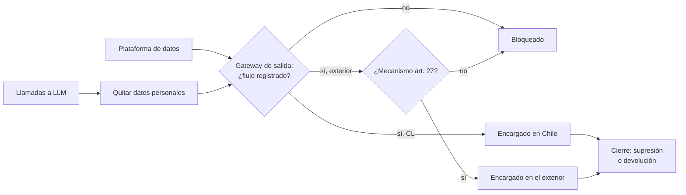

## 1. Resumen

Esta ficha no es asesoría legal: contratos, cláusulas y la elección del mecanismo de transferencia son del área legal; aquí se explica cómo ingeniería sabe y demuestra hacia dónde van los datos.

Una plataforma moderna está llena de encargados: nube, herramientas SaaS, ETL gestionado, observabilidad, APIs de LLM y otros proveedores. Cada uno que toca datos personales necesita contrato de encargo y, si procesa fuera de Chile, un mecanismo de transferencia. Ingeniería es quien sabe **qué datos salen, hacia qué servicio y en qué región**; sin ese inventario, el área legal no puede firmar lo correcto.

## 2. Qué es

- **[Obligación legal · art. 2]** **Encargado:** trata datos por cuenta del responsable (letra x)). **Cesión:** transferencia a otro responsable, que decide sus propios fines (letra v)).
- **[Obligación legal · art. 15]** La cesión consta por escrito y el cesionario pasa a ser responsable: distinguir cesión de encargo.
- **[Obligación legal · art. 15 bis]** El encargado trata según el encargo; no usa los datos para otro fin, no los cede ni subcontrata sin autorización escrita; cumple secreto y seguridad; reporta las vulneraciones; al terminar suprime o devuelve.
- **[Obligación legal · art. 1 bis]** La ley alcanza al encargado que trata a nombre de un responsable en Chile, aunque esté fuera.
- **[Obligación legal · art. 27]** **Transferencia internacional:** lícita a un país adecuado, con cláusulas o normas corporativas vinculantes, o con un modelo o certificación; sin eso, solo excepciones específicas y no habituales.
- **[Obligación legal · art. 28]** La Agencia determinará los países adecuados y publicará su listado y modelos de cláusulas; el responsable acredita la transferencia. Esta ficha no supone que ese listado ya exista.
- **[Decisión de arquitectura]** **Inventario de flujos:** dataset → servicio → encargado → país de procesamiento → contrato → mecanismo → estado.

## 3. Problema que resuelve

**[Buena práctica]** Casos típicos sin control: un equipo envía tickets de soporte con nombres y RUT a una API de LLM en otro país; un SaaS de email recibe la base completa de clientes; un proveedor conserva copias tras cerrar el contrato.

**[Obligación legal · art. 34 ter]** Transferir en contravención a la ley es infracción grave (letra m)); hacerlo a sabiendas, gravísima (art. 34 quáter h)).

## 4. Cómo funciona

1. **[Buena práctica]** Inventariar los flujos salientes: reverse ETL, exportaciones, integraciones y llamadas a APIs.
2. **[Decisión de arquitectura]** Elegir región: si el servicio está disponible en una región en Chile, preferirla para datos personales.
3. **[Obligación legal · art. 27]** Para cada flujo al exterior, el área legal define el mecanismo; ingeniería lo registra.
4. **[Buena práctica]** Minimizar lo que sale: solo campos necesarios, seudonimizados cuando el proveedor no necesita identificar.
5. **[Obligación legal · art. 15 bis]** Al terminar, exigir y guardar constancia de supresión o devolución.
6. **[Obligación legal · art. 14 ter]** El inventario alimenta la información pública sobre transferencias (letra h)).
7. **[Buena práctica]** La CI bloquea flujos nuevos sin registro.

## 5. Cuándo utilizarlo

- Al incorporar cualquier SaaS, API o proveedor que reciba datos personales.
- Al prestar servicios de datos a otro responsable: el proveedor suele ser su encargado.

## 6. Cuándo no utilizarlo

- Para elegir el mecanismo legal o redactar cláusulas: el área legal.
- Datos realmente anonimizados no requieren mecanismo de transferencia.

## 7. Ejemplo sencillo

| Flujo | País | Mecanismo | Estado |
|---|---|---|---|
| Bodega en la nube, región en Chile | CL | No aplica | OK |
| Plataforma de email | US | Cláusulas contractuales | OK |
| API de LLM para resumir tickets | US | Ninguno | Bloquear |
| Proveedor de ETL, contrato cerrado | CL | No aplica | Falta constancia de supresión |

## 8. Ejemplo de producción

| Control | Implementación posible |
|---|---|
| Región de datos | Políticas de organización que restringen ubicaciones de recursos (Organization Policy, Azure Policy, condiciones de región en IAM) |
| Salida de datos | Perímetros y egreso controlado |
| APIs de LLM | Gateway interno que quita datos personales antes de llamar al proveedor y registra la llamada |
| Proveedores | Acceso por entornos gestionados, sin descarga local; cierre con revocación y constancia |

### Evidencia de cumplimiento

| Evidencia | Dónde queda | Quién la produce |
|---|---|---|
| Inventario de flujos | Repositorio o catálogo | Ingeniería |
| Contratos y mecanismos | Repositorio del área legal | Área legal |
| Políticas de región y egreso | Configuración como código | Plataforma |
| Constancias de supresión al cierre | Expediente del proveedor | Encargado |

## 9. Arquitectura



## 10. Código

```python
# Python 3.12+, biblioteca estándar. Inventario de flujos hacia encargados y transferencias internacionales
# (arts. 15 bis, 27 y 28). La CI falla si un flujo con PII sale de Chile sin mecanismo, si un encargado no
# tiene contrato, o si un contrato terminado no tiene constancia de supresión o devolución.
import sys
from dataclasses import dataclass

MECANISMOS = {"país adecuado (art. 27 a)", "cláusulas contractuales (art. 27 b)",
              "modelo o certificación (art. 27 c)", "excepción específica (art. 27, inc. 2)"}


@dataclass(frozen=True)
class Flujo:
    dataset: str
    encargado: str
    pais_proceso: str
    contrato: bool
    mecanismo: str | None
    terminado: bool = False
    constancia_supresion: bool = False


FLUJOS = [
    Flujo("silver.pasajeros", "bodega cloud región Santiago", "CL", True, None),
    Flujo("silver.pasajeros", "plataforma de email", "US", True, "cláusulas contractuales (art. 27 b)"),
    Flujo("tickets_soporte", "API de LLM externa", "US", False, None),
    Flujo("silver.reservas", "proveedor de ETL (contrato cerrado)", "CL", True, None, True, False),
]


def brechas() -> list[str]:
    out: list[str] = []
    for f in FLUJOS:
        etiqueta = f"{f.dataset} → {f.encargado}"
        if not f.contrato:
            out.append(f"{etiqueta}: sin contrato de encargo (art. 15 bis)")
        if f.pais_proceso != "CL" and f.mecanismo not in MECANISMOS:
            out.append(f"{etiqueta}: transferencia a {f.pais_proceso} sin mecanismo (art. 27)")
        if f.terminado and not f.constancia_supresion:
            out.append(f"{etiqueta}: terminado sin constancia de supresión o devolución (art. 15 bis)")
    return out


if __name__ == "__main__":
    b = brechas()
    print(f"flujos: {len(FLUJOS)}; brechas: {len(b)}")
    for x in b:
        print("BRECHA", x)
    sys.exit(1 if b else 0)
```

El script se **ejecuta en la CI** con la biblioteca estándar y pasa `mypy --strict`. Imprime 4 flujos y 3 brechas: la API de LLM falla dos veces (sin contrato de encargo y sin mecanismo de transferencia) y el proveedor de ETL falla por no acreditar la supresión al cierre; termina con código 1.

## 11. GCP

En GCP, **Organization Policy**. Según *Ley 19628 SOBRE PROTECCION DE LOS DATOS PERSONALES* y *Restrict resource locations* (no ejecutado):

| Necesidad | Servicio | Etiqueta |
|---|---|---|
| Restringir ubicaciones | Restricción de ubicaciones de recursos: limita dónde se crean los recursos nuevos | **[Buena práctica]** |
| Límite | No afecta recursos existentes ni, en algunos servicios, subrecursos | **[Decisión de arquitectura]** |

## 12. AWS

En AWS, **IAM**. Según *Ley 19628 SOBRE PROTECCION DE LOS DATOS PERSONALES* y *AWS global condition context keys* (no ejecutado):

| Necesidad | Servicio | Etiqueta |
|---|---|---|
| Restringir regiones | Condición `aws:RequestedRegion` en las políticas | **[Buena práctica]** |
| Límite | Controla qué endpoint se invoca, no el impacto: S3 puede replicar a otras regiones | **[Decisión de arquitectura]** |

## 13. Azure

En Azure, **Azure Policy**. Según *Ley 19628 SOBRE PROTECCION DE LOS DATOS PERSONALES* y *Azure Policy built-in policy definitions* (no ejecutado):

| Necesidad | Servicio | Etiqueta |
|---|---|---|
| Restringir ubicaciones | «Allowed locations», con efectos Audit, Deny o Disabled | **[Buena práctica]** |
| Límite | Excluye resource groups y recursos de la región «global» | **[Decisión de arquitectura]** |

## 14. Buenas prácticas

- **[Buena práctica]** Verificar la región de cada servicio gestionado, no solo la del almacenamiento: logs, respaldos y soporte pueden estar en otro país.
- **[Buena práctica]** **Seguridad:** credenciales por proveedor, revocables al cierre.
- **[Obligación legal · art. 15 bis]** **GenAI:** una API de LLM que recibe datos personales es un encargado; revisar si retiene prompts o los usa para entrenar, y preferir opciones sin retención y con región conocida.
- **[Buena práctica]** **Observabilidad:** alertas por volumen anómalo de datos salientes.
- **[Buena práctica]** **Costo:** mientras la Agencia no publique países adecuados ni modelos de cláusulas, preparar los flujos para cláusulas contractuales.

## 15. Errores frecuentes

- Tratar la API de un LLM como «una librería» y no como un encargado.
- Copias locales de un proveedor que sobreviven al contrato.
- Asumir que la región del almacenamiento es la de todo el servicio.
- Ceder datos cuando se quería encargar (o al revés).

## 16. Trade-offs

Restringir todo a regiones en Chile simplifica la transferencia, pero limita servicios disponibles y puede encarecer. Conviene región en Chile para datos personales y sensibles, y servicios en el exterior con datos minimizados o seudonimizados y mecanismo registrado.

## 17. Conceptos relacionados

- `chile-data-protection`: ficha padre.
- `processing-activities-inventory`: destinatarios y transferencias.
- `chilean-identifier-pseudonymization`: seudonimizar lo que sale.
- `retention-and-erasure`: supresión al cierre.
- `data-breach-response`: vulneraciones en encargados.

## 18. Preguntas técnicas abiertas

1. ¿Cuántos servicios externos reciben datos personales de tu plataforma?
2. ¿Qué llamadas a LLM incluyen texto libre con datos de clientes?
3. ¿Qué datos de clientes anteriores siguen en tus equipos o en los de tus proveedores?

## 19. Laboratorio relacionado

Pendiente (F4).

## 20. Fuentes

- BCN Ley Chile: *Ley 19628 SOBRE PROTECCION DE LOS DATOS PERSONALES* (versión con vigencia diferida desde 2026-12-01).
- Google Cloud: *Restrict resource locations*.
- AWS: *AWS global condition context keys*.
- Microsoft Learn: *Azure Policy built-in policy definitions*.

El detalle de cada fuente está en `sources` del frontmatter.

## 21. Fecha de última verificación

2026-10-22: arts. 1 bis, 2, 14 ter, 15, 15 bis, 27, 28, 34 ter y 34 quáter consultados ese día en BCN. `review_required`: pasa a `verified` solo con la aprobación explícita de Felipe (`owner_approved_at`). Revisión mensual.

## 22. Historial de cambios importantes

- 2026-10-22: creación (upgrade de 19); reemplaza a `international-data-transfers`, que queda como alias.
- 2026-10-24: `PART_OF` hacia `chile-data-protection` (ADR-024) e `implication` por artículo en `legal_basis` (enmienda de ADR-023). Sin cambios de contenido legal ni de código.
