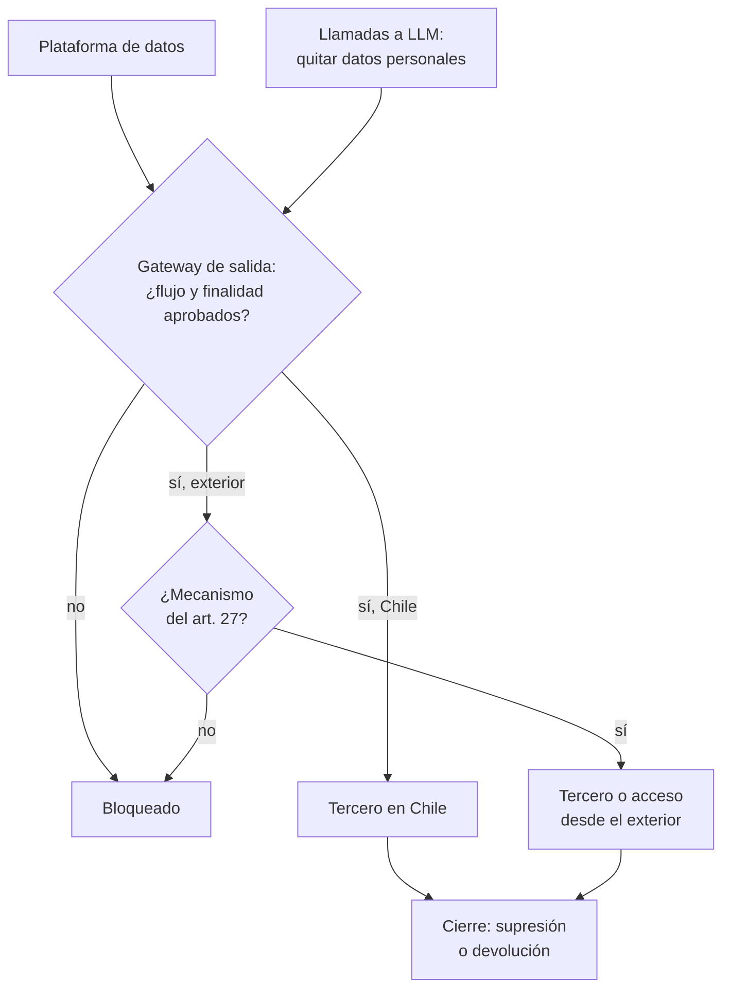

## 1. Resumen

Esta ficha no es asesoría legal: el rol de cada tercero, los contratos, las cláusulas y la elección del mecanismo de transferencia son del área legal; aquí se explica cómo ingeniería sabe y demuestra hacia dónde van los datos.

**Cómo leerla.** *Comprender* (§1–6): encargo, cesión y transferencia internacional, y por qué la región del almacenamiento no basta. *Aplicar* (§7–13): el inventario de flujos, sus controles y su cierre. *Demostrar*: la evidencia del §8, el control del §10 y los criterios del §18.

Una plataforma moderna está llena de terceros: nube, herramientas SaaS, ETL gestionado, observabilidad, soporte remoto, APIs de LLM. El reto no es solo saber en qué región está una base: es saber **qué datos personales salen, quién los recibe, con qué rol, desde dónde se puede acceder a ellos y con qué aprobación**. Cada encargado que toca datos personales necesita contrato de encargo y, si procesa fuera de Chile o se accede desde fuera, un mecanismo de transferencia. Sin ese inventario, el área legal no puede firmar lo correcto.

**Resultado esperado:** ante un dataset o un proveedor, reconstruir el flujo, su responsable técnico, sus destinos y la evidencia de su aprobación. Un servicio aprobado para una finalidad no queda aprobado para otra.

## 2. Qué es

- **[Obligación legal · art. 2]** **Encargado:** trata datos por cuenta del responsable (letra x)). **Cesión:** transferencia a otro responsable, que decide sus propios fines (letra v)).
- **[Obligación legal · art. 15]** La cesión consta por escrito o por un medio electrónico idóneo, y el cesionario pasa a ser responsable. **[Buena práctica]** Distinguir cesión de encargo en el inventario.
- **[Obligación legal · art. 15 bis]** El encargado trata según el encargo; no usa los datos para otro fin, no los cede ni subcontrata sin autorización escrita; cumple secreto y seguridad; reporta las vulneraciones; al terminar suprime o devuelve.
- **[Obligación legal · art. 1 bis]** La ley alcanza al encargado que trata a nombre de un responsable en Chile, aunque esté fuera.
- **[Obligación legal · art. 27]** **Transferencia internacional:** lícita a un país adecuado, con cláusulas o normas corporativas vinculantes, o con un modelo o certificación; sin eso, solo excepciones específicas y no habituales.
- **[Obligación legal · art. 28]** La Agencia determinará los países adecuados y publicará su listado y modelos de cláusulas; el responsable acredita la transferencia. Esta ficha no supone que ese listado ya exista.
- **[Buena práctica]** Tres preguntas distintas para cada tercero:

| Concepto | Pregunta | Ejemplo ilustrativo |
|---|---|---|
| Encargo | ¿El tercero trata por cuenta del responsable y según sus instrucciones? | Un servicio que envía las confirmaciones de reserva |
| Cesión | ¿El receptor trata los datos bajo su propia responsabilidad y para sus fines? | Una aerolínea socia que recibe el itinerario |
| Transferencia internacional | ¿Los datos se procesan en otro país, o se accede a ellos desde otro país? | Una API en el exterior, o soporte remoto desde otro país |

- **[Buena práctica]** El rol no se deduce del nombre del producto, del contrato comercial ni de que sea SaaS: se examina el tratamiento real, y lo valida el área legal.
- **[Decisión de arquitectura]** **Inventario de flujos:** dataset → tercero → rol validado → países de proceso o acceso → contrato o constancia → mecanismo → finalidades aprobadas → estado.

## 3. Problema que resuelve

**[Buena práctica]** Una aerolínea guarda sus reservas en una región en Chile, pero un servicio de correo recibe nombres y direcciones, una API externa resume tickets que pueden traer RUT o datos de salud, un proveedor de soporte accede en remoto a los logs, y los respaldos y la telemetría siguen rutas distintas del almacenamiento principal. Sin inventario, el equipo conoce dónde se guardan los datos, pero no por dónde circulan: eso complica evaluar proveedores, responder incidentes, atender derechos y cerrar contratos.

**[Obligación legal · art. 34 ter]** Transferir en contravención a la ley es infracción grave (letra m)); hacerlo a sabiendas, gravísima (art. 34 quáter h)). **[Decisión de arquitectura]** Bloquear los flujos no aprobados.

## 4. Cómo funciona

1. **[Buena práctica]** Descubrir los flujos salientes: reverse ETL, exportaciones, integraciones, llamadas a APIs, dashboards compartidos, accesos de soporte, logs y respaldos.
2. **[Buena práctica]** Caracterizar cada flujo: actividad, categorías de datos, volumen, finalidad, tercero, subencargados conocidos, países y tipo de acceso.
3. **[Decisión de arquitectura]** Elegir región: si el servicio está disponible en una región en Chile, preferirla para datos personales.
4. **[Obligación legal · art. 27]** Una transferencia internacional necesita una de las vías del artículo. **[Decisión de arquitectura]** El área legal valida el rol y elige el mecanismo de cada flujo; ingeniería lo registra con un identificador de aprobación, su vigencia, su alcance y un propietario técnico.
5. **[Buena práctica]** Controlar: solo los campos necesarios, seudonimizados cuando el tercero no necesita identificar; credenciales y permisos por integración; destinos y rutas de egreso acotados.
6. **[Buena práctica]** Observar: comparar las integraciones configuradas y el tráfico registrado con el inventario, e investigar las desviaciones.
7. **[Obligación legal · art. 15 bis]** Al terminar el servicio, el encargado suprime o devuelve los datos. **[Buena práctica]** Revocar accesos y exigir y guardar la constancia.
8. **[Obligación legal · art. 14 ter]** La información pública incluye las transferencias a terceros países y si estos ofrecen un nivel adecuado de protección (letra h)). **[Decisión de arquitectura]** El inventario la alimenta.
9. **[Buena práctica]** La CI bloquea flujos nuevos sin registro y los cambios de destino, región, subencargado o finalidad sin nueva aprobación.

**[Decisión de arquitectura]** La aprobación corresponde a un flujo y su alcance, no a un proveedor en abstracto.

## 5. Cuándo utilizarlo

- Al incorporar o modificar cualquier SaaS, API o proveedor que reciba datos personales, al habilitar un acceso remoto, cambiar una región, sumar un subencargado o conectar un LLM externo.
- Al prestar servicios de datos a otro responsable: el proveedor suele ser su encargado.
- Al revisar contratos, incidentes y bajas de proveedores.

## 6. Cuándo no utilizarlo

- Para decidir si hay transferencia internacional, si un país es adecuado o si un contrato basta: el área legal.
- Para afirmar que un dataset está anonimizado: necesita su propia evidencia (`chilean-identifier-pseudonymization`). Datos realmente anonimizados no requieren mecanismo de transferencia.

## 7. Ejemplo sencillo

Flujos hipotéticos; los estados no son conclusiones jurídicas sobre proveedores ni países reales.

| Flujo | Rol | País | Mecanismo | Estado |
|---|---|---|---|---|
| Bodega en la nube, región en Chile | Encargo | CL | No aplica | OK |
| Plataforma de email, para notificaciones | Encargo | US | Cláusulas contractuales | OK para esa finalidad |
| La misma plataforma, para perfilamiento | Encargo | US | Cláusulas contractuales | Bloquear: finalidad no aprobada |
| API de LLM para resumir tickets | Encargo | US | Ninguno | Bloquear hasta la revisión |
| Soporte remoto del proveedor de monitoreo | Encargo | CL y US | Ninguno | Restringir y levantar evidencia |
| Itinerario a una aerolínea socia | Cesión | CL | No aplica | Consta por escrito |
| Proveedor de ETL, contrato cerrado | Encargo | CL | No aplica | Falta constancia de supresión |

## 8. Ejemplo de producción

Escenario genérico: la plataforma de datos de una aerolínea en GCP.

| Control | Implementación posible | Qué demuestra y qué no |
|---|---|---|
| Inventario | Tabla gobernada `governance.external_flows`, vinculada a actividades y datasets | Documenta los flujos conocidos; no descubre los ocultos |
| Integraciones | Orquestador y conectores con identidad propia | Asocia cada ejecución a un flujo declarado |
| Región de datos | Políticas que restringen ubicaciones de recursos (Organization Policy, Azure Policy, condiciones de región en IAM) | Limita dónde se crean recursos; no dónde operan los subencargados ni desde dónde se da soporte |
| Salida de datos | Perímetros, egreso controlado y gateway | Reduce rutas no autorizadas; la cobertura depende de la configuración |
| APIs de LLM | Gateway interno que quita datos personales antes de llamar al proveedor y registra la llamada | Reduce exposición; no convierte los datos en anónimos |
| Proveedores | Acceso por entornos gestionados, sin descarga local; cierre con revocación y constancia | Acota las copias; no prueba la eliminación física en el proveedor |

### Evidencia de cumplimiento

| Evidencia | Dónde queda | Quién la produce | Qué demuestra | Qué no demuestra |
|---|---|---|---|---|
| Inventario de flujos con aprobación y versión | Repositorio o catálogo | Ingeniería | Qué flujos se declararon, con qué rol, finalidad y mecanismo | Que no existan flujos sin declarar |
| Contratos, cesiones y mecanismos | Repositorio del área legal | Área legal | Qué se firmó para cada flujo | Que el uso real se ajuste a lo firmado |
| Políticas de región y egreso | Configuración como código | Plataforma | Qué ubicaciones y destinos están permitidos | Dónde accede el soporte del proveedor |
| Resultado del control de la CI | Log de la CI | CI | Que los flujos declarados tienen sus requisitos | El tráfico real |
| Constancias de supresión al cierre | Expediente del proveedor | Encargado | Que el encargado declaró suprimir o devolver | La eliminación física en su sistema |

## 9. Arquitectura



Los logs y el linaje muestran conexiones técnicas, no la finalidad ni la licitud de un flujo.

## 10. Código

```python
# Python 3.12+, biblioteca estándar. Inventario de flujos hacia terceros: encargos, cesiones y transferencias
# internacionales (arts. 15, 15 bis, 27 y 28). La aprobación es de un flujo y su finalidad, no de un proveedor en
# abstracto. La CI falla si un encargo no tiene contrato, una cesión no consta por escrito, un flujo procesa o se
# accede desde fuera de Chile sin mecanismo, un uso excede la finalidad aprobada o un contrato terminado no tiene
# constancia de supresión o devolución. Valida metadatos declarados, no el tráfico real.
import sys
from dataclasses import dataclass, field

MECANISMOS = {"país adecuado (art. 27 a)", "cláusulas contractuales (art. 27 b)",
              "modelo o certificación (art. 27 c)", "excepción específica (art. 27, inc. 2)"}


@dataclass(frozen=True)
class Flujo:
    dataset: str
    tercero: str
    rol: str                       # "encargo" o "cesión", validado por el área legal
    paises: tuple[str, ...]        # donde se procesa o desde donde se accede (soporte remoto incluido)
    documento: bool                # contrato de encargo o constancia escrita de la cesión
    mecanismo: str | None
    finalidad: str
    aprobadas: frozenset[str] = field(default_factory=frozenset)   # finalidades aprobadas para este flujo
    terminado: bool = False
    constancia_supresion: bool = False


FLUJOS = [
    Flujo("silver.pasajeros", "bodega cloud región Santiago", "encargo", ("CL",), True, None,
          "venta_pasajes", frozenset({"venta_pasajes"})),
    Flujo("silver.pasajeros", "plataforma de email", "encargo", ("US",), True, "cláusulas contractuales (art. 27 b)",
          "notificaciones", frozenset({"notificaciones"})),
    Flujo("silver.pasajeros", "plataforma de email", "encargo", ("US",), True, "cláusulas contractuales (art. 27 b)",
          "perfilamiento", frozenset({"notificaciones"})),
    Flujo("tickets_soporte", "API de LLM externa", "encargo", ("US",), False, None, "soporte", frozenset()),
    Flujo("logs_aplicacion", "soporte remoto del proveedor de monitoreo", "encargo", ("CL", "US"), True, None,
          "operación", frozenset({"operación"})),
    Flujo("silver.reservas", "aerolínea socia", "cesión", ("CL",), True, None, "itinerario compartido",
          frozenset({"itinerario compartido"})),
    Flujo("silver.reservas", "proveedor de ETL (contrato cerrado)", "encargo", ("CL",), True, None, "carga",
          frozenset({"carga"}), True, False),
]


def brechas() -> list[str]:
    out: list[str] = []
    for f in FLUJOS:
        etiqueta = f"{f.dataset} → {f.tercero}"
        if not f.documento:
            out.append(f"{etiqueta}: " + ("sin contrato de encargo (art. 15 bis)" if f.rol == "encargo"
                                         else "cesión sin constancia escrita (art. 15)"))
        exterior = [p for p in f.paises if p != "CL"]
        if exterior and f.mecanismo not in MECANISMOS:
            out.append(f"{etiqueta}: transferencia a {', '.join(exterior)} sin mecanismo (art. 27)")
        if not f.aprobadas:
            out.append(f"{etiqueta}: flujo sin aprobación")
        elif f.finalidad not in f.aprobadas:
            out.append(f"{etiqueta}: finalidad «{f.finalidad}» fuera del alcance aprobado ({sorted(f.aprobadas)})")
        if f.terminado and not f.constancia_supresion:
            out.append(f"{etiqueta}: terminado sin constancia de supresión o devolución (art. 15 bis)")
    return out


if __name__ == "__main__":
    b = brechas()
    print(f"flujos: {len(FLUJOS)}; brechas: {len(b)}")
    for x in b:
        print("BRECHA", x)
    sys.exit(1 if b else 0)
```

El script se **ejecuta en la CI** con la biblioteca estándar y pasa `mypy --strict`. Imprime 7 flujos y 6 brechas y termina con código 1:

```text
BRECHA silver.pasajeros → plataforma de email: finalidad «perfilamiento» fuera del alcance aprobado (['notificaciones'])
BRECHA tickets_soporte → API de LLM externa: sin contrato de encargo (art. 15 bis)
BRECHA tickets_soporte → API de LLM externa: transferencia a US sin mecanismo (art. 27)
BRECHA tickets_soporte → API de LLM externa: flujo sin aprobación
BRECHA logs_aplicacion → soporte remoto del proveedor de monitoreo: transferencia a US sin mecanismo (art. 27)
BRECHA silver.reservas → proveedor de ETL (contrato cerrado): terminado sin constancia de supresión o devolución (art. 15 bis)
```

La plataforma de email está aprobada para notificaciones, no para perfilamiento; el soporte remoto cuenta como acceso desde el exterior aunque los datos estén en Chile; la cesión a la aerolínea socia no pide contrato de encargo, sino constancia escrita. **Limitaciones:** el control no ve el tráfico real ni juzga si un contrato o un mecanismo bastan; un flujo sin brechas no demuestra que cumpla la ley.

## 11. GCP

En GCP, **Organization Policy**. Según *Restrict resource locations* (no ejecutado):

| Necesidad | Servicio |
|---|---|
| Restringir ubicaciones | Restricción de ubicaciones de recursos: limita dónde se crean los recursos nuevos |
| Límite | No afecta recursos existentes ni, en algunos servicios, subrecursos |
| Lo que no cubre | La ubicación de los recursos no dice desde dónde accede el soporte ni dónde operan los subencargados |

## 12. AWS

En AWS, **IAM**. Según *AWS global condition context keys* (no ejecutado):

| Necesidad | Servicio |
|---|---|
| Restringir regiones | Condición `aws:RequestedRegion` en las políticas |
| Límite | Controla qué endpoint se invoca, no el impacto: S3 puede replicar a otras regiones |
| Lo que no cubre | Una restricción de región no prueba dónde opera un subencargado ni cómo se presta el soporte |

## 13. Azure

En Azure, **Azure Policy**. Según *List of built-in policy definitions* (no ejecutado):

| Necesidad | Servicio |
|---|---|
| Restringir ubicaciones | «Allowed locations», con efectos Audit, Deny o Disabled |
| Límite | Excluye resource groups y recursos de la región «global» |
| Lo que no cubre | La ubicación de un recurso no sustituye el análisis de acceso remoto, telemetría, respaldos y subencargos |

**Criterio común:** combinar controles preventivos con registros y revisión de arquitectura; no inferir la residencia de todo el servicio a partir de la región del almacenamiento.

## 14. Buenas prácticas

- **[Buena práctica]** Verificar la región de cada servicio gestionado, no solo la del almacenamiento: logs, respaldos y soporte pueden estar en otro país.
- **[Buena práctica]** **Seguridad:** una identidad técnica propia y credenciales por integración, con permisos mínimos y revocables al cierre.
- **[Decisión de arquitectura]** Registrar la finalidad y la versión de la aprobación de cada flujo, no solo el nombre del proveedor; tratar los cambios de destino, región, subencargado o uso como un flujo modificado.
- **[Buena práctica]** **GenAI:** tratar como encargado (art. 15 bis) una API de LLM que recibe datos personales; revisar si retiene prompts o los usa para entrenar, preferir opciones sin retención y con región conocida, e inspeccionar el texto libre y los adjuntos antes de enviarlos.
- **[Buena práctica]** **Observabilidad:** alertas por volumen anómalo de datos salientes y por integraciones que no están en el inventario.
- **[Buena práctica]** **Costo:** mientras la Agencia no publique países adecuados ni modelos de cláusulas, preparar los flujos para cláusulas contractuales.

## 15. Errores frecuentes

| Error | Por qué importa |
|---|---|
| «Está en Santiago, no hay transferencia» | Puede haber accesos remotos, servicios auxiliares o flujos adicionales |
| «El proveedor tiene contrato, así que todo uso está autorizado» | La aprobación cubre finalidades, servicios y destinos específicos |
| «La API del LLM es solo una librería» | Hay un tercero tratando datos; su rol debe evaluarse |
| «El dato tiene HMAC, ya no es personal» | Seudonimizar no es anonimizar; sigue haciendo falta el mecanismo |
| «No aparece en los logs, no existe» | La cobertura de la telemetría puede ser parcial |
| Copias locales de un proveedor que sobreviven al contrato | Datos fuera de control y sin constancia de supresión |
| Ceder datos cuando se quería encargar, o al revés | El tercero queda con obligaciones distintas de las que se creía |

## 16. Trade-offs

| Decisión | Beneficio | Costo o limitación |
|---|---|---|
| Región en Chile para datos personales y sensibles | Menos rutas internacionales que evaluar | Menos servicios disponibles; puede encarecer |
| Servicios en el exterior con datos minimizados o seudonimizados | Acceso a capacidades que no hay en la región | Sigue habiendo datos personales y mecanismo que registrar |
| Gateway central de salida | Reglas y auditoría uniformes | Un punto más que operar, y latencia |
| Bloquear integraciones sin aprobación | Evita altas no revisadas | Exige un proceso ágil de excepciones y cambios |

## 17. Conceptos relacionados

- `chile-data-protection`: ficha padre.
- `processing-activities-inventory`: destinatarios y transferencias por actividad.
- `pii-identification`: qué campos personales salen, incluido el texto libre.
- `data-minimization-by-layer`: enviar solo lo necesario.
- `chilean-identifier-pseudonymization`: seudonimizar lo que sale.
- `retention-and-erasure`: supresión al cierre.
- `data-breach-response`: vulneraciones en encargados.

## 18. Preguntas técnicas abiertas

1. ¿Cuántos servicios externos reciben datos personales de tu plataforma?
2. ¿Qué llamadas a LLM incluyen texto libre con datos de clientes?
3. ¿Qué datos de clientes anteriores siguen en tus equipos o en los de tus proveedores?
4. ¿Desde qué países accede el soporte de tus proveedores?

**Criterio de dominio:** dominas esta ficha si, antes de aprobar una integración, puedes responder qué actividad y finalidad la justifican, qué campos se envían de verdad, qué rol validó el área legal, en qué países hay proceso o acceso, dónde está la aprobación y cuál es su alcance, qué control impide destinos o campos no autorizados, y cómo se detectan los cambios y se ejecuta el cierre. Si falta una respuesta, el estado es «pendiente de revisión», no «cumple».

## 19. Laboratorio relacionado

Propuesta para F4: un archivo versionado con cuatro flujos ficticios (correo, ETL, soporte remoto y LLM); correr el control de la CI, corregir el flujo sin aprobación y simular un cambio de país para comprobar que exige una nueva revisión. Sin datos personales reales.

## 20. Fuentes

- BCN Ley Chile: *Ley 19628 SOBRE PROTECCION DE LOS DATOS PERSONALES* (versión con vigencia diferida desde 2026-12-01).
- Google Cloud: *Restrict resource locations*.
- AWS: *AWS global condition context keys*.
- Microsoft Learn: *List of built-in policy definitions*.

El detalle de cada fuente está en `sources` del frontmatter.

## 21. Fecha de última verificación

2026-10-25: textos legales vueltos a consultar en BCN, sin cambios. Antes, 2026-10-22: arts. 1 bis, 2, 14 ter, 15, 15 bis, 27, 28, 34 ter y 34 quáter consultados ese día en BCN. `review_required`: pasa a `verified` solo con la aprobación explícita de Felipe (`owner_approved_at`). Revisión mensual.

## 22. Historial de cambios importantes

- 2026-10-22: creación (upgrade de 19); reemplaza a `international-data-transfers`, que queda como alias.
- 2026-10-24: `PART_OF` hacia `chile-data-protection` (ADR-024) e `implication` por artículo en `legal_basis` (enmienda de ADR-023). Sin cambios de contenido legal ni de código.
- 2026-10-25: revisión del upgrade (`docs/reviews/cards-f3b-19-upgrade.md`) y auditoría de las etiquetas «Obligación legal»: cada una afirma solo lo que dice su artículo; lo demás pasa a buena práctica o decisión de arquitectura. Textos de BCN y del Senado consultados el 2026-10-25, sin cambios desde el 2026-10-22.
- 2026-10-25: §9 con el estándar de diagramas (máximo 8 nodos, CLAUDE.md): TB; quitar datos personales pasa a la etiqueta de las llamadas a LLM.
- 2026-10-28: mejora de contenido (lote P1) con tres niveles de lectura: §1 (qué sale, quién lo recibe y desde dónde se accede; resultado esperado), §2 (tabla de encargo, cesión y transferencia; el rol no se deduce del producto; inventario con rol y finalidades), §3 (soporte remoto, respaldos y telemetría), §4 (nueve pasos con descubrir, caracterizar, observar y cierre; la aprobación es del flujo), §5, §6, §7 (rol y finalidad por flujo), §8 (controles y evidencia «qué demuestra y qué no»), §9, §10 (rol encargo o cesión, países de proceso o acceso y finalidades aprobadas, sobre el mismo ejemplo: 7 flujos y 6 brechas), §11–13 (lo que no cubre cada política y criterio común), §14–16, §17 (relaciones con `pii-identification` y `data-minimization-by-layer`), §18 (criterio de dominio) y §19 (laboratorio para F4). Sin cambios en `legal_basis`, etiquetas, aviso ni vigencia.
- 2026-10-28: pasa al dominio 24-privacy-engineering, tramo `riesgo-terceros-incidentes` (ADR-027), desde 19-compliance; sin cambios de contenido. La URL de la ficha (`/concepts/processors-and-international-transfers/`) no cambia.
- 2026-10-30: Enmienda 4 de ADR-023: 4 tabla(s) sin columna ni línea «Etiqueta»; la fila con origen legal lleva «Obligación legal» al inicio de su primera celda. Sin cambios de contenido.
- 2026-10-30: mismo hallazgo que la revisión de P4: `page_title` de Azure Policy con el H1 de la página, «List of built-in policy definitions» (ADR-012). Sin cambios de contenido.
