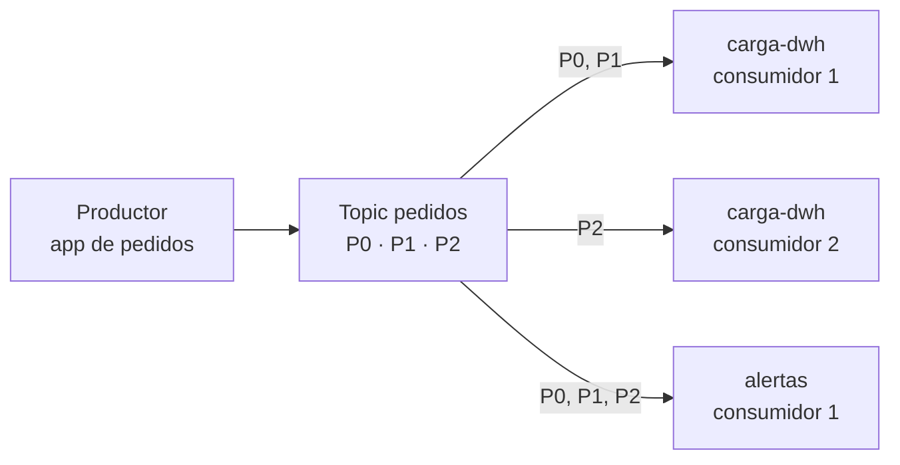

## 1. Resumen

En Kafka, los **productores** escriben eventos y los **consumidores** los leen. Están desacoplados: según la documentación, «producers never need to wait for consumers».

Tres ideas explican casi todo:

- **el productor elige la partición**, al azar o por clave;
- **el consumidor pide los datos y lleva su posición** (su offset) en cada partición;
- **un grupo de consumidores se reparte las particiones**, y cada grupo lee el topic entero por su cuenta.

## 2. Qué es

- **Productor:** la aplicación que publica eventos en un topic.
- **Consumidor:** la aplicación que se suscribe a un topic y procesa sus eventos.
- **Grupo de consumidores:** consumidores con el mismo `group.id`; cada partición la lee uno solo de ellos.
- **Pull:** el consumidor pide los datos al broker (fetch) desde su offset, a su ritmo.
- **Desacople:** el productor no sabe quién lee ni espera a nadie.

## 3. Problema que resuelve

Una app de pedidos llama directo al data warehouse, a facturación y a alertas. Si uno de ellos se cae, la app falla o se atrasa. Con un broker en el medio, la app escribe el pedido una vez y sigue. Cada sistema lee cuando puede, desde donde quedó.

## 4. Cómo funciona

1. El productor envía el evento al broker líder de la partición elegida.
2. El broker lo agrega al log de esa partición.
3. Cada consumidor de un grupo recibe algunas particiones y pide eventos desde su offset.
4. El consumidor confirma su offset (por defecto, en segundo plano con `enable.auto.commit`).
5. Si el consumidor vuelve, retoma desde el offset confirmado; un grupo nuevo empieza según `auto.offset.reset` (por defecto, `latest`).

## 5. Cuándo utilizarlo

- Varios sistemas que necesitan los mismos eventos, cada uno a su ritmo.
- Separar el ritmo de quien produce del ritmo de quien procesa.
- Escalar la lectura: más consumidores en el grupo, hasta una por partición.

## 6. Cuándo no utilizarlo

- Cuando el productor necesita la respuesta del procesamiento para seguir.
- Más consumidores que particiones en un grupo: los que sobran no reciben nada, porque cada partición la lee uno solo.
- Un grupo compartido por dos aplicaciones distintas: se reparten los eventos en vez de recibirlos todos.

## 7. Ejemplo sencillo

El productor escribe tres pedidos en `pedidos` sin ningún consumidor conectado. El grupo `carga-dwh` lee los tres. Si vuelve a leer, no hay nada nuevo: ya confirmó sus offsets. El grupo `alertas`, que nunca había leído, recibe los tres.

## 8. Ejemplo de producción

Un topic `pedidos` con 12 particiones:

- la app de pedidos produce con clave = id del pedido;
- el grupo `carga-dwh` corre 4 consumidores que se reparten las 12 particiones;
- el grupo `antifraude` corre aparte, con su propia posición;
- si `carga-dwh` se detiene una hora, al volver retoma desde su offset sin afectar a `antifraude`.

## 9. Arquitectura



## 10. Código

```bash
# Bash y Kafka (ejecutado en la CI con un broker Kafka 4.3.1 en KRaft, en Docker; ADR-017): el productor escribe sin
# esperar a nadie; cada grupo de consumidores lee todo por su cuenta y retoma donde quedó.
set -euo pipefail
K="${KAFKA_CONTAINER:-dekh-kafka}"
kafka() { docker exec -i "$K" /opt/kafka/bin/"$1" --bootstrap-server localhost:9092 "${@:2}"; }
trap 'kafka kafka-topics.sh --delete --topic pedidos > /dev/null 2>&1 || true' EXIT

kafka kafka-topics.sh --create --topic pedidos --partitions 1 > /dev/null
printf '%s\n' 'pedido 1' 'pedido 2' 'pedido 3' | kafka kafka-console-producer.sh --topic pedidos
echo "el productor escribió 3 eventos sin ningún consumidor conectado"

consume() {   # lee con el grupo $1 lo que ese grupo todavía no leyó
  kafka kafka-console-consumer.sh --topic pedidos --group "$1" --from-beginning --timeout-ms 8000 2> /dev/null | wc -l
}
echo "carga-dwh lee: $(consume carga-dwh)"
echo "carga-dwh vuelve a leer: $(consume carga-dwh)"   # ya confirmó sus offsets: no hay nada nuevo
echo "alertas lee: $(consume alertas)"                 # otro grupo, otra posición
```

El script se **ejecuta en la CI contra un broker Kafka 4.3.1 en KRaft, en Docker** (ADR-017). Imprime `carga-dwh lee: 3`, `carga-dwh vuelve a leer: 0` y `alertas lee: 3`.

## 11. GCP

En GCP, **Pub/Sub** separa la lectura en suscripciones. Las diferencias con Kafka, según *Subscription overview* y *Choose a subscription type* (no ejecutado):

| | Kafka | Pub/Sub |
|---|---|---|
| Lector independiente | Un grupo de consumidores | Una suscripción; un topic puede tener varias |
| Repartir la carga | Las particiones se reparten dentro del grupo | Varios suscriptores de la misma suscripción pull reciben cada uno una parte de los mensajes |
| Qué recibe un lector nuevo | Según `auto.offset.reset` | Solo los mensajes publicados después de crear la suscripción |

## 12. AWS

En AWS, **Kinesis Data Streams** tiene consumidores compartidos y con enhanced fan-out. Las diferencias, según *Develop enhanced fan-out consumers with dedicated throughput* (no ejecutado):

| | Kafka | Kinesis Data Streams |
|---|---|---|
| Cómo lee | El consumidor pide datos (pull) | Compartido: se reparten 2 MB/s por shard; enhanced fan-out: 2 MB/s dedicados por consumidor y por shard, por push |

## 13. Azure

En Azure, **Event Hubs** usa grupos de consumidores. Las diferencias, según *Event Hubs features and terminology* (no ejecutado):

| | Kafka | Event Hubs |
|---|---|---|
| Lector independiente | Un grupo de consumidores | Un grupo de consumidores, vista independiente del stream |
| Varios lectores por partición | Uno por grupo | Hasta 5 receptores sin epoch por partición dentro de un grupo |
| Posición | Offset confirmado en Kafka | El servicio da offsets y el consumidor hace su checkpoint (por ejemplo, en Blob Storage) |

## 14. Buenas prácticas

- Un grupo de consumidores por aplicación lectora, con un nombre que diga cuál es.
- Tantas particiones como el máximo de consumidores que se espera en un grupo.
- Confirmar el offset después de procesar (ver `delivery-semantics`).
- **Seguridad:** cada aplicación con su propia identidad y permiso solo sobre sus topics y su grupo.
- **Observabilidad:** el lag del grupo dice cuánto le falta (ver `offsets`).
- **Costo:** en Kinesis, el enhanced fan-out tiene su propio precio (ver `message-brokers`).

## 15. Errores frecuentes

- Dos aplicaciones con el mismo `group.id` que se roban los eventos.
- Un grupo nuevo con `latest` (el valor por defecto) que no ve los eventos ya escritos.
- Más consumidores que particiones, esperando más velocidad.
- Un productor que espera la respuesta de un consumidor por el broker.

## 16. Trade-offs

El desacople deja que cada sistema avance a su ritmo, a cambio de que el productor no sepa si alguien procesó el evento. El pull da control al consumidor, que lee a su velocidad, y lo obliga a llevar su posición. Más particiones permiten más consumidores, con más recursos en el broker.

## 17. Conceptos relacionados

- `events`: lo que se produce y se consume.
- `message-brokers`: el servicio en el medio.
- `offsets`: la posición de cada grupo.
- `pubsub-topics-and-subscriptions`: suscripciones en Pub/Sub.
- `streaming-ingestion`: el consumidor como paso de una ingesta.
- `delivery-semantics`: confirmar antes o después de procesar.

## 18. Preguntas técnicas abiertas

1. ¿Qué sistema de tu arquitectura hoy llama a otro y podría escribir un evento?
2. ¿Cuántos grupos de consumidores leen tu topic principal y quién es dueño de cada uno?
3. ¿Qué pasa con tu consumidor si arranca un grupo nuevo con `latest`?

## 19. Laboratorio relacionado

Pendiente (F4).

## 20. Fuentes

- Apache Kafka 4.3: *Introduction*, *Design* y *Consumer and Share Consumer Configs*.
- Google Cloud: *Subscription overview* y *Choose a subscription type*.
- AWS: *Develop enhanced fan-out consumers with dedicated throughput*.
- Microsoft Learn: *Event Hubs features and terminology*.

El detalle de cada fuente está en `sources` del frontmatter.

## 21. Fecha de última verificación

2026-10-19. `review_required`: pendiente de revisión B-F3.1 del lote F3b-14a.

## 22. Historial de cambios importantes

- 2026-10-19: creación (lote F3b-14a).
