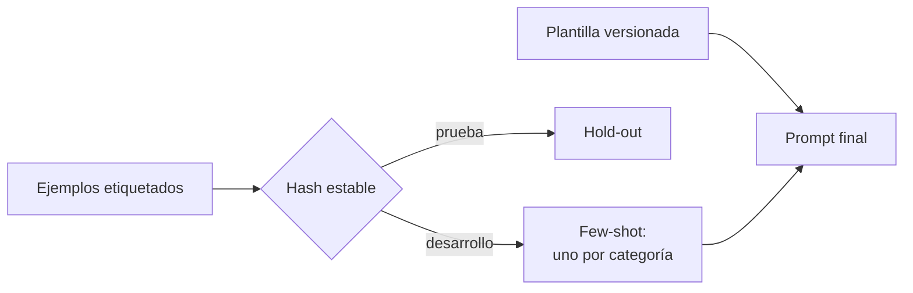

## 1. Resumen

Un **prompt** tiene una **tarea** (obligatoria) y, opcionalmente, **instrucciones de sistema**, **ejemplos few-shot** y **contexto** (*Introduction to prompting*). Hacer prompt engineering en un pipeline no es probar frases hasta que funcione: es tratar el prompt como **código**, con una plantilla versionada, el dato separado por delimitadores, una respuesta de respaldo y un conjunto de prueba que no se usa para ajustarlo.

La guía de Bedrock lo formula así: separar los ejemplos en un conjunto de **desarrollo**, donde se prueban los cambios, y uno de **prueba** (hold-out), que solo verifica el prompt final (*Design a prompt*).

## 2. Qué es

- **Tarea:** lo que se pide; en un pipeline, siempre la misma.
- **Instrucciones de sistema:** el rol, las reglas y el formato.
- **Few-shot:** pares de ejemplo entrada y salida que condicionan al modelo solo en esa inferencia (*Prompt engineering techniques*).
- **Zero-shot:** sin ejemplos.
- **Delimitadores:** marcan dónde empieza y termina el dato, para que no se confunda con la instrucción.
- **Respuesta de respaldo:** qué responder si nada aplica (aquí, `desconocido`).
- **Versión:** un hash del texto de la plantilla, guardado con cada resultado.

## 3. Problema que resuelve

Un prompt que se edita en producción sin versión cambia las clasificaciones de un día para otro y nadie sabe por qué. Con la plantilla versionada y un conjunto de prueba fijo, cada cambio se mide antes de desplegarlo y cada resultado dice con qué versión se obtuvo.

## 4. Cómo funciona

1. Se escribe la plantilla: tarea, categorías permitidas, respuesta de respaldo y delimitadores para el dato.
2. Se separan los ejemplos en desarrollo y prueba con un criterio estable (un hash del texto), no por orden.
3. Se eligen ejemplos few-shot del conjunto de desarrollo, uno por categoría.
4. La versión de la plantilla es el hash de su texto.
5. Un cambio se prueba en desarrollo y se verifica una vez en el conjunto de prueba.

## 5. Cuándo utilizarlo

- Toda tarea de modelo que corre en un pipeline.
- Clasificaciones con categorías cerradas.
- Cuando hay que comparar dos versiones del prompt con datos.

## 6. Cuándo no utilizarlo

- Para corregir con texto lo que debe asegurar un esquema: el formato se pide con salida estructurada (`structured-outputs`).
- Para meter reglas de negocio extensas que cambian seguido: van en código o en datos, no en el prompt.
- Ajustando sobre el conjunto de prueba: deja de medir generalización.

## 7. Ejemplo sencillo

De ocho ejemplos etiquetados, tres caen en prueba y cinco en desarrollo. Del conjunto de desarrollo se toma uno por categoría (`datos`, `esquema`, `infraestructura`) para el prompt; los de prueba no entran. El mensaje a clasificar va entre `<<<` y `>>>`.

## 8. Ejemplo de producción

Clasificación de errores de jobs:

- la plantilla vive en el repositorio y su hash se guarda con cada clasificación;
- un cambio de plantilla pasa por un PR con el resultado en el conjunto de desarrollo;
- antes de desplegar, una sola corrida en el conjunto de prueba;
- la llamada al modelo y la medición de aciertos quedan fuera del ejemplo (no ejecutado).

## 9. Arquitectura



## 10. Código

```python
# Python 3.12, biblioteca estándar (ejecutado en la CI): un prompt como artefacto versionado. Instrucción clara,
# ejemplos few-shot, delimitadores para el dato y una salida de respaldo; los ejemplos se separan en desarrollo y
# prueba (hold-out) con un criterio estable, y la versión es el hash del texto de la plantilla.
import hashlib
import zlib
from string import Template

PLANTILLA = Template("""Clasifica el mensaje de error de un job de datos en una de estas categorías:
esquema, datos, infraestructura. Responde solo con la categoría.
Si no corresponde a ninguna, responde: desconocido.

$ejemplos
Mensaje: <<<$mensaje>>>
Categoría:""")

EJEMPLOS = [
    ("column 'canal' not found in source", "esquema"),
    ("null value in column 'monto' violates not-null constraint", "datos"),
    ("connection timed out after 30s to warehouse", "infraestructura"),
    ("type mismatch: expected INT64, got STRING for 'cantidad'", "esquema"),
    ("duplicate key value violates unique constraint 'pk_pedido'", "datos"),
    ("disk quota exceeded on worker node", "infraestructura"),
    ("unexpected field 'descuento' in record", "esquema"),
    ("negative value in 'cantidad' for order 1042", "datos"),
]


def es_prueba(texto: str, porcentaje: int = 25) -> bool:
    """Hold-out estable: el mismo ejemplo cae siempre en el mismo conjunto, sin depender del orden."""
    return zlib.crc32(texto.encode()) % 100 < porcentaje


desarrollo = [e for e in EJEMPLOS if not es_prueba(e[0])]
prueba = [e for e in EJEMPLOS if es_prueba(e[0])]
uno_por_categoria = {c: m for m, c in reversed(desarrollo)}  # el primero de cada categoría que haya en desarrollo
bloque = "\n".join(f"Mensaje: <<<{m}>>>\nCategoría: {c}\n" for c, m in sorted(uno_por_categoria.items()))
faltan = {"esquema", "datos", "infraestructura"} - set(uno_por_categoria)
prompt = PLANTILLA.substitute(ejemplos=bloque, mensaje="permission denied for table gold.ventas")
version = hashlib.sha256(PLANTILLA.template.encode()).hexdigest()[:12]

print(f"plantilla v{version}; ejemplos: {len(desarrollo)} de desarrollo, {len(prueba)} de prueba (no van al prompt)")
print("prueba:", [m for m, _ in prueba])
print("categorías sin ejemplo en el prompt:", sorted(faltan) or "ninguna")
print(prompt)
```

El script se **ejecuta en la CI** con la biblioteca estándar y pasa `mypy --strict`. Imprime `plantilla v8fce0a2acc01; ejemplos: 5 de desarrollo, 3 de prueba (no van al prompt)`, los tres mensajes de prueba, `categorías sin ejemplo en el prompt: ninguna` y el prompt con un ejemplo de `datos`, uno de `esquema`, uno de `infraestructura` y el mensaje nuevo entre delimitadores.

## 11. GCP

En GCP, **Gemini Enterprise Agent Platform**. Según *Introduction to prompting* y *Overview of prompting strategies* (no ejecutado):

| | Este concepto | Agent Platform |
|---|---|---|
| Componentes | Tarea, sistema, few-shot, contexto | Los mismos; la tarea es obligatoria |
| Estrategias | Plantilla versionada y hold-out | Instrucciones claras, few-shot, contexto, estructura, comparar prompts, dividir tareas, iterar |
| Cuándo importa | En el pipeline, siempre | La página dice que en tareas simples Gemini suele funcionar sin prompt engineering |

## 12. AWS

En AWS, **Amazon Bedrock**. Según *Design a prompt* (no ejecutado):

| | Este concepto | Amazon Bedrock |
|---|---|---|
| Generalización | Hold-out por hash | Conjunto de desarrollo y conjunto de prueba hold-out |

## 13. Azure

En Azure, **Microsoft Foundry**. Según *Prompt engineering techniques* (no ejecutado):

| | Este concepto | Microsoft Foundry |
|---|---|---|
| Few-shot | En la plantilla | Ejemplos como mensajes de usuario y asistente, después del mensaje de sistema |
| Efecto | Solo en la inferencia | No cambia el modelo; condiciona la inferencia actual |

## 14. Buenas prácticas

- Plantilla en el repositorio, con versión por hash.
- Categorías cerradas y respuesta de respaldo explícita.
- Un ejemplo por categoría en el few-shot.
- Delimitadores para el dato.
- Hold-out estable, separado por hash y no por orden.
- **Seguridad:** el dato entre delimitadores puede traer instrucciones; tratarlo como dato y validar la salida (`structured-outputs`).
- **Observabilidad:** versión de la plantilla con cada resultado y aciertos por versión.
- **Costo:** cada ejemplo few-shot se paga en cada llamada; elegir pocos y representativos.

## 15. Errores frecuentes

- Editar el prompt en producción sin versión.
- Ajustar el prompt mirando el conjunto de prueba.
- Ejemplos few-shot de una sola categoría.
- Pedir el formato solo con texto en lugar de con un esquema.

## 16. Trade-offs

Más ejemplos suelen orientar mejor al modelo y cuestan tokens en cada llamada. Un prompt muy específico rinde en su tarea y se rompe ante casos nuevos; el hold-out lo muestra. Instrucciones largas cubren más casos y son más difíciles de mantener.

## 17. Conceptos relacionados

- `llm-fundamentals`: el modelo.
- `context-windows`: el espacio del prompt.
- `structured-outputs`: el formato con esquema.
- `llm-evaluation`: medir un cambio de prompt con el conjunto de control.

## 18. Preguntas técnicas abiertas

1. ¿Dónde vive hoy el prompt de tu proceso y quién lo puede cambiar?
2. ¿Con qué conjunto de prueba medirías un cambio?
3. ¿Qué categoría de tu clasificación no tiene ejemplo en el prompt?

## 19. Laboratorio relacionado

Pendiente (F4).

## 20. Fuentes

- Google Cloud: *Introduction to prompting* y *Overview of prompting strategies*.
- AWS: *Design a prompt*.
- Microsoft Learn: *Prompt engineering techniques*.

El detalle de cada fuente está en `sources` del frontmatter.

## 21. Fecha de última verificación

2026-10-25. `review_required`: pendiente de revisión B-F3.1 del lote F3b-21a.

## 22. Historial de cambios importantes

- 2026-10-25: creación (lote F3b-21a).
- 2026-10-26: §17 y `relations` enlazan `llm-evaluation`, creada en el lote F3b-21c (regla del §17); sin otros cambios.
