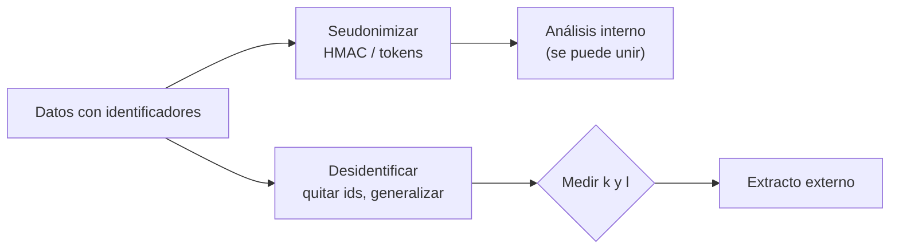

## 1. Resumen

Dos cosas distintas que se confunden seguido:

- **Seudonimizar** es reemplazar los identificadores directos (id, correo) por **seudónimos**: un token, un HMAC, un valor cifrado. Con la clave o la bóveda **se vuelve a la persona**, y las demás columnas (región, edad, sexo) **pueden reidentificar igual**.
- **Anonimizar** es transformar los datos para que **ya no se puedan vincular con nadie**: quitar identificadores, generalizar o suprimir cuasi-identificadores y medir el riesgo que queda.

Seudonimizar es útil (permite unir y analizar sin ver identificadores), pero **no es anonimizar**. Y anonimizar no es un estado que se declara: se mide, y aun así los datos desidentificados a veces se reidentifican (*NIST IR 8053*). Microsoft dice algo parecido: la desidentificación sola ha demostrado ser frágil (*Confidential AI*).

## 2. Qué es

- **Identificador directo:** identifica solo (id, correo, número de documento).
- **Cuasi-identificador:** identifica combinado con otros (región, edad, sexo) (*Re-identification risk analysis*).
- **Seudónimo:** reemplazo del identificador directo; reversible (token, cifrado) o no (HMAC) (*Pseudonymization*).
- **Desidentificación:** término general para quitar la asociación entre los datos y la persona (*NIST SP 800-188*).
- **Reidentificación:** volver a vincular datos con una persona, con una clave o cruzando otros datos.

## 3. Problema que resuelve

Un equipo reemplaza el id de cliente por un HMAC y comparte el extracto como «anónimo». El extracto conserva región, edad exacta y sexo. Quien recibe el archivo cruza esas columnas con perfiles públicos y encuentra a cada persona. El HMAC hizo su trabajo (el id no se recupera); el problema es llamar «anónimo» a algo seudonimizado.

## 4. Cómo funciona

| | Seudonimización | Anonimización |
|---|---|---|
| Identificadores directos | Reemplazados por seudónimos | Eliminados |
| Cuasi-identificadores | Se conservan | Generalizados o suprimidos |
| Volver a la persona | Con la clave o la bóveda | No debería ser posible; se mide el riesgo |
| Uniones entre tablas | Sí, por seudónimo | No |
| Utilidad | Alta | Menor |

## 5. Cuándo utilizarlo

- **Seudonimizar:** análisis interno que necesita unir por persona sin ver identificadores; entornos de prueba.
- **Anonimizar:** publicar o compartir fuera, cuando nadie necesita volver a la persona.

## 6. Cuándo no utilizarlo

- No llamar «anónimo» a un extracto seudonimizado.
- No anonimizar lo que después hay que unir o corregir por persona: se pierde.

## 7. Ejemplo sencillo

Cuatro clientes con región, edad, sexo y compra; un atacante tiene nombre, región, edad y sexo de perfiles públicos:

| Versión | Reidentificados |
|---|---|
| Seudonimizada (HMAC del id; edad y sexo exactos) | los 4 |
| Seudonimizada, con la clave | quien tiene la clave vuelve a encontrar al cliente `c-003` |
| Sin id, edad en rangos y sexo suprimido | ninguno, con este cruce |

«Ninguno, con este cruce» no prueba que sea anónimo: otro conjunto de datos externo podría reidentificar. Por eso se mide (`k-anonymity`).

## 8. Ejemplo de producción

- Zona de análisis con datos seudonimizados (HMAC o tokens); claves y bóveda fuera de esa zona.
- Extractos externos: sin identificadores directos, cuasi-identificadores generalizados y k y l medidos antes de publicar.
- Cada extracto declara si está seudonimizado o anonimizado y con qué técnica.

## 9. Arquitectura



## 10. Código

```python
"""Seudonimizar no es anonimizar: un seudónimo con la edad exacta se reidentifica cruzando datos públicos."""

import hashlib
import hmac
import secrets

CLAVE = secrets.token_bytes(32)

# Datos internos: id, región, edad, sexo, compra
INTERNOS = [("c-001", "norte", 34, "F", 120), ("c-002", "norte", 36, "F", 80), ("c-003", "sur", 23, "M", 45),
            ("c-004", "sur", 28, "M", 60)]
# Datos públicos que alguien ya tiene (por ejemplo, un perfil de red social): nombre, región, edad, sexo
PUBLICOS = [("Ana", "norte", 34, "F"), ("Bea", "norte", 36, "F"), ("Ciro", "sur", 23, "M"), ("Dani", "sur", 28, "M")]


def seudonimizar(fila: tuple[str, str, int, str, int]) -> tuple[str, str, str, str, int]:
    cid, region, edad, sexo, compra = fila
    return (hmac.new(CLAVE, cid.encode(), hashlib.sha256).hexdigest()[:12], region, str(edad), sexo, compra)


def anonimizar(fila: tuple[str, str, int, str, int]) -> tuple[str, str, str, str, int]:
    _, region, edad, sexo, compra = fila
    base = edad // 10 * 10
    return ("", region, f"{base}-{base + 9}", "*", compra)   # sin id; edad en rango; sexo suprimido


def reidentificar(publicadas: list[tuple[str, str, str, str, int]]) -> list[str]:
    """El atacante cruza por región, edad y sexo; reidentifica cuando hay una sola coincidencia."""
    nombres = []
    for nombre, region, edad, sexo in PUBLICOS:
        coinciden = [p for p in publicadas if p[1] == region and p[2] in (str(edad), "") and p[3] in (sexo, "*")]
        if len(coinciden) == 1:
            nombres.append(nombre)
    return nombres


seudo = [seudonimizar(f) for f in INTERNOS]
anon = [anonimizar(f) for f in INTERNOS]
print(f"seudonimizado, reidentificados: {reidentificar(seudo)}")
buscado = hmac.new(CLAVE, b"c-003", hashlib.sha256).hexdigest()[:12]   # quien tiene la clave y el id
print(f"seudonimizado, con la clave se vuelve a encontrar c-003: compra {[f[4] for f in seudo if f[0] == buscado]}")
print(f"anonimizado (sin id, edad en rango, sexo suprimido), reidentificados: {reidentificar(anon)}")
print(f"anonimizado, filas: {sorted({(r, e) for _, r, e, _, _ in anon})}")
```

El script se **ejecuta en la CI** con la biblioteca estándar y pasa `mypy --strict`. Imprime los cuatro nombres reidentificados en la versión seudonimizada, la compra de `c-003` encontrada con la clave, ninguno reidentificado en la versión generalizada con este cruce y las dos combinaciones que quedan.

## 11. GCP

En GCP, **Sensitive Data Protection**. Según *Pseudonymization* y *Re-identification risk analysis* (no ejecutado):

| | Este ejemplo | Sensitive Data Protection |
|---|---|---|
| Seudonimizar | HMAC del id | Tokens con AES-SIV o FPE (reversibles) o HMAC-SHA-256 (no reversible) |
| Medir el riesgo | El cruce del ejemplo | Análisis de riesgo: k-anonimato, l-diversidad, k-map y δ-presence |

## 12. AWS

En AWS, **AWS Glue**. Según *NIST IR 8053* y *Detect and process sensitive data* (no ejecutado):

| | Este ejemplo | AWS Glue |
|---|---|---|
| Tratar identificadores | HMAC o supresión | Detectar PII y redactar, redactar en parte o reemplazar por un hash SHA-256 |
| Cuasi-identificadores | Generalizados | La página trata la PII detectada, no la generalización de cuasi-identificadores |

Redactar o hacer hash de la PII detectada trata los identificadores; los cuasi-identificadores quedan como estaban.

## 13. Azure

En Azure, **Azure Data Factory**. Según *Confidential AI* y *PII detection and masking* (no ejecutado):

| | Este ejemplo | Azure Data Factory |
|---|---|---|
| Tratar identificadores | HMAC o supresión | Plantilla que llama a Foundry Tools y enmascara la PII antes de cargarla en el destino |
| Advertencia | «Ninguno, con este cruce» no prueba nada | *Confidential AI*: la desidentificación sola ha demostrado ser frágil |

## 14. Buenas prácticas

- Nombrar bien: «seudonimizado» o «anonimizado», con la técnica usada.
- Seudonimizar para el análisis interno; claves y bóveda fuera de su alcance.
- Antes de publicar, quitar identificadores, generalizar cuasi-identificadores y medir.
- **Seguridad:** los datos seudonimizados siguen siendo datos de personas; mismo control de acceso que el original.
- **Observabilidad:** registrar qué extractos salieron, con qué técnica y con qué k.
- **Costo:** anonimizar pierde utilidad; seudonimizar exige operar claves o una bóveda.

## 15. Errores frecuentes

- Un hash del id como «anonimización».
- Quitar el nombre y dejar fecha de nacimiento y código postal.
- Publicar extractos distintos que, cruzados entre sí, reidentifican.

## 16. Trade-offs

Seudonimizar conserva casi toda la utilidad y mantiene el riesgo; anonimizar baja el riesgo y la utilidad. Entre las dos hay un continuo: cuánto generalizar se decide midiendo, no por costumbre.

## 17. Conceptos relacionados

- `tokenization`: seudonimizar con bóveda.
- `keyed-hashing`: seudonimizar con HMAC.
- `k-anonymity`: medir el riesgo.
- `data-masking`: ocultar al mostrar.
- `data-classification`: qué columnas identifican.

## 18. Preguntas técnicas abiertas

1. ¿Qué extractos tuyos se llaman «anónimos» y en realidad están seudonimizados?
2. ¿Qué cuasi-identificadores conservan?
3. ¿Quién tiene las claves de tus seudónimos?

## 19. Laboratorio relacionado

Pendiente (F4).

## 20. Fuentes

- NIST: *SP 800-188, De-Identifying Government Datasets: Techniques and Governance* e *IR 8053, De-Identification of Personal Information*.
- Google Cloud: *Pseudonymization* y *Re-identification risk analysis* (Sensitive Data Protection).
- AWS: *Detect and process sensitive data* (Glue).
- Microsoft Learn: *PII detection and masking* (Data Factory) y *Confidential AI*.

El detalle de cada fuente está en `sources` del frontmatter.

## 21. Fecha de última verificación

2026-10-21. Pasa a `verified`: revisión B-F3.1 del lote F3b-18c sin hallazgos y CI en verde (run 39662678196).

## 22. Historial de cambios importantes

- 2026-10-21: creación (lote F3b-18c).
- 2026-10-21: `verification_status: verified` (revisión sin hallazgos; CI en verde, run 39662678196).
