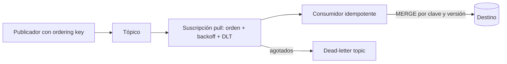

## 1. Resumen

Por defecto, Pub/Sub entrega cada mensaje **al menos una vez** y **sin orden garantizado**. Se puede activar exactly-once (solo en suscripciones pull y dentro de una región) y orden por *ordering key*, cada uno con condiciones. En la práctica, el consumidor debe ser idempotente: exactly-once cubre la entrega de Pub/Sub dentro de una región, no la escritura en el destino, y el orden por clave provoca reentregas en cascada.

## 2. Qué es

Es el conjunto de garantías de entrega de Pub/Sub y de las opciones que las modifican: el tipo de entrega (at-least-once o exactly-once), el orden (por clave), la política de reintento y el dead-letter topic.

## 3. Problema que resuelve

Diseñar un consumidor correcto exige saber qué puede pasar: duplicados, desorden, reentregas masivas, mensajes que nunca se procesan. Suponer "exactly-once y en orden" sin configurarlo, o sin entender sus límites, produce duplicados y datos inconsistentes en el destino.

## 4. Cómo funciona

- **At-least-once (por defecto):** si el consumidor no confirma a tiempo, Pub/Sub reentrega. Un mensaje puede llegar más de una vez.
- **Exactly-once:** opcional y solo en suscripciones pull. Se basa en el message ID de Pub/Sub y aplica dentro de una región, con suscriptores conectados en la misma región.
- **Orden:** por *ordering key* (hasta 1 KB). Hay que publicar todos los mensajes de una clave en la misma región y habilitar el orden en la suscripción. Los mensajes sin clave no se ordenan. Si se reentrega un mensaje, también se reentregan todos los posteriores de esa clave, **incluso los ya confirmados**.
- **Reintentos:** reentrega inmediata por defecto, o backoff exponencial configurable entre 0 y 600 segundos.
- **Dead-letter topic:** aparta los mensajes tras 5 a 100 intentos (conteo aproximado).

## 5. Cuándo utilizarlo

Siempre que se diseñe un consumidor de Pub/Sub: al elegir el tipo de suscripción, si hace falta orden, cómo confirmar y cómo escribir en el destino.

## 6. Cuándo no utilizarlo

- No conviene depender de exactly-once para la corrección del destino si el consumidor escribe en otro sistema: esa garantía es de la entrega de Pub/Sub, no de la escritura en BigQuery u otro destino.
- No conviene activar el orden si no se necesita: agrega condiciones de publicación y reentregas en cascada por clave.

## 7. Ejemplo sencillo

Un consumidor pull recibe el mensaje `m1`, lo procesa y tarda en confirmar. Pub/Sub lo reentrega y el consumidor lo procesa de nuevo. Con una escritura idempotente por `message_id`, el destino queda igual.

## 8. Ejemplo de producción

Eventos de cambios de clientes, publicados con `customer_id` como ordering key en una región. La suscripción pull tiene orden habilitado, backoff exponencial y dead-letter topic. El consumidor escribe con `MERGE` por `customer_id` y versión, así que tolera la reentrega en cascada de una clave y los duplicados. Una alerta vigila la antigüedad del mensaje más antiguo sin confirmar.

## 9. Arquitectura



## 10. Código

```python
# Consumidor de Pub/Sub idempotente (streaming pull): upsert en PostgreSQL por clave y versión,
# confirmación (ack) solo después de escribir.
# Requiere: Python 3.12, google-cloud-pubsub y psycopg 3; una suscripción pull; DATABASE_URL apuntando a
# PostgreSQL con la tabla customers(customer_id TEXT PRIMARY KEY, version BIGINT NOT NULL, payload JSONB NOT NULL);
# credenciales de Google Cloud con permiso para consumir la suscripción (por ejemplo roles/pubsub.subscriber).
import json
import logging
import os
from concurrent.futures import TimeoutError

import psycopg
from google.cloud import pubsub_v1

UPSERT = """
INSERT INTO customers AS c (customer_id, version, payload)
VALUES (%s, %s, %s)
ON CONFLICT (customer_id) DO UPDATE
SET version = excluded.version, payload = excluded.payload
WHERE c.version < excluded.version
"""

log = logging.getLogger("customers-consumer")
conn = psycopg.connect(os.environ["DATABASE_URL"], autocommit=True)  # cada sentencia se confirma sola


def parse(data: bytes) -> tuple[str, int, str]:
    event = json.loads(data)
    return str(event["customer_id"]), int(event["version"]), json.dumps(event["payload"])


def callback(message: pubsub_v1.subscriber.message.Message) -> None:
    try:
        customer_id, version, payload = parse(message.data)
    except (ValueError, KeyError, TypeError) as exc:      # JSON inválido o campos faltantes: permanente
        log.error("mensaje %s inválido: %s", message.message_id, exc)
        message.ack()                                     # no reintentar; queda registrado
        return
    try:
        conn.execute(UPSERT, (customer_id, version, payload))  # repetir el mismo mensaje no cambia nada
    except psycopg.Error:
        log.exception("fallo al escribir el mensaje %s", message.message_id)
        message.nack()                                    # transitorio: Pub/Sub lo vuelve a entregar
        return
    message.ack()                                         # confirmar después de escribir, nunca antes


def main(project_id: str, subscription_id: str, timeout: float | None = None) -> None:
    subscriber = pubsub_v1.SubscriberClient()
    path = subscriber.subscription_path(project_id, subscription_id)
    flow = pubsub_v1.types.FlowControl(max_messages=100)  # mensajes sin confirmar a la vez
    future = subscriber.subscribe(path, callback=callback, flow_control=flow)
    with subscriber:                                      # cierra el cliente al salir
        try:
            future.result(timeout=timeout)
        except TimeoutError:
            future.cancel()
            future.result()


if __name__ == "__main__":
    main(os.environ["GCP_PROJECT"], os.environ["PUBSUB_SUBSCRIPTION"])
```

La corrección no depende de que el mensaje llegue una sola vez:

- **Idempotencia:** el `INSERT ... ON CONFLICT DO UPDATE ... WHERE c.version < excluded.version` es una sola sentencia atómica. Una reentrega del mismo mensaje, o de uno más viejo, no cambia la fila.
- **Orden del ack:** se confirma después de escribir. Si el proceso cae entre la escritura y el ack, el mensaje se reentrega y el upsert lo absorbe.
- **Errores:** un mensaje inválido se registra y se confirma, porque reintentarlo no lo arregla; con un dead-letter topic configurado, se puede preferir `nack()` para que termine allí. Un error de la base hace `nack()` y Pub/Sub lo vuelve a entregar.
- **Concurrencia:** el cliente llama al callback desde varios hilos. psycopg serializa las consultas sobre una misma conexión, así que compartirla es seguro; con mucho volumen conviene un pool de conexiones.
- **Flujo:** `FlowControl(max_messages=100)` limita los mensajes en proceso sin confirmar; el valor por defecto es 1000.

## 11. GCP

Esta ficha trata de **Pub/Sub**. El tipo de suscripción limita las opciones: exactly-once solo existe en pull, no en push ni en las suscripciones de exportación (como las que escriben directamente en BigQuery).

## 12. AWS

En **SQS** el modelo es distinto: un mensaje no borrado antes de que venza el *visibility timeout* vuelve a ser visible y otro consumidor puede recibirlo. También ahí el consumidor debe tolerar la repetición. No es el mismo mecanismo que el plazo de confirmación de Pub/Sub, aunque cumple un papel parecido.

## 13. Azure

En **Event Hubs** no hay confirmación por mensaje: los consumidores leen por *offset* dentro de particiones ordenadas y guardan su posición con *checkpointing*. Tras un reinicio, se reprocesa lo posterior al último checkpoint. El orden es por partición, no por ordering key como en Pub/Sub.

## 14. Buenas prácticas

- Diseñar el consumidor como idempotente aunque se active exactly-once.
- Confirmar después de escribir en el destino, no antes.
- Activar el orden solo si el negocio lo necesita, y elegir claves de buena cardinalidad.
- Combinar backoff exponencial con dead-letter topic.
- **Observabilidad:** vigilar la antigüedad del mensaje más antiguo sin confirmar, la tasa de reentregas y los mensajes que llegan al dead-letter topic.
- **Seguridad:** separar los permisos de publicar y de suscribirse, y dar a la cuenta de servicio de Pub/Sub solo los permisos que exige el dead-letter topic.
- **Costo:** las reentregas y los mensajes retenidos también se procesan y se almacenan; un consumidor que confirma tarde paga su propio retraso en reentregas.

## 15. Errores frecuentes

- Confirmar el mensaje antes de escribir y perderlo si la escritura falla.
- Suponer que exactly-once cubre la escritura en el destino.
- Publicar la misma ordering key desde varias regiones y perder el orden.
- No prever la reentrega en cascada de una clave ordenada.

## 16. Trade-offs

At-least-once es simple y de menor latencia, pero exige idempotencia. Exactly-once reduce los duplicados de entrega, a cambio de restricciones (pull, región). El orden por clave simplifica la lógica del consumidor, pero impone condiciones de publicación y reentregas en cascada.

## 17. Conceptos relacionados

- `idempotency`: la defensa principal ante reentregas.
- `dead-letter-queue`: el límite de intentos.
- `retries`: la política de reentrega.
- `replay`: seek a un snapshot o a un timestamp.
- `delivery-semantics`: at-most-once y at-least-once, más allá de Pub/Sub.
- `event-ordering`: el orden por clave en Kafka, Kinesis y Event Hubs.
- `exactly-once-semantics`: exactly-once por componente, con su alcance.

## 18. Preguntas técnicas abiertas

1. ¿Qué garantía le das al negocio sobre duplicados en BigQuery si el consumidor lee de Pub/Sub con exactly-once activado?
2. ¿Cómo elegirías la ordering key para eventos de pedidos y qué riesgos tiene elegirla mal?
3. ¿Qué harías si la antigüedad del mensaje más antiguo sin confirmar crece sin parar?

## 19. Laboratorio relacionado

Pendiente (F4): arquitectura "Streaming pipeline" (§24).

## 20. Fuentes

- Google Cloud: *Subscription overview*, *Exactly-once delivery*, *Order messages*, *Subscription retry policy*, *Dead-letter topics*, *Quickstart: publish and receive messages* y la referencia del cliente de Python (`Message`, `FlowControl`, `Client`) (Pub/Sub).
- Psycopg 3: *Connection classes*, *Concurrent operations* y *errors*.
- PostgreSQL: *INSERT* (cláusula ON CONFLICT).
- AWS: *Amazon SQS visibility timeout*.
- Microsoft Learn: *Event Hubs features and terminology*.

El detalle de cada fuente está en `sources` del frontmatter.

## 21. Fecha de última verificación

2026-10-01. El código de §10 se verificó contra el quickstart y la referencia del cliente de Python de Pub/Sub y la documentación de psycopg 3. Pasa a `verified`: revisión B-F3.1 del lote 2 aplicada, sin VERIFY pendientes.

## 22. Historial de cambios importantes

- 2026-09-30: creación (lote 2 de F3).
- 2026-09-30: `verification_status: verified` (revisión B-F3.1 del lote 2 aplicada; sin VERIFY pendientes).
- 2026-10-01: §10 reemplazada por un consumidor real de Pub/Sub (google-cloud-pubsub, streaming pull) con upsert idempotente en PostgreSQL (psycopg 3) y requisitos exactos; antes era un esquema que llamaba a `parse` y `upsert_customer` sin definirlas.
- 2026-10-13: `page_title` en cada cita, con el título de la página citada (ADR-012); sin cambios de contenido.
- 2026-10-19: lote F3b-14a (regla del §17): relations y el §17 enlazan `delivery-semantics`, `event-ordering`, que ya tienen ficha; antes figuraban como pendientes de ficha.
- 2026-10-19: lote F3b-14b (regla del §17): relations y el §17 enlazan `exactly-once-semantics`, que ya tiene ficha; antes figuraba como pendiente de ficha.
- 2026-10-20: `page_title` sin la versión de parche del SDK (*Class Message*, *Class FlowControl*, *Class Client*), según la regla de CLAUDE.md de no citar versiones de parche de SDKs ni CLIs; sin cambios de contenido.
