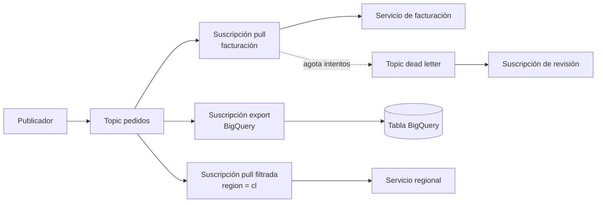

## 1. Resumen

En Pub/Sub, los publicadores escriben en un **topic** y los consumidores leen de una **suscripción**. Cada suscripción recibe su propia copia de los mensajes: varias suscripciones sobre el mismo topic permiten que distintos sistemas consuman el mismo flujo de forma independiente (*fan-out*). La suscripción define cómo se entrega (pull, push o export a BigQuery o Cloud Storage), cuánto se retienen los mensajes y qué pasa con los que fallan.

## 2. Qué es

Pub/Sub es el servicio de mensajería asíncrona de Google Cloud. Tiene dos recursos principales:

- **Topic:** el recurso con nombre al que se publican los mensajes. No sabe quién consume.
- **Suscripción:** la conexión entre un topic y un consumidor. Un topic puede tener muchas suscripciones; una suscripción pertenece a un solo topic.

Una regla que sorprende al empezar: **solo los mensajes publicados después de crear la suscripción** están disponibles para ella. Un topic sin suscripciones no guarda nada para consumidores futuros (salvo que se configure retención en el topic).

## 3. Problema que resuelve

Desacopla productores y consumidores. El sistema que genera eventos no necesita conocer a quienes los procesan, ni esperar a que estén disponibles. Agregar un nuevo consumidor (por ejemplo, un export a BigQuery para analítica) es crear otra suscripción, sin tocar el productor ni a los demás consumidores.

## 4. Cómo funciona

**Tipos de suscripción:**

| Tipo | Quién inicia la entrega | Uso típico |
|---|---|---|
| Pull | El consumidor pide mensajes | Procesadores propios (Dataflow, un servicio en GKE o Cloud Run) |
| Push | Pub/Sub envía a un endpoint HTTPS | Servicios web que reaccionan a eventos |
| Export: BigQuery | Pub/Sub escribe en una tabla | Aterrizar eventos sin código intermedio |
| Export: Cloud Storage | Pub/Sub escribe archivos en un bucket | Archivo crudo, data lake |
| Export: Bigtable | Pub/Sub escribe en una tabla de Bigtable | En Preview al 2026-10-02 |

El tipo se puede cambiar después de crear la suscripción.

**Propiedades principales de la suscripción** (valores de la documentación al 2026-10-02):

| Propiedad | Por defecto | Rango | Nota |
|---|---|---|---|
| Ack deadline | 10 s | 10–600 s | Plazo para confirmar antes de que el mensaje se reenvíe |
| Retención de mensajes | 7 días | 10 min – 31 días | Retener sin confirmar más de 24 h tiene cargo extra |
| Expiración | 31 días | ≥ 1 día, o nunca | Una suscripción sin actividad se elimina al expirar |
| Filtro | ninguno | atributos | No se puede cambiar después; lo que no coincide se confirma solo |
| Dead letter | desactivado | 5–100 intentos | Desvía mensajes que agotan los intentos |
| Retry policy | reentrega inmediata | o backoff exponencial (0–600 s) | Se aplica tras un nack o un ack deadline vencido |

Por defecto la entrega es **at-least-once y sin orden**; el orden por clave y el exactly-once son opciones de la suscripción, tratadas en `pubsub-delivery-semantics`.

## 5. Cuándo utilizarlo

- Distribuir un mismo evento a varios consumidores independientes (operación, analítica, auditoría).
- Ingesta streaming hacia BigQuery o Cloud Storage con suscripciones de export.
- Desacoplar servicios que producen eventos a ritmos distintos de los consumidores.

## 6. Cuándo no utilizarlo

- Como base de datos o almacenamiento de largo plazo: la retención máxima es de 31 días.
- Cuando el consumidor necesita leer desde el principio de la historia con suscripciones creadas después: los mensajes anteriores a la suscripción no están disponibles (salvo retención del topic y seek).
- Para filtrar por el contenido del mensaje: el filtro solo usa atributos.

## 7. Ejemplo sencillo

Topic `pedidos` con dos suscripciones:

- `pedidos-facturacion` (pull): el servicio de facturación procesa cada pedido.
- `pedidos-bq` (export a BigQuery): cada pedido llega a una tabla para analítica.

Un pedido publicado una vez llega a ambas suscripciones. Si facturación está caída, sus mensajes esperan en su suscripción (hasta la retención) sin afectar al export.

## 8. Ejemplo de producción

Un e-commerce publica eventos de pedidos con un atributo `region`. La suscripción del equipo de Chile filtra `attributes.region = "cl"`; la de analítica no filtra. La suscripción operacional tiene ack deadline de 60 s, retención de 3 días, retry policy con backoff de 10 a 300 s y dead letter tras 10 intentos, con su propia suscripción para revisar los mensajes desviados. Se alerta por la antigüedad del mensaje más viejo sin confirmar. Todo se declara en Terraform: el filtro no se puede cambiar, así que modificarlo implica crear otra suscripción.

## 9. Arquitectura



## 10. Código

```hcl
# Terraform: topic, suscripción pull con filtro, retención, reintentos y dead letter.
# Requiere: provider hashicorp/google configurado con proyecto y credenciales.
# Para la dead letter, el agente de servicio de Pub/Sub del proyecto
# (service-<número>@gcp-sa-pubsub.iam.gserviceaccount.com) necesita permiso para publicar
# en el topic de dead letter y para confirmar en la suscripción; esos bindings no se incluyen aquí.
terraform {
  required_providers {
    google = {
      source = "hashicorp/google"
    }
  }
}

resource "google_pubsub_topic" "pedidos" {
  name = "pedidos"
}

resource "google_pubsub_topic" "pedidos_dead_letter" {
  name = "pedidos-dead-letter"
}

# Un topic sin suscripciones pierde lo que recibe: la dead letter necesita la suya.
resource "google_pubsub_subscription" "pedidos_dead_letter_revision" {
  name                       = "pedidos-dead-letter-revision"
  topic                      = google_pubsub_topic.pedidos_dead_letter.id
  message_retention_duration = "604800s" # 7 días para revisar

  expiration_policy {
    ttl = "" # nunca expira
  }
}

resource "google_pubsub_subscription" "pedidos_cl" {
  name                       = "pedidos-cl"
  topic                      = google_pubsub_topic.pedidos.id
  ack_deadline_seconds       = 60
  message_retention_duration = "259200s"                 # 3 días
  filter                     = "attributes.region = \"cl\"" # no se puede modificar después

  expiration_policy {
    ttl = "" # nunca expira, aunque no haya consumidores un tiempo
  }

  retry_policy {
    minimum_backoff = "10s"
    maximum_backoff = "300s"
  }

  dead_letter_policy {
    dead_letter_topic     = google_pubsub_topic.pedidos_dead_letter.id
    max_delivery_attempts = 10
  }
}
```

## 11. GCP

**Pub/Sub** separa el topic de la suscripción y deja en la suscripción toda la configuración de consumo: tipo de entrega, ack deadline, retención, expiración, filtro, orden, reintentos y dead letter. Las suscripciones de export (BigQuery y Cloud Storage; Bigtable en Preview) evitan escribir un consumidor para aterrizar datos. Cada suscripción acumula su propio backlog, que es la métrica principal de salud.

## 12. AWS

AWS divide el modelo en dos servicios: **SNS** distribuye (un topic con varios suscriptores) y **SQS** retiene (cada cola suscrita persiste sus mensajes hasta que se procesan). El patrón *fanout* SNS → SQS se parece a un topic de Pub/Sub con varias suscripciones pull, pero son dos recursos que se configuran y pagan por separado, y la retención, los reintentos y la DLQ se definen en cada cola SQS, no en la suscripción.

## 13. Azure

**Service Bus topics** son lo más cercano: cada mensaje publicado queda disponible para cada suscripción, y las suscripciones tienen reglas de filtro (que, a diferencia de Pub/Sub, se administran como reglas de la suscripción). **Event Hubs** usa otro modelo: un log particionado donde cada *consumer group* lee el mismo stream con su propia posición. Es más parecido a Kafka que a Pub/Sub: el consumidor avanza un offset en lugar de confirmar mensajes individuales.

## 14. Buenas prácticas

- Una suscripción por consumidor lógico: varios suscriptores sobre la misma suscripción pull se reparten los mensajes, lo que sirve para escalar un mismo servicio pero no para que dos sistemas distintos reciban todo.
- Crear la suscripción antes de empezar a publicar lo que debe recibir.
- Ajustar la expiración: una suscripción crítica no debería desaparecer por un período sin consumidores.
- Dar a cada topic de dead letter su propia suscripción, revisarla y alertar sobre ella.
- Gestionar topics y suscripciones con Terraform; tratar el filtro como inmutable.
- **Seguridad:** dar `roles/pubsub.publisher` en el topic y `roles/pubsub.subscriber` en la suscripción, no roles amplios en el proyecto.
- **Observabilidad:** vigilar por suscripción el backlog de mensajes sin confirmar y su antigüedad, la tasa de nacks y lo que llega al topic de dead letter, con alertas cuando crecen.
- **Costo:** retener mensajes sin confirmar más de 24 horas tiene cargo adicional; eliminar suscripciones ociosas y usar la retención del topic si se necesita respaldo.

## 15. Errores frecuentes

- Crear la suscripción después de publicar y esperar recibir los mensajes anteriores.
- Dos servicios distintos leyendo de la misma suscripción: cada uno ve solo una parte.
- Topic de dead letter sin suscripción: los mensajes desviados se pierden.
- Querer cambiar el filtro de una suscripción existente.
- Dejar la expiración por defecto en una suscripción de un consumidor que se apaga por temporadas.

## 16. Trade-offs

Pub/Sub concentra distribución y retención en un servicio administrado con poco que operar, a cambio de menos control sobre particiones y offsets que Kafka o Event Hubs. Las suscripciones de export eliminan código, pero con menos capacidad de transformar antes de escribir que un pipeline en Dataflow.

## 17. Conceptos relacionados

- `pubsub-delivery-semantics`: garantías de entrega, orden y exactly-once.
- `dead-letter-queue`: el patrón detrás de la dead letter policy.
- `replay`: volver a consumir con retención y seek.
- `infrastructure-as-code`: declarar topics y suscripciones.
- Con ficha: `streaming-ingestion`.

## 18. Preguntas técnicas abiertas

1. Un consumidor nuevo necesita los eventos de los últimos 5 días. ¿Qué configuración tendría que haber existido antes y cómo lo resolverías si no existía?
2. ¿Cuándo preferirías una suscripción de export a BigQuery frente a un pipeline de Dataflow?
3. ¿Qué métricas y alertas pondrías sobre una suscripción crítica?

## 19. Laboratorio relacionado

Pendiente (F4).

## 20. Fuentes

- Google Cloud: *Subscription overview*, *Choose a subscription type*, *Subscription properties*, *Filter messages from a subscription*, *Subscription retry policy*, *Dead-letter topics* y *Access control* (Pub/Sub).
- Terraform: documentación de `google_pubsub_subscription` y `google_pubsub_topic` (provider hashicorp/google).
- AWS: *Fanout Amazon SNS notifications to Amazon SQS queues*.
- Microsoft Learn: *Service Bus queues, topics, and subscriptions* y *Azure Event Hubs*.

El detalle de cada fuente está en `sources` del frontmatter.

## 21. Fecha de última verificación

2026-10-04. Pasa a `verified`: revisión B-F3.1 del lote 5 aplicada, sin VERIFY pendientes.

## 22. Historial de cambios importantes

- 2026-10-02: creación (lote 5 de F3).
- 2026-10-04: revisión B-F3.1 del lote 5 aplicada (docs/reviews/cards-lote5.md): viñeta de Observabilidad en §14.
- 2026-10-04: `verification_status: verified` (revisión B-F3.1 del lote 5 aplicada; sin VERIFY pendientes).
- 2026-10-06: la sección de conceptos relacionados ya no lista como pendiente de ficha a `streaming-ingestion`, que ya tiene ficha.
- 2026-10-13: `page_title` en cada cita, con el título de la página citada (ADR-012); sin cambios de contenido.
