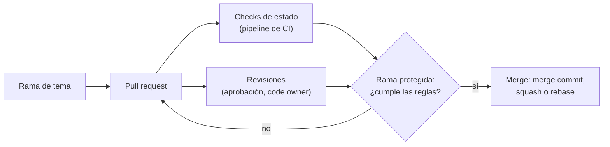

## 1. Resumen

GitHub Docs define un pull request como una propuesta: «Pull requests are proposals to merge code changes into a project». Reúne lo que necesita quien revisa: descripción, commits, cambios, comentarios y revisiones. En GitLab el equivalente es el **merge request**.

Lo que importa para una plataforma de datos:

- **cómo se integra:** merge commit, squash o rebase, y lo que cada uno deja en la historia;
- **qué se exige antes del merge:** con ramas protegidas, revisiones aprobadas y checks de estado verdes;
- **borradores:** en GitHub no se pueden fusionar ni piden revisión automática.

## 2. Qué es

- **Pull request (GitHub) / merge request (GitLab):** propuesta de integrar una rama en otra, con su conversación y su revisión.
- **Draft:** pull request en borrador; GitHub no deja fusionarlo.
- **Métodos de merge en GitHub:**
  - *Merge pull request* (por defecto): un merge commit, con `--no-ff`;
  - *Squash and merge*: los commits del pull request en uno, integrado con fast-forward;
  - *Rebase and merge*: los commits uno por uno, sin merge commit, reescritos sobre la rama base.
- **Rama protegida:** reglas que exigen, entre otras cosas, revisiones y checks antes del merge.
- **Roles en GitLab:** *assignee*, dueño del merge request (normalmente el autor), y *reviewer*.

## 3. Problema que resuelve

Sin pull requests, un cambio en un DAG o en un modelo SQL llega a main sin que nadie lo lea y sin que corran los tests. El pull request pone un punto de control: el cambio se ve completo, se discute y solo entra si cumple las reglas de la rama.

## 4. Cómo funciona

1. Se empuja una rama y se abre el pull request contra main (o como draft, si está a medio hacer).
2. GitHub crea refs temporales a la rama y, cuando se puede, a un merge simulado, que usan las integraciones.
3. Corre el pipeline de CI; sus resultados aparecen como checks de estado.
4. Se piden revisiones. Con revisiones exigidas, la rama protegida no acepta el merge hasta tener las aprobaciones.
5. Se integra con el método habilitado en el repositorio. Se puede habilitar uno solo.

## 5. Cuándo utilizarlo

- Todo cambio a una rama protegida: código de pipelines, modelos, DAGs, Terraform.
- Drafts para mostrar trabajo en curso sin pedir revisión formal.
- Squash cuando la rama tiene commits de trabajo que no aportan a la historia de main.
- Merge commit cuando conviene ver en main qué commits vinieron juntos.

## 6. Cuándo no utilizarlo

- Rebase and merge si otros ya bajaron la rama: reescribe commits.
- Pull requests de miles de líneas: se revisan peor (ver `code-review`).
- Como único control: la rama protegida es la que hace que el pull request sea obligatorio.

## 7. Ejemplo sencillo

Una rama con dos commits («paso 1», «paso 2») se integra con squash: en main queda un solo commit «pr-squash (#1)». La misma rama integrada con rebase deja en main los dos commits, sin merge commit.

## 8. Ejemplo de producción

La rama main de un repositorio de datos está protegida:

- exige una aprobación y la de un code owner para cambios en `dags/`;
- exige los checks de lint y tests en verde;
- exige resolver las conversaciones;
- solo habilita squash, para que cada pull request sea un commit en main.

Un analista abre un draft, lo marca como listo, recibe un «Request changes», corrige y, con los checks verdes y la aprobación, integra.

## 9. Arquitectura



## 10. Código

```bash
# Bash y Git (ejecutado en la CI sobre un repositorio temporal, sin remoto): lo que hacen en la historia los métodos
# «Squash and merge» y «Rebase and merge» de un pull request, reproducidos con Git local. No es la implementación de
# GitHub: su página dice que su rebase and merge se desvía un poco de git rebase.
set -euo pipefail
git init -q -b main repo && cd repo
echo "base" > dag.py && git add dag.py && git commit -q -m "dag base"

pr_branch() {  # una rama con dos commits, como la de un pull request
  git switch -q -c "$1" main
  echo "$1 paso 1" >> "$1.txt" && git add "$1.txt" && git commit -q -m "$1: paso 1"
  echo "$1 paso 2" >> "$1.txt" && git commit -q -am "$1: paso 2"
}

# Squash: los commits de la rama quedan en uno solo sobre main.
pr_branch pr-squash
git switch -q main
git merge -q --squash pr-squash && git commit -q -m "pr-squash (#1)"

# Rebase: los commits de la rama se reescriben sobre main, uno por uno, sin merge commit.
pr_branch pr-rebase
git rebase -q main
git switch -q main
git merge -q --ff-only pr-rebase

git log --format="%s" main
```

El script se **ejecuta en la CI** (pytest, sobre un repositorio temporal, sin remoto) y el test comprueba lo que queda en main: un commit por el squash y los dos commits de la rama por el rebase, sin merge commit. Reproduce con Git local el efecto en la historia de dos métodos de GitHub; no es su implementación, que según *About merge methods on GitHub* actualiza siempre el committer y descarta commits vacíos.

## 11. GCP

En GCP, Secure Source Manager trae pull requests. Las diferencias, según sus páginas:

| | GitHub | Secure Source Manager |
|---|---|---|
| Pull request | Propuesta de merge con conversación, commits, cambios y revisiones; drafts | Pull requests e issues integrados, con revisores, etiquetas, hitos, asignados y fechas |
| Reglas antes del merge | Rama protegida: revisiones, checks de estado, historia lineal, merge queue | Protección de ramas: pull request obligatorio y número de revisores y aprobadores |

## 12. AWS

En AWS, CodeCommit soporta pull requests. Las diferencias, según sus páginas:

| | GitHub | AWS CodeCommit |
|---|---|---|
| Pull request | Con drafts y tres métodos de merge | Revisar y comentar cambios antes del merge a una rama |
| Avisos | Notificaciones de GitHub | Notificaciones por email sobre pull requests y comentarios |

## 13. Azure

En **Azure Repos**, los pull requests sirven para cambiar, revisar y fusionar código, desde ramas del mismo repositorio o desde forks; quienes revisan comentan y votan para aprobar o rechazar (*About pull requests*). Las políticas de rama los hacen obligatorios (ver `git-branching-strategies`).

## 14. Buenas prácticas

- Proteger main: revisiones exigidas y checks de estado obligatorios.
- Un método de merge por repositorio, elegido a propósito.
- Drafts para trabajo en curso.
- Descripción que diga qué cambia y cómo se probó.
- **Seguridad:** sin rama protegida, el pull request es opcional; exigir aprobación de un code owner en las rutas sensibles.
- **Observabilidad:** los checks y las revisiones quedan en la línea de tiempo del pull request.
- **Costo:** cada push a un pull request corre el pipeline; un pipeline lento retrasa a todo el equipo.

## 15. Errores frecuentes

- Rama main sin protección: se puede fusionar sin revisión ni tests.
- Mezclar métodos de merge y terminar con una historia ilegible.
- Pull requests que juntan varios cambios no relacionados.
- Hacer rebase and merge de una rama compartida.

## 16. Trade-offs

El squash deja una historia de main simple, a cambio de perder los commits intermedios. El merge commit conserva la rama completa, con una historia con más nodos. El rebase deja una historia lineal reescribiendo commits. Exigir más revisiones y checks reduce errores en main a cambio de más tiempo hasta el merge.

## 17. Conceptos relacionados

- `code-review`: la revisión dentro del pull request.
- `git-branching-strategies`: de dónde vienen las ramas.
- `automated-testing-in-ci` y `ci-cd-pipelines`: los checks que exige la rama protegida.

## 18. Preguntas técnicas abiertas

1. ¿Qué método de merge habilitarías en un repositorio de modelos SQL, y por qué?
2. ¿Qué checks debería exigir la rama main de tu plataforma?
3. ¿Quién debería aprobar un cambio en un DAG que alimenta un reporte financiero?

## 19. Laboratorio relacionado

Pendiente (F4).

## 20. Fuentes

- GitHub Docs: *Pull requests*, *About merge methods on GitHub* y *About protected branches*.
- GitLab Docs: *Merge requests* y *Protected branches*.
- Google Cloud: *Secure Source Manager overview*. AWS: *What is AWS CodeCommit?*. Microsoft Learn: *About pull requests*.

El detalle de cada fuente está en `sources` del frontmatter.

## 21. Fecha de última verificación

2026-10-14. Pasa a `verified`: revisión B-F3.1 del lote F3b-11a aplicada, sin VERIFY pendientes.

## 22. Historial de cambios importantes

- 2026-10-14: creación (lote F3b-11a).
- 2026-10-14: revisión B-F3.1 del lote F3b-11a aplicada (docs/reviews/cards-f3b-11a.md): filas aprobadas sin cambios en esta ficha.
- 2026-10-14: `verification_status: verified` (sin VERIFY pendientes).
