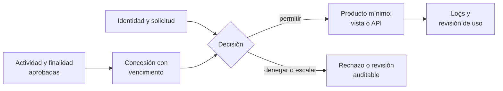

## 1. Resumen

Esta ficha no es asesoría legal: qué finalidades están aprobadas y con qué base lo deciden el responsable y el área legal; aquí se explica cómo convertir esa decisión en concesiones de acceso verificables.

**Cómo leerla.** *Comprender* (§1–6): en qué se distingue un permiso de una autorización por finalidad. *Aplicar* (§7–13): concesiones por identidad, actividad y producto, con vencimiento y pruebas negativas. *Demostrar*: la evidencia del §8, el código del §10 y los criterios del §18.

Los permisos tradicionales responden **quién** puede consultar. La autorización por finalidad agrega **para qué uso aprobado**, **qué datos**, **hasta cuándo** y **con qué restricciones**. Es una arquitectura de autorización y trazabilidad que complementa IAM, no lo reemplaza: IAM aplica la decisión; la finalidad la justifica.

**Idea central:** un permiso de lectura no autoriza cualquier finalidad. Cada concesión nace de una actividad aprobada y entrega un producto con solo lo que esa actividad necesita.

## 2. Qué es

- **[Obligación legal · art. 3]** Los datos se recolectan con fines específicos, explícitos y lícitos, y no se tratan con fines distintos salvo las excepciones de la letra b); se limitan estrictamente a los necesarios, adecuados y pertinentes (letra c)).
- **[Obligación legal · art. 14 quáter]** Por defecto, solo los datos específicos y estrictamente necesarios, considerando el número de datos recogidos, la extensión del tratamiento, el plazo de conservación y su accesibilidad.
- **[Decisión de arquitectura]** Cuatro piezas que no conviene mezclar:

| Pieza | Qué es | Ejemplo |
|---|---|---|
| Finalidad | Propósito aprobado de una actividad de tratamiento | Atención al cliente |
| Identidad | Grupo humano o cuenta de servicio, una por consumidor y finalidad | `grp-soporte`, `sa-bi-operacional` |
| Producto | Vista o API mínima para esa finalidad, no el dataset completo | `contacto_minimo` |
| Concesión | Identidad + actividad + producto + vencimiento, con aprobador | Soporte lee `contacto_minimo` hasta el 2026-12-31 |

- **[Decisión de arquitectura]** **Deny por defecto:** la concesión es la tupla (rol, finalidad, dataset o producto) con su vencimiento; lo que no está concedido se deniega.
- **[Decisión de arquitectura]** **Decisión:** permitir, denegar o escalar a revisión. Una finalidad no aprobada se deniega; una pedida y en revisión se escala; una concesión vencida se deniega.
- **[Buena práctica]** La base de licitud se define por actividad de tratamiento; no se deduce de una etiqueta en una tabla ni de una columna (`processing-activities-inventory`).

## 3. Problema que resuelve

**[Buena práctica]** Un analista con permiso para consultar `clientes` en tareas de soporte reutiliza el mismo dataset para una campaña de ofertas. IAM lo deja pasar, porque el permiso existe; nadie evaluó la finalidad nueva. Con concesiones por finalidad y productos por consumidor, el uso para la campaña se deniega o se escala, y la solicitud queda registrada.

**[Obligación legal · art. 34 quáter]** Destinar maliciosamente los datos a una finalidad distinta de la consentida o prevista en la ley es infracción gravísima (letra b)). **[Buena práctica]** El control técnico no califica la intención: deja el uso denegado o escalado, y auditado, para que lo analice el área competente.

## 4. Cómo funciona

1. **[Buena práctica]** Inventariar las actividades de tratamiento y sus finalidades aprobadas, con responsables.
2. **[Decisión de arquitectura]** Definir productos de datos mínimos por consumidor (vistas autorizadas, filtros de fila y columna) e identidades separadas por finalidad; nada de cuentas de servicio compartidas entre propósitos.
3. **[Decisión de arquitectura]** Registrar cada concesión con identidad, actividad, producto, aprobador y vencimiento; la solicitud declara la finalidad, pero el texto libre no es el único control.
4. **[Buena práctica]** Aplicar la decisión con IAM y las políticas de datos de la plataforma; donde hay contexto de negocio (una aplicación, un ticket), verificarlo también en la aplicación.
5. **[Buena práctica]** Probar las denegaciones: cada regla tiene casos que deben fallar, y la CI falla si alguno pasa.
6. **[Buena práctica]** Auditar el uso y los desvíos; un log muestra qué se consultó, no la intención real.
7. **[Buena práctica]** Revocar al vencer y gestionar las excepciones como temporales, con fecha de revisión.
8. **[Buena práctica]** Revisar periódicamente las concesiones vigentes con su dueño (por ejemplo, cada trimestre): las que nadie confirma se revocan.

## 5. Cuándo utilizarlo

- En plataformas compartidas por varias áreas, proveedores, marketing, atención al cliente, analítica y modelos de IA.
- Cuando un mismo activo sirve a varias actividades con finalidades distintas.

## 6. Cuándo no utilizarlo

- Para decidir si una finalidad es lícita o compatible: lo decide el área legal.
- Como función nativa universal: ninguna plataforma de esta ficha «entiende» finalidades; se modelan con identidades, productos y procesos.
- Como prueba de uso legítimo: una etiqueta de finalidad o una finalidad declarada no garantizan cómo se usan los datos.

## 7. Ejemplo sencillo

| Consumidor | Finalidad aprobada | Producto | Qué ve |
|---|---|---|---|
| Soporte | Atención al cliente | `contacto_minimo` | Contacto del pasajero de la incidencia |
| BI operacional | Estadística operacional | `vuelos_agregados` | Agregados, sin identificadores |
| Marketing | Campaña de ofertas | `contacto_con_consentimiento` | Solo quienes consintieron, mientras la concesión esté vigente |

La misma tabla de pasajeros alimenta los tres productos; ningún consumidor recibe la tabla completa.

## 8. Ejemplo de producción

Escenario genérico: una aerolínea en GCP. El catálogo relaciona cada dataset con sus actividades; los grupos y las cuentas de servicio se separan por consumidor y finalidad; las vistas autorizadas y las políticas de columna reducen los datos; la aplicación de soporte verifica el ticket antes de llamar al servicio; la CI corre las pruebas negativas de cada regla.

| Componente | Implementación posible |
|---|---|
| Registro de concesiones | Tabla versionada con identidad, actividad, producto, aprobador y vencimiento |
| Productos mínimos | Vistas autorizadas, filtros de fila y máscaras de columna |
| Identidades | Un grupo o cuenta de servicio por consumidor y finalidad |
| Decisión | Servicio de autorización o reglas en la CI, que permiten, deniegan o escalan |
| Auditoría | Logs de acceso cruzados con el proceso de negocio |

### Evidencia de cumplimiento

| Evidencia | Dónde queda | Quién la produce | Qué demuestra | Qué no demuestra |
|---|---|---|---|---|
| Solicitud y concesión con aprobador y vencimiento | Registro de concesiones | Dueño del dato y privacidad | Para qué finalidad y hasta cuándo se dio el acceso | Que la finalidad declarada sea la real |
| Permisos efectivos y pruebas negativas | Log de la CI | CI | Que las identidades solo leen su producto | Que no haya otras rutas de acceso |
| Auditoría de uso | Logs de acceso | Plataforma | Qué consultó cada identidad | Por qué lo consultó |
| Excepciones con fecha de revisión | Registro de concesiones | Privacidad | Qué se aceptó temporalmente y quién | Que el riesgo deje de existir |

## 9. Arquitectura



## 10. Código

```python
# Python 3.12+, biblioteca estándar. Autorización por finalidad: una solicitud (identidad, finalidad, producto de
# datos) se permite solo si la actividad de tratamiento aprobada la cubre y la concesión está vigente; si no, se
# deniega o se escala a revisión. Cada producto es una vista mínima por consumidor. Las pruebas negativas fallan la
# CI si una regla deja pasar un caso que debe denegar. La finalidad declarada no prueba el uso real: el log lo audita.
import sys
from dataclasses import dataclass
from datetime import date

HOY = date(2026, 10, 28)


@dataclass(frozen=True)
class Concesion:
    identidad: str            # grupo o cuenta de servicio, una por consumidor y finalidad
    actividad: str            # actividad de tratamiento aprobada (processing-activities-inventory)
    producto: str             # vista o API mínima, no el dataset completo
    vence: date


@dataclass(frozen=True)
class Solicitud:
    identidad: str
    finalidad: str
    producto: str


CONCESIONES = [
    Concesion("grp-soporte", "atencion_cliente", "contacto_minimo", date(2026, 12, 31)),
    Concesion("sa-bi-operacional", "estadistica_operacional", "vuelos_agregados", date(2027, 3, 31)),
    Concesion("grp-marketing", "campana_ofertas", "contacto_con_consentimiento", date(2026, 10, 1)),
]
EXCEPCIONES_EN_REVISION = {("grp-soporte", "auditoria_reclamos")}   # pedidas, no aprobadas


def decidir(s: Solicitud) -> str:
    vigentes = [c for c in CONCESIONES if c.identidad == s.identidad and c.producto == s.producto]
    if not vigentes:                                  # deny por defecto: sin concesión, no hay acceso
        return "DENEGAR: sin concesión para ese producto"
    if not any(c.actividad == s.finalidad for c in vigentes):
        if (s.identidad, s.finalidad) in EXCEPCIONES_EN_REVISION:
            return "ESCALAR: finalidad en revisión"
        return f"DENEGAR: la finalidad «{s.finalidad}» no es la aprobada"
    if all(c.vence < HOY for c in vigentes if c.actividad == s.finalidad):
        return "DENEGAR: concesión vencida"
    return "PERMITIR"


SOLICITUDES = [
    Solicitud("grp-soporte", "atencion_cliente", "contacto_minimo"),
    Solicitud("grp-soporte", "campana_ofertas", "contacto_minimo"),
    Solicitud("grp-soporte", "auditoria_reclamos", "contacto_minimo"),
    Solicitud("sa-bi-operacional", "estadistica_operacional", "contacto_minimo"),
    Solicitud("grp-marketing", "campana_ofertas", "contacto_con_consentimiento"),
]
DEBEN_DENEGAR = [s for s in SOLICITUDES if s.finalidad != "atencion_cliente" or s.identidad != "grp-soporte"]


def main() -> int:
    for s in SOLICITUDES:
        print(f"{s.identidad} · {s.finalidad} · {s.producto}: {decidir(s)}")
    fugas = [s for s in DEBEN_DENEGAR if decidir(s) == "PERMITIR"]
    print(f"pruebas negativas: {len(DEBEN_DENEGAR) - len(fugas)}/{len(DEBEN_DENEGAR)} no se permiten")
    return 1 if fugas else 0


if __name__ == "__main__":
    sys.exit(main())
```

El script se **ejecuta en la CI** con la biblioteca estándar y pasa `mypy --strict`. Imprime una decisión por solicitud y las pruebas negativas; termina con código 0 porque ninguna solicitud que debía denegarse pasó:

```text
grp-soporte · atencion_cliente · contacto_minimo: PERMITIR
grp-soporte · campana_ofertas · contacto_minimo: DENEGAR: la finalidad «campana_ofertas» no es la aprobada
grp-soporte · auditoria_reclamos · contacto_minimo: ESCALAR: finalidad en revisión
sa-bi-operacional · estadistica_operacional · contacto_minimo: DENEGAR: sin concesión para ese producto
grp-marketing · campana_ofertas · contacto_con_consentimiento: DENEGAR: concesión vencida
pruebas negativas: 4/4 no se permiten
```

**Limitaciones:** el ejemplo no autentica identidades ni comprueba que la finalidad declarada sea verdadera; requiere IAM, el proceso de aprobación y la auditoría.

## 11. GCP

En GCP, **BigQuery**. Según *Authorized views* (no ejecutado):

| Necesidad | Servicio |
|---|---|
| Producto mínimo por consumidor | Authorized views: comparten un subconjunto del dataset con principals específicos, que no acceden directamente al dataset de origen |
| Finalidad y vencimiento | Registro de concesiones propio; BigQuery aplica el acceso, no la finalidad |

## 12. AWS

En AWS, **Lake Formation**. Según *Data filtering and cell-level security in Lake Formation* (no ejecutado):

| Necesidad | Servicio |
|---|---|
| Producto mínimo por consumidor | Filtros de datos de columna, fila y celda al dar el permiso |
| Finalidad y vencimiento | Registro de concesiones propio, con una identidad por finalidad |

## 13. Azure

En Azure, **Unity Catalog** de Azure Databricks. Según *Row filters and column masks* (no ejecutado):

| Necesidad | Servicio |
|---|---|
| Producto mínimo por consumidor | Row filters y column masks que restringen lo que ve quien consulta |
| Finalidad y vencimiento | Registro de concesiones propio; la autorización contextual va en la aplicación |

**Criterio común:** las tres plataformas aplican acceso a datos; ninguna decide la finalidad. La concesión, su vencimiento y las pruebas negativas son de la arquitectura propia.

## 14. Buenas prácticas

- **[Buena práctica]** Preferir productos de datos mínimos por consumidor a reglas dinámicas improvisadas sobre la tabla completa.
- **[Decisión de arquitectura]** Separar identidades humanas y de servicio, y una identidad por finalidad.
- **[Buena práctica]** Registrar aprobaciones y vencimientos; revocar al vencer.
- **[Buena práctica]** **Seguridad:** probar las denegaciones con las identidades reales, no solo leer la configuración.
- **[Buena práctica]** **Observabilidad:** alertar por concesiones vencidas que siguen activas, por solicitudes escaladas sin resolver y por usos secundarios.
- **[Buena práctica]** **Costo:** cada producto y cada identidad se mantienen; agrupar consumidores con la misma finalidad y los mismos datos.

## 15. Errores frecuentes

- **Confundir permiso de lectura con autorización para cualquier finalidad:** el uso nuevo pasa sin evaluación.
- **Usar la finalidad declarada como única prueba:** un formulario no demuestra el uso real.
- **Cuentas de servicio compartidas entre propósitos:** no se puede saber ni limitar qué finalidad usó el acceso.
- **Guardar la base de licitud como propiedad de una columna:** la base es de la actividad, no del dato.
- **Concesiones sin vencimiento:** los accesos temporales se vuelven permanentes.

## 16. Trade-offs

| Decisión | Beneficio | Costo |
|---|---|---|
| Más granularidad (producto por consumidor) | Menos exposición | Más políticas, identidades y mantenimiento |
| Vistas y productos fijos | Gobernables y auditables | Menos flexibles ante pedidos nuevos |
| Reglas dinámicas por atributos | Flexibles | Difíciles de probar y de auditar |
| Escalar en vez de denegar | No bloquea usos legítimos nuevos | Exige un proceso de revisión ágil |

## 17. Conceptos relacionados

- `chile-data-protection`: ficha padre.
- `processing-activities-inventory`: las actividades y finalidades aprobadas.
- `data-minimization-by-layer`: el producto con solo lo necesario.
- `column-level-security`: máscaras y lectores por columna.
- `privacy-controls-as-code`: las pruebas negativas en la CI.

## 18. Preguntas técnicas abiertas

1. ¿Cómo se evita hoy un uso secundario de un dataset compartido?
2. ¿Qué pasa cuando un consumidor cambia de finalidad?
3. ¿Cómo se revoca un acceso temporal y quién lo verifica?
4. ¿Qué identidades leen datos personales sin una actividad asociada?

**Criterio de dominio:** dominas esta ficha si puedes explicar por qué un permiso no autoriza cualquier finalidad, cómo modelar una concesión con identidad, actividad, producto y vencimiento, qué prueba una denegación y por qué un log no demuestra la intención.

## 19. Laboratorio relacionado

Propuesta para F4: dos vistas autorizadas en BigQuery sobre datos ficticios, una cuenta de servicio por finalidad y pruebas de acceso positivas y negativas; una concesión vencida que debe denegarse. Sin datos personales reales.

## 20. Fuentes

- BCN Ley Chile: *Ley 19628 SOBRE PROTECCION DE LOS DATOS PERSONALES* (versión con vigencia diferida desde 2026-12-01).
- Google Cloud: *Authorized views*.
- AWS: *Data filtering and cell-level security in Lake Formation*.
- Microsoft Learn: *Row filters and column masks*.

El detalle de cada fuente está en `sources` del frontmatter.

## 21. Fecha de última verificación

2026-10-28: arts. 3, 14 quáter y 34 quáter consultados ese día en BCN; *Authorized views* consultada ese día. `review_required`: pasa a `verified` solo con la aprobación explícita de Felipe (`owner_approved_at`). Revisión mensual.

## 22. Historial de cambios importantes

- 2026-10-28: creación (lote P2, dominio 24, ADR-027) desde `docs/briefs/privacy-program/04-autorizacion-por-finalidad.md`, que es un guion, no una fuente.
- 2026-10-28: completada con lo que pedía el prompt de P2: la tupla (rol, finalidad, dataset o producto) y el deny por defecto en el §2 y en un comentario del código (la salida no cambia), y la revisión periódica de concesiones en el §4.
- 2026-10-28: revisión `docs/reviews/p2.md` aplicada: el art. 14 quáter nombra sus cuatro factores (número de datos, extensión, plazo y accesibilidad) en el §2 y en `legal_basis`; etiqueta del nodo de logs en dos líneas.
- 2026-10-30: Enmienda 4 de ADR-023: 4 tabla(s) sin columna ni línea «Etiqueta»; la fila con origen legal lleva «Obligación legal» al inicio de su primera celda. Sin cambios de contenido.
