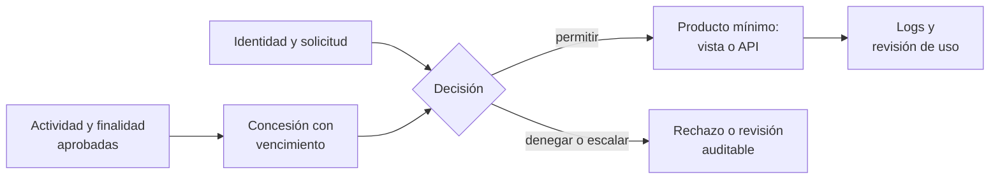

## 1. Resumen

Esta ficha no es asesoría legal: qué finalidades están aprobadas y con qué base lo deciden el responsable y el área legal; aquí se explica cómo convertir esa decisión en concesiones de acceso verificables.

Los permisos tradicionales responden **quién** puede consultar. La autorización por finalidad agrega **para qué uso aprobado**, **qué datos**, **hasta cuándo** y **con qué restricciones**. Es una arquitectura de autorización y trazabilidad que complementa IAM, no lo reemplaza: IAM aplica la decisión; la finalidad la justifica.

**Idea central:** un permiso de lectura no autoriza cualquier finalidad. Cada concesión nace de una actividad aprobada y entrega un producto con solo lo que esa actividad necesita.

## 2. Qué es

- **[Obligación legal · art. 3]** Los datos se recolectan con fines específicos, explícitos y lícitos, y no se tratan con fines distintos salvo las excepciones del principio de **finalidad**; se limitan estrictamente a los necesarios, adecuados y pertinentes (**proporcionalidad**).
- **[Obligación legal · art. 14 quáter]** Por defecto, solo los datos específicos y estrictamente necesarios, considerando el número de datos recogidos, la extensión del tratamiento, el plazo de conservación y su accesibilidad.
- **[Decisión de arquitectura]** Cuatro piezas que no conviene mezclar:

| Pieza | Qué es | Ejemplo |
|---|---|---|
| Finalidad | Propósito aprobado de una actividad de tratamiento | Atención al cliente |
| Identidad | Grupo humano o cuenta de servicio, una por consumidor y finalidad | `grp-soporte`, `sa-bi-operacional` |
| Producto | Vista o API mínima para esa finalidad, no el dataset completo | `contacto_minimo` |
| Concesión | Identidad + actividad + producto + vencimiento, con aprobador | Soporte lee `contacto_minimo` hasta el 2026-12-31 |

- **[Decisión de arquitectura]** **Deny por defecto:** la concesión es la tupla (rol, finalidad, dataset o producto) con su vencimiento; lo que no está concedido se deniega.
- **[Decisión de arquitectura]** **Decisión:** permitir, denegar o escalar a revisión. Una finalidad no aprobada se deniega; una pedida y en revisión se escala; una concesión vencida se deniega.
- **[Buena práctica]** La base de licitud se define por actividad de tratamiento; no se deduce de una etiqueta en una tabla ni de una columna (`processing-activities-inventory`).

## 3. Problema que resuelve

**[Buena práctica]** Un analista con permiso para consultar `clientes` en tareas de soporte reutiliza el mismo dataset para una campaña de ofertas. IAM lo deja pasar, porque el permiso existe; nadie evaluó la finalidad nueva. Con concesiones por finalidad y productos por consumidor, el uso para la campaña se deniega o se escala, y la solicitud queda registrada.

**[Obligación legal · art. 34 quáter]** «Destinar maliciosamente los datos personales a una finalidad distinta de la consentida por el titular o prevista en la ley que autoriza su tratamiento» es infracción gravísima (letra b)). **[Buena práctica]** El control técnico no califica la intención: deja el uso denegado o escalado, y auditado, para que lo analice el área competente.

## 4. Cómo funciona

1. **[Buena práctica]** Inventariar las actividades de tratamiento y sus finalidades aprobadas, con responsables.
2. **[Decisión de arquitectura]** Definir productos de datos mínimos por consumidor (vistas autorizadas, filtros de fila y columna) e identidades separadas por finalidad; nada de cuentas de servicio compartidas entre propósitos.
3. **[Decisión de arquitectura]** Registrar cada concesión con identidad, actividad, producto, aprobador y vencimiento; la solicitud declara la finalidad, pero el texto libre no es el único control.
4. **[Buena práctica]** Aplicar la decisión con IAM y las políticas de datos de la plataforma; donde hay contexto de negocio (una aplicación, un ticket), verificarlo también en la aplicación.
5. **[Buena práctica]** Probar las denegaciones: cada regla tiene casos que deben fallar, y la CI falla si alguno pasa.
6. **[Buena práctica]** Auditar el uso y los desvíos; un log muestra qué se consultó, no la intención real.
7. **[Buena práctica]** Revocar al vencer y gestionar las excepciones como temporales, con fecha de revisión.
8. **[Buena práctica]** Revisar periódicamente las concesiones vigentes con su dueño (por ejemplo, cada trimestre): las que nadie confirma se revocan.

## 5. Cuándo utilizarlo

- En plataformas compartidas por varias áreas, proveedores, marketing, atención al cliente, analítica y modelos de IA.
- Cuando un mismo activo sirve a varias actividades con finalidades distintas.

## 6. Cuándo no utilizarlo

- Para decidir si una finalidad es lícita o compatible: lo decide el área legal.
- Como función nativa universal: ninguna plataforma de esta ficha «entiende» finalidades; se modelan con identidades, productos y procesos.
- Como prueba de uso legítimo: una etiqueta de finalidad o una finalidad declarada no garantizan cómo se usan los datos.

## 7. Ejemplo sencillo

| Consumidor | Finalidad aprobada | Producto | Qué ve |
|---|---|---|---|
| Soporte | Atención al cliente | `contacto_minimo` | Contacto del pasajero de la incidencia |
| BI operacional | Estadística operacional | `vuelos_agregados` | Agregados, sin identificadores |
| Marketing | Campaña de ofertas | `contacto_con_consentimiento` | Solo quienes consintieron, mientras la concesión esté vigente |

La misma tabla de pasajeros alimenta los tres productos; ningún consumidor recibe la tabla completa.

## 8. Ejemplo de producción

Escenario genérico: una aerolínea en GCP. El catálogo relaciona cada dataset con sus actividades; los grupos y las cuentas de servicio se separan por consumidor y finalidad; las vistas autorizadas y las políticas de columna reducen los datos; la aplicación de soporte verifica el ticket antes de llamar al servicio; la CI corre las pruebas negativas de cada regla.

| Componente | Implementación posible |
|---|---|
| Registro de concesiones | Tabla versionada con identidad, actividad, producto, aprobador y vencimiento |
| Productos mínimos | Vistas autorizadas, filtros de fila y máscaras de columna |
| Identidades | Un grupo o cuenta de servicio por consumidor y finalidad |
| Decisión | Servicio de autorización o reglas en la CI, que permiten, deniegan o escalan |
| Auditoría | Logs de acceso cruzados con el proceso de negocio |

### Evidencia de cumplimiento

| Evidencia | Dónde queda | Quién la produce | Qué demuestra | Qué no demuestra |
|---|---|---|---|---|
| Solicitud y concesión con aprobador y vencimiento | Registro de concesiones | Dueño del dato y privacidad | Para qué finalidad y hasta cuándo se dio el acceso | Que la finalidad declarada sea la real |
| Permisos efectivos y pruebas negativas | Log de la CI | CI | Que las identidades solo leen su producto | Que no haya otras rutas de acceso |
| Auditoría de uso | Logs de acceso | Plataforma | Qué consultó cada identidad | Por qué lo consultó |
| Excepciones con fecha de revisión | Registro de concesiones | Privacidad | Qué se aceptó temporalmente y quién | Que el riesgo deje de existir |

## 9. Arquitectura



## 10. Código

```python
# Python 3.12+, biblioteca estándar. Autorización por finalidad, de punta a punta: registro de concesiones → decisión
# (deny por defecto) → pruebas negativas con su decisión esperada → revisión periódica → código de salida (0 aprueba,
# 1 rechaza). Uso: python finalidad.py solicitudes | fuga | revision. Una solicitud (identidad, finalidad, producto,
# columnas) se permite solo si una concesión aprobada la cubre, no está vencida y el producto mínimo trae esas columnas.
# Las funciones reciben el registro y la fecha de referencia. La finalidad declarada no prueba el uso real: el log lo
# audita. Datos ficticios.
import sys
from dataclasses import dataclass, replace
from datetime import date, timedelta
from typing import Literal

Decision = Literal["PERMITIR", "DENEGAR", "ESCALAR"]
REFERENCIA = date(2026, 11, 4)          # fecha fija: resultado reproducible
PERIODO_REVISION = timedelta(days=90)   # política interna ilustrativa, no un plazo legal


# @paso 1 Registro de concesiones
@dataclass(frozen=True)
class Concesion:
    identidad: str      # grupo o cuenta de servicio, una por consumidor y finalidad
    actividad: str      # actividad de tratamiento aprobada (processing-activities-inventory)
    producto: str       # vista o API mínima, no el dataset completo
    vence: date
    confirmada: date    # última vez que el dueño del dato confirmó que la concesión sigue siendo necesaria


@dataclass(frozen=True)
class Registro:
    productos: dict[str, frozenset[str]]       # producto mínimo → columnas que expone
    concesiones: tuple[Concesion, ...]
    en_revision: frozenset[tuple[str, str]]    # (identidad, finalidad) pedidas y no aprobadas


@dataclass(frozen=True)
class Solicitud:
    identidad: str
    finalidad: str
    producto: str
    columnas: frozenset[str]


def registro_base() -> Registro:
    productos = {"contacto_minimo": frozenset({"pasajero_id", "nombre", "correo"}),
                 "vuelos_agregados": frozenset({"ruta", "mes", "pasajeros"}),
                 "contacto_con_consentimiento": frozenset({"pasajero_id", "correo", "preferencias"})}
    concesiones = (
        Concesion("grp-soporte", "atencion_cliente", "contacto_minimo", date(2026, 12, 31), date(2026, 10, 15)),
        Concesion("sa-bi-operacional", "estadistica_operacional", "vuelos_agregados", date(2027, 3, 31),
                  date(2026, 9, 30)),
        Concesion("grp-marketing", "campana_ofertas", "contacto_con_consentimiento", date(2026, 10, 1),
                  date(2026, 9, 1)),
    )
    return Registro(productos, concesiones, frozenset({("grp-soporte", "auditoria_reclamos")}))


def vigentes(registro: Registro, hoy: date) -> list[Concesion]:
    """Solo las concesiones que no han vencido a la fecha de referencia."""
    return [c for c in registro.concesiones if c.vence >= hoy]


# @paso 2 Decisión
def del_producto(registro: Registro, s: Solicitud) -> list[Concesion]:
    """Concesiones de la identidad para ese producto, vencidas o no: la vigencia se decide después."""
    return [c for c in registro.concesiones if c.identidad == s.identidad and c.producto == s.producto]


def decidir(registro: Registro, s: Solicitud, hoy: date) -> tuple[Decision, str]:
    candidatas = del_producto(registro, s)
    if not candidatas:   # deny por defecto: sin concesión, no hay acceso
        return "DENEGAR", "sin concesión para ese producto"
    de_la_finalidad = [c for c in candidatas if c.actividad == s.finalidad]
    if not de_la_finalidad:
        if (s.identidad, s.finalidad) in registro.en_revision:
            return "ESCALAR", "finalidad en revisión"
        return "DENEGAR", f"la finalidad «{s.finalidad}» no es la aprobada"
    if all(c.vence < hoy for c in de_la_finalidad):
        return "DENEGAR", "concesión vencida"
    fuera = sorted(s.columnas - registro.productos[s.producto])
    if fuera:
        return "DENEGAR", f"pide {', '.join(fuera)}, fuera de {s.producto}"
    return "PERMITIR", "concesión vigente para esa finalidad y ese producto"


# @paso 3 Pruebas negativas
@dataclass(frozen=True)
class Caso:
    solicitud: Solicitud
    esperada: Decision   # la declara el dueño del dato al aprobar la regla; no se deriva del registro


def pide(identidad: str, finalidad: str, producto: str, *columnas: str) -> Solicitud:
    return Solicitud(identidad, finalidad, producto, frozenset(columnas))


def casos() -> tuple[Caso, ...]:
    return (
        Caso(pide("grp-soporte", "atencion_cliente", "contacto_minimo", "nombre", "correo"), "PERMITIR"),
        Caso(pide("sa-bi-operacional", "estadistica_operacional", "vuelos_agregados", "ruta", "pasajeros"), "PERMITIR"),
        Caso(pide("grp-soporte", "campana_ofertas", "contacto_minimo", "correo"), "DENEGAR"),
        Caso(pide("grp-soporte", "auditoria_reclamos", "contacto_minimo", "correo"), "ESCALAR"),
        Caso(pide("sa-bi-operacional", "estadistica_operacional", "contacto_minimo", "correo"), "DENEGAR"),
        Caso(pide("grp-marketing", "campana_ofertas", "contacto_con_consentimiento", "correo"), "DENEGAR"),
        Caso(pide("grp-soporte", "atencion_cliente", "contacto_minimo", "nombre", "rut"), "DENEGAR"),
    )


def probar(registro: Registro, lista: tuple[Caso, ...], hoy: date) -> list[tuple[Caso, Decision, str]]:
    return [(caso, *decidir(registro, caso.solicitud, hoy)) for caso in lista]


# @paso 4 Revisión y salida
def cuentas_compartidas(registro: Registro, hoy: date) -> list[str]:
    """Una identidad con concesiones para dos finalidades distintas no permite saber para qué se usó cada acceso."""
    finalidades: dict[str, list[str]] = {}
    for c in vigentes(registro, hoy):
        if c.actividad not in finalidades.setdefault(c.identidad, []):
            finalidades[c.identidad].append(c.actividad)
    return [f"cuenta compartida: {i} usa {' y '.join(f)}" for i, f in finalidades.items() if len(f) > 1]


def sin_confirmar(registro: Registro, hoy: date) -> list[str]:
    """Concesiones vigentes que nadie confirmó dentro del periodo de revisión: se marcan para revocar."""
    return [f"sin confirmar en {PERIODO_REVISION.days} días: {c.identidad} → {c.producto} (última confirmación "
            f"{c.confirmada}): marcar para revocar" for c in vigentes(registro, hoy) if hoy - c.confirmada > PERIODO_REVISION]


def escenario(nombre: str) -> Registro:
    base = registro_base()
    if nombre == "fuga":   # la vista contacto_minimo quedó publicada con rut: la regla de columnas ya no lo frena
        return replace(base, productos={**base.productos, "contacto_minimo": base.productos["contacto_minimo"] | {"rut"}})
    if nombre == "revision":
        compartida = (Concesion("sa-compartida", "campana_ofertas", "contacto_con_consentimiento", date(2027, 6, 30),
                                date(2026, 10, 20)),
                      Concesion("sa-compartida", "atencion_cliente", "contacto_minimo", date(2027, 6, 30),
                                date(2026, 10, 20)))
        antigua = tuple(replace(c, confirmada=date(2026, 7, 1)) if c.identidad == "sa-bi-operacional" else c
                        for c in base.concesiones)
        return replace(base, concesiones=antigua + compartida)
    return base


def main(nombre: str) -> int:
    registro = escenario(nombre)
    resultados = probar(registro, casos(), REFERENCIA)
    for caso, decision, motivo in resultados:
        s = caso.solicitud
        marca = "" if decision == caso.esperada else f" ← se esperaba {caso.esperada}"
        print(f"{s.identidad} · {s.finalidad} · {s.producto} [{', '.join(sorted(s.columnas))}]: {decision}: {motivo}{marca}")
    difieren = [r for r in resultados if r[1] != r[0].esperada]
    negativas = [r for r in resultados if r[0].esperada != "PERMITIR"]
    fugas = [r for r in negativas if r[1] == "PERMITIR"]
    print(f"pruebas negativas: {len(negativas) - len(fugas)}/{len(negativas)} no se permiten; "
          f"decisiones distintas de la declarada: {len(difieren)}")
    hallazgos = cuentas_compartidas(registro, REFERENCIA) + sin_confirmar(registro, REFERENCIA)
    for h in hallazgos:
        print(f"REVISIÓN {h}")
    if difieren or hallazgos:
        print(f"CI: rechazada (1): {len(difieren)} decisión(es) distinta(s) de la declarada, "
              f"{len(hallazgos)} hallazgo(s) de revisión")
        return 1
    print("CI: aprobada (0): cada caso dio la decisión declarada y la revisión no tiene hallazgos")
    return 0


if __name__ == "__main__":
    sys.exit(main(sys.argv[1] if len(sys.argv) > 1 else "solicitudes"))
```

El script se **ejecuta en la CI** con la biblioteca estándar y pasa `mypy --strict`. Recorre cuatro pasos:

1. **Registro de concesiones:** cada concesión une una identidad, una actividad aprobada, un producto mínimo, su vencimiento y la fecha de su última confirmación. Cada producto declara las columnas que expone.
2. **Decisión:** deny por defecto. Sin concesión para el producto, se deniega. Con otra finalidad, se deniega o, si está pedida y en revisión, se escala. Con la concesión vencida, se deniega, y también si pide una columna que el producto no expone (**proporcionalidad**). Solo entonces se permite, para esa finalidad (**finalidad**).
3. **Pruebas negativas:** cada caso declara a mano su decisión esperada, sin derivarla del registro, y la CI falla si alguna decisión difiere.
4. **Revisión y salida:** una identidad con concesiones vigentes para dos finalidades es una cuenta compartida, y una concesión que nadie confirmó en 90 días (una política interna de ejemplo) se marca para revocar.

Las funciones reciben el registro y la fecha de referencia, que es fija para que la salida se repita. Los datos son ficticios.

Con el registro correcto, los siete casos dan la decisión declarada: dos se permiten, cuatro se deniegan y uno se escala. Ninguno de los cinco que no debían permitirse pasa. Termina con código 0:

```text
$ python finalidad.py solicitudes
grp-soporte · atencion_cliente · contacto_minimo [correo, nombre]: PERMITIR: concesión vigente para esa finalidad y ese producto
sa-bi-operacional · estadistica_operacional · vuelos_agregados [pasajeros, ruta]: PERMITIR: concesión vigente para esa finalidad y ese producto
grp-soporte · campana_ofertas · contacto_minimo [correo]: DENEGAR: la finalidad «campana_ofertas» no es la aprobada
grp-soporte · auditoria_reclamos · contacto_minimo [correo]: ESCALAR: finalidad en revisión
sa-bi-operacional · estadistica_operacional · contacto_minimo [correo]: DENEGAR: sin concesión para ese producto
grp-marketing · campana_ofertas · contacto_con_consentimiento [correo]: DENEGAR: concesión vencida
grp-soporte · atencion_cliente · contacto_minimo [nombre, rut]: DENEGAR: pide rut, fuera de contacto_minimo
pruebas negativas: 5/5 no se permiten; decisiones distintas de la declarada: 0
CI: aprobada (0): cada caso dio la decisión declarada y la revisión no tiene hallazgos
```

Si la vista `contacto_minimo` queda publicada con `rut`, la regla de columnas ya no frena la solicitud que pide `rut`, y la prueba negativa la detecta como fuga. Termina con código 1:

```text
$ python finalidad.py fuga
grp-soporte · atencion_cliente · contacto_minimo [correo, nombre]: PERMITIR: concesión vigente para esa finalidad y ese producto
sa-bi-operacional · estadistica_operacional · vuelos_agregados [pasajeros, ruta]: PERMITIR: concesión vigente para esa finalidad y ese producto
grp-soporte · campana_ofertas · contacto_minimo [correo]: DENEGAR: la finalidad «campana_ofertas» no es la aprobada
grp-soporte · auditoria_reclamos · contacto_minimo [correo]: ESCALAR: finalidad en revisión
sa-bi-operacional · estadistica_operacional · contacto_minimo [correo]: DENEGAR: sin concesión para ese producto
grp-marketing · campana_ofertas · contacto_con_consentimiento [correo]: DENEGAR: concesión vencida
grp-soporte · atencion_cliente · contacto_minimo [nombre, rut]: PERMITIR: concesión vigente para esa finalidad y ese producto ← se esperaba DENEGAR
pruebas negativas: 4/5 no se permiten; decisiones distintas de la declarada: 1
CI: rechazada (1): 1 decisión(es) distinta(s) de la declarada, 0 hallazgo(s) de revisión
```

En la revisión, `sa-compartida` tiene concesiones para dos finalidades, y nadie confirma la de `sa-bi-operacional` desde el 2026-07-01. Las decisiones no cambian, pero la revisión tiene dos hallazgos. Termina con código 1:

```text
$ python finalidad.py revision
grp-soporte · atencion_cliente · contacto_minimo [correo, nombre]: PERMITIR: concesión vigente para esa finalidad y ese producto
sa-bi-operacional · estadistica_operacional · vuelos_agregados [pasajeros, ruta]: PERMITIR: concesión vigente para esa finalidad y ese producto
grp-soporte · campana_ofertas · contacto_minimo [correo]: DENEGAR: la finalidad «campana_ofertas» no es la aprobada
grp-soporte · auditoria_reclamos · contacto_minimo [correo]: ESCALAR: finalidad en revisión
sa-bi-operacional · estadistica_operacional · contacto_minimo [correo]: DENEGAR: sin concesión para ese producto
grp-marketing · campana_ofertas · contacto_con_consentimiento [correo]: DENEGAR: concesión vencida
grp-soporte · atencion_cliente · contacto_minimo [nombre, rut]: DENEGAR: pide rut, fuera de contacto_minimo
pruebas negativas: 5/5 no se permiten; decisiones distintas de la declarada: 0
REVISIÓN cuenta compartida: sa-compartida usa campana_ofertas y atencion_cliente
REVISIÓN sin confirmar en 90 días: sa-bi-operacional → vuelos_agregados (última confirmación 2026-07-01): marcar para revocar
CI: rechazada (1): 0 decisión(es) distinta(s) de la declarada, 2 hallazgo(s) de revisión
```

Limitaciones:

- **Identidad:** el ejemplo no autentica identidades; eso lo hace el IAM.
- **Finalidad real:** la decisión confía en la finalidad que declara la solicitud. Si es la verdadera, lo muestra la auditoría de los logs de acceso.
- **Cobertura de las pruebas:** las pruebas negativas solo cubren los casos declarados; una regla mal configurada que ningún caso ejercita no se detecta.
- **Revisión:** el ejemplo marca para revocar, no revoca. Quién confirma, y que la revocación se aplique en el IAM, queda fuera.
- **Plazo:** los 90 días son una política interna de ejemplo, no un plazo legal.

## 11. GCP

En GCP, **BigQuery**. Según *Authorized views* (no ejecutado):

| Necesidad | Servicio |
|---|---|
| Producto mínimo por consumidor | Authorized views: comparten un subconjunto del dataset con principals específicos, que no acceden directamente al dataset de origen |
| Finalidad y vencimiento | Registro de concesiones propio; BigQuery aplica el acceso, no la finalidad |

## 12. AWS

En AWS, **Lake Formation**. Según *Data filtering and cell-level security in Lake Formation* (no ejecutado):

| Necesidad | Servicio |
|---|---|
| Producto mínimo por consumidor | Filtros de datos de columna, fila y celda al dar el permiso |
| Finalidad y vencimiento | Registro de concesiones propio, con una identidad por finalidad |

## 13. Azure

En Azure, **Unity Catalog** de Azure Databricks. Según *Row filters and column masks* (no ejecutado):

| Necesidad | Servicio |
|---|---|
| Producto mínimo por consumidor | Row filters y column masks que restringen lo que ve quien consulta |
| Finalidad y vencimiento | Registro de concesiones propio; la autorización contextual va en la aplicación |

**Criterio común:** las tres plataformas aplican acceso a datos; ninguna decide la finalidad. La concesión, su vencimiento y las pruebas negativas son de la arquitectura propia.

## 14. Buenas prácticas

- **[Buena práctica]** Preferir productos de datos mínimos por consumidor a reglas dinámicas improvisadas sobre la tabla completa.
- **[Decisión de arquitectura]** Separar identidades humanas y de servicio, y una identidad por finalidad.
- **[Buena práctica]** Registrar aprobaciones y vencimientos; revocar al vencer.
- **[Buena práctica]** **Seguridad:** probar las denegaciones con las identidades reales, no solo leer la configuración.
- **[Buena práctica]** **Observabilidad:** alertar por concesiones vencidas que siguen activas, por solicitudes escaladas sin resolver y por usos secundarios.
- **[Buena práctica]** **Costo:** cada producto y cada identidad se mantienen; agrupar consumidores con la misma finalidad y los mismos datos.

## 15. Errores frecuentes

- **Confundir permiso de lectura con autorización para cualquier finalidad:** el uso nuevo pasa sin evaluación.
- **Usar la finalidad declarada como única prueba:** un formulario no demuestra el uso real.
- **Cuentas de servicio compartidas entre propósitos:** no se puede saber ni limitar qué finalidad usó el acceso.
- **Guardar la base de licitud como propiedad de una columna:** la base es de la actividad, no del dato.
- **Concesiones sin vencimiento:** los accesos temporales se vuelven permanentes.

## 16. Trade-offs

| Decisión | Beneficio | Costo |
|---|---|---|
| Más granularidad (producto por consumidor) | Menos exposición | Más políticas, identidades y mantenimiento |
| Vistas y productos fijos | Gobernables y auditables | Menos flexibles ante pedidos nuevos |
| Reglas dinámicas por atributos | Flexibles | Difíciles de probar y de auditar |
| Escalar en vez de denegar | No bloquea usos legítimos nuevos | Exige un proceso de revisión ágil |

## 17. Conceptos relacionados

- `chile-data-protection`: ficha padre.
- `processing-activities-inventory`: las actividades y finalidades aprobadas.
- `data-minimization-by-layer`: el producto con solo lo necesario.
- `column-level-security`: máscaras y lectores por columna.
- `privacy-controls-as-code`: las pruebas negativas en la CI.

## 18. Preguntas técnicas abiertas

1. ¿Cómo se evita hoy un uso secundario de un dataset compartido?
2. ¿Qué pasa cuando un consumidor cambia de finalidad?
3. ¿Cómo se revoca un acceso temporal y quién lo verifica?
4. ¿Qué identidades leen datos personales sin una actividad asociada?

**Criterio de dominio:** dominas esta ficha si puedes explicar por qué un permiso no autoriza cualquier finalidad, cómo modelar una concesión con identidad, actividad, producto y vencimiento, qué prueba una denegación y por qué un log no demuestra la intención.

## 19. Laboratorio relacionado

Propuesta para F4: dos vistas autorizadas en BigQuery sobre datos ficticios, una cuenta de servicio por finalidad y pruebas de acceso positivas y negativas; una concesión vencida que debe denegarse. Sin datos personales reales.

## 20. Fuentes

- BCN Ley Chile: *Ley 19628 SOBRE PROTECCION DE LOS DATOS PERSONALES* (versión con vigencia diferida desde 2026-12-01).
- Google Cloud: *Authorized views*.
- AWS: *Data filtering and cell-level security in Lake Formation*.
- Microsoft Learn: *Row filters and column masks*.

El detalle de cada fuente está en `sources` del frontmatter.

## 21. Fecha de última verificación

2026-10-28: arts. 3, 14 quáter y 34 quáter consultados ese día en BCN; *Authorized views* consultada ese día. `verified`: aprobada de nuevo el 2026-11-06 (`owner_approved_at`), con el §10 nuevo y la revisión PBA aplicada. Revisión mensual.

## 22. Historial de cambios importantes

- 2026-10-28: creación (lote P2, dominio 24, ADR-027) desde `docs/briefs/privacy-program/04-autorizacion-por-finalidad.md`, que es un guion, no una fuente.
- 2026-10-28: completada con lo que pedía el prompt de P2: la tupla (rol, finalidad, dataset o producto) y el deny por defecto en el §2 y en un comentario del código (la salida no cambia), y la revisión periódica de concesiones en el §4.
- 2026-10-28: revisión `docs/reviews/p2.md` aplicada: el art. 14 quáter nombra sus cuatro factores (número de datos, extensión, plazo y accesibilidad) en el §2 y en `legal_basis`; etiqueta del nodo de logs en dos líneas.
- 2026-10-30: Enmienda 4 de ADR-023: 4 tabla(s) sin columna ni línea «Etiqueta»; la fila con origen legal lleva «Obligación legal» al inicio de su primera celda. Sin cambios de contenido.
- 2026-11-01: aprobada con lista explícita (`owner_approved_at: 2026-11-01`); pasa a `verified` (ADR-023).
- 2026-11-03: se quita del §1 el párrafo «Cómo leerla» (guía de lectura por tramos de secciones). Sin cambios de fondo; el estado no cambia.
- 2026-11-03: los principios del art. 3 se nombran (en negrita en el texto) en vez de por su letra. Sin cambios de fondo; el estado no cambia.
- 2026-11-04: §10 reescrito de punta a punta al estándar de `chile-data-protection`: pasos `# @paso 1–4` (registro de concesiones, decisión, pruebas negativas, revisión y salida); funciones que reciben el registro y la fecha; decisión `Literal` con motivo; `vigentes` excluye ahora las vencidas (la búsqueda por producto pasa a `del_producto`); cada caso declara su decisión esperada; producto mínimo con columnas («pide rut, fuera de contacto_minimo»); cuenta compartida y revisión periódica de 90 días (política interna); escenarios `solicitudes` (0), `fuga` (1) y `revision` (1), iguales a la salida de la CI. Vuelve a `review_required`.
- 2026-11-06: revisión `docs/reviews/pba.md` aplicada: la letra b) del art. 34 quáter se cita completa, como en BCN («los datos personales», «la consentida por el titular o prevista en la ley que autoriza su tratamiento»), en la nota de `legal_basis` y en el párrafo del art. 34 quáter; la nota de la fuente ya la traía completa.
- 2026-11-06: aprobada con el §10 nuevo (`owner_approved_at: 2026-11-06`); vuelve a `verified` (ADR-023).
