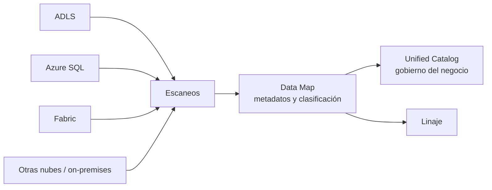

## 1. Resumen

**Microsoft Purview** es, según su documentación, un conjunto de soluciones para **gobernar, proteger y administrar** datos dondequiera que estén. Para el gobierno de datos de una plataforma, sus piezas son:

- el **Microsoft Purview Data Map overview**: captura **metadatos** de sistemas de analítica, SaaS y operacionales, también on-premises y en otras nubes, con **escaneo** y **clasificación** que lo mantienen al día; escala en **capacity units**;
- **Learn about Microsoft Purview Unified Catalog**: la plataforma de gobierno orientada al negocio. Su página avisa que se está **desplegando por región**;
- la **clasificación**, basada en el contexto de negocio (por ejemplo, números de tarjeta o de pasaporte);
- el **linaje**, documentado en la página del **Data Catalog clásico**.

## 2. Qué es

- **Cuenta de Purview:** el recurso que contiene el Data Map.
- **Data Map:**
  - metadatos de sistemas híbridos, on-premises y multicloud;
  - escaneo y clasificación integrados;
  - capacidad desde una capacity unit, que escala según solicitudes y metadatos.
- **Clasificación:** etiquetas según el contexto de negocio del dato, que ayudan a buscar, gobernar y ver el riesgo.
- **Unified Catalog:** gobierno de datos para el negocio; disponible según el calendario de cada región.
- **Linaje:** desde datos crudos hasta los que usan las plataformas de visualización (en la página del catálogo clásico).

## 3. Problema que resuelve

En una organización con datos en ADLS, bases, SaaS y otras nubes, nadie sabe qué datos hay, dónde están los sensibles ni de dónde sale cada tabla. Purview reúne esos metadatos en un mapa, clasifica lo sensible y muestra el linaje.

## 4. Cómo funciona

1. Se crea la cuenta de Purview.
2. Se registran los orígenes (ADLS, bases, Fabric, otras nubes) y se configuran sus escaneos.
3. Los escaneos recorren los orígenes, capturan metadatos y aplican la clasificación.
4. El Data Map queda al día; los usuarios buscan y gobiernan desde el catálogo.
5. El linaje muestra de qué datos crudos sale cada tabla o reporte.

## 5. Cuándo utilizarlo

- Inventario de datos entre Azure, on-premises y otras nubes.
- Encontrar datos sensibles por clasificación.
- Gobierno de datos orientado al negocio (Unified Catalog, donde esté disponible).

## 6. Cuándo no utilizarlo

- Como control de acceso dentro de Databricks: ahí manda Unity Catalog (ver `azure-databricks-lakehouse`).
- Esperar Unified Catalog en una región donde todavía no se desplegó.
- Como sustituto de los permisos de cada almacén.

## 7. Ejemplo sencillo

Un escaneo de la cuenta ADLS del lake encuentra columnas con números de tarjeta en `raw/pagos/` y las clasifica. El equipo de seguridad las ve en el catálogo y pide que no lleguen a `curated/` sin enmascarar.

## 8. Ejemplo de producción

Una cuenta de Purview sin acceso público, con escaneos semanales de:

- la cuenta ADLS del lake;
- las bases de Azure SQL de las aplicaciones;
- los datos admitidos de Fabric.

La clasificación marca los datos personales y el linaje muestra el camino desde cada base hasta los reportes. El equipo de datos revisa cada semana los assets nuevos sin dueño.

## 9. Arquitectura



## 10. Código

```hcl
# Terraform (validado en la CI con terraform validate, sin credenciales; no se aplicó): cuenta de Microsoft Purview con
# identidad administrada asignada por el sistema y sin acceso público.
# Requiere: provider hashicorp/azurerm ~> 5.0; un grupo de recursos existente.
terraform {
  required_providers {
    azurerm = {
      source  = "hashicorp/azurerm"
      version = "~> 5.0"
    }
  }
}

provider "azurerm" {
  features {}
}

variable "resource_group_name" {
  type = string
}

variable "location" {
  type    = string
  default = "eastus2"
}

resource "azurerm_purview_account" "gobierno" {
  name                   = "dekh-purview"
  resource_group_name    = var.resource_group_name
  location               = var.location
  public_network_enabled = false

  identity {
    type = "SystemAssigned"
  }
}
```

El bloque de Terraform se valida en la CI con `terraform validate`, sin credenciales (`make validate-terraform`), y **no se aplicó**. Crea solo la cuenta; los orígenes y los escaneos se configuran en Purview.

## 11. GCP

No aplica de forma específica: esta ficha describe Purview. Lo más cercano en GCP es Knowledge Catalog (ver `dataplex-governance`). Las diferencias, según sus páginas:

| | Microsoft Purview | Knowledge Catalog |
|---|---|---|
| Alcance de los metadatos | Sistemas de analítica, SaaS y operacionales, híbridos, on-premises y multicloud | Metadatos técnicos y de negocio de datos estructurados y no estructurados |
| Descubrimiento | Escaneos y clasificación por contexto de negocio | Grafo de contexto con capacidades de Gemini |
| Linaje | Datos crudos, transformados y de visualización (página del catálogo clásico) | Visible en la consola para assets de Knowledge Catalog, BigQuery y Vertex AI |

## 12. AWS

No aplica de forma específica. Lo más cercano es el Glue Data Catalog con Lake Formation (ver `glue-catalog-and-etl` y `lake-formation-permissions`). Las diferencias, según sus páginas:

| | Microsoft Purview | Glue Data Catalog / Lake Formation |
|---|---|---|
| Foco | Gobierno, descubrimiento y clasificación | Catálogo técnico del lake y permisos finos |
| Descubrimiento | Escaneos con clasificación | Crawlers que infieren formato y esquema |
| Control de acceso a los datos | Fuera del alcance de esta ficha | Lake Formation: base, tabla, columna, fila y celda en los motores integrados |

## 13. Azure

**Microsoft Purview.** El Data Map, la clasificación, Unified Catalog (con su aviso de despliegue) y el linaje del catálogo clásico son los de sus páginas. Los precios se consultan en la página de precios de Microsoft Purview.

## 14. Buenas prácticas

- Escanear primero los orígenes con más datos sensibles.
- Dueño por asset y revisión periódica de lo nuevo sin dueño.
- Revisar si Unified Catalog ya está disponible en la región antes de planificar sobre él.
- **Seguridad:** cuenta sin acceso público, como en el ejemplo de §10; permisos mínimos para los escaneos.
- **Observabilidad:** seguir escaneos fallidos y assets sin clasificar.
- **Costo:** el Data Map escala en capacity units según solicitudes y metadatos. Los montos se consultan en la página de precios.

## 15. Errores frecuentes

- Esperar que Purview bloquee accesos que se dan en cada almacén.
- Escanear todo sin prioridad y llenar el mapa de ruido.
- Planificar sobre Unified Catalog sin revisar su disponibilidad regional.
- Confundir el Data Catalog clásico con la experiencia nueva.

## 16. Trade-offs

Purview reúne metadatos de muchos sistemas y nubes en un mapa con clasificación, a cambio de configurar escaneos y de convivir con la transición del catálogo clásico a la experiencia nueva. Unity Catalog y Lake Formation controlan el acceso dentro de su plataforma; Purview se enfoca en el gobierno amplio.

## 17. Conceptos relacionados

- `dataplex-governance`: el gobierno del catálogo en GCP.
- `lake-formation-permissions` y `glue-catalog-and-etl`: catálogo y permisos en AWS.
- `fabric-onelake-and-workloads` y `azure-databricks-lakehouse`: las plataformas de Azure que gobierna o con las que convive.

## 18. Preguntas técnicas abiertas

1. ¿Qué orígenes escanearías primero?
2. ¿Qué clasificaciones necesitas para tus datos sensibles?
3. ¿Quién es el dueño de cada asset nuevo?

## 19. Laboratorio relacionado

Pendiente (F4).

## 20. Fuentes

- Microsoft Learn, Microsoft Purview: *Learn about Microsoft Purview*, *Microsoft Purview Data Map overview*, *Learn about Microsoft Purview Unified Catalog*, *Data classification in Data Map* y *Data lineage in classic Data Catalog*.
- Google Cloud: *Knowledge Catalog overview* y *About data lineage*. AWS: *What is AWS Lake Formation?* y *Using crawlers to populate the Data Catalog*.

El detalle de cada fuente está en `sources` del frontmatter.

## 21. Fecha de última verificación

2026-10-13. `review_required`: pendiente de revisión B-F3.1 del lote F3b-10b.

## 22. Historial de cambios importantes

- 2026-10-13: creación (lote F3b-10b).
