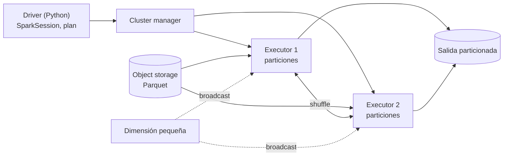

## 1. Resumen

PySpark es la API de Python de Apache Spark. Un DataFrame de PySpark parece una tabla de pandas, pero es un **plan**: cada transformación (`filter`, `join`, `groupBy`) agrega un paso y nada se calcula hasta una **acción** (`collect`, `write`, `count`). Al ejecutarse, el plan se reparte entre executors de un clúster. Conviene cuando los datos no caben o no se procesan a tiempo en una sola máquina. Para unos pocos GB, pandas o Polars suelen bastar con menos complejidad.

## 2. Qué es

- **SparkSession:** el punto de entrada. Crea DataFrames y lee fuentes.
- **DataFrame:** colección distribuida con esquema. Es inmutable: cada transformación devuelve uno nuevo.
- **Transformación vs acción:**
  - las transformaciones son perezosas;
  - las acciones disparan la ejecución y devuelven resultados al driver o escriben en almacenamiento.
- **Driver y executors:**
  - el driver (el proceso de Python con la SparkSession) planifica;
  - los executors, en los nodos, ejecutan las tareas sobre particiones de los datos.
- **Plan:** Spark optimiza la consulta y elige un plan físico (tipo de join, shuffles). Con Adaptive Query Execution, activado por defecto, re-optimiza durante la ejecución con estadísticas reales.

## 3. Problema que resuelve

Una transformación sobre cientos de GB o TB no cabe en la memoria de un proceso de pandas, y en una sola máquina no termina a tiempo. Spark divide los datos en particiones y ejecuta la misma lógica en paralelo en muchos nodos. Además, resuelve por el usuario la distribución, los reintentos de tareas y el movimiento de datos entre nodos (shuffle).

## 4. Cómo funciona

1. El código define transformaciones sobre DataFrames. Spark arma un plan lógico, sin leer datos.
2. Una acción (`collect`, `write`, `count`) hace que Spark optimice el plan y lo convierta en un plan físico de etapas y tareas.
3. Las operaciones que necesitan juntar filas por clave (`groupBy`, `join`, ventanas) requieren un **shuffle**: redistribuir datos entre executors por red. Es la parte cara. `spark.sql.shuffle.partitions` fija cuántas particiones produce (200 por defecto).
4. **Join con broadcast:**
   - si una tabla es pequeña (por debajo de `spark.sql.autoBroadcastJoinThreshold`, 10 MB por defecto) o se marca con `broadcast()`, Spark la copia a cada executor;
   - así evita mover la tabla grande.
5. `collect()` y `toPandas()` traen el resultado completo al driver: solo sirven para resultados pequeños. Los resultados grandes se escriben con `write` a almacenamiento.

## 5. Cuándo utilizarlo

- Transformaciones batch sobre volúmenes que no caben en una máquina o que necesitan paralelismo para cumplir una ventana de tiempo.
- Pipelines que ya corren en una plataforma Spark (Databricks, EMR, Glue, el servicio administrado de Spark de Google Cloud).
- Lectura y escritura de formatos columnares en object storage (Parquet, tablas de lakehouse) a gran escala.

## 6. Cuándo no utilizarlo

- Para datos que caben cómodos en memoria: pandas o Polars arrancan en milisegundos, se prueban más fácil y no necesitan JVM ni clúster (ver `python-dataframes`).
- Cuando la transformación se puede expresar en SQL dentro del warehouse donde ya están los datos: mover datos a Spark agrega un sistema más.
- Con UDFs de Python fila a fila para lógica que existe en las funciones nativas de `pyspark.sql.functions`. Esta ficha no mide su costo; la regla práctica es preferir las funciones nativas.

## 7. Ejemplo sencillo

```python
from pyspark.sql import SparkSession, functions as F

spark = SparkSession.builder.master("local[2]").getOrCreate()
df = spark.createDataFrame([("T1", 100), ("T2", 40), ("T1", 20)], "tienda string, monto long")
totales = df.groupBy("tienda").agg(F.sum("monto").alias("total"))   # todavía no se calculó nada
print(sorted(totales.collect()))                                     # la acción ejecuta el plan
```

No ejecutado como bloque aparte: es un subconjunto del código de la §10, que sí se ejecuta en la CI.

## 8. Ejemplo de producción

Un job diario procesa 2 TB de eventos en Parquet en object storage:

1. Lee la partición del día.
2. Se queda con la última versión de cada evento con `row_number()` sobre una ventana por `event_id`.
3. Une con una dimensión de tiendas de pocos MB usando broadcast.
4. Agrega por región y escribe el resultado en Parquet, particionado por fecha.

Nada pasa por el driver salvo el plan y algunas métricas. El job corre en un clúster efímero o en una opción serverless del proveedor, y el orquestador lo lanza con la fecha lógica como parámetro.

## 9. Arquitectura



## 10. Código

```python
# Python 3.12 y PySpark 4.2.0 en modo local (ejecutado en la CI: Java 17): última versión por clave con una
# ventana, filtro, join con una dimensión pequeña y agregación; las transformaciones son perezosas hasta la acción.
from pyspark.sql import SparkSession, Window
from pyspark.sql import functions as F

spark = (
    SparkSession.builder.master("local[2]").appName("ventas")
    .config("spark.sql.shuffle.partitions", "4")          # pocos datos: menos particiones de shuffle
    .config("spark.ui.enabled", "false")
    .getOrCreate()
)

ventas = spark.createDataFrame(
    [("v1", "T1", 100, "2026-10-07 10:00:00"), ("v1", "T1", 120, "2026-10-07 12:00:00"),   # v1 corregida
     ("v2", "T2", 40, "2026-10-07 10:05:00"), ("v3", "T1", None, "2026-10-08 09:00:00"), ("v4", "T9", 75, "2026-10-08 11:00:00")],
    "venta_id string, tienda string, monto long, actualizado string",
).withColumn("actualizado", F.to_timestamp("actualizado"))
tiendas = spark.createDataFrame([("T1", "norte"), ("T2", "sur")], "tienda string, region string")

ultima = Window.partitionBy("venta_id").orderBy(F.col("actualizado").desc())
resultado = (
    ventas.withColumn("rn", F.row_number().over(ultima)).filter("rn = 1").drop("rn")   # dedupe: gana la más reciente
    .filter(F.col("monto").isNotNull())
    .join(F.broadcast(tiendas), "tienda", "left")                                      # dimensión pequeña: broadcast
    .groupBy(F.coalesce("region", F.lit("sin región")).alias("region"))
    .agg(F.sum("monto").alias("total"), F.count("*").alias("ventas"))
    .orderBy("region")
)                                                     # hasta aquí no se leyó ni calculó nada

filas = [r.asDict() for r in resultado.collect()]   # la acción ejecuta el plan
print(filas)
# [{'region': 'norte', 'total': 120, 'ventas': 1}, {'region': 'sin región', 'total': 75, 'ventas': 1}, {'region': 'sur', 'total': 40, 'ventas': 1}]
assert filas == [
    {"region": "norte", "total": 120, "ventas": 1},
    {"region": "sin región", "total": 75, "ventas": 1},
    {"region": "sur", "total": 40, "ventas": 1},
]
resultado.explain()                                   # plan físico: BroadcastHashJoin, Window, HashAggregate
spark.stop()
```

Este bloque lo ejecuta la CI en cada push (`tests/test_snippet_code.py`, con Java 17 y `pyspark==4.2.0` de `requirements-snippets.txt`). No se ejecutó en local, porque no hay JDK. El test comprueba el resultado y que el plan contenga `BroadcastHashJoin`.

## 11. GCP

**Managed Service for Apache Spark** es el nombre actual del producto antes llamado Dataproc on Compute Engine (clústeres) y Google Cloud Serverless for Apache Spark (serverless). El mismo código de PySpark corre en las dos modalidades. La diferencia es si el equipo administra el ciclo de vida del clúster o envía lotes a un entorno serverless.

## 12. AWS

**Amazon EMR** es una plataforma de clústeres administrada para frameworks como Spark, y **EMR Serverless** es una opción de despliegue serverless con gestión automática de capacidad. **AWS Glue** usa una extensión de PySpark con tipos propios (`GlueContext`, `DynamicFrame`) y transformaciones como `ApplyMapping`. Diferencia: un script que usa `DynamicFrame` queda atado a Glue, mientras que uno con DataFrames de Spark estándar es portable a EMR u otra plataforma.

## 13. Azure

**Azure Databricks** está construido sobre Apache Spark y usa PySpark como interfaz de Python. **Azure Synapse Analytics** ofrece pools de Apache Spark serverless. El código de DataFrames es el mismo. Lo que cambia entre plataformas es cómo se crea la sesión, cómo se accede al almacenamiento y qué extensiones propias ofrece cada una.

## 14. Buenas prácticas

- Funciones nativas de `pyspark.sql.functions` antes que UDFs de Python.
- Esquema explícito al leer (o formatos con esquema como Parquet) en lugar de inferirlo en cada ejecución.
- `broadcast()` solo para tablas pequeñas de verdad; ajustar `spark.sql.shuffle.partitions` al volumen (el valor por defecto, 200, sobra para datos chicos y falta para muy grandes).
- `explain()` para revisar el plan antes de correr sobre todo el volumen.
- Nunca `collect()` ni `toPandas()` sobre resultados grandes: escribir a almacenamiento.
- **Seguridad:** credenciales del almacenamiento por identidad del clúster o del job (rol o cuenta de servicio), no en el código ni en la configuración de Spark; cuidado con `show()` y logs que impriman datos personales en la consola del driver.
- **Observabilidad:** registrar filas leídas y escritas por ejecución y revisar etapas con mucho shuffle o tareas desbalanceadas (skew); el plan físico y las métricas de cada etapa son la primera herramienta de diagnóstico.
- **Costo:** el costo es tiempo de clúster: un shuffle innecesario, un broadcast fallido o un `collect()` que satura el driver alargan el job; los clústeres efímeros o las opciones serverless evitan pagar por nodos ociosos.

## 15. Errores frecuentes

- Tratar el DataFrame como pandas y llamar `collect()` en un bucle.
- Medir "cuánto tarda" una transformación sin acción: no se ejecutó nada.
- Joins entre dos tablas grandes sin filtrar antes ni revisar el plan.
- Escribir muchos archivos pequeños por demasiadas particiones de salida.
- Depender de extensiones propias de una plataforma sin decidirlo (portabilidad).

## 16. Trade-offs

Spark escala a volúmenes que una máquina no maneja. A cambio, agrega JVM, clúster, shuffles y una depuración más difícil. Un job pequeño en Spark puede tardar más en arrancar que en procesar. Las plataformas administradas reducen la operación, pero acoplan el código a sus extensiones y modelos de costo. Para el mismo volumen, SQL en un warehouse puede ser más simple si los datos ya están ahí.

## 17. Conceptos relacionados

- `python-dataframes`: DataFrames en una sola máquina.
- `join-optimization`, `query-plans` y `sql-window-functions`: las mismas ideas en SQL.
- `arrow-columnar-memory`: conversión con pandas.
- `partitioning` y `parquet-format`: cómo se organiza la entrada y la salida.

## 18. Preguntas técnicas abiertas

1. ¿Con qué volumen y qué ventana de tiempo pasarías de Polars en una máquina a Spark en un clúster?
2. ¿Cómo detectarías en el plan que un join que debería ser broadcast terminó siendo un shuffle de ambas tablas?
3. ¿Qué partes de tu job dependen de extensiones propias de la plataforma y cuánto costaría migrarlas?

## 19. Laboratorio relacionado

Pendiente (F4).

## 20. Fuentes

- Apache Spark 4.2.0: *Quickstart: DataFrame*, *Installation*, *Performance Tuning*, *Arrow in PySpark* y *Cluster Mode Overview*.
- Google Cloud: *Managed Service for Apache Spark* (clústeres).
- AWS: *What is Amazon EMR?*, *What is Amazon EMR Serverless?* y *Program AWS Glue ETL scripts in PySpark*.
- Microsoft Learn: *PySpark on Azure Databricks* y *Apache Spark in Azure Synapse Analytics*.

El detalle de cada fuente está en `sources` del frontmatter.

## 21. Fecha de última verificación

2026-10-08. `review_required`: pendiente de revisión B-F3.1 del lote F3b-03b.

## 22. Historial de cambios importantes

- 2026-10-08: creación (lote F3b-03b).
