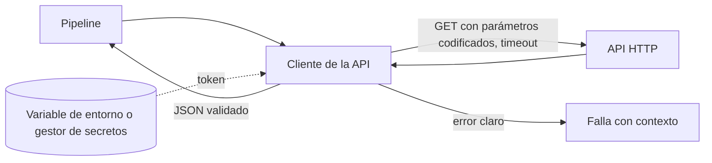

## 1. Resumen

Consumir una API desde Python bien hecho son cinco detalles:

- codificar los parámetros en lugar de concatenarlos;
- enviar las credenciales en una cabecera leída de un secreto, nunca escritas en el código;
- poner siempre un timeout;
- decodificar el JSON controlando el error;
- validar que la respuesta tenga la forma esperada antes de usarla.

Con eso, un cambio o un fallo de la API produce un error claro en lugar de datos corruptos o un proceso colgado.

## 2. Qué es

Es la capa de código que hace una llamada HTTP y devuelve datos confiables al resto del pipeline. Se apoya en la biblioteca estándar (`urllib.request`, `urllib.parse`, `json`) o en clientes de terceros (requests, httpx, que el blueprint trata en `http-clients`, fuera del MVP). Esta ficha usa la biblioteca estándar.

## 3. Problema que resuelve

Los errores típicos al consumir APIs son silenciosos:

- una URL armada a mano con un parámetro sin codificar;
- un token escrito en el código y subido al repositorio;
- una llamada sin timeout que deja un proceso colgado;
- un JSON que cambió de forma y el código guarda `None` sin avisar.

## 4. Cómo funciona

1. **Parámetros:** `urlencode` arma la query string codificada.
2. **Cabeceras:** el token se lee de una variable de entorno o del gestor de secretos y va en la cabecera `Authorization` del `Request`.
3. **Timeout:** `urlopen(..., timeout=...)` evita esperar indefinidamente; sin él, rige el timeout global por defecto.
4. **Errores HTTP:** `HTTPError` (subclase de `URLError`) trae el código y las cabeceras de la respuesta; se decide qué reintentar (ver `python-error-handling-and-retries`).
5. **JSON:** `json.load` decodifica; un documento inválido lanza `JSONDecodeError`, subclase de `ValueError`.
6. **Validación:** se comprueban los campos y tipos esperados antes de devolver los datos.

## 5. Cuándo utilizarlo

- Extracciones desde APIs de terceros o internas.
- Llamadas de enriquecimiento dentro de un pipeline (geocodificación, tipos de cambio).
- Cualquier código que dependa de una respuesta HTTP para seguir.

## 6. Cuándo no utilizarlo

- Si el proveedor ofrece un SDK oficial con autenticación, reintentos y paginación (por ejemplo, los de las nubes): conviene usarlo.
- Para volúmenes grandes que la fuente exporta como archivos: la ingesta de archivos es más simple y barata.
- Para peticiones que modifican datos (`POST`) sin clave de idempotencia, dentro de bucles con reintentos.

## 7. Ejemplo sencillo

Pedir el tipo de cambio de un día: una llamada `GET` con `fecha=2026-09-30`, token en cabecera, timeout de 10 segundos, y comprobar que la respuesta tenga `moneda` y `valor` numérico antes de usarla.

## 8. Ejemplo de producción

Un módulo `cliente_pagos.py` concentra todas las llamadas a la API de pagos:

- lee el token de `PAGOS_API_TOKEN`, que el orquestador inyecta desde el gestor de secretos;
- usa un timeout de 30 segundos;
- valida el esquema de cada respuesta y lanza un error con el endpoint y el campo faltante si cambia;
- no registra el token ni el cuerpo completo de las respuestas;
- los pipelines usan este módulo y no llaman a la API directamente; el manejo de reintentos y la paginación viven en `api-ingestion`.

## 9. Arquitectura



## 10. Código

```python
# Python 3.12, solo biblioteca estándar: llamada GET con token, timeout y validación de la respuesta.
# Requiere: la variable de entorno API_TOKEN y una API que responda {"moneda": "...", "valor": <número>}.
import json
import os
from urllib.error import HTTPError
from urllib.parse import urlencode
from urllib.request import Request, urlopen


class ApiResponseError(Exception):
    """La API respondió, pero no con la forma esperada."""


def get_json(url: str, params: dict[str, str], timeout: float = 10.0) -> dict:
    token = os.environ["API_TOKEN"]                                   # nunca en el código
    request = Request(f"{url}?{urlencode(params)}", headers={"Authorization": f"Bearer {token}"})
    with urlopen(request, timeout=timeout) as response:              # sin timeout podría esperar indefinidamente
        try:
            return json.load(response)
        except json.JSONDecodeError as exc:                          # subclase de ValueError
            raise ApiResponseError(f"{url}: la respuesta no es JSON válido") from exc


def tipo_de_cambio(url: str, fecha: str) -> float:
    try:
        data = get_json(url, {"fecha": fecha})
    except HTTPError as exc:
        raise ApiResponseError(f"{url}: HTTP {exc.code} para la fecha {fecha}") from exc
    valor = data.get("valor")
    if data.get("moneda") is None or not isinstance(valor, (int, float)):
        raise ApiResponseError(f"{url}: faltan 'moneda' o 'valor' numérico en la respuesta")
    return float(valor)
```

Es una lectura (`GET`, método seguro según la RFC 9110): repetirla no cambia nada en la API. Los reintentos de errores transitorios se agregan alrededor, como en `python-error-handling-and-retries` y el snippet `python-api-ingestion-retries`.

## 11. GCP

Para llamar APIs de Google Cloud se usan las bibliotecas cliente oficiales, construidas sobre google-api-core, que reintentan por defecto los errores transitorios con backoff exponencial (ver `python-error-handling-and-retries`). Para APIs externas aplica el patrón de esta ficha, con el token guardado en un gestor de secretos y entregado al proceso en tiempo de ejecución.

## 12. AWS

En AWS, las APIs propias de AWS se consumen con Boto3, que trae reintentos configurables; para APIs externas aplica el mismo patrón de esta ficha. Una alternativa sin código es el HTTP Task de Step Functions, que guarda las credenciales en una conexión de EventBridge (ver `api-ingestion`).

## 13. Azure

En Azure, las APIs de Azure se consumen con los clientes del Azure SDK para Python, que reintentan errores de conexión y ciertos códigos HTTP por defecto. Para APIs externas, Data Factory ofrece el conector REST con paginación declarativa (ver `api-ingestion`); en código Python aplica el patrón de esta ficha.

## 14. Buenas prácticas

- Un cliente por API, con timeout, autenticación y validación centralizados.
- Parámetros con `urlencode`, nunca concatenados a mano.
- Validar la forma de la respuesta y fallar con un mensaje que diga qué endpoint y qué campo.
- Encadenar la causa (`raise ... from exc`) para no perder el error original.
- **Seguridad:** token en variables de entorno o gestor de secretos; no registrarlo ni incluirlo en mensajes de error; usar HTTPS.
- **Observabilidad:** registrar endpoint, código de estado y latencia de cada llamada, sin datos sensibles.
- **Costo:** muchas APIs limitan o cobran por llamada; evitar llamadas repetidas para los mismos datos (cachear dentro de la ejecución).

## 15. Errores frecuentes

- Llamadas sin timeout.
- Token en el código o en los logs.
- Usar `data.get("campo")` sin validar y propagar `None` silenciosamente.
- Capturar `Exception` y seguir como si nada.

## 16. Trade-offs

La biblioteca estándar no agrega dependencias, a cambio de más código propio (sesiones, reintentos). Los clientes de terceros o los SDK oficiales simplifican, a cambio de una dependencia más que mantener.

## 17. Conceptos relacionados

- `api-ingestion`: el diseño de la ingesta completa.
- `python-error-handling-and-retries`: el manejo de errores alrededor de la llamada.
- `retries`: qué reintentar y cómo.
- Con ficha: `data-validation-with-pydantic`, `python-logging`.
- `http-clients`: sesión o cliente reutilizable, timeouts y errores HTTP con Requests y HTTPX.

## 18. Preguntas técnicas abiertas

1. ¿Qué validarías de la respuesta de una API antes de escribirla en la capa raw?
2. ¿Cómo darías el token a un proceso de Airflow sin que aparezca en el código ni en los logs?
3. ¿Qué timeout pondrías y cómo lo decidirías?

## 19. Laboratorio relacionado

Pendiente (F4): snippet "ingesta API con reintentos" (A-F3.2) y lab de tipo A.

## 20. Fuentes

- Python: *urllib.request*, *urllib.error*, *urllib.parse* y *json*.
- IETF: *RFC 9110*. Referencia canónica (Nivel 4).
- Google Cloud: *Retry* (google-api-core).
- AWS: *Retries* (Boto3) y *Call HTTPS APIs in Step Functions workflows*.
- Microsoft Learn: *Handle errors produced by the Azure SDK for Python* y *Copy and transform data from and to a REST endpoint* (Data Factory).

El detalle de cada fuente está en `sources` del frontmatter.

## 21. Fecha de última verificación

2026-10-01. Pasa a `verified`: revisión B-F3.1 del lote 4 aplicada, sin VERIFY pendientes.

## 22. Historial de cambios importantes

- 2026-10-01: creación (lote 4 de F3).
- 2026-10-01: `verification_status: verified` (revisión B-F3.1 del lote 4 aplicada; sin VERIFY pendientes).
- 2026-10-06: la sección de conceptos relacionados ya no lista como pendientes de ficha a `data-validation-with-pydantic`, `python-logging`, que ya tienen ficha.
- 2026-10-09: §17 enlaza `http-clients`, que ya tiene ficha (lote F3b-03b); antes figuraba como pendiente de ficha.
