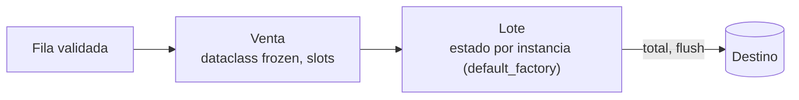

## 1. Resumen

En código de datos, las clases cumplen dos papeles:

- **Registros:** una fila con campos fijos. Para esto, `@dataclass(frozen=True, slots=True)` da constructor, `repr`, igualdad y hash sin escribirlos, y protege contra modificaciones accidentales.
- **Componentes con estado:** un escritor que acumula un lote, un cliente con su sesión. Aquí, una clase normal con atributos de instancia creados en `__init__`.

El error clásico es declarar una lista como **variable de clase**: todas las instancias comparten la misma lista.

## 2. Qué es

Una clase define un tipo con atributos y métodos. Hay dos niveles de atributos:

- **De instancia:** se asignan con `self.x = ...` y son propios de cada objeto.
- **De clase:** se declaran en el cuerpo de la clase y los comparten todas las instancias.

Las **dataclasses** generan `__init__`, `__repr__` y `__eq__` a partir de los campos anotados. Opciones útiles:

- `frozen=True`: inmutable y hashable si también hay `eq`;
- `slots=True`: sin `__dict__`, con menos memoria por instancia;
- `field(default_factory=list)`: un valor por defecto mutable nuevo por instancia.

## 3. Problema que resuelve

Un registro como `dict` no dice qué campos tiene, acepta claves mal escritas y se puede modificar en cualquier paso del pipeline. Una dataclass da forma, tipos visibles para mypy e inmutabilidad. Para componentes, la clase agrupa el estado (buffer, conexión, contadores) con las operaciones que lo usan, en lugar de pasar ese estado como variables globales.

## 4. Cómo funciona

1. Al definir la clase, el cuerpo se ejecuta una vez. Lo asignado ahí son **atributos de clase**, y una lista asignada ahí es la misma lista para todas las instancias.
2. Al crear una instancia se llama a `__init__`. Lo que se asigna a `self` es propio de esa instancia.
3. `@dataclass` lee las anotaciones del cuerpo y genera `__init__` con esos campos. Un default mutable (`list`, `dict`) directo lanza `ValueError`: hay que usar `field(default_factory=...)`.
4. Con `frozen=True`, asignar un campo lanza `FrozenInstanceError`, subclase de `AttributeError`. Con `eq` y `frozen` se genera `__hash__`, así los registros sirven como claves de dict o elementos de set.
5. `@property` expone un valor calculado como si fuera un atributo.

## 5. Cuándo utilizarlo

- Dataclass inmutable para cada registro validado del pipeline.
- Clase con estado para escritores por lotes, clientes de API con sesión y reintentos, acumuladores de métricas.
- `Protocol` (ver `python-typing`) para el contrato entre componentes, en lugar de jerarquías de herencia.

## 6. Cuándo no utilizarlo

- Para agrupar funciones sin estado: un módulo con funciones basta.
- Jerarquías de herencia profundas para variantes de un pipeline: la composición (pasar el componente como parámetro) es más simple de probar.
- Como validación de datos externos: una dataclass no verifica tipos en ejecución; para eso, validación explícita o Pydantic.

## 7. Ejemplo sencillo

```python
from dataclasses import dataclass


@dataclass(frozen=True)
class Venta:
    venta_id: str
    monto: int


v = Venta("v1", 10)
print(v, v == Venta("v1", 10))   # Venta(venta_id='v1', monto=10) True
```

## 8. Ejemplo de producción

Un servicio de ingesta representa cada fila validada como `Venta` (dataclass frozen con slots) y la pasa a un `Lote`. El `Lote` acumula filas hasta un tamaño máximo y luego las escribe en el destino. El `Lote` es una clase con estado: su lista de filas se crea por instancia con `default_factory`. En los tests se crean varios lotes en paralelo y cada uno conserva solo sus filas. Con una variable de clase, el segundo lote vería las filas del primero.

## 9. Arquitectura



## 10. Código

```python
# Python 3.12 (ejecutado; mypy --strict sin errores): dataclass inmutable para el registro y clase con estado.
from dataclasses import dataclass, field


@dataclass(frozen=True, slots=True)
class Venta:
    venta_id: str
    monto: int
    etiquetas: tuple[str, ...] = ()


class LoteMal:
    filas: list[Venta] = []          # variable de CLASE: la comparten todas las instancias


@dataclass
class Lote:
    nombre: str
    filas: list[Venta] = field(default_factory=list)   # una lista nueva por instancia

    def agregar(self, venta: Venta) -> None:
        self.filas.append(venta)

    @property
    def total(self) -> int:
        return sum(v.monto for v in self.filas)


a, b = LoteMal(), LoteMal()
a.filas.append(Venta("v1", 10))
print(len(b.filas))                                   # 1: b ve la fila de a

lote = Lote("2026-10-07")
lote.agregar(Venta("v1", 10))
lote.agregar(Venta("v2", 25, ("promo",)))
print(lote.total, Venta("v1", 10) == Venta("v1", 10), len({Venta("v1", 10), Venta("v1", 10)}))   # 35 True 1
try:
    lote.filas[0].monto = 99  # type: ignore[misc]
except AttributeError as error:                       # FrozenInstanceError es subclase de AttributeError
    print(type(error).__name__)                       # FrozenInstanceError
```

Los campos de `Venta` son inmutables. Por eso `etiquetas` es una tupla y no una lista: una lista dentro de un registro frozen se podría seguir modificando.

## 11. GCP

No aplica de forma específica: es semántica del lenguaje y se comporta igual en cualquier runtime de Python.

## 12. AWS

No aplica de forma específica (ver §11).

## 13. Azure

No aplica de forma específica (ver §11).

## 14. Buenas prácticas

- Registros como dataclasses `frozen=True`; usar `slots=True` cuando hay muchas instancias en memoria.
- Valores mutables por defecto siempre con `field(default_factory=...)`; nunca listas o dicts como atributos de clase.
- Estado del componente creado en `__init__` (o en la dataclass), no en el cuerpo de la clase.
- Composición antes que herencia; el contrato entre componentes con `Protocol`.
- **Seguridad:** el `__repr__` generado incluye todos los campos; si un registro o un cliente contiene tokens o datos personales, excluirlos con `field(repr=False)` para que no aparezcan en logs ni tracebacks.
- **Observabilidad:** los componentes con estado (lotes, clientes) son el lugar natural para contadores de filas, reintentos y errores que se registran al cerrar el lote.
- **Costo:** con millones de instancias en memoria, `slots=True` reduce la memoria por objeto, porque no crea `__dict__`; con pocos objetos, la diferencia no importa.

## 15. Errores frecuentes

- Lista o dict como variable de clase: el estado se comparte entre instancias y entre tests.
- Dataclass frozen con un campo `list`: el registro "inmutable" se puede modificar por dentro.
- Esperar que una dataclass valide tipos: `Venta("v1", "10")` se crea sin error.
- Jerarquías de herencia para cada fuente de datos, con métodos sobreescritos difíciles de seguir.

## 16. Trade-offs

Las dataclasses frozen dan seguridad y hash a cambio de crear un objeto nuevo para cada "cambio" (`dataclasses.replace`). `slots=True` ahorra memoria pero impide agregar atributos dinámicos. Para registros que vienen de afuera, Pydantic agrega validación en ejecución a cambio de una dependencia y más costo por registro. Las clases con estado facilitan agrupar recursos, pero hacen más difícil probar que las funciones puras.

## 17. Conceptos relacionados

- `python-typing`: los campos tipados y `Protocol`.
- `python-data-structures`: cuándo un dict basta.
- `python-context-managers`: componentes que liberan recursos.
- `data-validation-with-pydantic`: modelos con validación.

## 18. Preguntas técnicas abiertas

1. ¿Qué campos de tus registros deberían ser `repr=False`?
2. ¿Cuándo preferirías una dataclass y cuándo un modelo de Pydantic para el registro validado?
3. ¿Cómo detectarías en tests que dos instancias de un componente comparten estado sin querer?

## 19. Laboratorio relacionado

Pendiente (F4).

## 20. Fuentes

- Python: *Classes* (tutorial), *dataclasses — Data Classes* y *Data model* (referencia del lenguaje).

El detalle de cada fuente está en `sources` del frontmatter.

## 21. Fecha de última verificación

2026-10-08. Pasa a `verified`: revisión B-F3.1 del lote F3b-03a aplicada, sin VERIFY pendientes.

## 22. Historial de cambios importantes

- 2026-10-08: creación (lote F3b-03a).
- 2026-10-08: revisión B-F3.1 del lote F3b-03a aplicada (docs/reviews/cards-f3b-03a.md): la documentación de Python se cita en `/3.12/`, la versión con la que se ejecutó el código.
- 2026-10-08: `verification_status: verified` (sin VERIFY pendientes).
