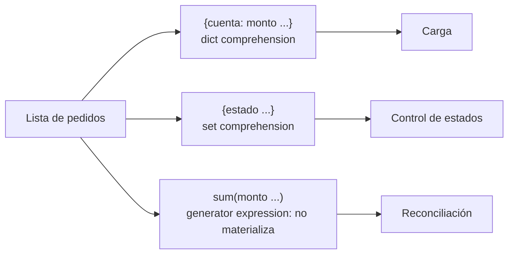

## 1. Resumen

Una comprehension construye una colección a partir de otra en una sola expresión: `[f(x) for x in datos if cond(x)]`. Hay cuatro variantes:

- list `[...]`;
- dict `{k: v ...}`;
- set `{...}`;
- generator expression `(...)`, que no construye nada: entrega los valores de a uno.

Para mapear y filtrar son más claras que un bucle con `append`. Pasan a ser menos claras cuando se anidan o se llenan de condiciones.

## 2. Qué es

Es una sintaxis de expresión para transformar y filtrar iterables:

- `[expr for x in it if cond]` → lista.
- `{k: v for x in it}` → dict.
- `{expr for x in it}` → set.
- `(expr for x in it)` → generator expression: un iterador perezoso.

Pueden tener varios `for` y varios `if`, que se leen en el mismo orden que los bucles anidados equivalentes.

## 3. Problema que resuelve

El patrón "crear lista vacía, recorrer, filtrar, transformar, agregar" aparece en todo script de datos. La comprehension lo expresa en una línea que dice qué se produce, no cómo. La generator expression resuelve además el caso en que no hace falta guardar el resultado: sumar, contar o escribir sin tener toda la colección en memoria.

## 4. Cómo funciona

1. Se evalúa el iterable del primer `for` en el ámbito exterior.
2. El resto de la comprehension se ejecuta en un **ámbito anidado implícito**: la variable del bucle (`x`) no queda definida afuera después de la comprehension.
3. Para cada elemento se evalúan los `if`; si pasan, se evalúa la expresión y se agrega al resultado.
4. List, dict y set comprehensions **materializan** el resultado completo. La generator expression devuelve un iterador y calcula cada valor solo cuando alguien lo pide (`sum`, `for`, `next`).
5. Dentro de una llamada con un único argumento se pueden omitir los paréntesis extra: `sum(x for x in it)`.

## 5. Cuándo utilizarlo

- Mapear o filtrar una colección en una línea legible: normalizar nombres, quedarse con registros válidos, construir un índice `{id: registro}`.
- Generator expression dentro de `sum`, `any`, `all`, `max` o `"".join` cuando no se necesita la lista intermedia.
- Construir conjuntos de claves para comparar origen y destino.

## 6. Cuándo no utilizarlo

- Cuando la lógica tiene efectos secundarios (escribir, llamar una API, registrar logs): un bucle `for` explícito deja claro que hay efectos.
- Con más de dos niveles de `for` o varias condiciones: el bucle explícito con nombres intermedios se lee y se depura mejor.
- Cuando el resultado no cabe en memoria: usar generator expression o generadores en vez de una list comprehension.
- Cuando hay que manejar errores por elemento (registro inválido): una función con `try`/`except` llamada desde un bucle es más clara.

## 7. Ejemplo sencillo

```python
montos = [1250, -30, 300, 0]
validos = [m for m in montos if m > 0]
print(validos)                      # [1250, 300]
print(sum(m for m in montos if m > 0))   # 1550, sin crear una lista intermedia
```

## 8. Ejemplo de producción

En la etapa de limpieza de una ingesta de pedidos, una dict comprehension construye el índice `{cuenta: monto}` de los pedidos pagados. Una set comprehension obtiene los estados distintos que llegaron, para comparar contra los estados válidos del contrato. Una generator expression suma el total del lote para la reconciliación sin crear otra lista. La validación por registro, con su manejo de errores, queda en una función aparte llamada desde un bucle explícito.

## 9. Arquitectura



## 10. Código

```python
# Python 3.12 (ejecutado; mypy --strict sin errores): mapear, filtrar, indexar y agregar sin lista intermedia.
pedidos = [
    ("A1", "pagado", 1250),
    ("A2", "anulado", 900),
    ("A3", "pagado", 300),
]

pagados = [(cuenta, monto) for cuenta, estado, monto in pedidos if estado == "pagado"]
indice = {cuenta: monto for cuenta, monto in pagados}
estados = {estado for _, estado, _ in pedidos}
total = sum(monto for _, estado, monto in pedidos if estado == "pagado")   # generator expression

print(pagados, indice, sorted(estados), total)
# [('A1', 1250), ('A3', 300)] {'A1': 1250, 'A3': 300} ['anulado', 'pagado'] 1550

cuenta = "fuera"
_ = [cuenta for cuenta, _, _ in pedidos]   # la variable del bucle vive en un ámbito anidado
print(cuenta)                              # fuera: no se sobrescribió
```

## 11. GCP

No aplica de forma específica: es sintaxis del lenguaje y se comporta igual en cualquier runtime de Python.

## 12. AWS

No aplica de forma específica (ver §11).

## 13. Azure

No aplica de forma específica (ver §11).

## 14. Buenas prácticas

- Una comprehension por idea: mapear y filtrar sí; mapear, filtrar, agrupar y validar no.
- Preferir generator expressions dentro de funciones que consumen (`sum`, `any`, `max`, `join`).
- Nombrar el resultado por lo que contiene (`pagados`, `indice_por_cuenta`), no por cómo se construyó.
- Sacar la lógica compleja a una función con nombre y llamarla desde la comprehension.
- **Seguridad:** las comprehensions no validan nada por sí mismas; si construyen consultas, rutas o comandos a partir de datos de entrada, la validación o el escapado tiene que estar en la función que transforma cada elemento.
- **Observabilidad:** una comprehension que filtra descarta registros sin dejar rastro; registrar cuántos entraron y cuántos quedaron (o separar los rechazados) evita pérdidas silenciosas.
- **Costo:** una list comprehension sobre un archivo grande carga todo en memoria; la generator expression equivalente recorre los datos una vez sin guardarlos.

## 15. Errores frecuentes

- Usar una list comprehension solo por sus efectos (`[print(x) for x in datos]`): crea una lista inútil y oculta la intención.
- Consumir dos veces una generator expression: la segunda vez está agotada y no produce nada.
- Comprehensions anidadas ilegibles; el orden de los `for` es el de los bucles equivalentes, no el inverso.
- Filtrar registros inválidos con un `if` sin contar ni guardar los descartados.

## 16. Trade-offs

Las comprehensions son concisas y dicen qué se produce. A cambio, esconden la lógica en una expresión que es más difícil de depurar paso a paso y no admite `try`/`except` dentro. La generator expression ahorra memoria, pero solo se puede recorrer una vez y no tiene `len`.

## 17. Conceptos relacionados

- `python-data-structures`: lo que construyen las comprehensions.
- `python-generators` y `python-iterators`: la versión perezosa y su protocolo.
- `data-transformation`: el concepto general de mapear y filtrar datos.

## 18. Preguntas técnicas abiertas

1. ¿En qué punto reemplazarías una comprehension por un bucle explícito en una revisión de código?
2. ¿Cómo contarías los registros descartados por el filtro sin recorrer la colección dos veces?
3. ¿Qué pasa si pasas una generator expression a dos funciones distintas que la consumen?

## 19. Laboratorio relacionado

Pendiente (F4).

## 20. Fuentes

- Python: *Data Structures* (tutorial), *Expressions* (referencia del lenguaje) y *Functional Programming HOWTO*.

El detalle de cada fuente está en `sources` del frontmatter.

## 21. Fecha de última verificación

2026-10-08. `review_required`: pendiente de revisión B-F3.1 del lote F3b-03a.

## 22. Historial de cambios importantes

- 2026-10-08: creación (lote F3b-03a).
